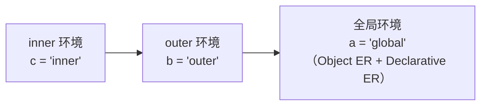
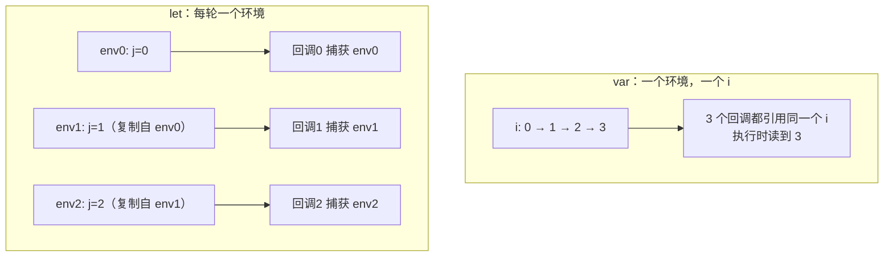
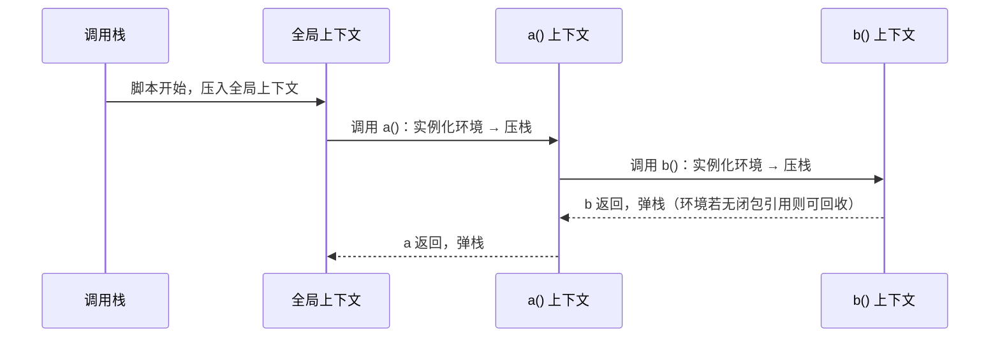
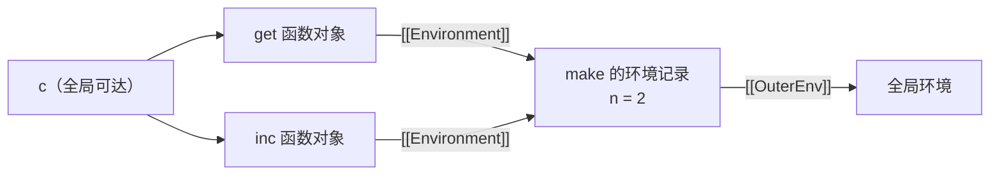

# 作用域、闭包与执行上下文

> 一句话概括：JavaScript 的变量归属在**写下代码时**就已确定（词法作用域），函数创建时会带走出生地的环境引用（`[[Environment]]`，即闭包），代码执行则靠执行上下文栈推进——三个高频面试话题，其实是同一套 **Environment Record** 机制的三个投影。

预计阅读时间：大约 75 分钟

所属主题：[JavaScript 基础常见面试题总结](summary.md)

本文以 **ECMAScript ES2025** 为规范基线，浏览器以当前 Chrome/V8 为准，Node.js 以 22/24 LTS 为准。规范锚点用 ECMA-262 概念名 + ES2025 章节号（如 `FunctionDeclarationInstantiation` §10.2.11），V8 锚点用 `Context`/`ScopeInfo` 等对象名（`src/objects/contexts.h`、`src/objects/scope-info.h`）。文中所有示例均在 **Node v24.14.0（V8 13.6）** 实测运行，输出为真实结果；与浏览器行为有差异处单独注明。总结文档给结论，本文给机制与证据：每个机制按「结论 → 机制 → 边界/代价 → 实践/追问」展开。

---

## 0. 阅读路线

| 读者 | 建议阅读 | 关注点 |
| --- | --- | --- |
| 初级（1 年内） | 1.1~1.2、2.1~2.3、4.1~4.2、5.1、6.1 | 词法作用域是什么、var/let/const 区别、经典输出题、闭包定义 |
| 中级（1~3 年） | 全部，重点 2.4、3、4.3、5.2~5.3、6 | TDZ 与每轮新绑定的规范机制、执行上下文组件、手写防抖节流柯里化 |
| 高级（3 年+） | 2.3~2.4、3.3~3.4、5.3~5.4、7、8 | V8 Context/ScopeInfo、共享环境保留、WeakRef 取证、PTC 现状、Annex B |
| 选型/架构 | 6.6、7.3、8 | 闭包 vs 类私有字段 vs 模块作用域、内存成本账、什么时候不该用闭包 |

目录：

1. 作用域模型：词法作用域与作用域链
2. var / let / const：绑定语义、TDZ 与每轮新绑定
3. 执行上下文与调用栈
4. 提升（hoisting）的准确图景
5. 闭包：定义、机制与 V8 视角
6. 闭包应用与手写
7. 闭包与内存
8. 边界与实践
9. 高频追问集
10. 参考资料

---

## 1. 作用域模型：词法作用域与作用域链

### 1.1 词法作用域 vs 动态作用域

**结论**：JavaScript 是**词法作用域**（lexical scoping，又称静态作用域）——变量在哪里可用，由**代码书写时的嵌套结构**决定，与函数在哪里被调用无关。

```js
// Node / browser 均可
const scope = "global";
function foo() {
  console.log(scope);
}
function bar() {
  const scope = "bar";
  foo(); // 调用点在 bar 内部
}
bar(); // 输出 "global"，不是 "bar"
```

`foo` 在 `bar` 里被调用，但它查找 `scope` 时回到的是**定义它的地方**（全局），而不是调用它的地方。如果 JS 是动态作用域，输出才会是 `"bar"`。

| 维度 | 词法作用域（JS） | 动态作用域（如 Bash、Emacs Lisp 默认） |
| --- | --- | --- |
| 解析依据 | 源码嵌套结构，**编译期可确定** | 运行时调用栈，谁调用就查谁的环境 |
| 同一函数在不同调用点 | 读到的外层变量**相同** | 可能读到**不同**变量 |
| 引擎优化 | 可静态分析、提前分配槽位 | 难以静态优化 |
| JS 中的"动态"部分 | **只有 `this`**（调用时绑定）和 `with`/`eval` 的运行时扰动 | — |

**边界**：JS 里真正"动态"的是 `this`——它不属于作用域链，而是调用时确定的绑定，箭头函数又把它拉回词法。二者不要混为一谈，详见 [this 绑定与函数调用](this-binding-and-function-call.md)。

**追问：词法作用域对引擎意味着什么？** 意味着解析器在编译期就能确定每个标识符属于哪个环境、哪个槽位，运行期不必"逐层问调用者"。这是 V8 能把变量访问编译成 `LdaContextSlot` 这类带固定槽位索引的字节码的前提（见 5.3）。

### 1.2 四种作用域：全局 / 函数 / 块级 / 模块

| 作用域 | 由什么创建 | 声明归属 | 备注 |
| --- | --- | --- | --- |
| 全局作用域 | Script 顶层 | `var`/函数声明 → 全局对象属性；`let`/`const`/`class` → 全局词法环境（**不在** `globalThis` 上） | 一个 Realm 一份 |
| 函数作用域 | 每次函数调用 | `var`、函数声明、参数 | 每次调用一份新环境 |
| 块级作用域 | `{}`、`for`、`if`、`switch` 等 | `let`/`const`/`class`、严格模式下的函数声明 | ES2015 引入 |
| 模块作用域 | 每个 ESM 模块 | 顶层所有声明 | 模块顶层 `this === undefined`；见 [模块专题](modules-commonjs-and-esm.md) |

**全局 var 与 let 的物理差异**（规范 §9.1.1.4：Global Environment Record 是 **Object Environment Record + Declarative Environment Record** 的复合体）：

```js
// Node：用 vm.runInThisContext 模拟浏览器经典 <script> 的全局行为
const vm = require("vm");
vm.runInThisContext("var gv = 1; let gl = 2; function gf() {}");
console.log(globalThis.gv, globalThis.gl, typeof globalThis.gf);
// 输出：1 undefined function
```

`var`/函数声明走 `CreateGlobalVarBinding`/`CreateGlobalFunctionBinding`，成为全局对象的**不可配置属性**；`let`/`const` 走 `CreateMutableBinding`/`CreateImmutableBinding`，只存在于 Declarative 部分，`globalThis` 上看不见。

**模块作用域的两个实测事实**：

```js
// node --input-type=module -e 'let ml = 1; console.log(globalThis.ml, this);'
// 输出：undefined undefined
```

ESM 顶层 `let` 不是全局绑定，顶层 `this` 是 `undefined`（规范 §9.1.1.5.4：Module Environment Record 的 `GetThisBinding` 直接返回 `undefined`）。CommonJS 则靠**包装函数**实现"模块作用域"——Node 源码里 `Module.wrap` 的真实输出：

```js
console.log(require("module").wrap("var x = 1;"));
// (function (exports, require, module, __filename, __dirname) { var x = 1;
// });
```

所以 CJS 文件顶层的 `var` 其实是**函数作用域**变量，不是全局变量；`exports/require/module/__filename/__dirname` 是包装函数的参数，不是真正的"全局"。

**追问：为什么 `let` 不挂到 `globalThis`？** 避免与全局对象既有属性冲突、避免被 `delete`/属性描述符操作影响，也让跨 Script 的重复声明能在运行期被检测为 SyntaxError（§16.1.7 `GlobalDeclarationInstantiation` 会检查 `HasLexicalDeclaration` 与 `HasRestrictedGlobalProperty`）。

### 1.3 作用域链与标识符解析：LHS / RHS

**结论**：每个环境记录（Environment Record）都有 `[[OuterEnv]]` 指向外层环境，层层相连构成**作用域链**。标识符解析（规范 `ResolveBinding`）从当前环境沿链向外找，找到第一个同名绑定为止；全局环境是链尾。

```js
const a = "global";
function outer() {
  const b = "outer";
  function inner() {
    const c = "inner";
    console.log(c, b, a); // inner outer global
  }
  inner();
}
outer();
```



**LHS / RHS 查询**（《You Don't Know JS》的术语，规范对应 `PutValue` / `GetValue`）：

- **RHS**：取变量的值（`console.log(x)` 里的 `x`）；
- **LHS**：给变量赋值（`x = 1` 里的 `x`），关心"绑定是否存在、能否写入"。

两类查询失败时的错误**类型不同**，这是高频辨析点（以下输出均实测）：

| 场景 | 结果 | 规范依据 |
| --- | --- | --- |
| RHS 找不到绑定（`console.log(notDefined)`） | **ReferenceError** | `GetValue`：`IsUnresolvableReference` 为真 → 抛 ReferenceError |
| 调用不存在的函数（`notDefinedFn()`） | **ReferenceError** | 先 RHS 解析标识符，同上 |
| 非严格模式 LHS 找不到绑定（`sloppyLHS = 7`） | **静默创建全局属性**（实测 `globalThis.sloppyLHS === 7`） | `PutValue`：非严格 → `Set(globalObj, name, value)` |
| 严格模式 LHS 找不到绑定 | **ReferenceError** | `PutValue`：`[[Strict]]` 为真 → 抛 ReferenceError |
| 绑定存在但值不能操作（`null.x`、`(5)()`） | **TypeError** | 值已取到，是后续操作非法 |
| TDZ 内读取 let/const | **ReferenceError**（绑定存在但未初始化，见 2.3） | `GetBindingValue` 对未初始化绑定抛错 |
| 给 const 重新赋值 | **TypeError**（实测 `Assignment to constant variable.`） | 绑定不可变，操作非法 |

```js
try { console.log(notDefined); } catch (e) { console.log(e.constructor.name); } // ReferenceError
try { null.x; } catch (e) { console.log(e.constructor.name); }                  // TypeError
try { (5)(); } catch (e) { console.log(e.constructor.name); }                   // TypeError
```

**一句话记忆**：**ReferenceError 是"作用域里没这个人（或人还没就位）"，TypeError 是"人找到了但他干不了这事"**。非严格 LHS 的静默全局创建是历史包袱，也是意外全局变量泄漏的根源之一（见 7.2），严格模式与 ESM（天然严格）已堵上。

---

## 2. var / let / const：绑定语义、TDZ 与每轮新绑定

### 2.1 三种声明对比总表

| 维度 | var | let | const |
| --- | --- | --- | --- |
| 作用域 | 函数作用域 | 块级作用域 | 块级作用域 |
| 实例化时 | 创建绑定并**初始化为 undefined** | 创建绑定，**不初始化**（TDZ） | 创建绑定，**不初始化**（TDZ） |
| 声明前访问 | 得到 `undefined` | ReferenceError | ReferenceError |
| 重复声明（同作用域） | 允许 | SyntaxError | SyntaxError |
| 重新赋值 | 允许 | 允许 | **TypeError** |
| 全局声明挂 globalThis | 是 | 否 | 否 |
| 循环每轮新绑定 | 否 | **是**（for/for-of/for-in） | **是**（for-of/for-in；`for(;;)` 中不可自增） |

### 2.2 var：函数作用域 + 提前初始化

`var` 的绑定在**函数上下文实例化阶段**（`FunctionDeclarationInstantiation`，§10.2.11）就创建并初始化为 `undefined`，与声明写在函数体哪一行无关；块 `{}` 不为 `var` 创建新环境：

```js
function demo() {
  if (true) { var leaked = 1; }
  console.log(leaked); // 1 —— var 穿透块，归属整个函数
}
demo();
```

规范步骤（简单参数列表分支）：对 `varNames` 中每个尚未实例化的名字 `n`，执行 `CreateMutableBinding(n, false)` + `InitializeBinding(n, undefined)`。**"提升"提升的是这一步，不是赋值语句**（见第 4 章）。

### 2.3 let / const 与 TDZ：绑定已创建，但未初始化

**结论**：`let`/`const` 同样在环境实例化时就创建绑定，但**不初始化**；从块入口到声明语句求值完成之间，绑定处于"未初始化"状态，这段区间就是 **TDZ（Temporal Dead Zone，暂时性死区）**。访问未初始化绑定抛 ReferenceError，**`typeof` 也不例外**。

规范证据（ES2025）：

- §9.1.1.1.2 `CreateMutableBinding`："It creates a new mutable binding for the name N **that is uninitialized**."
- §9.1.1.1.6 `GetBindingValue`："If the binding exists but is **uninitialized a ReferenceError is thrown, regardless of the value of S**."（S 即 strict 标志——`typeof` 走的正是 S=false 的宽松路径，照样抛错）
- §14.2.3 `BlockDeclarationInstantiation`：块求值时即为块内所有词法声明实例化绑定。

```js
console.log(typeof neverDeclared); // "undefined" —— 绑定根本不存在，typeof 特判
try {
  console.log(typeof laterLet);    // ReferenceError: Cannot access 'laterLet' before initialization
} catch (e) { console.log(e.constructor.name + ": " + e.message); }
let laterLet = 1;
```

**为什么 `typeof` 对未声明变量安全、对 TDZ 变量却抛错？** `typeof` 的特判只针对 **unresolvable reference**（整条作用域链都找不到绑定）；TDZ 变量是"找到了绑定但未初始化"，走 `GetBindingValue` 的抛错分支。两种"不存在"在规范里是不同状态。

**TDZ 从块入口就开始**，哪怕外层有同名变量（实测）：

```js
let x = "outer";
{
  try { console.log(x); } catch (e) { console.log(e.constructor.name); } // ReferenceError
  let x = "inner"; // 内层 x 的 TDZ 从 { 就开始了，遮蔽了外层 x
}
```

**V8 实现锚点**：`Context::Initialize` 的注释写明 "Lexical variables that need initialization are filled with **the hole**"——V8 用内部哨兵值 `the_hole` 标记未初始化词法绑定，读到 hole 即抛 ReferenceError。TDZ 不是语法糖，是运行期真实存在的状态检查。

**const 的"不变"指绑定，不指值**（实测）：

```js
const obj = { a: 1 };
obj.a = 2;
console.log(obj.a); // 2 —— 改属性没问题
try { obj = {}; } catch (e) { console.log(e.constructor.name + ": " + e.message); }
// TypeError: Assignment to constant variable.
```

推论：`for (const k = 0; k < 3; k++)` 会在 `k++` 时抛 TypeError（实测）；而 `for (const item of arr)` 完全合法——每轮是**新绑定**，不是对同一绑定重新赋值（见 2.4）。需要深冻结值请用 `Object.freeze`，那属于对象属性层面的约束。

**追问：TDZ 的设计动机？** 让 `const` 的"先声明后使用"成为可依赖的不变式，避免 `var` 时代"声明前读到 undefined"的隐蔽 bug；同时让 `let` 遮蔽外层同名变量时行为可预测（块入口即遮蔽）。代价是 `typeof` 不再是万能探测手段。

### 2.4 经典循环题：var 共享一个绑定，let 每轮新建绑定

**题目与实测输出**（Node 24，browser 的 setTimeout 语义相同，见 [事件循环专题](event-loop.md)）：

```js
for (var i = 0; i < 3; i++) setTimeout(() => console.log("var", i), 0);
for (let j = 0; j < 3; j++) setTimeout(() => console.log("let", j), 0);
// 输出：
// var 3
// var 3
// var 3
// let 0
// let 1
// let 2
```

**机制**：三个 `var` 回调闭包捕获的是**同一个环境里的同一个 `i`**；回调执行时循环早已结束，`i === 3`。`let` 则不同——规范 §14.7.4.4 `CreatePerIterationEnvironment` 在**每轮迭代**都新建一个 Declarative Environment Record，把上一轮绑定的值**复制**进来：

> If perIterationBindings has any elements, then
> Let lastIterationEnv be the running execution context's LexicalEnvironment.
> Let thisIterationEnv be NewDeclarativeEnvironment(outer).
> For each element bn of perIterationBindings: CreateMutableBinding(bn, false);
> lastValue = lastIterationEnv.GetBindingValue(bn, true);
> thisIterationEnv.InitializeBinding(bn, lastValue).
> Set the running execution context's LexicalEnvironment to thisIterationEnv.

`ForLoopEvaluation`（§14.7.4.2）只在循环头是 `LexicalDeclaration`（let/const）时把绑定名放进 `perIterationLets` 传给 `ForBodyEvaluation`；`var` 的 `perIterationBindings` 为空，整个循环共用一个环境。



**var 循环的三种修法**（第四种是宿主 API 彩蛋，全部实测输出 0/1/2）：

```js
// 修法 1：let —— 每轮新绑定（首选）
for (let i = 0; i < 3; i++) setTimeout(() => console.log(i), 0);

// 修法 2：IIFE —— 用函数参数按值捕获当轮 i
for (var i = 0; i < 3; i++)
  (function (j) { setTimeout(() => console.log(j), 0); })(i);

// 修法 3：闭包工厂 —— 本质同 IIFE，只是具名化
function makeLogger(j) { return () => console.log(j); }
for (var i = 0; i < 3; i++) setTimeout(makeLogger(i), 0);

// 修法 4：setTimeout 第三个参数起会透传给回调（宿主能力，非语言机制）
for (var i = 0; i < 3; i++) setTimeout((x) => console.log(x), 0, i);
```

**for-of / for-in 的 let 同样每轮新绑定**（实测）：

```js
const fns = [];
for (let k of [10, 20, 30]) fns.push(() => k);
console.log(fns.map((f) => f())); // [ 10, 20, 30 ]
```

**边界**：每轮新绑定不是零成本——每轮要新建环境并复制绑定值。V8 对未被闭包捕获的循环变量会做栈分配优化（见 5.3），日常代码无需担心；但"在循环里创建大量逃逸闭包"确实有分配压力（见 8.1）。

---

## 3. 执行上下文与调用栈

### 3.1 执行上下文是什么：规范组件表

**结论**：执行上下文（Execution Context）是规范用来**追踪代码求值进度**的抽象设备；执行上下文栈的栈顶永远是当前 running execution context（§9.4）。它不是"函数"，也不等于"作用域"——作用域（环境记录）只是上下文的一个组件。

ES2025 §9.4 的两张组件表（Table 25/26）：

| 组件 | 含义 |
| --- | --- |
| code evaluation state | 求值进度（可挂起/恢复，generator、async 的基础） |
| Function | 正在执行的函数对象；Script/Module 上下文为 null |
| Realm | 代码所属 Realm（内置对象、全局对象的来源） |
| ScriptOrModule | 代码来源的 Script/Module Record |
| **LexicalEnvironment** | 解析**标识符引用**用的环境记录（let/const/块级环境随求值切换） |
| **VariableEnvironment** | 承载 **VariableStatement（var）** 绑定的环境记录 |
| PrivateEnvironment | 最近外围 class 的私有名环境（无 class 则 null） |

**与老教材的对照**：ES5 时代常说的"变量对象 VO / 活动对象 AO、作用域链、this 三件套"是旧表述。现代规范里：VO/AO → Environment Record；作用域链 → `[[OuterEnv]]` 链；**this 不再是上下文的独立组件，而是环境记录的绑定**——`GetThisEnvironment`（§9.4.3）从 LexicalEnvironment 沿 `[[OuterEnv]]` 向外找第一个 `HasThisBinding()` 为真的环境。箭头函数 `[[ThisMode]]` 为 `lexical`，自身环境没有 this 绑定，于是自然"穿透"到外层（实测）：

```js
const timer = {
  name: "timer",
  start() { setTimeout(() => console.log(this.name), 0); },
};
timer.start(); // "timer" —— 箭头函数沿环境链拿到 start 的 this
```

**LexicalEnvironment 与 VariableEnvironment 何时不同？** 典型是**带默认值的参数**：`FunctionDeclarationInstantiation` 检测到 `hasParameterExpressions` 时会为函数体另建一个 Declarative Environment 作为 VariableEnvironment，使参数默认值表达式里的闭包看不到函数体声明（规范 NOTE 原文）。块求值也会临时切换 LexicalEnvironment，而 VariableEnvironment 不动——这就是"let 进块、var 不进块"的组件级解释。

### 3.2 创建阶段与执行阶段：四种上下文

"创建阶段做绑定、执行阶段跑代码"是教学模型，对应到规范是各类 **DeclarationInstantiation** 操作：

| 上下文类型 | 实例化操作（规范锚点） | 关键行为 |
| --- | --- | --- |
| 全局（Script） | `GlobalDeclarationInstantiation` §16.1.7 | var/函数 → 全局对象绑定；let/const/class **只创建不初始化**（TDZ） |
| 函数 | `FunctionDeclarationInstantiation` §10.2.11 | 参数 → var（补 undefined）→ 函数声明赋值 → 词法绑定创建；this 由调用方式绑定 |
| eval | `EvalDeclarationInstantiation` §19.2.1.3 | 非严格直接 eval 的 var 进入**调用者的 VariableEnvironment**；严格 eval 自建环境 |
| 模块 | `ModuleDeclarationInstantiation`（链接阶段） | 导入是**间接绑定**（live binding），导出在求值前完成接线 |



**注意**：上下文弹栈 ≠ 环境立即销毁。若 b 里创建的函数被返回/注册到外部，其 `[[Environment]]` 仍指向 b 的环境记录，环境随闭包存活（第 5 章）。**调用栈管"执行到哪"，环境链管"变量在哪"，两者生命周期可以分离**——这是理解闭包的关键一刀。

### 3.3 调用栈与栈溢出

每次函数调用压入一个上下文（引擎层面是栈帧），返回时弹出。栈空间有限，无限递归触发 **RangeError**（实测）：

```js
function f() { return f(); }
try { f(); } catch (e) { console.log(e.constructor.name + ": " + e.message); }
// RangeError: Maximum call stack size exceeded
```

- V8 默认栈大小约 **864~984 KB，随 V8 版本而异**（`--stack-size` 标志，单位 KB，Node 透传该 V8 标志；`node --v8-options` 实测：Node 24/V8 13.6 默认 984，Node 20/V8 11.3 默认 864）。可递归深度取决于每帧大小，不是固定数字。
- 注意 `return f()` 在规范上**是尾调用**，但 V8 不实现 PTC，所以照样溢出（见 3.4）。
- **异步递归不增长调用栈**：`setTimeout`/`await` 把下一步推到新的任务/微任务里执行，每次都是新栈（见 [事件循环](event-loop.md) 与 [Promise 与 async/await](promise-and-async-await.md)）。
- generator/async 的上下文可以**挂起并恢复**（§9.4 code evaluation state），挂起时不在栈上，恢复时重新压栈——"栈帧"与"上下文"因此也不是一一对应（见 [迭代器与生成器](iterators-and-generators.md)）。

### 3.4 尾调用优化（PTC）：规范有，主流引擎没有

**结论**：ES2015 起规范定义了 **Proper Tail Calls**（ES2025 §15.10 Tail Position Calls：`IsInTailPosition` §15.10.1、`PrepareForTailCall` §15.10.3）——**严格模式**下处于尾位置的调用应复用当前栈帧。但**只有 JavaScriptCore（Safari 10+，以及基于 JSC 的 Bun）实现了它**；V8 曾在 2016 年以 `--harmony-tailcalls` 实验、2017 年移除，SpiderMonkey 从未发布。MDN 执行模型文档明确写道："Currently, only Safari (JavaScriptCore) implements PTC"。

| 引擎 | 代表运行时 | PTC |
| --- | --- | --- |
| JavaScriptCore | Safari（含 iOS 全部浏览器）、Bun | ✅ 仅严格模式 |
| V8 | Chrome、Edge、Node.js、Deno | ❌ 实验后移除 |
| SpiderMonkey | Firefox | ❌ 从未实现 |

**为什么 V8 不做？** 官方口径集中在两点：尾帧复用会**抹掉调用栈信息**，错误堆栈与调试器看不到中间帧（JSC 为此专门做了 shadow stack）；实现与维护成本高而实际收益场景少。这是"规范正确性 vs 工程可调试性"的经典取舍。

**实践**：不要写依赖 PTC 的深递归。跨引擎安全的替代是**蹦床（trampoline）**——把递归改成返回 thunk，用循环驱动（实测 20000! 无溢出）：

```js
function trampoline(fn) {
  return function (...args) {
    let result = fn.apply(this, args);
    while (typeof result === "function") result = result();
    return result;
  };
}
function fact(n, acc = 1n) {
  if (n <= 1) return acc;
  return () => fact(n - 1, acc * BigInt(n)); // 返回 thunk 而非直接递归
}
console.log(trampoline(fact)(20000).toString().length); // 77338 位，无 RangeError
```

---

## 4. 提升（hoisting）的准确图景

### 4.1 准确表述：提升的是"绑定创建"，不是代码

**结论**：hoisting 不是"把代码搬到顶部"，而是**声明在环境实例化阶段就被处理**：

| 声明 | 实例化阶段做什么 | 声明语句执行前访问 |
| --- | --- | --- |
| `var x` | 创建绑定 + 初始化 `undefined` | 得到 `undefined` |
| `function f(){}` | 创建绑定 + **初始化为函数对象** | 得到函数，可调用 |
| `let x` / `const x` / `class C` | **只创建绑定，不初始化** | ReferenceError（TDZ） |

所以说"let/const 不提升"是不准确的——它们**提升了绑定创建，只是不提升初始化**。规范原文（§16.1.7 NOTE）："Lexically declared names are only instantiated here but not initialized."

### 4.2 函数声明 vs 函数表达式 vs var：经典输出题

```js
console.log(typeof decl); // "function" —— 函数声明整体提升
console.log(typeof expr); // "undefined" —— 只有 var expr 提升，赋值未执行
function decl() {}
var expr = function () {};
```

**同名函数与变量声明的优先级**（实测）：

```js
function demo() {
  console.log(typeof a); // "function"
  var a = 1;
  function a() {}
  console.log(a);        // 1
}
demo();
```

**机制**（`FunctionDeclarationInstantiation` §10.2.11 的步骤顺序）：

1. 先处理 `varNames`：名字**尚未存在**才 `CreateMutableBinding` + `InitializeBinding(undefined)`——已存在的绑定（参数、先创建的函数绑定）**不会被 var 覆盖**；
2. 再处理 `functionsToInitialize`：对每个函数声明执行 `varEnv.SetMutableBinding(fn, fo)`——**函数对象在实例化阶段写入绑定**，覆盖 var 留下的 undefined；
3. 执行阶段才运行 `a = 1` 这条赋值语句。

所以"函数声明优先于 var"的准确说法是：**两者都在实例化阶段处理，函数声明的初始化写在 var 之后，覆盖了 undefined；而 var 的赋值语句留在执行阶段**。另注意规范 NOTE：同名多个函数声明，**最后一个生效**（逆序收集、去重取首）。

**边界**：函数表达式（含 `var f = function(){}`、箭头函数、IIFE）只有左侧变量按 var/let 规则提升，函数体在赋值执行时才创建——`typeof` 探测到的是 `undefined` 或 TDZ 抛错，绝不是函数。

### 4.3 块级函数声明：Annex B 的 Web 遗留语义

块内的函数声明在**严格模式**下是纯块级绑定；**非严格模式**下 Annex B（ES2025 编号 **B.3.2**，ES2016 编号 B.3.3，锚点 `sec-block-level-function-declarations-web-legacy-compatibility-semantics`）为兼容旧网页追加了语义：同时在外层函数作用域创建一个 var 绑定，块内声明求值时把函数值同步给它。实测对比：

```js
const vm = require("vm");
vm.runInThisContext("{ function bf() {} } console.log(typeof bf);");
// "function" —— 非严格：Annex B 把 bf 同步成了外层 var 绑定
vm.runInThisContext('"use strict"; { function bf3() {} } try { console.log(bf3); } catch (e) { console.log(e.constructor.name); }');
// ReferenceError —— 严格：bf3 只活在块内
```

**实践**：这是"只在浏览器非严格脚本里成立"的遗留行为，跨引擎/跨模式不可依赖。需要块内函数就用 `const f = function () {}` 或函数表达式，语义干净。

---

## 5. 闭包：定义、机制与 V8 视角

### 5.1 定义：函数 + 其词法环境的引用

MDN 的定义："A **closure** is the combination of a function bundled together (enclosed) with **references to its surrounding state (the lexical environment)**."

规范对应物：`OrdinaryFunctionCreate`（§10.2.3）创建函数对象时执行 **"Set F.[[Environment]] to env"**——`env` 就是创建时刻的 LexicalEnvironment。**每个函数创建时都捕获环境**，所以"JS 里闭包无处不在"；面试语境下的"闭包"通常特指**外层函数返回后，内层函数仍引用其环境**的情形。

```js
function make() {
  let n = 0;
  return { get: () => n, inc: () => { n++; } };
}
const c = make();
c.inc(); c.inc();
console.log(c.get()); // 2 —— make 早已返回，n 仍活着，且 get/inc 共享同一个 n
```

### 5.2 机制：为什么外层返回后环境不被回收

**结论**：GC 回收的依据是**可达性**，不是"函数是否返回"。`make` 返回后，其上下文弹栈，但返回的对象里两个箭头函数的 `[[Environment]]` 仍指向 `make` 的环境记录；环境记录被闭包引用 → 可达 → 不回收。`n` 作为环境里的绑定随之存活。



**闭包捕获的是环境引用，不是值快照**——这是 var 循环题的根因（三个回调共享一个环境，读的是执行时的 `i`），也是"live binding"的来源：ESM 的 import 绑定同样如此（见 [模块专题](modules-commonjs-and-esm.md)）。`let` 循环之所以正确，不是因为"let 捕获值"，而是因为**每轮环境本身是新的**（2.4）。

**边界/代价**：环境记录是**整块**存活的——只要还有一个闭包引用它，里面**所有被上下文分配的变量**都活着，哪怕某个闭包只用其中一个（5.4 的共享环境保留）。闭包延长的是环境寿命，不是单个变量寿命。

### 5.3 V8 视角：Context 对象链与 ScopeInfo

V8 把规范的环境记录实现为堆上的 **Context** 对象（`src/objects/contexts.h`）：

- Context 是 **FixedArray-like** 对象，固定头部槽位：`SCOPE_INFO_INDEX`（指向 ScopeInfo）、`PREVIOUS_INDEX`（外层 Context，即 `[[OuterEnv]]`）、可选 `EXTENSION_INDEX`（with/eval 扩展），其后是**变量槽位**；
- **ScopeInfo**（`src/objects/scope-info.h`）描述作用域元数据：变量名、变量模式（let/const/var）、`ContextLocalCount`（上下文分配变量数）等，供运行期栈dump、去优化、调试使用；
- 词法绑定的未初始化状态用 **the_hole** 填充（`Context::Initialize` 注释），读到 hole 抛 ReferenceError——TDZ 的物理实现。

**关键优化：只把被内层函数引用的变量放进 Context**。解析期 V8 做作用域分析，变量分两类分配：

| 分配方式 | 条件 | 存放位置 | 外层返回后 |
| --- | --- | --- | --- |
| 栈分配 | 没有被任何内层函数引用 | 当前栈帧/寄存器 | 随帧销毁 |
| 上下文分配 | 被内层函数引用（或 eval 等强制） | Context 槽位 | 随闭包存活 |

编译期解析结果直接固化进字节码：`VariableLookupResult { context_index, slot_index }`（scope-info.h）对应 Ignition 的 `LdaContextSlot`（操作数：寄存器、槽位索引、**深度**）/`LdaCurrentContextSlot`/`StaContextSlot` 等（`src/interpreter/bytecodes.h`）。**运行期访问外层变量 = 沿 PREVIOUS_INDEX 走固定深度 + 取固定槽位**，不是字符串查找。

**两个强制上下文分配的情形**（ScopeInfo 标志位佐证：`SloppyEvalCanExtendVarsBit`、`ForceContextAllocationBit`）：

1. 函数内含**直接 eval**：eval 可能引用任何名字，V8 保守地把整个作用域上下文分配；
2. 调试器求值等场景。

以上两条分配规则在第 7 章用 WeakRef 实验直接验证。

### 5.4 共享环境：兄弟闭包共用一个 Context

同一次调用里创建的多个内层函数，**共享同一个 Context**（不是每人一份拷贝）。后果：只要**任一**兄弟闭包引用了大对象，该对象就被上下文分配；即使你返回的闭包从不碰它，它也被连带保留。

```js
function outer() {
  const big = { /* 假设很大 */ };
  const unused = () => big;   // 引用了 big → big 被上下文分配
  return () => "small";       // 从不引用 big，但与 unused 共享 Context
}
```

第 7 章的 WeakRef 实验证明：只要返回值活着，`big` 就回收不掉；把 `unused` 那行删掉，`big` 立即变为栈分配、外层返回即回收。**这是闭包内存问题里最隐蔽的一类**，DevTools 堆快照的 Retainers 里能看到 `context` 链（见 7.3）。

---

## 6. 闭包应用与手写

以下实现全部在 Node 24 实测，输出附在代码后。手写题的通用骨架：**外层函数制造私有环境 → 返回的函数通过 `[[Environment]]` 独占/共享这份状态**。状态放闭包而不是 `this`，天然规避 this 丢失问题（对比见 [this 绑定专题](this-binding-and-function-call.md)）。

### 6.1 模块模式 / IIFE

```js
const counter = (function () {
  let count = 0; // 私有状态，外部无法直接访问
  return {
    inc: () => ++count,
    get value() { return count; },
  };
})();
counter.inc(); counter.inc();
console.log(counter.value, typeof counter.count); // 2 undefined
```

IIFE 制造一次性函数作用域，返回的 API 闭包共享 `count`。**选型边界**：ESM 时代模块作用域天然私有（顶层声明不导出即不可见），**新代码优先用模块封装而不是 IIFE**；IIFE 仍见于打包产物与需要立即隔离的脚本片段。

### 6.2 memoize：缓存闭包

```js
function memoize(fn, keyOf = (...args) => JSON.stringify(args)) {
  const cache = new Map(); // 私有缓存，随返回函数存活
  return function (...args) {
    const key = keyOf.apply(this, args);
    if (cache.has(key)) return cache.get(key);
    const result = fn.apply(this, args);
    cache.set(key, result);
    return result;
  };
}
let calls = 0;
const square = memoize((n) => { calls++; return n * n; });
console.log(square(4), square(4), square(5), "calls =", calls);
// 16 16 25 calls = 2
```

**边界与代价**：① 缓存**无界增长**——长生命周期服务里要加 LRU/容量上限，或对象键改用 `WeakMap`；② `JSON.stringify` 键会碰撞（`undefined`/函数被丢弃、键序敏感）；③ 异步函数应缓存 **Promise** 以合并并发请求，而不是缓存结果值；④ 缓存忽略 `this`，依赖 this 的函数慎用。

### 6.3 curry：柯里化与占位符

```js
function curry(fn) {
  const arity = fn.length;
  function curried(...args) {
    if (args.length >= arity && !args.slice(0, arity).includes(curry.placeholder)) {
      return fn.apply(this, args); // 参数齐了且无占位符 → 真正执行
    }
    return function (...next) {
      const merged = [];
      let i = 0;
      for (const a of args) {
        merged.push(a === curry.placeholder && i < next.length ? next[i++] : a);
      }
      return curried.apply(this, [...merged, ...next.slice(i)]);
    };
  }
  return curried;
}
curry.placeholder = Symbol("placeholder");

const _ = curry.placeholder;
const add3 = (a, b, c) => a + b + c;
const c = curry(add3);
console.log(c(1)(2)(3), c(1, _, 3)(2), c(_, 2, _)(1, 3), c(1, 2, 3)); // 6 6 6 6
const addThis = curry(function (a, b) { return this.base + a + b; });
console.log(addThis(1).call({ base: 10 }, 2)); // 13
```

**机制**：每步部分应用都返回新闭包，`args` 累积在闭包环境里；占位符思路是"占位符保留位置，后续实参按序回填"。**边界**：`this` 取**最后一次调用**的 this（与 lodash 一致），跨步不自动绑定；依赖 `fn.length`，rest 参数函数需显式传 arity；多余实参会透传给原函数。

### 6.4 debounce：防抖（leading / trailing / cancel）

```js
function debounce(fn, wait, { leading = false, trailing = true } = {}) {
  let timer = null;      // 私有状态：计时器
  let pending = null;    // 私有状态：待执行的 trailing 调用（this + 参数）
  function debounced(...args) {
    const callNow = leading && timer === null;
    if (timer !== null) clearTimeout(timer);
    timer = setTimeout(() => {
      timer = null;
      if (trailing && pending) {
        const { thisArg, args } = pending;
        pending = null;
        fn.apply(thisArg, args); // this 与参数透传
      }
    }, wait);
    if (callNow) {
      pending = null;
      return fn.apply(this, args); // leading 立即执行
    }
    pending = { thisArg: this, args };
  }
  debounced.cancel = () => {
    if (timer !== null) clearTimeout(timer);
    timer = null;
    pending = null;
  };
  return debounced;
}
```

实测（完整可运行测试，Node / browser 均可）：

```js
const sleep = (ms) => new Promise((r) => setTimeout(r, ms));
(async () => {
  const log = [];
  const d = debounce((x) => log.push(x), 40);
  d(1); d(2); d(3);
  await sleep(100);
  console.log(log); // [3] —— trailing，最后一次参数

  const log2 = [];
  const dl = debounce((x) => log2.push(x), 40, { leading: true, trailing: false });
  dl("a"); dl("b");
  await sleep(100);
  console.log(log2); // ["a"] —— leading 立即，窗口内后续忽略

  const log3 = [];
  const db = debounce((x) => log3.push(x), 40, { leading: true, trailing: true });
  db("first"); db("second");
  await sleep(100);
  console.log(log3); // ["first","second"] —— 首尾各一次

  const obj = { v: 42, run: debounce(function () { console.log(this.v); }, 20) };
  obj.run(); // 42 —— this 透传正确
  await sleep(60);

  let fired = false;
  const cd = debounce(() => { fired = true; }, 30);
  cd(); cd.cancel();
  await sleep(80);
  console.log(fired); // false —— cancel 同时清掉计时器与 pending
})();
```

**边界**：trailing 执行发生在定时器回调里，**返回值拿不到**（只有 leading 分支能同步返回）；`cancel` 必须同时清 timer 和 pending，否则泄漏一次调用。

### 6.5 throttle：节流（时间戳 + 定时器混合）

```js
function throttle(fn, interval, { leading = true, trailing = true } = {}) {
  let last = 0;        // 上次执行时间戳
  let timer = null;    // trailing 定时器
  let pending = null;  // trailing 的 this + 参数
  function throttled(...args) {
    const now = Date.now();
    if (last === 0 && !leading) last = now; // 关闭 leading：首次不立即执行
    const remaining = interval - (now - last);
    if (remaining <= 0 || remaining > interval) {
      if (timer !== null) { clearTimeout(timer); timer = null; }
      last = now;
      fn.apply(this, args); // 窗口到期：立即执行
    } else if (trailing) {
      pending = { thisArg: this, args }; // 窗口内：更新 trailing 参数
      if (timer === null) {
        timer = setTimeout(() => {
          last = leading ? Date.now() : 0;
          timer = null;
          const p = pending;
          pending = null;
          fn.apply(p.thisArg, p.args);
        }, remaining);
      }
    }
  }
  throttled.cancel = () => {
    if (timer !== null) clearTimeout(timer);
    timer = null; pending = null; last = 0;
  };
  return throttled;
}
```

实测：80ms 窗口内 t=0/30/60 三次调用 → `[1, 3]`（首立即 + 尾补最后一次）；`{ leading: false }` 时 t=0/30 两次 → `["b"]`（只留窗口末尾）。

**取舍**：纯时间戳版实现简单但**没有 trailing**（窗口内最后一次调用被丢弃）；纯定时器版有 trailing 但首次要等一个窗口。混合版两者兼得，代价是状态多、边界多（`remaining > interval` 防系统时钟回拨）。**防抖 vs 节流**：防抖等"安静下来"才执行（搜索输入），节流保证"固定频率"执行（scroll/resize）。

### 6.6 once 与选型对照

```js
function once(fn) {
  let called = false, result;
  return function (...args) {
    if (!called) { called = true; result = fn.apply(this, args); }
    return result; // 后续调用返回首次结果
  };
}
let n = 0;
const init = once(() => ++n);
console.log(init(), init(), "n =", n); // 1 1 n = 1
```

进阶写法在首次执行后把 `fn = null`，释放对原函数及其环境的引用（lodash 同款思路）。

| 工具 | 闭包里存的状态 | 状态释放条件 |
| --- | --- | --- |
| memoize | cache（Map） | 返回函数不可达；或手动清缓存 |
| curry | 已收集参数 args | 执行完成、中间闭包不可达 |
| debounce/throttle | timer、pending、last | cancel() 或触发完成；**组件卸载必须 cancel** |
| once | called、result、fn | 返回函数不可达 |

**选型（资深视角）**：私有状态三条路——**闭包**（函数级、最轻、天然防 this 丢失）、**class 私有字段 `#x`**（实例级、可配合方法共享原型、调试器可见）、**模块作用域**（文件级、零运行时开销）。单例工具函数用闭包；多实例对象用 class；文件内共享常量/缓存用模块作用域。不要为了"看起来面向对象"把每个工具都包成 class，也不要在构造函数里给每个实例创建本可共享的方法闭包（MDN 明确提示这浪费内存，方法应放原型上，见 [原型链专题](prototype-chain-and-inheritance.md)）。

---

## 7. 闭包与内存

### 7.1 什么时候释放：可达性决定一切

**结论**：闭包变量在**所有引用该环境的函数都不可达**之后的某次 GC 中释放。"外层函数返回"不是释放条件，"没人再拿着闭包"才是。GC 时机由引擎决定，**不可预测也不保证及时**（详见 [内存管理与 GC](memory-management-and-gc.md)）。

用 `WeakRef` + `--expose-gc` 直接取证（Node 24 实测；`sleep` 跨事件循环轮次，因为 MDN 明确：刚 `deref` 过的目标会被保活到**当前 job 结束**，回收只能在轮次之间观察到）：

```js
// node --expose-gc
const sleep = (ms) => new Promise((r) => setTimeout(r, ms));
(async () => {
  let keep, wr;
  (function () {
    const big = { tag: "big" };
    wr = new WeakRef(big);
    keep = () => big.tag; // 闭包引用 big
  })();
  await sleep(10); global.gc();
  console.log(wr.deref() !== undefined); // true —— 闭包活着，big 回收不掉
  keep = null;
  await sleep(10); global.gc();
  console.log(wr.deref() === undefined); // true —— 闭包不可达后，big 被回收
})();
```

### 7.2 意外保留与泄漏场景清单

**闭包本身不泄漏；泄漏 = 闭包被长生命周期对象意外持有，连带环境里的大对象一起活着。** 实测四组对照（Node 24，`--expose-gc`，held 表示 GC 后仍存活）：

| # | 场景 | held | 说明 |
| --- | --- | --- | --- |
| 1 | 返回的闭包直接引用 big | true | 正常闭包保留 |
| 2 | 兄弟闭包 `unused` 引用 big，返回的闭包不引用 | **true** | **共享 Context 连带保留**（5.4） |
| 3 | 没有任何内层函数引用 big | **false** | big 栈分配，外层返回即回收 |
| 4 | 函数内含直接 `eval("")`，无内层引用 big | **true** | eval 强制全量上下文分配 |

工程中的典型泄漏形态：

| 形态 | 机制 | 对策 |
| --- | --- | --- |
| `setInterval`/事件监听回调捕获大对象 | 定时器/DOM 长生命周期持有闭包 | 卸载时 clearInterval/removeEventListener；debounce/throttle 调 cancel |
| 共享环境连带保留（场景 2） | 兄弟闭包把大对象拖进 Context | 缩小捕获面：只提取需要的字段进小对象；拆函数隔离作用域 |
| 直接 eval（场景 4） | 全量上下文分配 + 优化失效 | 禁用 eval（CSP `unsafe-eval` 也应关） |
| 非严格 LHS 意外全局（1.3） | 变量挂上 globalThis，永不释放 | 严格模式/ESM |
| 无界 memoize 缓存 | cache 随闭包永生 | LRU/WeakMap/定期清理 |
| 闭包引用 DOM 节点，节点又引用闭包 | 循环引用本身 GC 能处理，但根可达就都不回收 | 断开根（移除监听、置空引用） |

### 7.3 排查手段

1. **Chrome DevTools → Memory → Heap snapshot**：搜大对象，看 **Retainers** 面板——闭包保留会显示为 `context`（V8 Context 对象）链，一路指到某个函数/定时器根；对比两次快照（Comparison 视图）找 Delta 为正且被 context 持有的对象。
2. **WeakRef/FinalizationRegistry 探针**：如 7.1，在可疑释放点前后跨轮次观察；注意 GC 时机不确定，结论是"典型表现"而非保证。
3. **Node**：`--expose-gc` 手动 GC + `process.memoryUsage()`；或 `node --inspect` 接 DevTools 抓快照。
4. 修复优先级：**断根（cancel/移除监听/置空）> 缩小捕获面 > 换 WeakMap/有界缓存**。不要指望"引擎会优化掉"——场景 2/4 证明引擎的保守策略恰恰是保留。

---

## 8. 边界与实践

### 8.1 作用域链查找成本与闭包分配成本

**结论**：现代引擎里"作用域链逐层查找"主要发生在**编译期**——V8 解析时就把标识符解析成（context 深度，槽位索引），运行期是固定偏移访问（5.3），**不是运行时字符串搜索**。真实成本在别处：

| 成本 | 说明 | 量级判断 |
| --- | --- | --- |
| 跨层访问 | 沿 PREVIOUS_INDEX 走 depth 步再取槽位 | 极小；热路径上把外层变量提为局部变量仍可省几步 |
| 闭包分配 | 每个逃逸闭包 = 函数对象 + 可能的 Context | 循环里大量创建逃逸闭包才有感；未捕获变量走栈分配 |
| eval/with | 破坏静态作用域分析，强制上下文分配、去优化 | 显著，且不可预测 |
| 构造函数内定义方法 | 每实例一份方法闭包（本可共享原型） | 实例多时浪费明显（MDN 性能提示） |

**实践**：不必为"少一层作用域"重构代码；要为"少创建不必要的逃逸闭包、别在热路径用 eval"立规矩。

### 8.2 闭包不是 this

闭包保存的是**词法环境**（变量），`this` 是**调用时绑定**，不进作用域链。把方法当回调传出去，this 就丢了（实测）：

```js
const obj = { name: "obj", say() { console.log(this.name); } };
setTimeout(obj.say, 0);        // undefined —— this 不再是 obj
setTimeout(() => obj.say(), 0); // "obj" —— 箭头函数包裹，调用点恢复 obj.say()
```

Node 中定时器回调的 this 是 Timeout 对象，浏览器非严格模式是 window——总之不是 obj。解法：箭头函数包裹、`bind`、或把状态放闭包（6.x 的手写实现全部用闭包存状态，正是为了绕开 this）。完整规则见 [this 绑定与函数调用](this-binding-and-function-call.md)。

### 8.3 with / eval：对词法作用域的破坏

- **with**：把对象包装成 Object Environment Record 插到作用域链前端，属性查找变成运行期行为（实测 `with({x:1}){ console.log(x) }` → 1）；**严格模式直接 SyntaxError**（实测）。已废弃，不用。
- **直接 eval**：非严格模式下 var 声明**注入调用者的 VariableEnvironment**（实测 `eval("var ev=42")` 后外层可读 ev=42）；严格模式 eval 自建环境，注入失效（实测 ReferenceError）。**间接 eval**（`(0,eval)(...)`、`const g = eval; g(...)`）永远在全局作用域求值（实测 `globalThis.indirectVar === 9`）。
- 代价：两者都让引擎无法静态确定作用域 → 强制上下文分配（7.2 场景 4）、内联/去优化受阻；eval 还有注入攻击面与 CSP 限制。**结论：业务代码零 eval、零 with**；动态求值需求用 `new Function`（仍受限）或干脆改设计。

### 8.4 实践清单

1. 默认 `const`，需要重新赋值才 `let`，循环一律 `let`；新代码不写 `var`。
2. 声明尽量靠近使用处，缩小 TDZ 窗口与捕获面。
3. 长生命周期回调（定时器/监听器）必须配取消路径；组件卸载调 `cancel`/`clear`/`remove`。
4. 闭包只捕获需要的最小数据（提字段、拆作用域），警惕兄弟闭包连带保留。
5. 多实例共享逻辑放原型/模块，不在构造函数里批量造方法闭包。
6. 深递归改循环/蹦床/异步分批，不赌 PTC。

---

## 9. 高频追问集

**Q1：闭包到底存了什么？**
期望答案：函数对象 + 其 `[[Environment]]` 指向的词法环境引用（OrdinaryFunctionCreate §10.2.3）。V8 里是 Context 对象链：被内层引用的变量上下文分配进 Context 槽位，ScopeInfo 记录元数据，未初始化词法绑定填 the_hole。捕获的是**环境引用不是值快照**，所以共享环境的闭包互相看得见修改，var 循环回调读到最终值。

**Q2：let 循环为什么每轮是新绑定？**
期望答案：规范 CreatePerIterationEnvironment（§14.7.4.4）：每轮新建 Declarative Environment，把上轮绑定值复制进来再执行循环体；perIterationBindings 仅在循环头为 let/const 时非空。var 整个循环共享一个环境。for-of/for-in 的 let/const 同样每轮新绑定。

**Q3：var 循环 setTimeout 输出 3,3,3，三种修法？**
期望答案：① 改 let（每轮新绑定，首选）；② IIFE 用参数按值捕获当轮 i；③ 闭包工厂函数返回捕获参数的回调。②③ 本质相同：函数参数是新的按值绑定。彩蛋：setTimeout 第三个参数起透传给回调（宿主能力）。

**Q4：闭包一定导致内存泄漏吗？**
期望答案：不。闭包只是延长环境寿命，GC 按可达性回收：所有持有该环境的函数不可达后即可回收（WeakRef 实验证实）。泄漏是"闭包被长生命周期根意外持有"——定时器/监听器未清理、共享 Context 连带大对象、eval 强制上下文分配、无界缓存。对策是断根与缩小捕获面，不是"不用闭包"。

**Q5：执行上下文和调用栈是什么关系？**
期望答案：调用栈是执行上下文栈，栈顶是 running context；函数调用压栈、返回弹栈。上下文含 LexicalEnvironment/VariableEnvironment 等组件，作用域链是环境的 [[OuterEnv]] 链。**弹栈不等于环境销毁**——闭包引用会让环境继续存活；generator/async 上下文还能挂起/恢复，不在栈上时依然持有状态。

**Q6：为什么 typeof 对 TDZ 变量也抛错？**
期望答案：typeof 的"安全"只针对 unresolvable reference（链上无绑定）；TDZ 是绑定已创建但未初始化，GetBindingValue（§9.1.1.1.6）对未初始化绑定无条件抛 ReferenceError，与 strict 标志无关。V8 用 the_hole 标记该状态。

**Q7：函数声明和 var 同名，谁优先？**
期望答案：实例化阶段 var 只为不存在的名字建绑定并初始化 undefined，函数声明随后 SetMutableBinding 写入函数对象，所以**声明阶段函数赢**；执行阶段的 var 赋值语句再覆盖。多个同名函数声明最后一个生效。函数表达式只提升左侧变量。

**Q8：const 到底什么不变？**
期望答案：绑定不可变（重新赋值 TypeError），值本身可变（对象属性随便改）。for(;;) 里 const 自增抛 TypeError，for-of 里 const 合法因为每轮是新绑定。要值不可变用 Object.freeze（浅冻结）。

**Q9：ES6 不是有尾调用优化吗，为什么 Node 还栈溢出？**
期望答案：规范有 PTC（§15.10，仅严格模式），但只有 JavaScriptCore（Safari/Bun）实现；V8 实验后移除、SpiderMonkey 从未实现，主因是尾帧复用破坏堆栈可调试性。跨引擎方案：循环、蹦床、异步分批。

**Q10：全局 var 和 let 有什么区别？**
期望答案：Global Environment Record 是 Object ER + Declarative ER 复合体；var/函数声明进 Object 部分（globalThis 可见、不可配置），let/const/class 进 Declarative 部分（globalThis 不可见）。跨 Script 重复 let 声明运行期 SyntaxError。模块顶层声明则是模块作用域，ESM 顶层 this 为 undefined。

---

## 10. 参考资料

**规范（ECMA-262 ES2025，锚点为稳定 sec- ID）**

- Execution Contexts（§9.4，组件表 25/26）、GetThisEnvironment（§9.4.3）：<https://tc39.es/ecma262/2025/multipage/executable-code-and-execution-contexts.html#sec-execution-contexts>
- Environment Records（§9.1）：Declarative（CreateMutableBinding §9.1.1.1.2 / GetBindingValue §9.1.1.1.6）、Global（§9.1.1.4）、Module（§9.1.1.5，GetThisBinding §9.1.1.5.4）：同上页 `#sec-environment-records`
- OrdinaryFunctionCreate（§10.2.3，`[[Environment]]`）、FunctionDeclarationInstantiation（§10.2.11）：<https://tc39.es/ecma262/2025/multipage/ordinary-and-exotic-objects-behaviours.html#sec-functiondeclarationinstantiation>
- BlockDeclarationInstantiation（§14.2.3）、ForLoopEvaluation（§14.7.4.2）、CreatePerIterationEnvironment（§14.7.4.4）：<https://tc39.es/ecma262/2025/multipage/ecmascript-language-statements-and-declarations.html#sec-createperiterationenvironment>
- GlobalDeclarationInstantiation（§16.1.7）：<https://tc39.es/ecma262/2025/multipage/ecmascript-language-scripts-and-modules.html#sec-globaldeclarationinstantiation>
- PerformEval（§19.2.1.1）、EvalDeclarationInstantiation（§19.2.1.3）：<https://tc39.es/ecma262/2025/multipage/global-object.html#sec-evaldeclarationinstantiation>
- GetValue / PutValue（Reference Record）：<https://tc39.es/ecma262/2025/multipage/ecmascript-data-types-and-values.html#sec-getvalue>
- Tail Position Calls（§15.10，IsInTailPosition / PrepareForTailCall）：<https://tc39.es/ecma262/2025/multipage/ecmascript-language-functions-and-classes.html#sec-tail-position-calls>
- Annex B.3.2 Block-Level Function Declarations Web Legacy Compatibility Semantics（ES2016 编号 B.3.3）：<https://tc39.es/ecma262/2025/multipage/additional-ecmascript-features-for-web-browsers.html#sec-block-level-function-declarations-web-legacy-compatibility-semantics>

**MDN**

- Closures（定义与词法作用域）：<https://developer.mozilla.org/en-US/docs/Web/JavaScript/Closures>
- JavaScript execution model（上下文栈、挂起恢复、PTC 仅 Safari 实现）：<https://developer.mozilla.org/en-US/docs/Web/JavaScript/Reference/Execution_model>
- let / const / Hoisting：<https://developer.mozilla.org/en-US/docs/Web/JavaScript/Reference/Statements/let>、<https://developer.mozilla.org/en-US/docs/Web/JavaScript/Reference/Statements/const>、<https://developer.mozilla.org/en-US/docs/Glossary/Hoisting>
- WeakRef（Notes on WeakRefs：deref 保活到当前 job 结束、GC 时机不可预测）：<https://developer.mozilla.org/en-US/docs/Web/JavaScript/Reference/Global_Objects/WeakRef>

**V8 源码与官方**

- `src/objects/contexts.h`（Context 槽位布局、the_hole 初始化）：<https://github.com/v8/v8/blob/main/src/objects/contexts.h>
- `src/objects/scope-info.h`（ScopeInfo、ContextLocalCount、VariableLookupResult、SloppyEvalCanExtendVarsBit / ForceContextAllocationBit）：<https://github.com/v8/v8/blob/main/src/objects/scope-info.h>
- `src/interpreter/bytecodes.h`（LdaContextSlot / LdaCurrentContextSlot / StaContextSlot）：<https://github.com/v8/v8/blob/main/src/interpreter/bytecodes.h>
- WebKit：ECMAScript 6 Proper Tail Calls in WebKit（2016，JSC 实现与 shadow stack）：<https://webkit.org/blog/6240/ecmascript-6-proper-tail-calls-in-webkit/>

**兄弟专题**

- [this 绑定与函数调用](this-binding-and-function-call.md)、[事件循环](event-loop.md)、[内存管理与 GC](memory-management-and-gc.md)、[模块：CommonJS 与 ESM](modules-commonjs-and-esm.md)、[迭代器与生成器](iterators-and-generators.md)、[Promise 与 async/await](promise-and-async-await.md)、[原型链与继承](prototype-chain-and-inheritance.md)

> 核验说明：规范引文取自 ES2025 快照原文；V8 行为（只捕获被引用变量、共享 Context 保留、eval 强制上下文分配、TDZ the_hole）以 Node v24.14.0（V8 13.6）WeakRef 实验与源码头文件注释双重佐证；PTC 引擎支持现状以 MDN 执行模型文档（2026-11 更新）与 WebKit 官方博客为准。个别 V8 内部优化细节（如具体内联决策）随版本演进，未逐一核验处均已标注为"典型表现"。

---

## 附：一页速记

**作用域**
1. 词法作用域：变量归属由书写位置决定，编译期可解析；JS 里唯一"动态"的是 this。
2. 作用域链 = Environment Record 的 [[OuterEnv]] 链；全局环境 = Object ER + Declarative ER。
3. var/函数声明挂 globalThis，let/const/class 不挂；ESM 顶层 this 是 undefined，CJS 靠包装函数。
4. ReferenceError = 绑定找不到/未初始化；TypeError = 值找到了但操作非法；非严格 LHS 静默造全局。

**声明与提升**
5. 提升的是绑定创建：var 初始化 undefined，函数声明初始化函数对象，let/const 只创建不初始化（TDZ）。
6. TDZ 从块入口开始，typeof 也抛 ReferenceError；V8 用 the_hole 标记未初始化。
7. const 锁绑定不锁值；for(;;) 自增抛 TypeError，for-of 每轮新绑定所以合法。
8. let 循环每轮新建环境（CreatePerIterationEnvironment），var 循环共享一个绑定 → 3,3,3；修法：let / IIFE / 闭包工厂 / setTimeout 透传参数。
9. 同名函数声明覆盖 var 的 undefined（实例化顺序），执行期赋值再覆盖；块级函数声明非严格走 Annex B，别依赖。

**执行上下文**
10. 上下文组件：LexicalEnvironment / VariableEnvironment / PrivateEnvironment + Function / Realm / ScriptOrModule；this 在环境记录里，GetThisEnvironment 沿链找。
11. 调用栈管执行进度，环境链管变量归属；弹栈 ≠ 环境销毁（闭包可续命）；generator/async 上下文可挂起恢复。
12. 栈溢出 RangeError，V8 默认栈约 864~984KB（随版本而异）；PTC 规范有但只有 JSC（Safari/Bun）实现，深递归用蹦床。

**闭包**
13. 闭包 = 函数 + [[Environment]] 环境引用；捕获引用不是值快照；每个函数创建时都捕获环境。
14. V8：Context（SCOPE_INFO / PREVIOUS / 变量槽）+ ScopeInfo；只上下文分配被内层引用的变量；直接 eval 强制全量分配。
15. 兄弟闭包共享一个 Context → 任一引用大对象就连带保留；这是最隐蔽的闭包内存坑。
16. 闭包不必然泄漏：可达性决定回收；泄漏 = 长生命周期根意外持有闭包；断根 > 缩小捕获面 > 有界缓存。
17. 手写骨架：外层造私有环境，返回函数独占状态；debounce/throttle 记得 cancel、透传 this 与参数。
18. 私有状态三选一：闭包（函数级）/ class #字段（实例级）/ 模块作用域（文件级）；别在构造函数里批量造方法闭包。

**一句话**
> 作用域回答"变量在哪"，执行上下文回答"执行到哪"，闭包回答"函数走后环境为什么还在"——把三者统一到 Environment Record 与可达性上，所有输出题和内存题都有了同一套推理工具。
