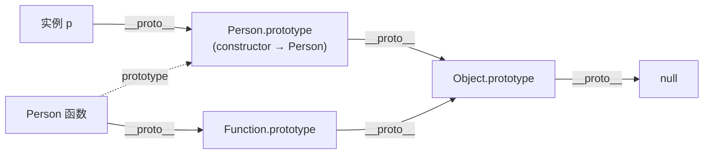

# JavaScript 基础常见面试题总结

> 一句话概括：JavaScript 面试考的从来不是"背 API"，而是"你能不能为**单线程 + 动态类型 + 原型继承 + 事件循环**这套运行时模型说清楚它**如何工作、在哪里会失效、工程上怎么兜底**"。

预计阅读时间：大约 120 分钟

本文按面试真实提问顺序组织：基础认知 → 类型与转换 → 作用域与闭包 → this 与原型链 → 函数调用与手写 → 事件循环 → Promise 与 async/await → 现代语法 → 模块系统 → 对象与拷贝 → 内存与 GC → 迭代器与生成器 → 工程踩坑 → 版本演进 → 快问快答。每题给出**一句话结论 + 展开要点 + 追问方向**，机制深挖交给对应专题（相对链接），方便临场组织语言。

---

## 0. 怎么用这篇文档

### 0.1 答题四段式

面试官问"为什么 `0.1 + 0.2 !== 0.3`"，答"因为浮点数有误差"只能拿到 30 分。用四段式：

| 层次 | 内容 | 作用 |
| --- | --- | --- |
| ① 结论 | 一句话给出判断 | 让面试官知道你有整体认知 |
| ② 机制 | 关键实现原理，2~4 个点 | 证明不是背的 |
| ③ 边界 | 什么时候不成立 / 代价是什么 | **区分中级和高级的分水岭** |
| ④ 实践 | 你在项目里怎么用、踩过什么坑 | 把知识变成经验 |

例：

> JS 的 `number` 是 IEEE754 双精度浮点，0.1 和 0.2 转成二进制都是无限循环小数，存储时就被截断，相加自然得到 `0.30000000000000004`。**这不是 JS 的 bug，所有用 IEEE754 的语言都一样**；而且不只小数——整数超过 `2^53 - 1` 同样失真，连 `toFixed` 都受表示误差影响（`1.005.toFixed(2)` 是 `'1.00'`）。我们项目里金额一律用整数分存储、展示层再除，比较用误差容限；ES2026 起批量求和还可以用 `Math.sumPrecise`。

### 0.2 面试官的四个考察层次

| 层次 | 典型问法 | 期望 |
| --- | --- | --- |
| 会不会用 | `let`/`const` 区别、数组去重、`?.` 怎么写 | 熟悉日常语法与 API |
| 懂不懂原理 | 闭包为什么能记住变量、事件循环输出题 | 能讲清词法环境、任务调度机制 |
| 能不能扛事 | 线上内存泄漏怎么排查、异步错误风暴怎么治理 | 有排查思路和工程预案 |
| 有没有判断力 | 该不该发 ESM-only 包、Temporal 现在能不能上生产 | 能说"不该 / 还不能"的理由 |

### 0.3 阅读路线

| 读者 | 建议章节 |
| --- | --- |
| 初级（1 年内） | 1、2、3.1~3.3、4.1~4.3、6.1~6.2、7.1~7.4、15 快问快答 |
| 中级（1~3 年） | 3.4~3.6、4.4~4.6、5、6.3~6.5、7.5~7.6、9、10、12 |
| 高级（3 年+） | 8.2、9.5~9.6、11、13 全部、14 |
| 选型/架构 | 1.4~1.5、9.6、13.1、13.5、14.3~14.4，重点看每节的"边界"段落 |

### 0.4 本主题专题目录

本主题按「一份总结 + 若干专题」组织，本文给结论与展开要点，机制深挖见下表：

| 文档 | 内容 |
| --- | --- |
| [数据类型与类型转换](types-and-coercion.md) | 8 种类型与检测、ToPrimitive、==/===/Object.is、IEEE754 浮点、Symbol/BigInt |
| [作用域、闭包与执行上下文](scope-closures-and-execution-context.md) | var/let/const 与 TDZ、作用域链、提升、执行上下文与调用栈、闭包机制与应用（手写 curry/防抖/节流） |
| [this 绑定与函数调用](this-binding-and-function-call.md) | 五种绑定规则与优先级、箭头函数、手写 call/apply/bind/new、隐式丢失 |
| [原型链与继承演进](prototype-chain-and-inheritance.md) | prototype/__proto__/constructor、六种继承演进、class/extends/super、手写 instanceof |
| [事件循环：浏览器与 Node 的异步调度](event-loop.md) | 宏/微任务与渲染时机、Node libuv 六阶段、nextTick、输出题方法论 |
| [Promise 与 async/await](promise-and-async-await.md) | 状态机、then 链与错误传播、async 本质、手写静态方法与并发调度器 |
| [迭代器、生成器与异步迭代](iterators-and-generators.md) | Iterator 协议、Generator 状态机、yield*、for await、ES2025 Iterator helpers |
| [ES6+ 核心语法与现代 JavaScript 特性](es6-plus-and-modern-js.md) | 解构/展开、Proxy/Reflect、?./??、ES2022~ES2026 特性时间线、严格模式 |
| [模块系统：CommonJS 与 ESM](modules-commonjs-and-esm.md) | 值拷贝 vs live binding、循环依赖、tree shaking、动态 import、exports |
| [内存管理与垃圾回收](memory-management-and-gc.md) | V8 分代堆、Scavenge/标记整理、Orinoco、内存泄漏排查、弱引用 |
| [对象属性与深浅拷贝](objects-properties-and-copy.md) | 属性描述符、freeze/seal、枚举顺序、structuredClone、手写深拷贝 |

### 0.5 本文目录

1. 基础认知
2. 数据类型与转换
3. 作用域、闭包与提升
4. this 与原型链
5. 函数调用与手写（结论级）
6. 事件循环
7. Promise 与 async/await
8. ES6+ 与现代特性
9. 模块系统：CommonJS 与 ESM
10. 对象与拷贝
11. 内存管理与垃圾回收
12. 迭代器、生成器与异步迭代
13. 工程踩坑与场景设计
14. 版本演进时间线（ES6 → ES2026）
15. 快问快答 40 题
16. 面试答题模板与反问
17. 参考资料

---

## 1. 基础认知

### 1.1 JavaScript 是什么

**结论**：JavaScript 是一门**单线程、动态弱类型、基于原型、函数一等公民**的脚本语言，现代引擎以 **JIT 编译**执行；语言核心由 ECMAScript 标准定义，能力边界由宿主环境扩展。

四个关键词各自对应一片考点：

| 特征 | 含义 | 引出的面试题 |
| --- | --- | --- |
| 单线程 | 同一时刻只有一段 JS 在执行（一个调用栈） | 事件循环、异步、Web Worker |
| 动态弱类型 | 变量无类型、值有类型；运算时允许隐式转换 | 8 种类型、ToPrimitive、`==` 坑 |
| 基于原型 | 对象通过原型链复用行为，没有传统"类" | prototype、继承演进、class 语法糖 |
| 函数一等公民 | 函数可赋值、传参、返回 | 闭包、高阶函数、this 绑定 |

**ECMAScript vs JavaScript vs 宿主环境**：ECMAScript（ECMA-262）只定义语言核心——语法、类型、内置对象、Promise 微任务；**DOM/BOM/fetch 是浏览器宿主给的，fs/http/process 是 Node 宿主给的**。所以"JS 能操作页面"不是语言能力，是宿主能力；同一份 ECMAScript 代码换个宿主，可用的 API 完全不同。

**追问：事件循环是 ECMAScript 规定的吗？**
不是。ECMA-262 只规定了 Job（微任务）队列；**宏任务、渲染时机由 HTML 标准定义，Node 的事件循环由 libuv 定义**。这是浏览器与 Node 输出题差异的根源（见第 6 章）。

### 1.2 单线程为什么还能异步

**结论**：JS 执行是单线程，但**耗时操作交给宿主的其他线程/系统机制**，完成后再把回调排进任务队列，由事件循环调度回主线程执行。

- 浏览器：渲染进程里 JS 主线程与定时器线程、事件触发线程、网络线程等协作；`setTimeout` 由定时器线程计时，网络请求由网络线程处理，完成后回调入队。**JS 主线程与渲染（样式计算/布局/绘制）互斥**——长任务会卡渲染，这是性能题的底层原因。
- Node：主线程跑 JS，libuv 提供事件循环；**文件 IO、DNS、部分 crypto 走线程池**（默认 4 线程，`UV_THREADPOOL_SIZE` 可调），网络 IO 走操作系统异步机制（epoll/kqueue），不占线程池。
- 需要真正并行计算时用 **Web Worker**（浏览器，独立线程、无 DOM 访问、`postMessage` 通信）或 Node `worker_threads`；CPU 密集逻辑也可以交给 WebAssembly。

**追问：单线程是缺点吗？**
是取舍：避免了 DOM 操作的多线程竞争与锁复杂度，代价是任何同步长任务都会阻塞一切。工程答案不是"换多线程语言"，而是**拆分长任务、把计算移出主线程**（见 6.5、13）。

### 1.3 解释执行还是编译执行

**结论**："JS 是解释型语言"是过时说法。现代引擎是**解释器 + 多层 JIT 编译器**的混合体，V8 的流水线是 Ignition → Sparkplug → Maglev → TurboFan。

| 组件 | 角色 |
| --- | --- |
| Ignition | 字节码解释器，快速启动、收集类型反馈 |
| Sparkplug | 基线编译器，字节码直译机器码，无优化 |
| Maglev | 中层优化编译器，兼顾编译速度与优化收益 |
| TurboFan | 顶层优化编译器，基于类型反馈做激进优化（内联、逃逸分析等） |

两个支撑机制：**隐藏类（Hidden Class / Map）**让动态对象获得类似静态类型的内存布局；**内联缓存（IC）**记住调用点的类型，命中则走快路径。类型突变会触发**去优化（deopt）**回退到低层代码——这就是"保持对象形状稳定、别乱删属性"的性能依据。

**追问：为什么 JS 性能题常扯到隐藏类？**
因为 `delete obj.x`、以不同顺序初始化属性、多态调用点都会破坏隐藏类/IC 的稳定性，让 JIT 优化失效。机制细节见 [ES6+ 与现代特性](es6-plus-and-modern-js.md) 与 v8.dev 博客。

### 1.4 JavaScript 与 TypeScript

**结论**：TS = JS + **编译期**静态类型系统，类型在运行前被完全擦除，**运行时执行的仍是 JS**；TS 不改变任何运行时语义。

- 类型检查发生在 `tsc`/IDE，不发生在引擎；`number` 标注拦不住运行时传入字符串（除非有校验）。
- Node 已原生支持运行 `.ts`：**22.6.0 引入 type stripping（需 flag），23.6.0 / 22.18.0 起默认开启，24.12.0 起稳定**（官方文档版本表）。原理是把类型注解替换为等长空白，**不做类型检查**、不支持需要代码生成的语法（enum/namespace 需 transform 模式），也不读 tsconfig。
- 工程立场：**Node 原生跑 TS 解决的是"运行"，不是"安全"**；CI 里仍要 `tsc --noEmit` 做检查。

**追问：TS 能消除 `==` 隐式转换坑吗？**
不能。类型擦除后运行时行为与 JS 完全一致；TS 只能在编译期拦截一部分明显错误。语言机制题该答 JS 还得答 JS。

### 1.5 本文版本基线

- 语言以 **ECMAScript ES2025（第 16 版，2025-06）为基线**；ES2026（第 17 版，2026-06-30 批准）特性单独注明归属；Stage 4 但预计 ES2027 收录的（Temporal、`using`）明确区分，不混入 ES2026。
- 浏览器以当前 Chrome/V8 为准；Node.js 以 **22（Jod）/ 24（Krypton）LTS** 为准。
- 本文机制类示例均在 Node.js 20.11 实测输出（经典语义跨版本不变）；标注 ES2025/ES2026 的新 API 示例需要支持对应特性的新版引擎，落地前查 MDN 兼容表。

---

## 2. 数据类型与转换

### 2.1 八种数据类型

**结论**：7 种原始类型 + 1 种对象类型：`undefined`、`null`、`boolean`、`number`、`string`、`symbol`（ES6）、`bigint`（ES2020）、`object`。

| 类型 | typeof 结果 | 备注 |
| --- | --- | --- |
| undefined | `'undefined'` | 声明未赋值、缺参、缺属性 |
| null | **`'object'`** | 历史 bug：早期类型标签低位 000 与对象相同，沿用至今 |
| boolean | `'boolean'` | — |
| number | `'number'` | IEEE754 双精度，NaN 也是 number |
| string | `'string'` | 不可变，UTF-16 码元序列 |
| symbol | `'symbol'` | 唯一标识，ES6 |
| bigint | `'bigint'` | 任意精度整数，ES2020 |
| object | `'object'` | 数组/函数/日期等；**函数单独返回 `'function'`**（可调用对象的特例） |

**追问：`typeof` 未声明的变量为什么不报错？**
`typeof` 对未声明标识符做了保护，返回 `'undefined'`；**但对 TDZ 中的 `let/const` 仍抛 ReferenceError**（实测）。所以 `typeof x === 'undefined'` 不能用来安全探测块级变量。

### 2.2 类型检测怎么选

**结论**：原始类型用 `typeof`（null 除外），数组用 `Array.isArray`，内置对象品牌用 `Object.prototype.toString.call`，继承关系用 `instanceof`——**各有失效边界**。

| 手段 | 能做什么 | 失效边界 |
| --- | --- | --- |
| `typeof` | 原始类型（除 null）、函数 | null → `'object'`；对象一律 `'object'` |
| `instanceof` | 原型链上找 `Ctor.prototype` | 原始值恒 false；**跨 realm（iframe/vm）失效**；可被 `Symbol.hasInstance` 改写 |
| `Object.prototype.toString.call(x)` | 内置品牌 `[object Array/Date/RegExp/Null...]` | 可被 `Symbol.toStringTag` 伪造；自定义类默认 `[object Object]` |
| `Array.isArray(x)` | 数组判定，**跨 realm 安全** | 只认数组 |
| `Number.isNaN` / `Number.isFinite` | 不做隐式转换的判定 | 区别于全局 `isNaN`（先 ToNumber，`isNaN('abc')` 为 true） |
| `Error.isError(x)`（**ES2026**） | 跨 realm 可靠判定 Error | 需新版引擎；此前跨 realm `instanceof Error` 失效（vm 实测 false） |

```js
// Node / browser 均可运行（实测）
Object.prototype.toString.call(null);      // '[object Null]'
Object.prototype.toString.call([]);        // '[object Array]'
Object.prototype.toString.call(new Date);  // '[object Date]'
Array.isArray([]);                         // true
```

**追问：为什么跨 iframe 的数组 `instanceof Array` 是 false？**
每个 realm 有自己的 `Array.prototype`，对象的原型链指向创建它的那个 realm。`Array.isArray` 检查的是内部槽而非原型链，所以跨 realm 安全；`Error.isError`（ES2026）同理补上了 Error 的跨 realm 判定。完整推导见 [数据类型与类型转换](types-and-coercion.md)。

### 2.3 ToPrimitive 与隐式转换

**结论**：对象转原始值走 **ToPrimitive**：优先调用 `Symbol.toPrimitive`，否则按 hint 依次尝试 `valueOf` / `toString`；`+` 运算符两侧只要有一个转出来是字符串就做拼接，否则做数值加法。

| hint | 默认尝试顺序 | 典型场景 |
| --- | --- | --- |
| `'number'` | valueOf → toString | 算术运算、`Number(obj)` |
| `'string'` | toString → valueOf | 模板字符串、`String(obj)` |
| `'default'` | 同 number（**Date 例外，同 string**） | `+`、`==` |

```js
// Node / browser（实测）
[] + [];        // ''            （[].toString() → ''）
[] + {};        // '[object Object]'
1 + '2';        // '12'          （字符串拼接）
'5' - 2;        // 3             （减法只有数值语义）
true + true;    // 2
Number(null);   // 0
Number(undefined); // NaN
Number('');     // 0
```

**追问：`[] == ![]` 为什么是 true？**
`![]` → `false`；`[] == false` → 布尔先转数值 `[] == 0`；对象转原始 `'' == 0`；字符串转数值 `0 == 0` → true。每一步都是规范里的确定性算法，不是玄学。逐步推导见 [数据类型与类型转换](types-and-coercion.md)。

### 2.4 == / === / Object.is

**结论**：`===` 不做类型转换（但 `NaN !== NaN`、`+0 === -0`）；`==` 允许按规范隐式转换；`Object.is` 在 `===` 基础上修正两处——**NaN 等于自身、+0 与 -0 不等**。

| 表达式 | `==` | `===` | `Object.is` |
| --- | --- | --- | --- |
| `NaN` vs `NaN` | false | false | **true** |
| `+0` vs `-0` | true | true | **false** |
| `null` vs `undefined` | **true** | false | false |
| `null` vs `0` | false | false | false |
| `''` vs `false` | true | false | false |
| `'0'` vs `false` | true | false | false |

`==` 的核心规则（同类型直接比；不同类型按下面走）：

- `null == undefined` 为 true，且它们**不等于任何其他值**；
- number vs string → string 转 number；
- boolean vs 任何 → boolean 先转 number；
- object vs 原始 → object 走 ToPrimitive；
- NaN 与任何值（含自身）都不等。

**8 个 falsy 值**：`false`、`0`、`-0`、`0n`、`''`、`null`、`undefined`、`NaN`。其余全 truthy——**`[]`、`{}`、`'0'`、`'false'` 都是真**（浏览器还有个特例：`document.all` 是 falsy 的对象，历史兼容包袱）。

**追问：`null >= 0` 为什么是 true，`null == 0` 却是 false？**
关系运算符（`>=`）把 null 转成 0 再比；相等运算符（`==`）对 null 有专门规则，不做转换。两套算法不同，所以出现"大于等于成立、等于不成立"的反直觉组合（实测）。实践结论：**判空用 `== null`（同时覆盖 null/undefined）或 `??`，其余比较一律 `===`**。

### 2.5 IEEE754 与浮点数

**结论**：`number` 是 64 位双精度（1 符号 + 11 指数 + 52 尾数），十进制小数转二进制常为无限循环，存储即截断——**误差在表示阶段就产生了，不是计算阶段**。

```js
// Node / browser（实测）
0.1 + 0.2;                    // 0.30000000000000004
0.1 + 0.2 === 0.3;            // false
(0.1 + 0.2).toFixed(2);       // '0.30'
(1.005).toFixed(2);           // '1.00'  ← 1.005 实际存的是 1.00499999...
Number.MAX_SAFE_INTEGER;      // 9007199254740991（2^53 - 1）
9007199254740993 === 9007199254740992; // true ← 大整数同样失真
Math.abs(0.1 + 0.2 - 0.3) < Number.EPSILON; // true（容限比较）
```

| 场景 | 方案 | 边界 |
| --- | --- | --- |
| 金额 | **整数分**存储运算，展示层再除；或 decimal.js/big.js | 整数分仍受安全整数上限约束；除法/分摊要定义舍入规则 |
| 大整数 ID | BigInt 或字符串 | BigInt 不能与 Number 混算、不能直接 JSON 序列化 |
| 浮点比较 | 误差容限（`Number.EPSILON` 或业务精度） | 容限选取依赖量级，不是万能 |
| 批量求和 | `Math.sumPrecise`（**ES2026**，补偿求和） | 只解决求和累积误差，不解决单次表示误差 |
| 展示 | `Intl.NumberFormat` / `toFixed` | toFixed 受表示误差影响，别当精确舍入用 |

**追问：为什么 `1.005.toFixed(2)` 是 `'1.00'`？**
因为 1.005 的双精度表示略小于 1.005，舍入时自然向下。这说明**toFixed 不是"精确十进制舍入"**，金额舍入要在整数域或十进制库里做。场景展开见 13.1。

### 2.6 Symbol 与 BigInt

**结论**：Symbol 是**唯一且不可枚举**的原始值，用作属性键避免冲突、参与元编程；BigInt 是**任意精度整数**，补 Number 的安全整数缺口。

- `Symbol('a') !== Symbol('a')`（每次创建都唯一）；`Symbol.for('a')` 走全局注册表，可跨模块共享（实测）。
- 知名符号（well-known symbols）是语言扩展点：`Symbol.iterator`、`Symbol.hasInstance`、`Symbol.toPrimitive`、`Symbol.toStringTag` 等。
- Symbol 键不出现在 `for...in`、`Object.keys`、`JSON.stringify` 中，但 `Reflect.ownKeys` 能拿到——"半隐藏"，不是真私有（真私有见 class `#field`）。
- BigInt：`10n / 3n === 3n`（截断）；`1n + 1` 抛 TypeError（禁止混算，防精度静默丢失）；`JSON.stringify({x:1n})` 抛 TypeError（实测），序列化需先转字符串。

**追问：Symbol 能实现私有属性吗？**
只能"防误撞"，不能"防访问"——`Object.getOwnPropertySymbols` 就能拿到。语言级私有是 class 的 `#field`（ES2022，品牌检查，外部访问直接 SyntaxError）。

---

## 3. 作用域、闭包与提升

### 3.1 var / let / const 与 TDZ

**结论**：`var` 是函数作用域、声明提升并初始化为 undefined；`let/const` 是块级作用域、声明提升但**不初始化**，声明前访问落在 **TDZ（暂时性死区）** 抛 ReferenceError；`const` 锁定的是**绑定**而非值。

| 维度 | var | let | const |
| --- | --- | --- | --- |
| 作用域 | 函数 | 块 `{}` | 块 `{}` |
| 提升 | 声明+初始化 undefined | 声明提升，TDZ | 声明提升，TDZ |
| 重复声明 | 允许 | 报错 | 报错 |
| 重新赋值 | 允许 | 允许 | **绑定不可变**（对象内容仍可改） |
| 全局声明挂到 globalThis | 是（脚本作用域） | 否 | 否 |

```js
// Node / browser（实测）
console.log(a); var a = 1;   // undefined
console.log(b); let b = 1;   // ReferenceError（TDZ）
const obj = { n: 1 }; obj.n = 2; // 合法：改的是值，不是绑定
```

**追问：TDZ 存在的意义是什么？**
让"声明前使用"从 var 时代的静默 undefined 变成显式错误，把一类隐蔽 bug 提前暴露；同时让 `const` 的"必须先初始化"语义自洽。`typeof` 也救不了 TDZ（2.1 实测）。

### 3.2 词法作用域与作用域链

**结论**：JS 是**词法（静态）作用域**——作用域在**写代码时**由嵌套结构确定，与调用位置无关；查找变量沿**作用域链**由内向外，直到全局。

- 作用域链的本质是**环境记录（Environment Record）的嵌套引用**：函数环境 → 外层函数环境 → … → 全局环境。
- `this` 不走作用域链（它是调用时确定的，见第 4 章）——"作用域链查变量、this 看调用"是两套机制，别混。
- 动态作用域的两个"后门"：`eval`（非严格模式下在当前作用域引入变量）与 `with`（严格模式禁用）——都破坏静态可分析性，工程上禁用。

**追问：函数在 A 处定义、B 处调用，它能访问 B 的局部变量吗？**
不能。词法作用域只看定义位置。这正是闭包能"记住"定义处环境的原因，也是 `this` 与作用域必须分开答的原因。

### 3.3 提升（Hoisting）

**结论**：提升是**执行上下文创建阶段**先处理声明的行为——函数声明**整体提升**（含函数体），`var` 只提升声明（值为 undefined），`let/const/class` 提升但处于 TDZ。

```js
// Node / browser（实测）
foo();                       // 正常执行
function foo() {}            // 函数声明整体提升

bar();                       // TypeError: bar is not a function
var bar = function () {};    // 只提升了 var bar = undefined

baz();                       // ReferenceError（TDZ）
let baz = () => {};
```

**追问：函数声明和函数表达式提升差异的根源？**
创建阶段对函数声明直接绑定完整函数对象；对 `var` 只绑定 undefined，赋值发生在执行阶段。所以"调用在声明前"对前者安全、对后者是 TypeError。块级函数声明在 sloppy 模式还有 Annex B 遗留语义，细节见 [作用域、闭包与执行上下文](scope-closures-and-execution-context.md)。

### 3.4 执行上下文与调用栈

**结论**：每段可执行代码（全局/函数/eval/模块）运行前创建**执行上下文**，经历**创建阶段**（确定作用域链、变量环境、this）与**执行阶段**（逐行赋值求值）；上下文压入**调用栈**，LIFO 进出。

- 调用栈深度有限，无终止递归 → `RangeError: Maximum call stack size exceeded`。
- 栈里存的是上下文与原始值绑定；对象本体在堆上，栈里是引用（存储细节是引擎实现，面试答"值 vs 引用语义"即可，别把"原始值一定在栈"当规范）。
- 异步回调不在当前栈里执行——它们由事件循环在未来某个任务中重新入栈（第 6 章），所以 `try/catch` 包不住异步回调的异常（13.2）。

**追问：为什么递归爆栈而 setTimeout 递归不会？**
`setTimeout` 的回调是新的宏任务，每次都在**空栈**上重新执行，不累积栈帧；同步递归则一直在同一根栈上叠加。这也是"用调度代替递归"做长任务拆分的依据。

### 3.5 闭包：机制与代价

**结论**：闭包 = **函数 + 对其定义处词法环境的引用**。外层函数返回后，只要内层函数还被引用，它捕获的变量就不会被回收。

```js
// Node / browser（实测）：var 循环经典题
for (var i = 0; i < 3; i++) setTimeout(() => console.log(i), 0); // 3 3 3
for (let j = 0; j < 3; j++) setTimeout(() => console.log(j), 0); // 0 1 2
```

机制拆解：

- `var` 版：三个回调共享**同一个**函数作用域里的 `i`，回调执行时循环早已结束，`i === 3`。
- `let` 版：规范为**每轮循环创建新的块级绑定**并把上一轮值拷贝进来，三个回调各捕获各的 `j`。
- 闭包捕获的是**变量绑定（引用）**，不是值的快照——所以共享绑定才会"都看到终值"。

**代价与边界**：

- 被捕获的变量常驻内存，捕获大对象且长期持有 = 内存泄漏温床（11.4）；V8 会做作用域分析，**只保留真正被引用的变量**，但被引用的大对象照样驻留。
- 闭包不是"复制了一份环境"，调试器里看到的 Scope 是活引用。
- 循环里创建大量闭包有分配成本，热点路径注意。

**追问：闭包和内存泄漏什么关系？**
闭包本身不是泄漏——**"不再需要却仍被引用的闭包"才是**。典型：组件卸载后定时器/事件监听仍持有闭包，闭包又持有大对象。排查见 13.4，弱引用方案见 11.6。

### 3.6 闭包应用速查（手写结论级）

**结论**：curry、防抖、节流、memoize、once、模块模式本质都是**用闭包保存状态**；手写完整版见 [作用域、闭包与执行上下文](scope-closures-and-execution-context.md)，这里给结论与骨架。

| 应用 | 闭包保存什么 | 一句话要点 |
| --- | --- | --- |
| 防抖 debounce | timer | 触发后重置计时，**只执行最后一次**；搜索输入、resize |
| 节流 throttle | 上次执行时间/timer | 固定间隔内**至多执行一次**；scroll、mousemove |
| curry | 已收集参数 | 参数够数才执行，否则返回继续收参的函数 |
| memoize | 结果缓存 Map | 同参直接返回缓存；注意缓存淘汰与 this |
| once | 是否已执行标志 | 执行一次后永久返回首次结果 |
| 模块模式 | 私有变量 | IIFE/ESM 暴露窄接口，外部摸不到内部状态 |

```js
// 防抖骨架（Node / browser 均可运行）
function debounce(fn, wait) {
  let timer = null;                      // 闭包保存 timer
  return function (...args) {
    clearTimeout(timer);
    timer = setTimeout(() => fn.apply(this, args), wait); // 保留调用处 this
  };
}
```

**追问：防抖和节流怎么选？**
关心"最终状态"用防抖（输入停止后才搜索）；关心"过程频率"用节流（滚动中持续计算位置）。动画对齐帧用 `requestAnimationFrame` 而不是 setTimeout（6.5、13.6）。**组件卸载必须 cancel**，否则回调在卸载后执行（setState on unmounted / 泄漏）。

---

## 4. this 与原型链

### 4.1 五种绑定规则与优先级

**结论**：`this` 在**调用时**确定（箭头函数例外，定义时确定），按优先级：**new > 显式（call/apply/bind）> 隐式（obj.fn()）> 默认**；箭头函数不参与规则，继承外层词法 this。

| 规则 | 形式 | this 指向 |
| --- | --- | --- |
| 默认绑定 | `fn()` | 非严格 → globalThis；**严格 → undefined** |
| 隐式绑定 | `obj.fn()` | obj（**只看最后一层**：`a.b.fn()` 是 b） |
| 显式绑定 | `fn.call/apply/bind(ctx)` | ctx（null/undefined 在非严格下回落 globalThis） |
| new 绑定 | `new Fn()` | 新创建的对象 |
| 箭头函数 | `() => this` | 定义处外层的 this，**call/bind/new 都改不了** |

```js
// Node / browser（实测）
function F() { this.x = 1; }
const B = F.bind({ x: 9 });
const o = new B();
o.x;                 // 1  ← new 优先级高于 bind，绑定的 this 被忽略
o instanceof F;      // true ← 原型仍连 F.prototype
```

**追问：bind 之后还能被 call 改 this 吗？**
不能，bind 是"一次性硬绑定"。但 `new` 能覆盖 bind 的 this（实测），且 bind 预置的参数仍生效——手写 bind 必须处理"被 new 调用"的分支（5.2）。

### 4.2 隐式丢失

**结论**：把方法**从对象上摘下来**再调用，隐式绑定就丢了——赋值、传参、解构、别名都会触发。

```js
// Node（实测；browser 的 globalThis.name 为 ''，输出略有差异）
const obj = { name: 'obj', getName() { return this.name; } };
const f = obj.getName;
f();                          // undefined（this 落到 globalThis，非严格）
setTimeout(obj.getName, 0);   // Node 里 this 是 Timeout 对象；browser 里是 window
```

三种修复：`bind` 硬绑定、箭头函数包裹（`() => obj.getName()`）、class 字段箭头（13.7）。**`setTimeout(obj.fn)` 的 this 在浏览器是 window、在 Node 是 Timeout 对象**——环境差异本身就是考点。

**追问：为什么 `a.b.fn()` 的 this 是 b 不是 a？**
隐式绑定只看**调用点紧邻的对象**（引用求值的结果是 b 上的函数值，携带的 base 是 b）。链式访问前面的部分与 this 无关。

### 4.3 箭头函数

**结论**：箭头函数没有自己的 `this`、`arguments`、`super`、`new.target`，也**没有 prototype 属性、不能 new**；它适合"继承外层 this 的短回调"，不适合需要动态 this 的方法。

| 维度 | 普通函数 | 箭头函数 |
| --- | --- | --- |
| this | 调用时按规则绑定 | 定义时词法继承，不可改 |
| arguments | 有（类数组） | 无（用 rest 参数） |
| prototype 属性 | 有 | **无**（实测 `'prototype' in (()=>{})` 为 false） |
| 作为构造器 | 可以 new | **new 抛 TypeError**（实测） |
| 适合 | 方法、构造器、需要 this 的回调 | 短回调、函数式管道、保留外层 this |

**追问：对象方法能用箭头函数吗？**
`const obj = { f: () => this }` 的 this 是**定义处外层**（模块/全局），不是 obj——对象字面量不构成作用域。需要 obj 作 this 就用普通方法或 `obj.f = function(){}`。

### 4.4 原型链三角

**结论**：每个函数有显式 `prototype`；每个对象有隐式原型（`__proto__`，规范操作是 `Object.getPrototypeOf`），**指向构造它的函数的 prototype**；`prototype` 上有 `constructor` 指回函数。属性查找沿隐式原型链逐级向上，终点是 `null`。

```js
// Node / browser（实测，全部 true）
function Person() {}
const p = new Person();
p.__proto__ === Person.prototype;
Person.prototype.constructor === Person;
Person.__proto__ === Function.prototype;        // 函数也是对象，由 Function 构造
Function.prototype.__proto__ === Object.prototype;
Object.prototype.__proto__ === null;            // 原型链终点
```



**追问：`__proto__` 是标准吗？**
它是 Annex B 的历史访问器（getter/setter 挂在 Object.prototype 上），规范推荐 `Object.getPrototypeOf` / `Object.setPrototypeOf` / `Object.create`。`Object.create(null)` 造出的对象**没有原型链**，`instanceof Object` 为 false、`String(dict)` 抛 TypeError（实测）——适合做纯字典，但别对它用依赖原型的方法。

### 4.5 instanceof 与手写

**结论**：`x instanceof C` 的本质是**沿 x 的原型链找 `C.prototype`**；手写就是循环 `getPrototypeOf`。

```js
// Node / browser（实测）
function myInstanceof(x, C) {
  if (x == null || (typeof x !== 'object' && typeof x !== 'function')) return false;
  let proto = Object.getPrototypeOf(x);
  while (proto) {
    if (proto === C.prototype) return true;
    proto = Object.getPrototypeOf(proto);
  }
  return false;
}
myInstanceof([], Array);          // true
myInstanceof(1, Number);          // false（原始值没有原型链）
myInstanceof(new Number(1), Number); // true
```

边界：原始值恒 false；跨 realm 失效（2.2）；`C.prototype` 被改写后结果随之变化；`Symbol.hasInstance` 可自定义判定（`instanceof` 实际调用它）。完整推导与 `Object.create` 见 [原型链与继承演进](prototype-chain-and-inheritance.md)。

### 4.6 继承演进与 class

**结论**：JS 继承演进的主线是**修复"原型共享引用属性"与"父构造器重复调用"两个缺陷**，ES6 class 是原型继承的语法糖，但有可观察差异。

| 方案 | 核心做法 | 致命缺陷 |
| --- | --- | --- |
| 原型链继承 | `Sub.prototype = new Super()` | 引用属性被所有实例共享；无法向父传参 |
| 构造器继承 | 子构造器内 `Super.call(this)` | 方法定义在构造器里，无法复用 |
| 组合继承 | 构造器继承属性 + 原型链继承方法 | **父构造器调用两次** |
| 原型式 | `Object.create(proto)` | 同原型链，引用共享 |
| 寄生式 | 工厂里增强对象 | 方法不复用 |
| **寄生组合式** | `Sub.prototype = Object.create(Super.prototype)` + 构造器内 `Super.call(this)` | ES5 最优解，只调一次父构造器 |
| ES6 class | `extends` + `super()` | 语法糖，但必须先 super 才有 this |

class 与函数构造器的**可观察差异**（实测）：

- class 声明处于 TDZ，不整体提升；函数声明提升。
- class 体自动严格模式；`class C{}; C()` 抛 TypeError（必须 new）。
- class 原型方法**不可枚举**（`Object.keys(C.prototype)` 为空）；函数 prototype 上手动挂的方法默认可枚举。
- class 字段（ES2022）按实例初始化，`#private` 是语言级私有（品牌检查）。

**追问：class 既然是语法糖，为什么还有这些差异？**
"糖"指底层仍是原型链，但规范给 class 加了额外约束（TDZ、严格、不可普通调用、方法不可枚举）来对齐其他语言的直觉。答"完全等价"是错的。`extends` 同时接好两条链（实例链 + 静态链），`super` 在构造器里是"调用父构造器并绑定 this"，在方法里是"父原型引用"——细节见 [原型链与继承演进](prototype-chain-and-inheritance.md)。

---

## 5. 函数调用与手写（结论级）

### 5.1 new 的四步

**结论**：`new Fn()` = ① 创建空对象 → ② 其原型连到 `Fn.prototype` → ③ 以该对象为 this 执行构造器 → ④ **构造器返回对象则用该对象，否则返回新对象**。

```js
// Node / browser（实测）
function R1() { this.a = 1; return { b: 2 }; }
function R2() { this.a = 1; return 5; }
new R1(); // { b: 2 }   ← 返回对象，覆盖新对象
new R2(); // { a: 1 }   ← 返回原始值，被忽略
```

手写要点：`Object.create(Fn.prototype)` 一步完成①②；`Fn.apply(obj, args)` 完成③；返回值判断 `typeof ret === 'object' && ret !== null || typeof ret === 'function'`。箭头函数没有 `[[Construct]]`，不能 new（4.3 实测）。完整版见 [this 绑定与函数调用](this-binding-and-function-call.md)。

### 5.2 call / apply / bind

**结论**：三者都显式指定 this；**call 收参数列表、apply 收参数数组、bind 返回预绑定（可预置参数）的新函数**。

| 方法 | 参数 | 返回 | 立即执行 |
| --- | --- | --- | --- |
| `fn.call(ctx, a, b)` | 列表 | 调用结果 | 是 |
| `fn.apply(ctx, [a, b])` | 数组 | 调用结果 | 是 |
| `fn.bind(ctx, a)` | 列表（可预置） | **新函数** | 否 |

手写考点：

- call/apply：把函数挂到 ctx 的 Symbol 键上调用再删除（或 `Reflect.apply`），注意 ctx 为 null/undefined 时回落 globalThis、原始值要装箱。
- bind：闭包保存 ctx 与预置参数，返回函数内 apply；**必须处理被 new 调用的分支**（此时忽略绑定 this，原型连原函数，4.1 实测）。
- 箭头函数 call/bind 改不了 this（词法绑定）。

### 5.3 arguments 与 rest

**结论**：`arguments` 是**类数组**（有 length/索引，无数组方法，实测 `Array.isArray` 为 false）；rest 参数 `...args` 是**真数组**（实测 true），且只收集"未命名剩余参数"。箭头函数没有 arguments，用 rest。

**追问：arguments 和形参的联动？**
非严格模式下 arguments 与形参**别名联动**（改一个另一个跟着变），严格模式解除联动——这是严格模式差异表（8.4）里的高频项。

### 5.4 手写题清单与考点映射

| 手写题 | 核心考点 | 深挖专题 |
| --- | --- | --- |
| new / call / apply / bind | this 规则、原型连接、返回值规则 | [this 绑定与函数调用](this-binding-and-function-call.md) |
| instanceof / Object.create | 原型链遍历 | [原型链与继承演进](prototype-chain-and-inheritance.md) |
| curry / 防抖 / 节流 / once | 闭包保存状态、this 保留、cancel | [作用域、闭包与执行上下文](scope-closures-and-execution-context.md) |
| Promise / all / race / 并发调度器 | 状态机、微任务、thenable 同化 | [Promise 与 async/await](promise-and-async-await.md) |
| 深拷贝 | 循环引用、Symbol 键、特殊对象 | [对象属性与深浅拷贝](objects-properties-and-copy.md) |
| 迭代器 / 生成器 runner | 协议、暂停恢复 | [迭代器、生成器与异步迭代](iterators-and-generators.md) |

---

## 6. 事件循环

### 6.1 浏览器：宏任务、微任务与渲染

**结论**：浏览器事件循环每轮**取一个宏任务执行 → 清空微任务队列 → （需要时）进入渲染步骤**；微任务在每个宏任务后**全部清完**，渲染不是每轮都发生。

| 类别 | 成员 | 调度 |
| --- | --- | --- |
| 宏任务（task） | 整体 script、setTimeout/setInterval、I/O、UI 事件、postMessage/MessageChannel | 每轮取**一个** |
| 微任务（microtask） | Promise.then/catch/finally、queueMicrotask、MutationObserver、await 后续 | 每个宏任务后**清空** |
| 渲染步骤 | requestAnimationFrame 回调 → 样式/布局/绘制 | 按刷新率（通常 60Hz ≈ 16.7ms），**rAF 不是宏任务** |
| 空闲 | requestIdleCallback | 帧内空闲期，Safari 稳定版长期未支持（需降级） |

```js
// Node / browser 输出一致（实测）
console.log('script start');
setTimeout(() => console.log('setTimeout'), 0);
Promise.resolve().then(() => console.log('promise1')).then(() => console.log('promise2'));
console.log('script end');
// script start → script end → promise1 → promise2 → setTimeout
```

边界：

- **微任务可以饿死渲染与宏任务**：无限递归 `queueMicrotask` 会卡死页面（微任务不清完不进入下一轮）。
- `setTimeout(fn, 0)` 不是立即：HTML 规范规定**嵌套层级超过 5 层且延时 < 4ms 时钳制到 4ms**；要无钳制地拆分任务用 MessageChannel。
- 渲染步骤里 rAF 回调在绘制前执行，适合做动画；rAF 里再排 rAF 是下一帧。

### 6.2 输出题方法论

**结论**：四步走——① 跑完所有同步代码（注意 async 函数体在 await 前是同步的）→ ② 清空微任务（await 后续 ≈ then 回调）→ ③ 取下一个宏任务 → ④ 再清微任务，循环。

```js
// Node / browser 输出一致（实测）
console.log('script start');
setTimeout(() => console.log('setTimeout'), 0);
Promise.resolve().then(() => console.log('promise1')).then(() => console.log('promise2'));
(async () => {
  console.log('async1 start');
  await async2();
  console.log('async1 end');   // ≈ then 回调，微任务
})();
async function async2() { console.log('async2'); }
console.log('script end');
// script start → async1 start → async2 → script end
// → promise1 → async1 end → promise2 → setTimeout
```

两个易错点（实测确认）：

- **await 非 Promise 也会让出**：`await null` 后续代码进微任务队列，至少一轮微任务后才执行。
- **resolve 一个 thenable 会多一轮微任务**（同化需要额外 Job）：`new Promise(r => r({then(res){res(1)}}))` 的 then 回调晚于普通 `Promise.resolve().then`。

```js
// Node / browser（实测）
async function f() { console.log('f1'); await null; console.log('f2'); }
f();
Promise.resolve().then(() => console.log('p1')).then(() => console.log('p2'));
console.log('sync');
// f1 → sync → f2 → p1 → p2
```

### 6.3 Node：libuv 六阶段与 nextTick

**结论**：Node 事件循环由 libuv 驱动，分六个阶段循环；**每个阶段切换前、以及每个回调执行后（Node 11+）都会清空 nextTick 队列与微任务队列**，nextTick 优先于 Promise 微任务。

| 阶段 | 做什么 | 典型回调 |
| --- | --- | --- |
| timers | 到期的 setTimeout/setInterval | 定时器回调 |
| pending callbacks | 上一轮延迟的系统级回调 | TCP 错误等 |
| idle / prepare | 内部使用 | — |
| **poll** | 取 I/O 事件、执行 I/O 回调；无事件时阻塞等待 | fs/网络回调 |
| check | setImmediate | immediate 回调 |
| close callbacks | 关闭事件 | socket.on('close') |

```js
// Node（实测）
process.nextTick(() => console.log('nextTick'));
Promise.resolve().then(() => console.log('promise'));
// nextTick → promise   ← nextTick 队列先于微任务队列

// Node 11+：每个宏任务回调后清微任务（实测）
setTimeout(() => { console.log('t1'); Promise.resolve().then(() => console.log('p1')); }, 0);
setTimeout(() => { console.log('t2'); Promise.resolve().then(() => console.log('p2')); }, 0);
// t1 → p1 → t2 → p2   （Node 10 及以前是 t1 t2 p1 p2，版本归属是考点）

// I/O 回调内：setImmediate 必先于 setTimeout（实测）
require('fs').readFile(__filename, () => {
  setTimeout(() => console.log('timeout'), 0);
  setImmediate(() => console.log('immediate'));
});
// immediate → timeout   （poll 阶段结束直接进 check）
```

边界：

- **版本注（libuv 1.45 / Node 20 起）**：timers 阶段移到 **poll 之后**执行（旧版在 poll 前后各跑一次），上表是经典教学顺序；答 Node 20+ 的 timers/setImmediate 相对时序须带上此变化，详见 [事件循环](event-loop.md) §6.3。
- **主模块里** setTimeout(0) 与 setImmediate 的先后**不确定**（受进程启动耗时影响）；I/O 回调内才确定 immediate 先。
- nextTick 递归会**饿死 I/O**（nextTick 队列不清完不进下一阶段），比微任务饿死更危险；`setImmediate` 递归则每轮让出，是安全的"下一轮"写法。
- `process.nextTick` 不属于 libuv 阶段，是 Node 在阶段间插入的自有队列。

### 6.4 浏览器 vs Node 对照

| 维度 | 浏览器 | Node（22/24 LTS） |
| --- | --- | --- |
| 规范来源 | HTML 标准 event loop | libuv + Node 自有队列 |
| 宏任务粒度 | 每轮一个 task | 每阶段批量执行到期回调 |
| 微任务时机 | 每个 task 后清空 | 每个回调后清空（Node 11+ 对齐浏览器） |
| 额外队列 | 无 | nextTick（优先于微任务） |
| 渲染 | rAF/绘制在微任务后 | 无渲染概念 |
| "下一轮"写法 | setTimeout/MessageChannel | setImmediate |

### 6.5 渲染时机与长任务

**结论**：JS 主线程与渲染互斥，**超过 50ms 的长任务**会阻塞输入响应（INP 指标）；治理思路是拆分任务、让出主线程、把非紧急工作放空闲期。

| 手段 | 适用 | 边界 |
| --- | --- | --- |
| `requestAnimationFrame` | 动画、与帧对齐的视觉更新 | 后台标签页暂停；不是宏任务 |
| `requestIdleCallback` | 非紧急后台工作（日志、预计算） | Safari 稳定版未支持，需 setTimeout 降级；deadline.timeRemaining() 控制时长 |
| MessageChannel / setTimeout 分片 | 大计算拆成小任务 | setTimeout 嵌套有 4ms 钳制；MessageChannel 无 |
| Scheduler API（`scheduler.postTask/yield`） | 带优先级让出 | 宿主 API 非 ECMAScript：postTask Chrome 94+ / yield Chrome 129+；Firefox 142+；Safari 未支持 |
| Web Worker / WASM | CPU 密集计算 | 无 DOM 访问；通信有序列化成本 |

**追问：为什么微任务里不能做长计算？**
微任务不清完不进入渲染与下一个宏任务，长微任务 = 直接卡帧。重活要么拆成宏任务分片，要么移出主线程。

---

## 7. Promise 与 async/await

### 7.1 状态机与执行时机

**结论**：Promise 是**三态状态机**（pending → fulfilled / rejected，**不可逆**）；**executor 同步立即执行**，then/catch/finally 回调进微任务；resolve 一个 thenable 会被同化（多一轮微任务）。

```js
// Node / browser（实测）
new Promise(r => { console.log('executor'); r(); }).then(() => console.log('then1'));
Promise.resolve().then(() => console.log('then2'));
// executor → then1 → then2   ← executor 是同步的，then 才是微任务
```

要点：

- 状态一旦敲定不可再变；重复 resolve/reject 静默忽略。
- `resolve(thenable)` 会调用其 then 并接管状态（同化），`resolve(Promise)` 直接跟随——这是手写 Promise 的核心难点（7.6）。
- Promise 解决的是**回调的控制权反转与组合**，不是"让代码变快"；它仍是单线程异步。

### 7.2 then 链与错误传播

**结论**：then 返回**新 Promise**；回调的返回值/抛错/返回 Promise 决定新 Promise 的状态；错误沿链**冒泡到最近的 catch**；finally 透传值/原因（除非自己抛错）。

| 回调里发生 | 新 Promise 状态 |
| --- | --- |
| `return v` | fulfilled(v) |
| `return promise` | 跟随该 promise |
| `throw e` / 返回 rejected | rejected(e) |
| 无 return | fulfilled(undefined)（**值穿透**的根源） |

```js
// Node / browser（实测）
Promise.resolve(1).finally(() => 99).then(v => console.log(v)); // 1 ← finally 不改值
Promise.reject('e').finally(() => { throw 'f'; }).catch(r => console.log(r)); // 'f' ← finally 抛错覆盖原因
```

**追问：`.then(null)` 和 `.catch` 的关系？**
`catch(fn)` 就是 `then(undefined, fn)` 的语法糖；链上任何一环 rejected 且无 onRejected，就一路穿透到最近的 catch。**链尾不挂 catch = unhandledrejection**（13.2）。

### 7.3 静态方法选型

**结论**：按"失败语义"选——**all 快速失败、allSettled 全部等齐、any 一个成功即可、race 一个敲定即可**。

| 方法 | 成功条件 | 失败条件 | 版本 |
| --- | --- | --- | --- |
| `Promise.all` | 全部 fulfilled，结果按序数组 | **任一 rejected 立即 reject**（其余结果丢弃） | ES6 |
| `Promise.allSettled` | 永远 fulfilled，`{status, value/reason}` 数组 | 无 | ES2020 |
| `Promise.any` | 任一 fulfilled | 全部 rejected → **AggregateError** | ES2021 |
| `Promise.race` | 第一个敲定者（无论成败） | 第一个敲定者是 rejected | ES6 |
| `Promise.try(fn)` | 统一包装"可能同步抛错/可能返回 Promise"的 fn | fn 同步抛错也变 rejected | **ES2025** |
| `Promise.withResolvers()` | 返回 `{promise, resolve, reject}`，免 executor 嵌套 | — | ES2024 |

```js
// Node / browser（实测）
Promise.all([Promise.resolve(1), Promise.reject('boom')]).catch(e => e); // 'boom'（快速失败）
Promise.allSettled([Promise.resolve(1), Promise.reject('x')]);
// [{status:'fulfilled',value:1},{status:'rejected',reason:'x'}]
Promise.any([Promise.reject('a'), Promise.reject('b')]).catch(e => e.errors); // ['a','b']（AggregateError）
Promise.all([]); // 立即 fulfilled []
```

边界：**race 不取消落败者**——超时竞赛里慢请求仍在跑、仍占资源，取消要靠 AbortController（13.2）。`all([])` 立即成功、`any([])` 立即 AggregateError（空输入语义相反，实测 all([]) 为 []）。

### 7.4 async/await 本质

**结论**：async 函数**概念上等价于「生成器 + 自动执行器」**（教学类比，**非规范字面语法糖**：ECMA-262 为 async 函数定义了独立的求值机制，引擎并不创建 generator 对象），返回 Promise；`await` 把后续代码切进微任务，**用同步写法表达异步流程**，错误用 try/catch 捕获。

- async 函数返回值被 `Promise.resolve` 包装；抛错 → rejected。
- `await x`：先同步求值 x，再让出执行权，后续 ≈ `then` 回调（6.2 实测：await 非 Promise 也让出）。
- 历史脉络：callback → Promise（组合）→ generator + co（手动 runner）→ async/await（语言级 runner）。Babel 降级 async **可**转生成器 + helper（这是转译策略，不是引擎实现）。
- **并行别写成串行**：无依赖的请求先同时发起再 await，或 `Promise.all`；`for` 循环里逐个 await 是串行。

```js
// Node / browser
// 串行（慢）：for (const u of urls) await fetch(u);
// 并行（快）：
const results = await Promise.all(urls.map(u => fetch(u)));
// 独立批量、允许部分失败：
const settled = await Promise.allSettled(urls.map(u => fetch(u)));
```

**追问：await 后面的代码为什么不在当前栈执行？**
await 让出后，函数剩余部分被打包成微任务 Job，由事件循环在未来入栈——所以 await 之后的异常不会落在调用处的 try/catch 里（除非调用处也 await）。这是 13.2 异步错误治理的机制基础。

### 7.5 并发与错误治理（结论级）

**结论**：并发要**限流**（保护下游与自身内存），错误要**有归属**（每个 Promise 链都有人接住）。

- 100 个请求限 5 并发：维护执行池，完成一个补一个；手写调度器与 p-limit 原理见 [Promise 与 async/await](promise-and-async-await.md)，场景见 13.3。
- 批量独立任务用 allSettled 收集成败，别让一个失败拖垮整批；强依赖用 all 快速失败。
- **unhandledrejection 必须监控**：浏览器 `window.addEventListener('unhandledrejection')`；Node `process.on('unhandledRejection')`——**Node 15+ 默认直接抛错终止进程**，不是打条日志就完事。
- 超时用 `AbortController` + race，并真正 abort 落败请求（7.3 边界）。

### 7.6 手写 Promise 考点

**结论**：手写核心是 **A+ 规范的四件事**——状态机不可逆、then 返回新 Promise 实现链式、回调微任务化、resolve 的 thenable 同化（含循环引用检测）。

| 考点 | 一句话 |
| --- | --- |
| 状态机 | pending 才能迁移；敲定后回调补执行 |
| then 链 | 收集回调数组；返回值决定下一个 Promise |
| 微任务 | 用 queueMicrotask/MutationObserver 模拟（面试允许 setTimeout 降级） |
| resolve 同化 | thenable 取 then 调用、防重复敲定、自引用抛 Chaining cycle detected |
| 静态方法 | all 计数 + 按序回填；race 首个敲定；any 全败 AggregateError |

完整实现与逐行推导见 [Promise 与 async/await](promise-and-async-await.md)。

---

## 8. ES6+ 与现代特性

### 8.1 ES6 核心语法速查

**结论**：ES6（ES2015）是最大的一次升级，主线是**块级作用域、模块化、类、异步基础设施**；日常高频语法如下。

| 语法 | 要点 | 易错边界 |
| --- | --- | --- |
| let/const | 块级 + TDZ | const 锁绑定不锁值（3.1） |
| 解构 | 按模式取值，可默认值 | 默认值**只在 undefined 时生效**，null 不触发 |
| 展开/剩余 `...` | 展开可迭代对象；剩余收数组 | 对象展开是 ES2018；展开是浅拷贝（10.4） |
| 模板字符串 | 插值 + 多行 | 标签模板可做 SQL/HTML 转义 |
| 箭头函数 | 词法 this | 不能 new、无 arguments（4.3） |
| 默认参数 | 缺参/undefined 时用默认 | 默认参数有独立作用域，可引用前面的参数 |
| class | 原型语法糖 + 约束 | 见 4.6 |
| Module | 静态 import/export | 见第 9 章 |
| Symbol/Map/Set/WeakMap | 新内置对象 | Map 键可为任意值；WeakMap 键弱引用（11.6） |
| for...of | 消费迭代器 | 与 for...in（枚举键）完全不同（12.2） |
| Promise/Generator | 异步基础设施 | 见第 7、12 章 |

### 8.2 Proxy 与 Reflect

**结论**：Proxy 在**对象边界**拦截 13 种基本操作（get/set/has/deleteProperty/ownKeys/apply/construct 等），Reflect 提供与 trap 一一对应的默认行为；**Vue3 响应式靠 Proxy，Vue2 靠 defineProperty**，差异是高频考点。

| 维度 | Vue2 defineProperty | Vue3 Proxy |
| --- | --- | --- |
| 拦截粒度 | 初始化时逐属性劫持 get/set | 整个对象边界，13 种操作 |
| 新增/删除属性 | 检测不到（需 `$set`/`$delete`） | 天然支持 |
| 数组 | 索引赋值与 length 变化检测不到（重写 7 个方法 hack） | 索引、length、方法调用全拦截 |
| 初始化成本 | 递归遍历全部属性 | **惰性**：访问到才代理下一层 |
| 代价 | 初始化慢、内存占用 | 代理对象比普通对象慢（JIT 不友好），边界处使用 |

边界与代价：

- **不变量约束（invariants）**：trap 不能撒谎——不可配置不可写属性的 get 必须返回真实值，不能隐藏不可配置属性，违反直接 TypeError。
- `Reflect.get(target, key, receiver)` 保证 getter 里的 this 指向代理（正确触发依赖收集），这是 Proxy + Reflect 搭配的原因。
- `Proxy.revocable` 可撤销代理（内存管理/安全边界）；代理不透明，`===` 比较的是代理而非目标。
- **数组局限要拆开看**：索引属性 `configurable: true`，理论上能用 defineProperty 劫持，Vue2 是出于性能权衡没做（数组可能极大）；而 `length` 是 `configurable: false`，规范层面就无法改成存取属性、根本劫持不了（实测对 length 定义 getter 抛 TypeError，对索引定义 getter 成功）。详见 [对象属性与深浅拷贝](objects-properties-and-copy.md) §2.3。

**追问：为什么 Proxy 不能 polyfill？**
它拦截的是语言内部操作（[[Get]] 等），ES5 没有等价能力，defineProperty 只能覆盖一部分。所以 Vue3 放弃了 IE。机制与 trap 全表见 [ES6+ 核心语法与现代 JavaScript 特性](es6-plus-and-modern-js.md)。

### 8.3 可选链 ?. 与空值合并 ??

**结论**：`?.`（ES2020）在左侧为 **null/undefined** 时短路返回 undefined；`??`（ES2020）只在左侧为 null/undefined 时取右值——**与 `||` 的区别是保留 `0`、`''`、`false` 等合法 falsy 值**。

```js
// Node / browser
const cfg = { count: 0, name: '' };
cfg.count || 10;   // 10  ← 0 被当"无值"，误伤
cfg.count ?? 10;   // 0   ← 只认 null/undefined
user?.profile?.name;       // user 为 nullish → undefined，不抛错
user?.getName?.();         // 方法存在才调用
```

边界：

- `?.` 短路的是**整条链**：`a?.b.c` 中 a 为 nullish 时整体 undefined，不会去读 `.c`。
- `?.` 不保护**未声明变量**（`undeclared?.x` 仍 ReferenceError）。
- `??` 与 `&&`/`||` **混用必须加括号**，否则 SyntaxError（规范故意禁止歧义）。
- 逻辑赋值 `||=` `&&=` `??=` 是 ES2021。

### 8.4 严格模式

**结论**：`'use strict'` 把一批 sloppy 模式的静默错误变成显式异常，并修正若干危险语义；**ESM 模块体与 class 体自动严格**，无需声明。

| 维度 | sloppy | strict |
| --- | --- | --- |
| 普通调用 this | globalThis | **undefined** |
| 未声明赋值 | 意外创建全局变量 | ReferenceError |
| 删除变量/不可配置属性 | 静默失败/部分允许 | TypeError |
| 重复参数名 | 允许 | SyntaxError |
| arguments 与形参 | 别名联动 | 解除联动 |
| eval | 在当前作用域引入变量 | 自有作用域 |
| with | 允许 | 禁用 |
| 八进制字面量 `010` | 允许 | SyntaxError |

**追问：为什么模块自动严格？**
模块是静态可分析的新代码空间，没有历史包袱，规范直接选择更安全的语义。这也是"ESM 里 this 是 undefined 而不是 window"的原因（9.1）。

---

## 9. 模块系统：CommonJS 与 ESM

### 9.1 本质差异

**结论**：CommonJS 是**运行时加载、输出值拷贝**；ESM 是**编译时静态分析、输出 live binding（活的只读引用）**。差异决定了循环依赖行为、tree shaking 能力与互操作方式。

| 维度 | CommonJS | ESM |
| --- | --- | --- |
| 加载时机 | 运行时 require，同步 | 编译时确定依赖图，三阶段：构建→实例化→求值 |
| 输出 | module.exports 对象的**拷贝语义** | 导出绑定的**只读间接引用**（live binding） |
| 导入方能否改 | 拿到对象可改属性（改的是同一对象） | **赋值抛 TypeError**（绑定只读） |
| 顶层 this | module.exports | **undefined** |
| 顶层 await | 不支持 | 支持（ES2022） |
| 动态性 | require 可写在条件/循环里 | import 声明必须顶层静态；动态用 `import()` |
| tree shaking | 难（动态结构） | **天然支持**（静态结构） |
| 缓存 | 缓存 module.exports | 缓存模块记录，绑定共享 |

### 9.2 值拷贝 vs live binding

**结论**：CJS 的 require 拿到的是**当时 module.exports 的引用快照**——之后模块内**重新赋值 module.exports 或导出原始值**，已 require 的一方看不到；ESM 的 import 是**活绑定**，导出方更新，导入方立即可见。

```js
// CJS（Node）：counter.js
let count = 0;
module.exports = { count, inc: () => count++ };
// main.js：require 后 count 永远是 0（原始值拷贝），inc() 改的是模块内部 count

// ESM（Node .mjs / browser）：counter.mjs
export let count = 0;
export const inc = () => count++;
// main.mjs：import { count, inc }；inc() 后 count 变为 1（live binding）
// count = 9;  ← TypeError，导入绑定只读
```

**追问：CJS 导出对象后改属性，为什么外面看得到？**
因为拷贝的是**对象引用**，属性修改发生在同一对象上；看不到的是"重新赋值整个 exports"和"原始值导出"。把"值拷贝"答成"深拷贝"是高频错误。

### 9.3 循环依赖

**结论**：CJS 循环依赖返回**已执行部分的 exports**（半成品，静默）；ESM 靠 live binding + 提升让函数声明可用，但**过早访问未初始化的 let/const 绑定抛 TDZ ReferenceError**（显式）。

- CJS：A require B、B require A 时，B 拿到 A **当时已导出**的部分；未执行到的导出是 undefined——bug 静默发生。
- ESM：实例化阶段先分配所有绑定（未初始化），求值阶段按序执行；函数声明提升所以互相调用函数通常安全，访问未初始化的变量绑定则 TDZ 报错。
- 工程立场：循环依赖是设计坏味道，两种模块系统都优先重构（拆公共模块、依赖倒置），而不是依赖各自的"容忍机制"。

### 9.4 tree shaking 与 sideEffects

**结论**：tree shaking 依赖 **ESM 的静态结构**（import/export 编译期可分析）+ 打包器标记未使用导出 + `package.json` 的 **`sideEffects`** 声明哪些文件有副作用不能删。

- CJS 的 require 可动态拼接、可在条件里，静态分析无法确定依赖与使用，难以 shake。
- `sideEffects: false` 告诉打包器"未引用的导出可安全删除"；有副作用的文件（polyfill、CSS）要列白名单，否则被误删。
- **ESM 是 tree shaking 的必要非充分条件**：写法动态（如导出整个命名空间再动态取键）照样 shake 不掉。

### 9.5 Node 模块判定与互操作

**结论**：Node 用**扩展名 + 最近 package.json 的 type 字段**判定模块系统；`exports` 条件导出做双格式入口；**require(esm) 自 22.12.0 起默认开启**，但只支持同步模块图。

| 判定 | 规则 |
| --- | --- |
| `.mjs` / `.cjs` | 强制 ESM / CJS |
| `.js` | 看最近 package.json `type: "module"` → ESM；否则 CJS（Node 22+ 还会做语法探测） |
| `exports` 字段 | 条件导出：`import` / `require` / `default`，封装内部路径 |

require(esm) 关键事实（官方发布说明核实）：

- 版本线：**22.0.0 / 20.17.0 起带 flag（`--experimental-require-module`）→ 22.12.0 / 23.0.0 起默认无需 flag → 20.19.0 回移到 20.x LTS**；22.13.0 起不再打实验警告，Node 24 继承默认、后续版本标记稳定。
- **硬限制：模块图含顶层 await 则抛 `ERR_REQUIRE_ASYNC_MODULE`**，必须改用 `import()`。
- 返回的是模块命名空间对象（default 在 `.default`），不是 CJS 式的 module.exports。
- `import.meta.dirname/filename`（Node 20.11+/21.2+）补上了 ESM 里 `__dirname` 的缺口。

**追问：dual package hazard 是什么？**
同一个包被 require 和 import 各加载一份 → **两个模块实例**：内部状态（单例、缓存）分裂，`instanceof` 跨实例失败。解法：状态收敛到单一入口、或用条件导出保证两条路径指向同一份实现。

### 9.6 选型

**结论**：**新应用 ESM-first；npm 库按消费者双发（exports 双入口）；浏览器原生 ESM 仍需打包器处理裸模块名/TS/资源/摇树/分包**。

- 库作者：`exports` 同时给 import/require 入口；**require 可达路径上不要引入顶层 await**——它对 CJS 消费者是 breaking change（13.5 真实事故）。
- 应用：Node 22.12+ 已能 require 同步 ESM，"ESM-only 依赖打爆 CJS 应用"的老问题大幅缓解，但 TLA 依赖仍需 import()。
- 浏览器：`<script type="module">` 默认 defer、走 CORS；裸模块名靠 import map 或打包器；动态 `import()` 做代码分割。
- 不要为了"纯 ESM"把含 TLA 的库强塞给 CJS 消费者——**模块格式是接口契约的一部分**。

---

## 10. 对象与拷贝

### 10.1 属性描述符

**结论**：属性分**数据描述符**（value/writable/enumerable/configurable）与**存取描述符**（get/set/enumerable/configurable）；`Object.defineProperty` 未声明的布尔位**默认 false**，而字面量/赋值创建的属性默认全 true。

```js
// Node / browser（实测）
const d = {};
Object.defineProperty(d, 'x', { value: 1 });
Object.getOwnPropertyDescriptor(d, 'x');
// { value: 1, writable: false, enumerable: false, configurable: false }
```

- `configurable: false` → 不能删除、不能改描述符（writable 只能 true→false 单向）。
- `writable: false` + `configurable: false` → 值不可改，严格模式赋值抛 TypeError。
- 存取属性没有 value/writable，get/set 与数据描述符互斥。

### 10.2 freeze / seal / preventExtensions

**结论**：三者都是**浅**约束，强度递增：preventExtensions（不能加）< seal（不能加删、可改值）< freeze（不能加删改）。

| 操作 | 加属性 | 删属性 | 改值 | 改描述符 |
| --- | --- | --- | --- | --- |
| preventExtensions | ✗ | ✓ | ✓ | ✓ |
| seal | ✗ | ✗ | ✓ | ✗ |
| freeze | ✗ | ✗ | ✗ | ✗ |

```js
// Node / browser（实测）
const frozen = Object.freeze({ a: { b: 1 } });
frozen.a.b = 2;   // 成功！freeze 只冻第一层
```

**追问：怎么深冻结？**
递归 freeze 所有嵌套对象（注意循环引用）；或不可变数据库（Immer 产出结构共享的冻结树）。**冻结不是线程安全/不可变数据的充分条件**——它只约束属性操作，Map/Set 的内容 freeze 管不到。

### 10.3 枚举顺序与遍历方法

**结论**：自有键的枚举顺序是**整数索引键升序 → 字符串键插入序 → Symbol 键插入序**（实测 `{2,1,b,a}` → `['1','2','b','a']`）；不同遍历方法覆盖范围不同。

| 方法 | 覆盖 | 含继承 | 含不可枚举 | 含 Symbol |
| --- | --- | --- | --- | --- |
| `for...in` | 可枚举字符串键 | **✓** | ✗ | ✗ |
| `Object.keys` / `values` / `entries` | 自有可枚举字符串键 | ✗ | ✗ | ✗ |
| `Object.getOwnPropertyNames` | 自有字符串键 | ✗ | ✓ | ✗ |
| `Reflect.ownKeys` | **全部自有键** | ✗ | ✓ | ✓ |
| `JSON.stringify` | 自有可枚举字符串键（值还要可序列化） | ✗ | ✗ | ✗ |

**追问：为什么整数键要排前面？**
规范把"规范数字字符串"（0 ~ 2^32-2 的整数）当数组索引语义，升序排列以对齐数组行为；其余字符串键保持插入序。`for...in` 还会沿原型链向上（实测 own,inherited），所以枚举自有属性别用它。

### 10.4 浅拷贝

**结论**：`Object.assign` 与对象展开都只拷**自有可枚举键（字符串 + Symbol）的值**（一层），嵌套对象仍共享；两者都会**求值源对象 getter**，但 assign 走目标 setter、展开走定义新属性。

```js
// Node / browser（实测）
const target = { set x(v) { this._x = v * 2; } };
Object.assign(target, { x: 5 });  // _x === 10 ← 触发 setter
const src = { get g() { return 42; } };
({ ...src }).g;                   // 42 ← getter 被求值，结果是数据属性
const orig = { nested: { n: 1 } };
const shallow = { ...orig };
shallow.nested.n = 99;            // orig.nested.n 也变 99 ← 浅拷贝共享嵌套
```

边界：两者都拷**自有可枚举键（含 Symbol 键）**，但都不拷不可枚举键、不拷原型、不拷描述符（结果属性默认全 true）；数组浅拷贝用 slice/concat/展开。

### 10.5 深拷贝

**结论**：`JSON.parse(JSON.stringify(x))` 是**有损**深拷贝；`structuredClone`（HTML 标准，浏览器 + Node 17+）是**无损结构化克隆**但有类型边界；手写深拷贝要处理循环引用、Symbol 键与特殊对象。

JSON 方案丢失清单（实测）：

| 输入 | 输出 |
| --- | --- |
| undefined / function / symbol（对象属性） | **整个键消失** |
| undefined / function / symbol（数组元素） | null |
| NaN / Infinity | null |
| Date | ISO 字符串（不再是 Date） |
| RegExp / Map / Set | `{}` |
| BigInt / 循环引用 | **抛 TypeError** |
| toJSON 方法 | 按其返回值序列化 |

structuredClone 能力与边界（实测）：

- ✓ 循环引用、Map/Set/Date/RegExp/ArrayBuffer/TypedArray/Error、Blob/File（浏览器）。
- ✗ **函数、DOM 节点、Symbol** → DataCloneError（DOMException）；**原型链丢失**（class 实例克隆成普通对象，实测 `instanceof K` 为 false）；getter 被求值成数据属性；不可枚举键不拷。

手写深拷贝检查清单（骨架实测可跑，完整版见 [对象属性与深浅拷贝](objects-properties-and-copy.md)）：

```js
// Node / browser（骨架，实测：循环引用 OK、保留原型 OK）
function deepClone(x, seen = new WeakMap()) {
  if (x === null || typeof x !== 'object') return x;
  if (seen.has(x)) return seen.get(x);            // 循环引用
  if (x instanceof Date) return new Date(x);
  if (x instanceof RegExp) return new RegExp(x.source, x.flags);
  const out = Array.isArray(x) ? [] : Object.create(Object.getPrototypeOf(x));
  seen.set(x, out);
  for (const k of Reflect.ownKeys(x)) out[k] = deepClone(x[k], seen); // Symbol 键
  return out;
}
```

完整版还要处理：Map/Set 逐项克隆、ArrayBuffer/TypedArray、描述符保留、函数策略（通常不拷）。**选型结论：纯数据用 structuredClone；要保原型/函数/描述符才手写或上 lodash.cloneDeep**。

---

## 11. 内存管理与垃圾回收

### 11.1 可达性与分代假说

**结论**：V8 用**可达性分析**判定存活——从根（全局对象、当前调用栈、句柄等）出发能到达的对象保留，不可达的回收；**分代假说**（多数对象朝生夕死）支撑了分代堆设计。

- 引用计数无法解决循环引用，现代引擎不用它做主 GC。
- "闭包/定时器/全局缓存持有引用" = 人为制造可达路径 = 泄漏（11.4）。

### 11.2 V8 分代堆

**结论**：堆分**新生代（Scavenge 复制算法）**与**老生代（标记-清除-整理）**，对象满足条件后晋升；大对象直接进大对象空间。

| 空间 | 算法 | 特点 |
| --- | --- | --- |
| 新生代（from/to 两个半区） | **Scavenge**：存活对象复制到 to 区，交换 | 快、停顿短，空间换时间（只用一半） |
| 老生代 | 标记-清除 + 整理（compaction） | 存活率高，复制不划算；整理消除碎片 |
| 大对象空间 | 直接分配，不参与 Scavenge | 超过阈值的大对象 |
| 代码空间 | JIT 代码 | 隐藏类（Map）对象现分配在老生代（早期 V8 曾有独立 Map 空间，当前主干 `AllocationSpace` 已无 MAP_SPACE） |

晋升机制（据当前 V8 主干 `scavenger.cc` / `new-spaces-inl.h` 核实）：主判据是 **age mark**——`ShouldBePromoted` 只查 `IsAddressBelowAgeMark`，即对象在上一轮 Scavenge 前分配（已存活过一轮）就在本轮晋升；另有两条路径：**to 区复制失败时回退晋升**（碎片导致 semi-space copy 失败则 promote 到老生代）、**高存活率批量晋升**（flag `scavenger_high_survival_promotion`，上一轮新生代存活率过高时本轮存活对象直接全晋升）。**「to 区占用超 25% 直接晋升」是流行但未经当前源码证实的说法**，主干无此常量。新生代上限约 16 MiB（两个半区，随设备内存与 `--max-semi-space-size` 变化），老生代上限可用 `--max-old-space-size` 调整。

**追问：为什么新生代用复制、老生代用标记整理？**
新生代存活率低，复制少量存活对象比遍历标记全部便宜；老生代存活率高，复制成本大，标记清除更合适，整理解决碎片。算法选择是**存活率**决定的。

### 11.3 Orinoco：增量、并发、并行

**结论**：Orinoco 是 V8 的 GC 项目 umbrella，用**增量标记（写屏障记录变化）、并发标记/清除（辅助线程）、并行 Scavenge（多线程复制）**把主线程停顿摊薄。

- 增量：把一次长标记切成小片穿插在 JS 执行间；写屏障保证标记期间对象图变化不被漏标。
- 并发：标记/清除在辅助线程跑，主线程几乎不停。
- 并行：Scavenge 的复制工作分给多线程。
- 代价：吞吐换停顿、写屏障开销、实现复杂度——**GC 优化目标是可预测的低停顿，不是零停顿**。

### 11.4 内存泄漏场景清单

**结论**：泄漏 = **不再需要的对象仍可达**。高频场景如下：

| 场景 | 机制 | 修复 |
| --- | --- | --- |
| 意外全局变量 | sloppy 模式未声明赋值挂到 globalThis | 严格模式 + lint |
| 遗忘的定时器/回调 | setInterval 持有闭包，闭包持有大对象 | 组件卸载 clearInterval |
| 脱离文档的 DOM（detached DOM） | 节点移出树但 JS 仍引用 | 解除引用；快照搜 "Detached" |
| 未移除的事件监听 | 挂在 window/document 等长生命周期目标上 | 卸载时 removeEventListener / AbortController |
| 无淘汰缓存 | Map 只增不减 | LRU / WeakMap / 容量上限 |
| 闭包长期持有 | 3.5 的代价面 | 缩小捕获范围、及时解绑 |
| Node 全局状态 | 模块级 Map/数组累积 | 请求级作用域、定期清理 |

### 11.5 排查方法

**结论**：浏览器用 **DevTools Memory 三快照对比**定位增长对象与保留路径；Node 用 `process.memoryUsage()` 趋势 + `--inspect` 堆快照。

三快照法（浏览器）：

1. 基线快照 → 执行可疑操作（如路由切换）→ 回到初始状态 → 强制 GC → 第二快照；
2. 重复操作 → 第三快照；
3. 用 **Comparison 视图**看 delta 持续增长的对象，沿 **Retainers（保留路径）** 找到谁在引用它；detached DOM 直接搜 "Detached"。

Node：`process.memoryUsage()` 看 heapUsed 是否"锯齿基线持续抬升"（GC 后回不去 = 泄漏信号）；`node --inspect` 接 DevTools，或 `v8.writeHeapSnapshot()` 落盘分析；`--max-old-space-size` 只是扩容，不是修复。

**追问：Performance Monitor 和 Memory 面板怎么配合？**
Monitor 看 JS heap size / DOM 节点数实时趋势（确认"有没有"泄漏），Memory 快照定位"是什么、谁持有"。先趋势后快照，别上来就 dump。

### 11.6 弱引用

**结论**：WeakMap/WeakSet 的键是**弱引用**（不阻止回收，因此不可枚举、无 size）；WeakRef/FinalizationRegistry（ES2021）提供"可能已回收"的引用与回收通知，**都不保证时机**。

| 工具 | 语义 | 适用 | 边界 |
| --- | --- | --- | --- |
| WeakMap | 对象键弱引用 | 私有数据、DOM 元数据、对象级缓存 | 键必须是对象（ES2023 起允许非注册 Symbol）；不可遍历 |
| WeakSet | 对象成员弱引用 | "是否处理过"标记 | 同上 |
| WeakRef | `deref()` 可能返回 undefined | 大对象缓存（可重建） | 同一 Job 内保活；别用于关键逻辑 |
| FinalizationRegistry | 回收后**可能**触发清理回调 | 兜底告警/资源释放提示 | **不保证执行与时机**，不能当析构函数 |

**追问：为什么 WeakMap 不可枚举？**
因为 GC 随时可能回收键，枚举结果不确定——规范干脆禁止遍历/size，保证语义自洽。需要"可枚举的对象缓存"就用 Map + 主动淘汰。

---

## 12. 迭代器、生成器与异步迭代

### 12.1 两个协议

**结论**：**迭代器协议** = 对象有 `next()` 返回 `{value, done}`；**可迭代协议** = 对象有 `[Symbol.iterator]()` 返回迭代器。`for...of`、展开、解构、`yield*`、`Array.from` 消费的都是**可迭代对象**。

```js
// Node / browser（实测）
const range = {
  from: 1, to: 3,
  [Symbol.iterator]() {
    let cur = this.from; const last = this.to;
    return { next: () => cur <= last ? { value: cur++, done: false } : { value: undefined, done: true } };
  }
};
[...range]; // [1, 2, 3]
```

内置可迭代：Array、String、Map、Set、TypedArray、arguments、NodeList（浏览器）；**普通对象不可迭代**（`{}[Symbol.iterator]` 为 undefined，实测），遍历对象用 `Object.entries`。

### 12.2 for...of vs for...in 与字符串陷阱

**结论**：`for...of` 走迭代器拿**值**，`for...in` 枚举**键**（含继承可枚举，10.3）；字符串迭代按**码点**，`split('')` 按 UTF-16 码元——代理对会被后者劈开。

```js
// Node / browser（实测）
[...'a𝒳b'].length;     // 3（码点：a、𝒳、b）
'a𝒳b'.split('').length; // 4（码元：𝒳 占两个）
```

**追问：为什么展开字符串能正确处理 emoji？**
String 的迭代器按码点产出，展开/for...of 消费它；split('') 直接切码元。处理 Unicode 文本优先用迭代器系 API（或 Intl.Segmenter 做字素簇）。

### 12.3 Generator：可暂停的状态机

**结论**：`function*` 返回**生成器对象**（既是迭代器又是可迭代对象）；`yield` 暂停、`next()` 恢复，**`next(arg)` 把值传回上一个 yield 的左值**——双向通信是生成器区别于普通迭代器的关键。

```js
// Node / browser（实测）
function* g() { const x = yield 1; return x + 1; }
const it = g();
it.next();     // { value: 1, done: false }
it.next(10);   // { value: 11, done: true }  ← 10 成为 x
it.next();     // { value: undefined, done: true }
```

- 状态机：suspendedStart → suspendedYield → executing → completed；`return()/throw()` 可外部终止/注入异常，触发内部 try/finally。
- `yield*` **委托**给另一个可迭代对象，并捕获其 return 值（实测 `[...outer()]` 含 inner 的 return）。
- 历史角色：async/await 出现前，generator + 自动 runner（co）是异步同步化的主流方案（7.4）。

### 12.4 异步迭代

**结论**：异步生成器 `async function*` + `for await...of`（ES2018）消费**异步可迭代对象**（`[Symbol.asyncIterator]`）；**消费者驱动、天然背压**——取一个才产一个。

```js
// Node / browser（实测）
async function* ag() { yield 1; yield await Promise.resolve(2); }
const out = [];
for await (const v of ag()) out.push(v); // [1, 2]
```

- Node 的 Readable 流是异步可迭代的，`for await (const chunk of stream)` 是读流的标准姿势。
- **`Array.fromAsync`（ES2026）** 把异步可迭代对象收集成数组（支持同步迭代器产出 Promise 的情形），替代 for-await-push 循环；需新版引擎。
- 边界：异步迭代是**串行拉取**，要并发得自己组合 Promise（第 7 章）；流错误在 for await 处抛出，可 try/catch。

### 12.5 Iterator helpers（ES2025）

**结论**：ES2025 给迭代器加了**惰性**的 map/filter/take/drop/flatMap/reduce/toArray 等方法（`Iterator.from` 包装），**逐项处理、不建中间数组**，可处理无限序列。

```js
// ES2025（Chrome 122+ / Node 22+；本地旧版 Node 未运行，落地查 MDN 兼容表）
function* naturals() { let n = 1; while (true) yield n++; }
Iterator.from(naturals())
  .filter(n => n % 2 === 0)
  .take(5)
  .toArray(); // [2, 4, 6, 8, 10] ← 无限序列只取所需
```

| 维度 | 数组方法 | Iterator helpers |
| --- | --- | --- |
| 求值 | 立即，每步建中间数组 | **惰性**，逐项流水线 |
| 无限序列 | 不行 | take/drop 截断即可 |
| 复用 | 数组可反复遍历 | 迭代器**单次消费** |

**追问：ES2026 的 Iterator.concat 是什么？**
Iterator Sequencing 提案（ES2026）提供 `Iterator.concat` 惰性拼接多个迭代器，与 helpers 同一族；注意和 `Array.prototype.concat`（立即、建数组）区分。协议与状态机深挖见 [迭代器、生成器与异步迭代](iterators-and-generators.md)。

---

## 13. 工程踩坑与场景设计

### 13.1 浮点金额处理

**结论**：金额**不要用浮点直接算**——存储运算用整数分或十进制库，展示层再格式化；舍入规则要在业务层显式定义。

| 方案 | 做法 | 边界 |
| --- | --- | --- |
| 整数分 | 金额 ×100 存整数，运算后 /100 展示 | 仍受安全整数上限；分摊除法要定义余数归属 |
| decimal.js / big.js | 十进制算术库 | 包体积与性能成本；API 与 Number 不互通 |
| BigInt 缩放 | 定点数用 BigInt 表示 | 不能混算 Number、JSON 需转字符串 |
| Math.sumPrecise（ES2026） | 批量求和补偿误差 | 只解决求和，不解决表示与乘除 |
| Intl.NumberFormat | 展示格式化 | 只管展示，不管计算 |

**追问：`toFixed` 能做金额舍入吗？**
不能当精确舍入用——`1.005.toFixed(2)` 是 `'1.00'`（2.5 实测），因为表示误差。舍入要在整数域（分）或十进制库里做，并明确"四舍五入/银行家舍入"的业务规则。

### 13.2 异步错误治理

**结论**：同步 try/catch **包不住异步回调**；每个 Promise 链都要有错误归属，进程级 unhandledrejection 必须监控。

| 坑 | 机制 | 治理 |
| --- | --- | --- |
| try/catch 包 setTimeout 回调 | 回调在未来任务入栈，已离开 try 作用域（3.4） | 回调内部自行 try/catch |
| 链尾无 catch | rejected 无人接 → unhandledrejection | 链尾 catch + 全局兜底监控 |
| Node 未处理 rejection | **Node 15+ 默认抛错终止进程** | process.on('unhandledRejection') 上报；修复而非吞掉 |
| all 快速失败丢结果 | 一个 reject 其余结果丢弃（7.3） | 独立批量用 allSettled |
| race 超时不取消 | 落败请求继续跑（7.3） | AbortController 真正 abort |
| await 串行化 | 循环里逐个 await | 无依赖先并发再 await / all |

```js
// 超时 + 真正取消（Node 18+ / browser）
const ctrl = new AbortController();
const timer = setTimeout(() => ctrl.abort(), 3000);
try {
  const res = await fetch(url, { signal: ctrl.signal });
} finally { clearTimeout(timer); }
```

### 13.3 并发调度器

**结论**：批量异步任务要**限并发**（保护下游、控制内存），核心是"执行池 + 完成一个补一个"。

- 场景：100 个请求限 5 并发、爬虫限速、批量上传。
- 骨架：维护 running 计数与任务队列，`next()` 在有空位时取任务执行，完成回调里再 `next()`；结果按原序回填。
- 现成方案：p-limit / p-queue；手写完整版与"按序回填、错误策略、动态添加任务"见 [Promise 与 async/await](promise-and-async-await.md)。
- 边界：限流不等于限速（QPS 控制要加时间窗）；失败重试要幂等 + 指数退避 + 上限。

### 13.4 SPA 内存泄漏排查

**结论**：路由切换后内存"锯齿基线持续抬升"是泄漏信号；用三快照法（11.5）定位，重点查 detached DOM、未卸载监听/定时器、模块级缓存。

实践路径：Performance Monitor 确认趋势 → 基线/操作/回退三快照 → Comparison 看 delta → Retainers 找持有者 → 修复（卸载清 timer/listener、缓存加淘汰、闭包缩小捕获）→ 回归验证基线回落。**WeakRef 适合"可重建的大对象缓存"，不适合关键状态**（11.6）。

### 13.5 模块选型与 TLA 事故

**结论**：库的模块格式是**接口契约**——require 可达路径上引入顶层 await，对所有 CJS 消费者是 breaking change。

真实案例（2026-04，公开复盘）：`lru-cache@11.3.0` 在 ESM 构建里引入顶层 await，导致 CJS 的 jsdom 经纯 ESM 依赖链传递加载到它时整图无法同步 require，`ERR_REQUIRE_ASYNC_MODULE` 级联炸掉下游；维护者随后回退 TLA。教训：

- 库作者：**TLA 只放在确定不会被 require 的入口**；双发时 CJS 路径保持同步；把"引入 TLA"当 semver-major 对待。
- 应用：Node 22.12+ 的 require(esm) 解决了"纯 ESM 依赖"的老问题，但**解决不了 TLA**（9.5）；遇到 ERR_REQUIRE_ASYNC_MODULE 改 `import()`。
- 选型：新应用 ESM-first；库按消费者双发 + exports 条件导出（9.6）。

### 13.6 防抖 / 节流 / rAF 选型

| 场景 | 方案 | 理由 |
| --- | --- | --- |
| 搜索输入联想 | 防抖 300ms | 只关心最终输入 |
| resize 后重算布局 | 防抖 | 停止变化后算一次 |
| scroll 中持续更新 | 节流 100ms 或 rAF | 关心过程频率 |
| 动画/视觉更新 | **rAF** | 与刷新率对齐，后台自动暂停 |
| 按钮防连点 | 节流 leading 或 once | 首次立即、间隔内忽略 |

边界：组件卸载必须 cancel（3.6）；节流 trailing 语义决定是否补最后一次；rAF 不是宏任务（6.1）。

### 13.7 回调 this 丢失与类方法绑定

**结论**：类方法作为回调传递会丢 this（4.2）；两种修复各有代价——**constructor 里 bind（原型方法，省内存）vs class 字段箭头（每实例一份函数，写法简洁）**。

```js
// Node / browser
class Btn {
  constructor() { this.onClick = this.onClick.bind(this); } // 方案 A：bind
  onClick() { /* this 正确 */ }
}
class Btn2 {
  onClick = () => { /* this 正确 */ };  // 方案 B：实例字段箭头（ES2022）
}
```

- 方案 A：方法在原型上共享，bind 后每实例一个绑定函数（仍比字段箭头省，且可测试原型方法）。
- 方案 B：每个实例创建新函数，**实例多时内存开销大**，且方法不在原型上（spy/mock 原型方法会失效）。
- React 类组件时代这是高频坑；函数组件 + Hooks 用闭包天然规避。

### 13.8 JSON 序列化坑

**结论**：JSON.stringify 是**有损**序列化（10.5 清单）；跨进程/存储传输要显式定义类型契约。

| 坑 | 对策 |
| --- | --- |
| undefined/function/symbol 丢失 | 传输前清洗或换 structuredClone（同进程） |
| Date 变字符串 | 约定 ISO 格式 + 接收方还原 |
| BigInt 抛错 | 转字符串传输，接收方 BigInt() 还原 |
| 循环引用抛错 | flatted 等库，或重构数据结构 |
| NaN/Infinity 变 null | 业务层用哨兵值或字符串 |
| Map/Set 变 {} | 转数组 entries 传输 |

**追问：toJSON 是干什么的？**
对象自定义序列化钩子（实测生效），Date 就靠它输出 ISO 字符串；库作者可用它控制导出形态，但**接收方不会自动还原**——契约要双方约定。

---

## 14. 版本演进时间线（ES6 → ES2026）

### 14.1 年度发布与 TC39 流程

**结论**：自 ES2016 起每年 6 月发布一版；提案走 **Stage 0（strawperson）→ 1（proposal）→ 2（draft）→ 3（candidate）→ 4（finished）**，**Stage 4 且赶上年度快照才进当年版**——"Stage 4 = 立刻进 ES2026"是常见误解。

### 14.2 时间线（热门特性）

| 版本 | 热门特性 | 面试价值 |
| --- | --- | --- |
| ES6 / ES2015 | let/const、class、Module、Promise、Generator、箭头函数、解构、Symbol、Map/Set、for...of | 现代 JS 地基 |
| ES2016 | Array.includes、指数运算符 `**` | includes 与 indexOf 的 NaN 差异 |
| ES2017 | **async/await**、Object.values/entries、padStart、SharedArrayBuffer/Atomics | 异步同步化 |
| ES2018 | **异步迭代 for await**、对象 rest/spread、Promise.finally、正则命名组/lookbehind/s | 异步流 |
| ES2019 | flat/flatMap、Object.fromEntries、trimStart/End、optional catch binding | 数据整形 |
| ES2020 | **BigInt、动态 import()、Promise.allSettled、globalThis、?.、??**、matchAll | 空值安全与大整数 |
| ES2021 | replaceAll、**Promise.any**、逻辑赋值、数字分隔符、**WeakRef/FinalizationRegistry** | 弱引用 |
| ES2022 | **顶层 await**、class 字段/#私有、.at()、Object.hasOwn、error cause、正则 /d | class 现代化 |
| ES2023 | **toSorted/toReversed/toSpliced/with（改副本）**、findLast、hashbang、Symbol 作 WeakMap 键 | 不可变数组操作 |
| ES2024 | **Object.groupBy/Map.groupBy、Promise.withResolvers**、ArrayBuffer resize/transfer、String.isWellFormed、正则 /v | 分组与外部 resolve |
| ES2025 | **Iterator helpers、Set 方法、Promise.try、RegExp.escape、import attributes + JSON modules、正则修饰符、重复命名组、Float16Array/Math.f16round** | 惰性迭代与集合运算 |
| ES2026 | **Array.fromAsync、Error.isError、Math.sumPrecise、Iterator.concat、Map/WeakMap Upsert（getOrInsert）、Uint8Array Base64/Hex、JSON.parse source access（rawJSON）** | 见 14.3 |

### 14.3 ES2026 清单（已核实）与易错归属

**结论**：ES2026（第 17 版，2026-06-30 批准）收录 **7 项**（据 TC39 finished-proposals 与规范 Introduction 核实）：

| 特性 | 一句话 |
| --- | --- |
| `Array.fromAsync` | 异步可迭代对象 → 数组（12.4） |
| `Error.isError` | 跨 realm 可靠判定 Error（2.2） |
| `Math.sumPrecise` | 补偿求和，消除累积浮点误差（2.5） |
| Iterator Sequencing（`Iterator.concat`） | 惰性拼接迭代器（12.5） |
| Upsert（`Map/WeakMap.getOrInsert` / `getOrInsertComputed`） | 键不存在则插入默认值再返回 |
| Uint8Array Base64/Hex（`fromBase64/toBase64/fromHex/toHex` 等） | 二进制 ⇄ 编码字符串，替代 btoa/atob hack |
| JSON.parse source access（`JSON.rawJSON/isRawJSON`、reviver 第三参 source） | 高精度数字保留原始 JSON 文本 |

**易错归属（高频扣分点，务必区分）**：

| 特性 | 正确归属 | 常见误传 |
| --- | --- | --- |
| `using` / `await using`（Explicit Resource Management） | **Stage 4，预计 ES2027**；Chrome 134+ 已实现、TS 5.2+ 可编译 | 误标 ES2026 |
| Temporal | **Stage 4（2026-03-11），预计 ES2027** | 误标 ES2026 |
| `Atomics.pause` | Stage 4，预计 ES2027 | 误标 ES2026 |
| Float16Array / Math.f16round | **ES2025** | 误标 ES2026 |
| RegExp.escape / Promise.try / Set 方法 / Iterator helpers | **ES2025** | 误标 ES2026 |
| Array.fromAsync | **ES2026** | 误标 ES2025 |

### 14.4 展望与落地判断

**结论**：Stage 4 不等于"全引擎可用"，落地看兼容表与 polyfill 成本。

- **Temporal**：Firefox 139+（2025-05）、Chrome/Edge 144+（2026-01）、Node 26+ 已默认开启；**Safari 稳定版截至 2026-10 仍未支持**（iOS 全生态被 WebKit 绑定），生产需 `@js-temporal/polyfill`（约 56KB min+gzip）或 `temporal-polyfill`（约 20KB gzip）+ 运行时检测。它是 ES2015 以来最大的新增，但**标准归属是预计 ES2027**。
- **using/await using**：确定性资源释放（`Symbol.dispose/asyncDispose`），Chrome 134+ 已实现、TS 5.2+ 支持降级；标准预计 ES2027。需要兼容旧引擎时用 TS 编译或 try/finally。
- 仍在推进：装饰器、模式匹配、Records & Tuples、管道运算符——**都未 finished，别当已定标准答**。

**追问：面试官问"ES2026 有什么"怎么答？**
先报 7 项清单，再主动澄清"using 和 Temporal 是 Stage 4 但预计 ES2027，很多博客标错了"——这一句就能体现你跟进了规范而不是营销文。

---

## 15. 快问快答 40 题

| # | 问题 | 一句话答案 |
| --- | --- | --- |
| 1 | JS 为什么单线程 | 避免 DOM 多线程竞争；异步靠宿主线程 + 事件循环 |
| 2 | ECMAScript 与 JavaScript | 标准核心 vs 核心 + 宿主 API（DOM/BOM/Node） |
| 3 | 8 种数据类型 | undefined/null/boolean/number/string/symbol/bigint + object |
| 4 | typeof null | 'object'，历史类型标签 bug |
| 5 | 可靠检测数组 | Array.isArray，跨 realm 安全 |
| 6 | == vs === | == 按规范隐式转换，=== 不转换 |
| 7 | Object.is vs === | NaN 相等、+0/-0 区分 |
| 8 | 0.1+0.2 !== 0.3 | IEEE754 表示误差，0.30000000000000004 |
| 9 | 安全整数范围 | ±(2^53-1)，Number.MAX_SAFE_INTEGER |
| 10 | BigInt 与 Number 混算 | 抛 TypeError，禁止混算 |
| 11 | falsy 值 | false/0/-0/0n/''/null/undefined/NaN |
| 12 | var/let/const | 函数作用域+提升初始化 vs 块级+TDZ；const 锁绑定 |
| 13 | TDZ | let/const 声明前访问抛 ReferenceError，typeof 也救不了 |
| 14 | 闭包 | 函数 + 定义处词法环境引用；代价是被捕获变量常驻 |
| 15 | var 循环 setTimeout | 全输出终值（共享绑定）；let 每轮新绑定 |
| 16 | 提升 | 函数声明整体提升；var 只提升声明；let/const TDZ |
| 17 | 默认 this | 非严格 globalThis，严格 undefined |
| 18 | 箭头函数 this | 定义时词法继承，call/bind/new 改不了 |
| 19 | new vs bind 优先级 | new 更高，忽略绑定 this，原型连原函数 |
| 20 | this 隐式丢失 | 赋值/传参/解构脱离对象；bind 或箭头包裹修复 |
| 21 | 原型三角 | 实例 __proto__ → Ctor.prototype，其 constructor 指回 Ctor |
| 22 | instanceof 原理 | 沿原型链找 Ctor.prototype；原始值/跨 realm 失效 |
| 23 | class 与函数差异 | TDZ、自动严格、必须 new、方法不可枚举 |
| 24 | 宏/微任务举例 | 宏：script/setTimeout/I/O；微：then/queueMicrotask/await 后续 |
| 25 | 输出题顺序 | 同步 → 清微任务 → 一个宏任务 → 再清微任务 |
| 26 | rAF 是宏任务吗 | 不是，渲染步骤里绘制前的回调 |
| 27 | nextTick vs Promise | nextTick 队列优先于微任务队列 |
| 28 | I/O 内 immediate vs timeout | setImmediate 必先（poll → check）；主模块不确定 |
| 29 | Promise 状态与 executor | 三态不可逆；executor 同步执行，then 微任务 |
| 30 | async/await 本质 | 生成器 + 自动 runner；返回 Promise，await 后续进微任务 |
| 31 | all/allSettled/any/race | 快速失败 / 全等齐 / 一成功 / 一敲定；any 全败 AggregateError |
| 32 | CJS vs ESM | 运行时值拷贝 vs 编译时 live binding（只读活引用） |
| 33 | tree shaking 前提 | ESM 静态结构 + sideEffects 声明 |
| 34 | require(esm) | Node 22.12+ 默认；含顶层 await 抛 ERR_REQUIRE_ASYNC_MODULE |
| 35 | 对象键枚举顺序 | 整数键升序 → 字符串键插入序 → Symbol 插入序 |
| 36 | freeze 是深是浅 | 浅；seal 可改值不可加删，freeze 全禁 |
| 37 | structuredClone 边界 | 支持循环/Map/Set/Date；不支持函数/DOM/Symbol，丢原型 |
| 38 | JSON.stringify 丢什么 | undefined/function/symbol；NaN→null；BigInt/循环抛错 |
| 39 | V8 GC | 分代：新生代 Scavenge 复制，老生代标记整理；Orinoco 并发摊薄停顿 |
| 40 | helpers/fromAsync/using 归属 | ES2025 / ES2026 / 预计 ES2027（Temporal 同后者） |

---

## 16. 面试答题模板与反问

### 16.1 万能结构：背景 → 排查 → 方案 → 权衡 → 结果

问"你排查过什么 JS 相关的线上问题"：

> **背景**：SPA 后台停留久了页面越来越卡，Performance Monitor 里 JS heap 与 DOM 节点数锯齿基线持续抬升。
> **排查**：三快照法——基线 → 反复切换路由 → 回退强制 GC → 对比，Comparison 视图发现某图表组件实例与 detached canvas 节点持续增长；Retainers 指向一个挂在 window 上的 resize 监听，闭包持有整个组件实例。
> **方案**：组件卸载时 removeEventListener（统一用 AbortController 管理监听生命周期）；图表缓存加 LRU 上限；评审清单加入"全局监听/定时器必须随组件卸载清理"。
> **权衡**：没有上 WeakRef 重构缓存——关键状态不能依赖不确定的回收时机，主动淘汰更可控。
> **结果**：长停留内存基线稳定，卡顿工单归零；沉淀了生命周期清理规范。

### 16.2 不会答时怎么办

不要编。可以说：

- "这个 API 我没在生产用过，我的理解是……（讲机制），如果是我会先写个最小 demo 验证输出。"
- 把问题拉回熟悉的相邻领域："这个和我们排查 this 丢失的思路类似，本质都是调用点决定了绑定……"
- 版本归属拿不准就明说"我印象里是 ES202X，落地前我会查 MDN 兼容表确认"——**比张口就错强得多**。

面试官更怕"张口就来"，不怕"知道边界"。

### 16.3 可以反问的问题

- 你们 Node 升到 22/24 LTS 了吗？ESM 迁移和 require(esm) 有没有踩到 TLA 的坑？
- 前端异步错误和 unhandledrejection 有没有统一监控？金额计算用什么方案？
- 新特性（Temporal/using）的落地策略是什么——等 Safari 还是 polyfill？

这些问题能让面试官感觉你真的维护过 JS 工程，而不是只刷过八股。

---

## 17. 参考资料

- MDN JavaScript 指南与参考：<https://developer.mozilla.org/zh-CN/docs/Web/JavaScript>（类型、闭包、this、Promise、迭代器、structuredClone 各条目附兼容表）
- ECMAScript 规范（草案，含最新 finished 提案）：<https://tc39.es/ecma262/>
- ECMA-262 第 17 版（ES2026，2026-06）：<https://262.ecma-international.org/17.0/>
- TC39 提案流程与 finished 清单：<https://github.com/tc39/proposals/blob/main/finished-proposals.md>（ES2025/2026/2027 归属的权威依据）
- HTML 标准 · 事件循环：<https://html.spec.whatwg.org/multipage/webappapis.html#event-loops>（宏/微任务与渲染的规范来源）
- V8 官方博客：<https://v8.dev/blog>（Ignition/TurboFan/Maglev、隐藏类、GC "Trash talk"、并发标记、Explicit Resource Management 专文）
- Node.js 官方文档：<https://nodejs.org/api/esm.html>、<https://nodejs.org/api/modules.html>（require(esm) 版本表）、<https://nodejs.org/api/typescript.html>（type stripping 版本表）
- Node.js 22.12.0 发布说明（require(esm) 默认开启）：<https://nodejs.org/en/blog/release/v22.12.0>
- Jake Archibald：*Tasks, microtasks, queues and schedules*：<https://jakearchibald.com/2015/tasks-microtasks-queues-and-schedules/>（浏览器输出题必读）
- web.dev 渲染性能：<https://web.dev/articles/rendering-performance>（长任务与帧预算）
- 《You Don't Know JS Yet》Kyle Simpson：<https://github.com/getify/You-Dont-Know-JS>（作用域/this/类型机制最透的免费书）
- Bloomberg JS Blog：*Temporal: The 9-Year Journey to Fix Time in JavaScript*（2026-03-11，Temporal Stage 4 与各引擎落地时间）

---

## 附：一页速记

**语言模型**
1. JS = 单线程 + 动态弱类型 + 原型 + 函数一等公民；ECMAScript 是核心，DOM/Node API 是宿主给的；事件循环不是 ECMA-262 规定的。
2. 现代引擎 JIT：Ignition → Sparkplug → Maglev → TurboFan；隐藏类 + IC，类型突变触发 deopt。
3. TS 类型编译期擦除；Node 22.18+/24 原生跑 .ts（type stripping，不检查类型）。

**类型与作用域**
4. 8 类型；typeof null 是 'object'；数组用 Array.isArray（跨 realm 安全）；Error.isError 是 ES2026。
5. == 按规范转换，=== 不转换，Object.is 修 NaN 与 ±0；判空用 == null 或 ??；8 个 falsy 背熟。
6. 0.1+0.2 是表示误差；安全整数 2^53-1；金额用整数分/十进制库；toFixed 不是精确舍入。
7. var 函数作用域+提升初始化；let/const 块级+TDZ；闭包 = 函数 + 词法环境引用，捕获的是绑定不是快照。
8. var 循环 setTimeout 全输出终值，let 每轮新绑定；函数声明整体提升，var 只提升声明。

**this 与原型**
9. this 调用时定：new > 显式 > 隐式 > 默认；箭头词法继承不可改；摘下来调用就丢 this。
10. 实例 __proto__ → Ctor.prototype → Object.prototype → null；instanceof 沿链找 prototype。
11. class 是糖但有差异：TDZ、自动严格、必须 new、方法不可枚举；寄生组合式是 ES5 最优继承。
12. new 四步；构造器返回对象则覆盖；bind 后被 new 忽略绑定 this。

**异步**
13. 浏览器：一个宏任务 → 清微任务 → 渲染（rAF 不是宏任务）；微任务可饿死渲染；setTimeout 嵌套 4ms 钳制。
14. Node：libuv 六阶段；nextTick 先于微任务；Node 11+ 每回调后清微任务；I/O 内 immediate 必先；nextTick 递归饿死 I/O。
15. Promise 三态不可逆，executor 同步、then 微任务；resolve thenable 多一轮微任务；错误冒泡到最近 catch。
16. all 快速失败 / allSettled 全等齐 / any 一成功（全败 AggregateError）/ race 不取消落败者；async ≈ 生成器 + runner（概念类比，非字面语法糖）。
17. 并发要限流；每个链有人接错；Node 15+ unhandledRejection 默认终止进程；超时用 AbortController。

**模块与对象**
18. CJS 运行时值拷贝，ESM 编译时 live binding（只读）；ESM 循环依赖 TDZ 显式报错；tree shaking 靠静态结构 + sideEffects。
19. require(esm) Node 22.12+ 默认，TLA 抛 ERR_REQUIRE_ASYNC_MODULE；库的 TLA 对 CJS 消费者是 breaking change。
20. 枚举顺序：整数键升序 → 字符串插入序 → Symbol；freeze/seal 都是浅；structuredClone 不支持函数/DOM/Symbol、丢原型；JSON 有损。

**内存与迭代**
21. V8 分代：新生代 Scavenge 复制（age mark 晋升 + 复制失败回退 + 高存活率批量晋升；「to 区 25%」未经当前源码证实），老生代标记整理；Orinoco 增量/并发/并行摊薄停顿。
22. 泄漏 = 不再需要仍可达；三快照对比 + Retainers；WeakMap 键弱引用不可枚举；WeakRef/FinalizationRegistry 不保证时机。
23. for...of 消费迭代器，for...in 枚举键；字符串迭代按码点；generator 可暂停、next 传值、yield* 委托；for await 串行拉取天然背压。
24. Iterator helpers ES2025 惰性；Array.fromAsync/Error.isError/Math.sumPrecise/Iterator.concat/Upsert/Uint8Array Base64/JSON.rawJSON 是 ES2026；using 与 Temporal 预计 ES2027（别标错）。

**一句话**
> JavaScript 的所有面试题，最终都指向同一个判断：**你知不知道自己正在用"单线程 + 动态类型 + 运行时绑定"换取灵活性与开发效率，并且清楚这个交换在哪里失效、代价由谁承担、工程上怎么兜底。**
