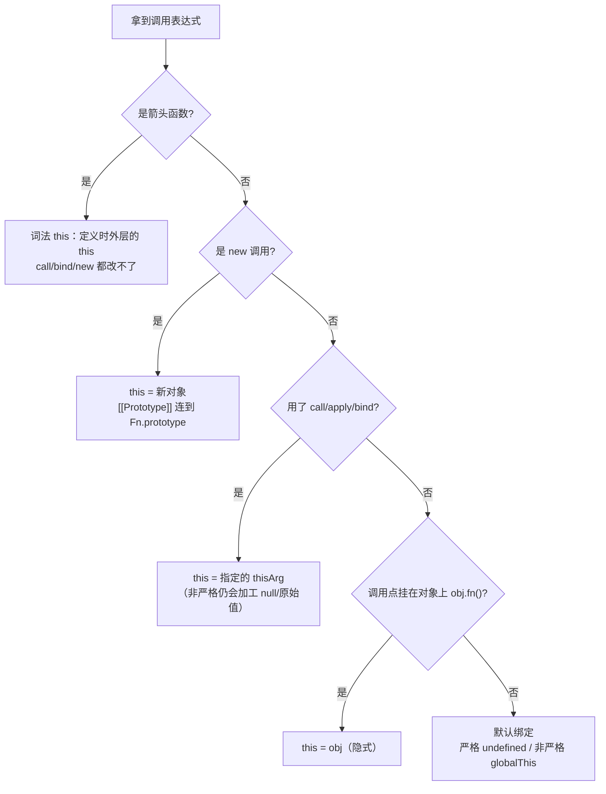
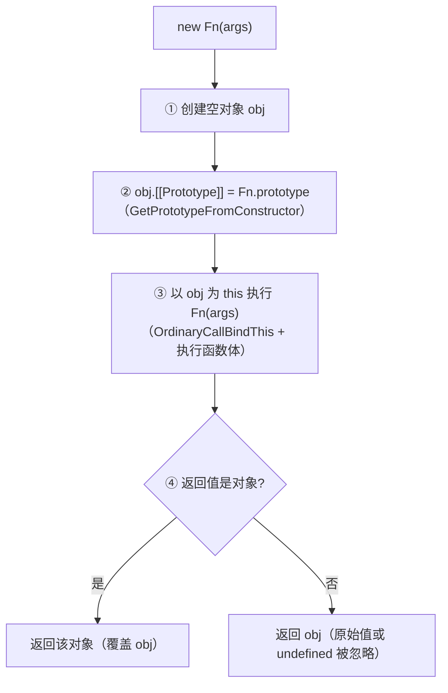

# this 绑定与函数调用

> 一句话概括：`this` 不是定义时写死的、也不是函数自身，而是**函数被调用那一刻**由调用形式决定的执行上下文绑定；
> 本文从 ECMA-262 的 `OrdinaryCallBindThis` / `[[Construct]]` / `GetThisBinding` 讲清四条绑定规则与优先级、call/apply/bind 与 new 的规范步骤和手写实现，以及箭头函数为什么是唯一的词法例外。

预计阅读时间：大约 70 分钟

所属主题：[JavaScript 基础常见面试题总结](summary.md)

本文以 **ECMAScript ES2025（ECMA-262 第 16 版）** 为规范基线，浏览器行为以当前 Chrome/V8 为准，Node.js 以 22/24 LTS 为准。规范锚点用抽象操作/内置方法名标注（如 `OrdinaryCallBindThis`、`Function.prototype.bind`、`[[Construct]]`、`GetThisBinding`），章节号取自 ES2025 正式版。文中可运行示例均在 **Node v20.11.1** 实测通过（this 绑定语义自 ES5 起稳定，20/22/24 行为一致）；凡浏览器与 Node 结果不同处单独标注。总结文档给结论，本文给机制与证据：每个机制按「结论 → 机制 → 边界/代价 → 实践/追问」展开。

---

## 0. 阅读路线

| 读者 | 建议阅读 | 关注点 |
| --- | --- | --- |
| 初级（1 年内） | 1.1、2.1~2.5、5.1、7.1~7.3 | this 是什么、四条绑定规则怎么写、箭头函数长什么样、能做对基础输出题 |
| 中级（1~3 年） | 1.2~1.4、2.6~2.7、3.1~3.2、4.1~4.3、6 | 规范机制、优先级判定、call/apply/bind 与 new 的规范步骤、严格模式差异 |
| 高级（3 年+） | 3.3~3.5、4.4~4.5、5.2、7.4~7.7、8 | 手写 call/apply/bind/myNew 及其边界、箭头函数规范依据、经典难题、DOM/getter/autobind 排查 |
| 选型/资深 | 5.3、8.3~8.4、9 | 箭头 vs 普通函数的取舍、autobind 的内存账、bind 缓存时机、Reflect 与手写的权衡 |

目录：

1. this 的本质：调用时确定的执行上下文绑定
2. 绑定规则与优先级
3. call / apply / bind 三件套
4. new 的完整过程
5. 箭头函数 vs 普通函数
6. 严格模式差异
7. 输出题方法论与经典题精讲
8. 边界与实践
9. 高频追问集
10. 参考资料

---

## 1. this 的本质：调用时确定的执行上下文绑定

### 1.1 结论与三个「不是」

**结论**：`this` 是函数**执行时**其执行上下文（Execution Context）里的一个绑定，值由**调用形式**（call site）决定，而不是由函数写在哪里决定。同一个函数，用不同方式调用，`this` 就不同。

先排除三个最常见的误解：

| 误解 | 真相 |
| --- | --- |
| this 指向函数自身 | 不是。函数内部要引用自身用函数名（或 `arguments.callee`，严格模式已禁），`this` 与函数对象无关 |
| this 指向函数的作用域 | 不是。作用域链决定**变量怎么找**，this 是另一套机制；「this 指向外层作用域」是错误说法（见 [作用域、闭包与执行上下文](scope-closures-and-execution-context.md)） |
| this 在定义时就确定 | 普通函数不是。**箭头函数是唯一例外**——它的 this 在定义时由外层词法环境确定（见 1.3） |

```js
// 环境：browser / Node 均可（非严格模式）
function show() { return this; }
const obj = { show };

show();        // 独立调用 → globalThis（browser 是 window，Node 是 global）
obj.show();    // 隐式调用 → obj
show.call(42); // 显式调用 → 42 的包装对象 Number（非严格会 ToObject）
```

同一个 `show`，三种调用形式得到三个不同的 this——这就是「调用时确定」的字面含义。

### 1.2 机制：this 是怎么被解析出来的（规范锚点）

引擎求值 `this` 关键字时走的是 `ResolveThisBinding`（ES2025 §9.4.4）：

```text
ResolveThisBinding():
  1. envRec = GetThisEnvironment()
  2. return envRec.GetThisBinding()
```

- **`GetThisEnvironment`（§9.4.3）**：从当前执行上下文的 LexicalEnvironment 出发，**沿 `[[OuterEnv]]` 向外逐层找**，直到某个环境记录的 `HasThisBinding()` 为 true 就返回它。
- **`HasThisBinding`（Function Environment Record，§9.1.1.3.2）**：`[[ThisBindingStatus]]` 为 `lexical` 时返回 **false**，否则返回 true。
- **`GetThisBinding`（§9.1.1.3.4）**：若 `[[ThisBindingStatus]]` 是 `uninitialized` 抛 `ReferenceError`（派生类构造器里 `super()` 之前访问 this 就是这条路）；否则返回 `[[ThisValue]]`。

而 `[[ThisValue]]` 是函数被调用时由 **`OrdinaryCallBindThis`（§10.2.1.2）** 写进去的，它的逻辑就是全部绑定规则的规范源头：

```text
OrdinaryCallBindThis(F, calleeContext, thisArgument):
  1. thisMode = F.[[ThisMode]]
  2. 若 thisMode 是 lexical → 直接返回（不绑定 this，留给外层）   ← 箭头函数
  3. 若 thisMode 是 strict  → thisValue = thisArgument            ← 严格模式：原样，不加工
  4. 否则（非严格）:
       若 thisArgument 是 undefined 或 null → thisValue = 当前 realm 的 globalThis
       否则                              → thisValue = ToObject(thisArgument)  ← 原始值包装
  5. BindThisValue(localEnv, thisValue)
```

**一句话串起来**：调用形式决定传给 `[[Call]]` 的 `thisArgument` → `OrdinaryCallBindThis` 按 `[[ThisMode]]` 加工成 `thisValue` 写进函数环境记录 → 函数体里的 `this` 经 `ResolveThisBinding` 读到它。箭头函数因为 `[[ThisMode]] = lexical`，第 2 步直接返回、根本不写自己的 this，于是 `GetThisEnvironment` 一路向外找到最近一个有 this 绑定的外层函数——这就是「词法 this」的规范实现。

**追问：为什么箭头函数嵌套多层还能拿到最外层的 this？** 因为每一层箭头的函数环境记录 `HasThisBinding()` 都返回 false，`GetThisEnvironment` 的循环会跳过所有箭头层，停在第一个普通函数（或全局/模块环境）上。

### 1.3 箭头函数：唯一的词法例外

**结论**：箭头函数没有自己的 this 绑定，它的 this **等于定义时所在外层（普通函数/全局/模块）的 this**，且此后任何调用方式都改不了。

规范依据是 `InstantiateArrowFunctionExpression`（ES2025 §15.3.4）：创建箭头函数时调用 `OrdinaryFunctionCreate(%Function.prototype%, …, lexical-this, env, …)`，把 `[[ThisMode]]` 设为 `lexical`，并捕获当时的词法环境 `env`。该节 Note 明确：

> An ArrowFunction does not define local bindings for **arguments, super, this, or new.target**. Any reference to … must resolve to a binding in a lexically enclosing environment.

```js
// 环境：经典脚本 / CJS（ESM 下 obj.arrow() 会抛错，见下）
const obj = {
  name: 'obj',
  regular() { return (() => this.name)(); }, // 箭头定义在 regular 内，this 继承 regular 的 this
  arrow: () => this.name,                    // 对象字面量不构成作用域，外层是脚本/模块顶层 this
};
obj.regular(); // 'obj'  ← 箭头继承了 regular 被 obj 调用时的 this
obj.arrow();   // this = 顶层 this：经典脚本 globalThis（browser 读 window.name 默认 ''）/ CJS module.exports（.name 为 undefined）
```

**环境差异**：对象字面量不构成作用域，箭头的 this 等于**脚本/模块顶层的 this**——经典脚本是 `globalThis`（browser 即 window，`this.name` 读 `window.name` 默认 `''`）；CJS 模块顶层 `this === module.exports`（`this.name` 为 undefined）；**ESM 顶层 this 是 undefined，`obj.arrow()` 读 `this.name` 直接抛 TypeError**。这与本文「先确认环境」的方法论一致（见 7.1）。

**边界**：`call/apply/bind` 对箭头函数的 thisArg **一律忽略**（`Function.prototype.call` Note 2、`bind` Note 2 都点名了 arrow）；`new` 箭头函数直接抛 `TypeError`（没有 `[[Construct]]`，见 5.2）。想「改」箭头函数的 this，唯一办法是改它**外层普通函数**的 this（见 9 Q3）。

### 1.4 this 与作用域、与函数自身的关系

- **this ≠ 作用域**：作用域链是变量查找的静态链路，this 是调用时动态写入的绑定。两者唯一的交汇点是箭头函数——它把「this 的查找」也变成了沿词法环境向外找，于是看起来「像作用域」，但本质仍是 `GetThisEnvironment` 在找 this 绑定，而非找变量。
- **this ≠ 函数自身**：`function f(){ console.log(this === f); }`，`f()` 在非严格下 this 是 globalThis，不等于 f。要拿函数自身用名字 `f`。
- **执行上下文视角**：每次函数调用创建一个新的执行上下文，this 绑定存在该上下文的（函数）环境记录里。递归调用同一个函数，每层有各自的 this。详见 [作用域、闭包与执行上下文](scope-closures-and-execution-context.md)。

---

## 2. 绑定规则与优先级

### 2.1 默认绑定（独立调用）

**结论**：函数被**独立调用**（前面没有任何对象、也没有 call/apply/bind/new）时走默认绑定：**非严格 → `globalThis`；严格 → `undefined`**。

```js
// 环境：Node（browser 把 globalThis 换成 window）
function sloppy() { return this === globalThis; }
function strict() { 'use strict'; return this; }
sloppy(); // true
strict(); // undefined
```

**机制**：独立调用时 `[[Call]]` 收到的 `thisArgument` 是 `undefined`，`OrdinaryCallBindThis` 第 4 步把 undefined/null 替换成 `globalThis`（非严格），严格模式则第 3 步原样保留 undefined。

**边界（browser vs Node）**：非严格默认绑定下 `this` 是全局对象，于是 `this.name` 在 browser 读到的是 `window.name`（默认空字符串 `''`），在 Node 读到 `globalThis.name`（`undefined`）。**同一道「隐式丢失」输出题，browser 输出 `''`、Node 输出 `undefined`**，原因就在这里（见 7.2）。

### 2.2 隐式绑定与隐式丢失

**结论**：`obj.fn()` 这种「函数作为对象方法被调用」的形式，this 绑定到**调用点的那个对象**（`obj`）。但隐式绑定非常脆弱——只要调用形式变了，绑定就丢。

```js
// 环境：Node
const obj = { name: 'obj', fn() { return this.name; } };
obj.fn(); // 'obj'  ← 隐式绑定到 obj
```

**隐式丢失的四种典型形式**（本质都是「调用点不再挂在 obj 上」）：

| 形式 | 代码 | 实际调用形式 | this 落点 |
| --- | --- | --- | --- |
| 赋值后调用 | `const f = obj.fn; f();` | 独立调用 | 默认绑定 → `globalThis`（`this.name`：Node `undefined` / browser `''`） |
| 传参/回调 | `run(obj.fn)`，内部 `cb()` | 独立调用 | 默认绑定 |
| 解构取方法 | `const { fn } = obj; fn();` | 独立调用 | 默认绑定 |
| 方法当返回值 | `getFn()()` | 独立调用 | 默认绑定 |

```js
// 环境：Node（实测）
const obj = { name: 'obj', fn() { return this.name; } };
const bare = obj.fn;        bare();              // undefined
const { fn } = obj;         fn();                // undefined
function run(cb) { return cb(); } run(obj.fn);   // undefined
```

**机制**：`obj.fn` 只是取出函数对象的引用，赋值/传参/解构都**不携带「它是 obj 的方法」这条信息**。真正调用时是 `bare()` 而非 `obj.bare()`，调用点没有对象，于是退回默认绑定。规范上这叫引用（Reference）的 base 丢失：`obj.fn` 求值出的 Reference base 是 obj，但赋值给变量后 Reference 被「取值」成纯函数对象，base 信息没了。

**追问：怎么保住隐式绑定？** 要么调用时始终写成 `obj.fn()`；要么用 `bind` 硬绑定（2.3）；要么用箭头函数包裹（`run(() => obj.fn())`，箭头内仍以 `obj.fn()` 形式调用）。class 场景见 7.7 的 autobind。

### 2.3 显式绑定：call / apply / bind

**结论**：`fn.call(thisArg, …)` / `fn.apply(thisArg, […])` / `fn.bind(thisArg, …)` 把 this **显式指定**为 thisArg，优先级高于隐式与默认。三者细节与手写见第 3 章。

```js
// 环境：browser / Node 均可
function greet(g, p) { return `${g},${this.name}${p}`; }
const ctx = { name: 'ctx' };
greet.call(ctx, 'hi', '!');      // 'hi,ctx!'
greet.apply(ctx, ['hi', '!']);   // 'hi,ctx!'
greet.bind(ctx, 'hi')('!');      // 'hi,ctx!'
```

**边界**：显式绑定传 `null/undefined` 时，**非严格函数仍会退回 globalThis**（因为 `OrdinaryCallBindThis` 的加工发生在函数入口，call 只是原样透传 thisArg）；严格函数则保留 null/undefined。原始值在非严格下被 `ToObject` 包装。详见 3.2 与第 6 章。

### 2.4 new 绑定

**结论**：`new Fn()` 会创建一个新对象，把 this 绑定到它，并让新对象的 `[[Prototype]]` 指向 `Fn.prototype`；优先级最高。完整四步与规范见第 4 章。

```js
// 环境：browser / Node 均可
function Person(name) { this.name = name; }
const p = new Person('n');
p.name;                 // 'n'
p instanceof Person;    // true
```

### 2.5 箭头函数「绑定」

箭头函数不参与上面四条规则——它没有自己的 this，`call/apply/bind` 的 thisArg 被忽略，`new` 直接报错。它的 this 永远是定义时外层的 this（1.3）。在优先级讨论里，箭头函数是**凌驾于规则之外的特例**，而不是「优先级最高的一条」。

### 2.6 优先级总表与判定流程

**结论**：对**普通函数**，优先级 **new > 显式（call/apply/bind）> 隐式 > 默认**。箭头函数另算（词法）。

| 优先级 | 规则 | 调用形式 | this |
| --- | --- | --- | --- |
| 1（最高） | new 绑定 | `new Fn()` | 新创建的对象 |
| 2 | 显式绑定 | `fn.call/apply/bind(obj)` | obj（bind 为硬绑定） |
| 3 | 隐式绑定 | `obj.fn()` | obj |
| 4（最低） | 默认绑定 | `fn()` | 严格 undefined / 非严格 globalThis |
| 特例 | 箭头函数 | 任意 | 定义时外层 this，忽略上述全部 |

判定流程（拿到一个调用表达式，从上往下问）：



**追问：new 和 bind 同时出现谁赢？** new 赢——`new (fn.bind(obj))()` 的 this 是新对象而非 obj，但 bind 预置的参数仍保留。机制见 2.7。

### 2.7 bind 硬绑定后 new 的行为（高频深挖）

**结论**：`bind` 产生的是**硬绑定**——之后再用 call/apply/bind 都改不了 this（第一次 bind 生效）。但 **`new` 会忽略绑定的 this，却保留预置参数**。

```js
// 环境：Node（实测）
function Person(name, age) { this.name = name; this.age = age; }
const BoundPerson = Person.bind({ name: 'IGNORED' }, 'preset');
const p = new BoundPerson(30);
p.name;                  // 'preset'  ← 预置参数保留
p.age;                   // 30
p instanceof Person;     // true      ← this 是新对象，不是 {name:'IGNORED'}
```

**机制**（bound function 的 `[[Construct]]`，ES2025 §10.4.1.2）：

```text
bound.[[Construct]](args, newTarget):
  1. target = bound.[[BoundTargetFunction]]
  2. args = bound.[[BoundArguments]] ++ args        ← 预置参数拼在前面
  3. 若 SameValue(bound, newTarget) → newTarget = target
  4. return Construct(target, args, newTarget)       ← 转交 target 的 [[Construct]]
```

关键在第 4 步：它调用的是 **target 的 `[[Construct]]`**，而 target 的 `[[Construct]]`（§10.2.2）会自己 `OrdinaryCreateFromConstructor` 造一个新对象并绑定为 this——**根本不看 `[[BoundThis]]`**。所以绑定的 this 被丢弃，预置参数（第 2 步）被保留。对比 bound 的 `[[Call]]`（§10.4.1.1）则是 `Call(target, boundThis, boundArgs ++ args)`，**用** boundThis——这就是「普通调用硬绑定生效、new 调用硬绑定失效」的规范分水岭。

**追问：bind 两次哪个生效？** 第一次。`fn.bind(a).bind(b)` 外层 bind 的 target 是内层 bound 函数，内层 `[[Call]]` 永远用自己的 `[[BoundThis]] = a`，外层传入的 b 被忽略（见 7.5）。

---

## 3. call / apply / bind 三件套

### 3.1 对比表

| 维度 | `call` | `apply` | `bind` |
| --- | --- | --- | --- |
| 参数形式 | `(thisArg, arg1, arg2, …)` 逐个 | `(thisArg, [arg1, arg2, …])` 数组/类数组 | `(thisArg, arg1, …)` 逐个（可预置） |
| 是否立即执行 | **是** | **是** | **否**，返回新函数 |
| 返回值 | 原函数的返回值 | 原函数的返回值 | 一个**绑定后的新函数**（exotic object） |
| this 是否可再改 | 每次调用现传 | 每次调用现传 | **硬绑定**，再 call/bind 改不了（new 除外） |
| 预置参数（柯里化） | 不支持 | 不支持 | 支持，预置参数拼在实参前 |
| 规范位置 | §20.2.3.3 | §20.2.3.1 | §20.2.3.2 |
| 典型用途 | 借用方法、显式指定 this | 参数已是数组（如 `Math.max.apply(null, arr)`） | 回调固定 this、偏函数、autobind |

### 3.2 规范步骤与两个 Note

**call（§20.2.3.3）/ apply（§20.2.3.1）** 的核心都是 `Call(func, thisArg, args)`，区别只在参数怎么收集（apply 多一步 `CreateListFromArrayLike(argArray)`，argArray 为 null/undefined 时不传参）。两条官方 Note 是高频考点：

- **Note 1**：thisArg **原样透传**，不做加工。这是 ES5 相对 ES3 的变化（ES3 会在 call/apply 里就把 null→全局、原始值→包装）。**但非严格函数仍会在入口（`OrdinaryCallBindThis`）做这些加工**——所以「call 传 null 非严格变 globalThis」的根因在函数入口，不在 call 本身。
- **Note 2**：若 func 是**箭头函数或 bound 函数**，thisArg 被其 `[[Call]]` 忽略。

**bind（§20.2.3.2）**：`BoundFunctionCreate(Target, thisArg, args)` 创建 exotic object，存 `[[BoundTargetFunction]]` / `[[BoundThis]]` / `[[BoundArguments]]`；再设置：

- `length = max(targetLen − 预置参数个数, 0)`（target 无 length 则为 0）；
- `name = "bound " + targetName`；
- **没有 `prototype` 属性**（Note 1）；
- 若 Target 是箭头/bound，thisArg 不会被后续调用使用（Note 2）。

```js
// 环境：Node（实测）
function three(a, b, c) {}
const b = three.bind(null, 1);
b.length;                 // 2  （3 − 1）
b.name;                   // 'bound three'
'prototype' in b;         // false
```

### 3.3 手写 call（Symbol 键 + null/undefined + 原始值包装）

**思路**：把函数临时挂到目标对象上，用「隐式绑定」让 this 自然指向该对象，调用完删除。用 `Symbol` 作键避免与已有属性冲突。

```js
// 环境：browser / Node 均可（实测通过）
Function.prototype.myCall = function (thisArg, ...args) {
  if (typeof this !== 'function') throw new TypeError('myCall: not callable');
  // null/undefined → globalThis；原始值 → 包装对象（模拟非严格 OrdinaryCallBindThis）
  const ctx = (thisArg === null || thisArg === undefined) ? globalThis : Object(thisArg);
  const key = Symbol('fn');   // 唯一键，避免属性污染
  ctx[key] = this;            // this 就是要调用的原函数
  const result = ctx[key](...args); // 隐式绑定：this → ctx
  delete ctx[key];            // 清理，不留痕迹
  return result;
};

// 验证
function greet(g, p) { return `${g},${this.name}${p}`; }
greet.myCall({ name: 'ctx' }, 'hi', '!'); // 'hi,ctx!'
function retThis() { return this; }
retThis.myCall(null) === globalThis;      // true
retThis.myCall(42) instanceof Number;     // true（原始值被包装）
```

**边界/代价（必须诚实说明）**：

- 这个实现靠「临时方法 + 隐式绑定」模拟，**天然等价于非严格语义**。它**无法精确复现严格模式的「原样透传」**——严格函数 `fn.call(null)` 真实 this 是 null，而 myCall 会给 globalThis；严格 `fn.call(42)` 真实 this 是 42，myCall 给 Number 包装对象。这是 Symbol 手写法的公认局限，面试要主动点出。
- `Object(thisArg)` 对已是对象的值返回自身，不额外包装；对原始值才包装。
- 用 Symbol 而非字符串键，是为了不覆盖目标对象已有同名属性、也不被 `Object.keys` 枚举到（实测调用后目标对象自有 Symbol 键数为 0）。
- 要**完全忠实**的语义，用 `Reflect.apply(fn, thisArg, args)`——它直接走规范 `[[Call]]`，严格/非严格都由函数自身 `[[ThisMode]]` 决定（见 8.4 选型）。

### 3.4 手写 apply

与 myCall 同理，只是参数来自数组；argArray 为 null/undefined 时不传参（对齐规范 apply 的分支）。

```js
// 环境：browser / Node 均可（实测通过）
Function.prototype.myApply = function (thisArg, argsArray) {
  if (typeof this !== 'function') throw new TypeError('myApply: not callable');
  const ctx = (thisArg === null || thisArg === undefined) ? globalThis : Object(thisArg);
  const key = Symbol('fn');
  ctx[key] = this;
  const result = (argsArray === null || argsArray === undefined)
    ? ctx[key]()
    : ctx[key](...argsArray);
  delete ctx[key];
  return result;
};

greet.myApply({ name: 'ctx' }, ['hi', '!']); // 'hi,ctx!'
```

边界同 3.3（非严格近似、严格透传无法复现）。

### 3.5 手写 bind（预置参数 + 支持 new：原型连接与 this 判断）

**思路**：返回一个新函数 `bound`；普通调用时用 `thisArg`，`new` 调用时用新实例（忽略 thisArg）；预置参数拼在实参前；把 `bound.prototype` 接到 `target.prototype`，让 `new bound()` 的实例能继承 target 的原型。

```js
// 环境：browser / Node 均可（实测通过）
Function.prototype.myBind = function (thisArg, ...preset) {
  const target = this;
  if (typeof target !== 'function') throw new TypeError('myBind: not callable');
  function bound(...args) {
    const all = [...preset, ...args];
    // new 调用时 this 是新实例（this instanceof bound 为 true）→ 用它，忽略 thisArg
    // 普通调用 → 用 thisArg（硬绑定）
    return target.apply(this instanceof bound ? this : thisArg, all);
  }
  // 原型连接：借助空构造函数做中介，避免直接改 target.prototype
  function Noop() {}
  Noop.prototype = target.prototype;
  bound.prototype = new Noop();
  return bound;
};

// 验证：普通调用 + 预置参数
greet.myBind({ name: 'ctx' }, 'hi')('!'); // 'hi,ctx!'
// 验证：new 忽略 thisArg、保留预置参数、原型继承
function Person(name, age) { this.name = name; this.age = age; }
const BP = Person.myBind({ name: 'IGNORED' }, 'preset');
const p = new BP(30);
p.name;               // 'preset'
p.age;                // 30
p instanceof Person;  // true
```

**机制要点**：

- `this instanceof bound`：`new bound()` 时，新对象的 `[[Prototype]]` 是 `bound.prototype`（中介 Noop 的实例，其原型是 `target.prototype`），所以 `this instanceof bound` 为 true，据此判定「这是 new 调用」，用新实例当 this。
- 预置参数 `preset` 始终拼在 `args` 前，对齐 bound `[[Call]]`/`[[Construct]]` 的 `boundArgs ++ argumentsList`。

**边界/代价**：

- **不支持 class 构造器**：`target.apply` 是普通调用，class 不能用 `.apply` 调用，会抛 TypeError。
- **`new.target` 失真**：apply 不设置 newTarget，target 内部 `new.target` 为 undefined（实测：原生 `new (NT.bind({}))()` 里 `new.target === NT`，手写版里为 undefined）。
- **原型回退未处理**：`target.prototype` 被改成原始值时，手写版经 Noop 中介得到的原型，与规范 `GetPrototypeFromConstructor`「回退到构造器所在 realm 的 `%Object.prototype%`」不一致。
- **`this instanceof bound` 是启发式判定**：靠原型链判断是否 new 调用，极端情况下普通调用传入的 thisArg 恰好 `instanceof bound` 会误判。
- **手写 bound 带 own `prototype` 属性**：原生 bound 是 exotic object，**没有** `prototype` 属性（实测 `'prototype' in fn.bind({}) === false`，手写版为 true）。
- 要忠实复现 new 语义，用 `Reflect.construct(target, all, newTarget)`（见 4.4、8.4）。手写版是面试近似，重点在「原型连接 + this 判断 + 预置参数」三件事。

**一个容易误判的点**：手写版**其实能处理「构造器返回对象则覆盖」**——bound 自身是普通函数，`new bound()` 时 bound 自己的 `[[Construct]]` 会对「bound 函数体的返回值」（即 target 经 apply 的返回值）执行覆盖。实测 `new (RetObj.myBind({}))()` 返回 `{b:2}`，与原生 `new (RetObj.bind({}))()` 一致（`RetObj` 见 4.3）。

---

## 4. new 的完整过程

### 4.1 四步与流程图

**结论**：`new Fn(args)` 做四件事——① 创建空对象；② 把它的 `[[Prototype]]` 连到 `Fn.prototype`；③ 以该对象为 this 执行构造器；④ 构造器返回对象则用该对象，否则返回新对象。



### 4.2 规范步骤（[[Construct]] / OrdinaryCreateFromConstructor）

ECMAScript 函数对象的 `[[Construct]]`（ES2025 §10.2.2，简化）：

```text
F.[[Construct]](args, newTarget):
  1. kind = F.[[ConstructorKind]]                       // base 或 derived
  2. 若 kind 是 base:
       thisArgument = OrdinaryCreateFromConstructor(newTarget, "%Object.prototype%")
  3. calleeContext = PrepareForOrdinaryCall(F, newTarget)
  4. 若 kind 是 base:
       OrdinaryCallBindThis(F, calleeContext, thisArgument)   // this = 新对象
       InitializeInstanceElements(thisArgument, F)            // class 字段初始化
  5. result = 执行函数体(F, args)
  6. 若 result.[[Value]] 是 Object → 返回它                 // 对象覆盖
  7. 若 kind 是 base → 返回 thisArgument                    // base 返回新对象；derived 继续第 8/9 步
  8. 若 result.[[Value]] 不是 undefined → 抛 TypeError      // derived 返回原始值
  9. 返回 constructorEnv.GetThisBinding()                   // derived 返回 super() 的 this
```

- **`OrdinaryCreateFromConstructor`（§10.1.13）** → **`GetPrototypeFromConstructor`（§10.1.14）**：`proto = Get(constructor, "prototype")`；若 proto 不是对象，回退到**构造器所在 realm** 的 `%Object.prototype%`。这就是「`Fn.prototype` 被改成原始值时，new 出来的对象原型回退到 Object.prototype」的规范依据。
- **base vs derived**：普通函数/基类是 base，自己造 this；派生类（`class B extends A`）是 derived，this 由 `super()`（即父类 `[[Construct]]`）创建，所以派生类构造器在 `super()` 前访问 this 抛 ReferenceError（`GetThisBinding` 的 uninitialized 分支）。

### 4.3 返回值覆盖规则

**结论**：构造器**显式返回一个对象**（含函数）→ new 的结果被它覆盖；返回**原始值或 undefined** → 忽略，仍返回新对象。

```js
// 环境：Node（实测）
function RetObj()  { this.a = 1; return { b: 2 }; }
function RetPrim() { this.a = 1; return 42; }
new RetObj();  // { b: 2 }   ← 对象覆盖，this.a 丢失
new RetPrim(); // { a: 1 }   ← 原始值被忽略
```

**边界**：派生类（derived）构造器若返回**非 undefined 的原始值**，按 §10.2.2 第 8 步抛 `TypeError`（base 函数则静默忽略）。这是 base/derived 的又一处差异。

### 4.4 手写 myNew

```js
// 环境：browser / Node 均可（实测通过）
function myNew(Ctor, ...args) {
  if (typeof Ctor !== 'function') throw new TypeError('myNew: not a constructor');
  // ① + ② 创建空对象并连接原型
  const obj = Object.create(Ctor.prototype);
  // ③ 以 obj 为 this 执行构造器
  const result = Ctor.apply(obj, args);
  // ④ 返回对象则覆盖，否则返回 obj
  return (result !== null && (typeof result === 'object' || typeof result === 'function'))
    ? result
    : obj;
}

// 验证
function Person(name, age) { this.name = name; this.age = age; }
myNew(Person, 'n', 5);          // { name: 'n', age: 5 }
function RetObj()  { this.a = 1; return { b: 2 }; }
function RetPrim() { this.a = 1; return 42; }
myNew(RetObj);                  // { b: 2 }
myNew(RetPrim);                 // { a: 1 }
```

**边界/代价**：

- `Ctor.apply` 是普通调用，**不设置 newTarget**，构造器内 `new.target` 为 undefined；也**不支持 class**（class 必须用 new 调用）。
- `Object.create(Ctor.prototype)` 在 `Ctor.prototype` 不是对象时会抛错，而真实 `GetPrototypeFromConstructor` 会回退到 Object.prototype——手写版未处理该回退。
- 忠实实现是 `Reflect.construct(Ctor, args, newTarget)`：它直接走 `[[Construct]]`，自动处理原型回退、返回对象覆盖、new.target、base/derived。手写版用于理解四步，生产/精确语义用 Reflect（8.4）。

### 4.5 new.target 与「禁止直接调用」模式

**结论**：`new.target` 在函数被 `new` 调用时指向**被 new 的那个构造器**（派生类里指向最初 new 的子类），普通调用时为 `undefined`。规范上由 `GetNewTarget`（§9.4.5）从 `GetThisEnvironment()` 的 `[[NewTarget]]` 字段读取。

```js
// 环境：Node（实测）
function NT() { return new.target; }
new NT() === NT; // true
NT();            // undefined
```

**实践：禁止直接调用 / 强制 new**：

```js
// 环境：browser / Node 均可
function MustNew(name) {
  if (!new.target) throw new TypeError('MustNew 必须用 new 调用');
  this.name = name;
}
// 兼容写法：直接调用时自动补 new（旧库常见）
function AutoNew(name) {
  if (!new.target) return new AutoNew(name);
  this.name = name;
}
```

**边界**：箭头函数没有自己的 new.target，引用它会解析到外层（§15.3.4 Note），所以**不能用箭头函数写构造器**，也不能在箭头里靠 new.target 判断调用方式。class 构造器天然禁止直接调用（不用 new 调 class 直接 TypeError），无需手写守卫。

---

## 5. 箭头函数 vs 普通函数

### 5.1 对比表

| 维度 | 普通函数 | 箭头函数 |
| --- | --- | --- |
| this | 调用时确定（四条规则） | **词法**：定义时外层 this，不可改 |
| `arguments` | 有自己的 arguments 对象 | **无**，解析到外层普通函数的 arguments |
| `prototype` 属性 | 有（可作构造器） | **无** |
| 能否 `new` | 能（有 `[[Construct]]`） | **不能**，抛 TypeError |
| 能否 `yield` / 当 Generator | 能（`function*`） | **不能**（箭头无 generator 形式） |
| `super` | 方法里有自己的 super 绑定 | 无，解析到外层 |
| `new.target` | 有自己的 | 无，解析到外层 |
| 能否当方法/原型方法 | 适合 | **不适合**（this 不指向调用对象） |
| call/apply/bind 改 this | 可 | thisArg 被忽略 |

### 5.2 规范依据：为什么箭头不能 new、没有 arguments

`InstantiateArrowFunctionExpression`（§15.3.4）用 `lexical-this` 创建函数，且 Note 明确箭头**不为 arguments/super/this/new.target 定义本地绑定**。由此推出：

- **不能 new**：`new` 要求目标有 `[[Construct]]`。箭头函数创建时不设置 `[[Construct]]`（它不是构造器），`new (()=>{})` 抛 TypeError。`BoundFunctionCreate`（§10.4.1.3）也只在 `IsConstructor(target)` 为真时才给 bound 函数装 `[[Construct]]`——所以 **bind 一个箭头函数仍然不能 new**。
- **没有 prototype**：箭头函数对象不带 `prototype` 属性（实测 `'prototype' in (()=>{}) === false`）。
- **arguments 向外找**：箭头内 `arguments` 经 `ResolveBinding` 沿词法环境找到外层普通函数的 arguments（实测 `function outer(){ const a=()=>arguments[0]; return a(); } outer('A') === 'A'`）。需要不定参数时用**剩余参数 `...args`**，它是箭头自己的本地绑定。
- **不能 yield**：generator 必须是 `function*`，箭头没有对应语法，体内写 yield 是语法错误。

### 5.3 适用与不适用场景（选型）

| 场景 | 推荐 | 理由 |
| --- | --- | --- |
| 回调里要保留外层 this（定时器、事件、Promise.then、数组方法） | **箭头** | 词法 this 天然 autobind，省去 `.bind(this)` |
| 对象字面量的方法 | **普通函数**（或简写方法） | 需要 this 指向调用对象；箭头会指向全局 |
| 原型方法 / class 原型方法 | **普通函数** | 同上，且要能被继承复用 |
| 需要 `arguments` / 不定参数 | 普通函数，或箭头 + `...args` | 箭头无 arguments |
| 构造器 / 需要 new | **普通函数 / class** | 箭头不能 new |
| 需要动态 this（借用方法、call 指定） | **普通函数** | 箭头 thisArg 被忽略 |
| generator / 需要 yield | **`function*`** | 箭头不支持 |

**权衡立场**：箭头函数用「放弃自己的 this/arguments/构造能力」换来「回调里不用手动 bind」的便利。**它是回调的默认选择，但不是方法的默认选择**。把对象方法写成箭头是高频错误（this 指向全局而非对象）。

---

## 6. 严格模式差异

### 6.1 默认绑定 undefined

**结论**：严格模式下独立调用 this 是 `undefined`，不再替换成 globalThis（`OrdinaryCallBindThis` 第 3 步原样保留）。

```js
// 环境：Node（实测）
function strict() { 'use strict'; return this; }
strict(); // undefined
```

### 6.2 call/apply 传 null 不包装、原始值不包装

**结论**：严格模式下 `fn.call(null)` 的 this 就是 `null`，`fn.call(42)` 的 this 就是 `42`（原始值），**都不加工**。非严格才会 null→globalThis、原始值→包装对象。

```js
// 环境：Node（实测）
function sloppy() { return this; }
function strict() { 'use strict'; return this; }
sloppy.call(null) === globalThis;   // true
strict.call(null);                  // null
typeof sloppy.call(42);             // 'object'（Number 包装）
typeof strict.call(42);             // 'number'（原样）
```

**机制**：差异全部集中在 `OrdinaryCallBindThis` 的 strict 分支（原样）vs 非严格分支（加工）。call/apply 本身只透传（3.2 Note 1），所以「严格与否」是**被调用函数自身的 `[[ThisMode]]`** 决定的，不是 call 决定的。

### 6.3 class 永远严格

class 体（含方法、字段初始化）默认严格模式。所以 class 方法被解构/赋值后独立调用，this 是 undefined，访问 `this.x` 直接抛 TypeError（而非非严格那样静默读到全局）——这是 7.7 class 丢失题比非严格函数「更危险」的原因。

### 6.4 交叉链接

严格模式的完整规则（语法限制、this、arguments、eval、delete 等）见 [ES6+ 与现代 JavaScript](es6-plus-and-modern-js.md) 的严格模式章节；本文只聚焦与 this 绑定相关的差异。模块（ESM）顶层也默认严格，且模块顶层 this 是 undefined（见 [CommonJS 与 ESM](modules-commonjs-and-esm.md)）。

---

## 7. 输出题方法论与经典题精讲

### 7.1 方法论：看调用形式，不看定义位置

**三步法**：

1. **找调用点**：this 由「函数最终被怎么调用」决定，与它定义在哪、被赋值给谁无关。盯住 `()` 前面的形式。
2. **套优先级**：箭头？→ 词法。否则 new > 显式 > 隐式 > 默认（2.6 流程图）。
3. **看严格模式与环境**：默认绑定/原始值加工在严格与非严格下不同；browser 与 Node 的全局对象不同（`window.name` vs `globalThis.name`）。

### 7.2 题 1：对象方法赋值后调用

```js
// 环境：browser / Node 均可演示「绑定丢失」
const obj = {
  name: 'obj',
  fn() { return this.name; },
};
const f = obj.fn;
obj.fn(); // 'obj'  ← 隐式绑定到 obj
f();      // 默认绑定 → this 是全局对象，读的是「全局的 name」而非 obj.name
```

**精讲**：`f = obj.fn` 只取函数引用，`f()` 是独立调用 → 默认绑定，this 是全局对象，于是 `this.name` 读的是**全局的 name**：browser 脚本里 `window.name` 默认 `''`（若脚本用 `var name='global'` 声明过则为 `'global'`，因为经典脚本的顶层 var 会挂到 window）；Node 里 `globalThis.name` 默认 `undefined`（CommonJS 模块顶层的 `var` 是模块作用域，不挂 globalThis；REPL/stdin 全局作用域则会挂）。**绑定丢失的机制（隐式→默认）在所有环境一致，但输出值随环境变化**——面试务必先确认环境，这是区分背题与真懂的分水岭。

### 7.3 题 2：setTimeout 回调

```js
// 环境：browser 与 Node 不同
const obj = {
  name: 'obj',
  delay() {
    setTimeout(function () { console.log(this.name); }, 0); // 普通函数回调
  },
  delayArrow() {
    setTimeout(() => console.log(this.name), 0);            // 箭头回调
  },
};
obj.delay();      // browser: ''（this=window，window.name 默认 ''）；Node: undefined（this=Timeout 对象，无 name）
obj.delayArrow(); // 'obj'（箭头继承 delay 的 this=obj）
```

**精讲**：`setTimeout` 把回调当**独立函数**调用，this 由宿主决定——**browser 是 `window`（globalThis），Node 是 `Timeout` 对象**（Node 实测回调 this 的构造器名为 `Timeout`）。普通函数回调因此丢失 obj；箭头回调词法继承 `delay` 被 obj 调用时的 this，稳定输出 `'obj'`。**这就是「回调优先用箭头」的典型场景**。要保普通函数的 this，用 `setTimeout(fn.bind(obj), 0)` 或 `setTimeout(() => fn.call(obj), 0)`。

### 7.4 题 3：链式调用返回 this

```js
// 环境：browser / Node 均可
const counter = {
  n: 0,
  inc() { this.n++; return this; }, // 返回 this 支持链式
  dec() { this.n--; return this; },
};
counter.inc().inc().dec(); // this 始终是 counter，n === 1
```

**精讲**：每个方法返回 `this`（隐式绑定到 counter），下一次 `.inc()` 仍挂在 counter 上，隐式绑定持续生效。**陷阱**：若把方法写成箭头（`inc: () => { this.n++; return this; }`），this 指向全局，链式立刻崩。链式 API 的方法必须是普通函数。

### 7.5 题 4：bind 两次

```js
// 环境：Node（实测）
function f() { return this.x; }
const b = f.bind({ x: 1 }).bind({ x: 2 });
b(); // 1  ← 第一次 bind 生效
```

**精讲**：外层 bind 的 target 是内层 bound 函数。调用 `b()` 走外层 `[[Call]]` → `Call(内层bound, {x:2}, [])`，但内层 bound 的 `[[Call]]`（§10.4.1.1）永远用自己的 `[[BoundThis]] = {x:1}`，外层传的 `{x:2}` 被忽略。**硬绑定一旦形成不可再改**（new 除外）。

### 7.6 题 5：箭头嵌套

```js
// 环境：Node（实测）
const obj = {
  name: 'obj',
  outer() {
    const inner = () => {
      const deeper = () => this.name;
      return deeper();
    };
    return inner();
  },
};
obj.outer(); // 'obj'
```

**精讲**：`inner`、`deeper` 都是箭头，`HasThisBinding()` 均为 false，`GetThisEnvironment` 跳过两层箭头，停在 `outer` 的函数环境（this=obj）。**箭头嵌套多少层都不改变 this**，它始终等于最外层普通函数的 this。

### 7.7 题 6：class 方法解构丢失与 autobind

```js
// 环境：Node（实测）
class C {
  constructor() { this.v = 'C'; }
  m() { return this.v; }
}
const c = new C();
const m = c.m;
m(); // TypeError：this 是 undefined（class 永远严格），读 this.v 报错
```

**精讲**：class 方法在原型上，`c.m` 取引用后 `m()` 独立调用，this=undefined（严格），访问属性抛错。三种 autobind 方案：

| 方案 | 写法 | 代价 |
| --- | --- | --- |
| 构造器里 bind | `constructor(){ this.m = this.m.bind(this); }` | 每实例一个 bound 函数（内存），但只 bind 一次 |
| class 字段箭头 | `m = () => this.v;` | **每实例一份箭头函数**（见 8.3），且方法不在原型上、不可被继承覆写复用 |
| 调用处包裹 | `run(() => c.m())` | 零额外存储，但每个调用点都要写 |

```js
// class 字段箭头 autobind（实测：两实例的函数字段不是同一个）
class K { v = 1; f = () => this.v; }
const k1 = new K(), k2 = new K();
k1.f !== k2.f; // true ← 每实例独立一份
const f = k1.f; f(); // 1，解构后仍正确（词法 this 绑定到 k1）
```

---

## 8. 边界与实践

### 8.1 DOM 事件回调中的 this

**结论**：`element.addEventListener('click', handler)` 中，**普通函数 handler 的 this 指向 `element`**（currentTarget）；箭头 handler 的 this 仍是定义时外层。

```js
// 环境：browser
btn.addEventListener('click', function () { console.log(this === btn); }); // true
btn.addEventListener('click', () => console.log(this === btn));            // false（this 是外层）
```

**边界**：这是 DOM 规范的约定（宿主以 element 为 thisArg 调用），不是 JS 绑定规则的改变。需要同时拿 element 和外层 this 时，用 `event.currentTarget` 取元素、箭头取外层 this，二者兼得。内联 `onclick="..."` 属性里的 this 也指向元素，但混用作用域易错，不推荐。

### 8.2 getter / setter 的 this

**结论**：getter/setter 也是函数，this 同样按调用形式绑定——`obj.x` 触发 getter 时 this 是 obj；用 `call` 显式指定则按显式绑定。

```js
// 环境：Node（实测）
const g = { _x: 9, get x() { return this._x; } };
g.x; // 9（隐式：this=g）
const desc = Object.getOwnPropertyDescriptor(g, 'x');
desc.get.call({ _x: 7 }); // 7（显式：this={_x:7}）
```

**边界**：getter 里写箭头会丢失 this（指向外层），导致读不到实例字段——**getter/setter 必须是普通函数**。解构 `const { x } = g` 会立即触发 getter（this=g），但取出的是值不是函数，不涉及后续绑定。

### 8.3 class 字段箭头 autobind 的内存代价

**结论**：`m = () => …` 写在 class 字段里，**每个实例都会新建一份箭头函数**（字段初始化器 `InitializeInstanceElements` 在每次构造时执行），而原型方法全类共享一份。

| 方案 | 函数份数 | 是否在原型上 | 可继承覆写 | 内存 |
| --- | --- | --- | --- | --- |
| 原型方法 `m(){}` | 全类 1 份 | 是 | 是 | 最省 |
| 构造器 bind `this.m=this.m.bind(this)` | 每实例 1 份 bound | 否（实例自有） | 覆写原型不影响已 bind 的 | 每实例 +1 函数 |
| class 字段箭头 `m=()=>{}` | 每实例 1 份箭头 | 否 | 否（不在原型链） | 每实例 +1 函数 |

**代价量化**：创建 N 个实例，原型方法只有 1 个函数对象；字段箭头/bind 则有 N 个。实例量大（如列表渲染上万个组件实例）时，这是真实的内存与 GC 压力（见 [内存管理与 GC](memory-management-and-gc.md)）。此外字段箭头不在原型上，`super.m()`、子类覆写、`Object.getPrototypeOf` 取方法都拿不到它。

**实践立场**：默认用**原型方法**；只有「该方法会被解构/当回调传出去」时才 autobind，且优先**构造器 bind**（仍保留原型方法可继承），或干脆在调用处用箭头包裹。不要无脑把所有方法写成字段箭头。

### 8.4 什么时候用 bind 缓存 / Reflect 选型

**bind 缓存时机**：

- **要缓存**：同一个 bound 函数被反复传给回调（如渲染循环里 `onClick={this.handle.bind(this)}` 每次 render 新建函数，破坏子组件 memo/shouldComponentUpdate）——应在构造器 bind 一次或用字段箭头，保持引用稳定。
- **不必缓存**：一次性调用 `fn.call(obj, …)` 直接写即可，bind 反而多造一个函数对象。
- **bind 的开销**：每次 bind 创建一个 exotic object（存三个内部槽 + 设置 name/length），热路径里频繁 bind 有分配成本。

**手写 vs Reflect（资深选型）**：

| 需求 | 手写（Symbol/apply） | Reflect |
| --- | --- | --- |
| 理解机制 / 面试 | ✅ 展示原理 | — |
| 忠实严格模式透传 | ❌ 只能近似非严格 | ✅ `Reflect.apply(fn, thisArg, args)` |
| 忠实 new（返回覆盖/new.target/原型回退/class） | ❌ 多处近似 | ✅ `Reflect.construct(Ctor, args, newTarget)` |
| 生产代码 | 不推荐 | ✅ 推荐 |

一句话：**手写用于懂原理，生产用 Reflect**。`Reflect.apply/construct` 与 `Function.prototype.call/apply`、`new` 走同一套规范内部方法，语义完全一致且无近似边界。

---

## 9. 高频追问集

**Q1：箭头函数为什么不能 new？**
期望答案：`new` 要求目标有 `[[Construct]]` 内部方法。箭头函数经 `InstantiateArrowFunctionExpression`（§15.3.4）以 `lexical-this` 创建，**不设置 `[[Construct]]`**，也没有 `prototype` 属性，所以 `new` 抛 TypeError。推论：bind 一个箭头仍不能 new——`BoundFunctionCreate`（§10.4.1.3）只在 `IsConstructor(target)` 为真时才装 `[[Construct]]`。

**Q2：bind 两次哪个生效？**
期望答案：**第一次**。`fn.bind(a).bind(b)` 外层 target 是内层 bound，内层 `[[Call]]`（§10.4.1.1）永远用自己的 `[[BoundThis]]=a`，外层传的 b 被忽略。硬绑定不可再改（new 调用除外，new 会忽略 boundThis）。

**Q3：如何「修改」箭头函数的 this？**
期望答案：**改不了**。箭头 `[[ThisMode]]=lexical`，`OrdinaryCallBindThis` 第 2 步直接返回，call/apply/bind 的 thisArg 被忽略。唯一办法是改它**外层普通函数**的 this——把箭头包进一个普通函数，再对那个普通函数 call/bind：`function wrap(){ return (()=>this)(); } wrap.call(obj)`。

**Q4：call 传原始值发生什么？**
期望答案：call 本身**原样透传**（§20.2.3.3 Note 1）。加工发生在被调函数入口的 `OrdinaryCallBindThis`：**非严格**把原始值 `ToObject` 包装成对象（`fn.call(42)` 的 this 是 Number 对象）；**严格**原样保留（this 就是 42）。null/undefined 在非严格下变 globalThis，严格下保留。

**Q5：new 一个 bind 过的函数，this 和参数怎么处理？**
期望答案：this 是**新对象**（忽略 boundThis），预置参数**保留**。规范上 bound `[[Construct]]`（§10.4.1.2）把 newTarget 换成 target 后转交 target 的 `[[Construct]]`，后者自己造新对象绑 this，不看 `[[BoundThis]]`；而 `[[BoundArguments]]` 在转交前拼进 args。

**Q6：隐式丢失怎么排查与修复？**
期望答案：盯调用点——赋值/传参/解构/返回值都会让 `obj.fn` 退化成独立调用 `fn()`，退回默认绑定。修复：调用处保持 `obj.fn()`；或 bind 硬绑定；或箭头包裹 `()=>obj.fn()`；class 用构造器 bind/字段箭头 autobind。

**Q7：setTimeout 回调的 this 是什么？**
期望答案：由宿主决定，**browser 是 window（globalThis），Node 是 Timeout 对象**（实测）。普通函数回调因此丢失外层 obj；要保留用箭头（词法 this）或 `fn.bind(obj)`。这是「回调优先箭头」的典型场景。

**Q8：手写 call 为什么用 Symbol？能完全复现规范吗？**
期望答案：Symbol 键唯一，避免覆盖目标已有属性、不被枚举。但「临时方法+隐式绑定」只能近似**非严格**语义，**无法复现严格模式的原样透传**（严格 call(null) 真实是 null，手写会给 globalThis）。要忠实用 `Reflect.apply`。

**Q9：new 的返回值规则？base 和 derived 有何不同？**
期望答案：构造器返回对象→覆盖新对象；返回原始值/undefined→返回新对象（§10.2.2）。base 函数返回原始值静默忽略；**derived（派生类）返回非 undefined 原始值抛 TypeError**，且 derived 的 this 由 super() 创建，super() 前访问 this 抛 ReferenceError。

**Q10：class 字段箭头 autobind 有什么代价？**
期望答案：每实例新建一份函数（字段初始化器每次构造执行），N 实例 N 份，内存/GC 压力随实例数线性增长；且方法不在原型上，不可被继承覆写、`super` 取不到。默认用原型方法，仅对「会被当回调传出去」的方法 autobind，优先构造器 bind。

---

## 10. 参考资料

- ECMA-262 ES2025 规范（本文锚点出处）：<https://tc39.es/ecma262/2025/>
  - `OrdinaryCallBindThis` §10.2.1.2、`[[Construct]]` §10.2.2、`OrdinaryCreateFromConstructor` §10.1.13、`GetPrototypeFromConstructor` §10.1.14
  - `GetThisEnvironment` §9.4.3、`ResolveThisBinding` §9.4.4、`GetNewTarget` §9.4.5、`HasThisBinding` §9.1.1.3.2、`GetThisBinding` §9.1.1.3.4
  - `Function.prototype.call` §20.2.3.3、`apply` §20.2.3.1、`bind` §20.2.3.2
  - bound function `[[Call]]` §10.4.1.1、`[[Construct]]` §10.4.1.2、`BoundFunctionCreate` §10.4.1.3
  - `InstantiateArrowFunctionExpression` §15.3.4
- MDN · this：<https://developer.mozilla.org/en-US/docs/Web/JavaScript/Reference/Operators/this>
- MDN · Function.prototype.bind：<https://developer.mozilla.org/en-US/docs/Web/JavaScript/Reference/Global_Objects/Function/bind>
- MDN · Function.prototype.call：<https://developer.mozilla.org/en-US/docs/Web/JavaScript/Reference/Global_Objects/Function/call>
- MDN · Function.prototype.apply：<https://developer.mozilla.org/en-US/docs/Web/JavaScript/Reference/Global_Objects/Function/apply>
- MDN · new：<https://developer.mozilla.org/en-US/docs/Web/JavaScript/Reference/Operators/new>
- MDN · new.target：<https://developer.mozilla.org/en-US/docs/Web/JavaScript/Reference/Operators/new.target>
- MDN · Arrow functions：<https://developer.mozilla.org/en-US/docs/Web/JavaScript/Reference/Functions/Arrow_functions>
- MDN · Strict mode：<https://developer.mozilla.org/en-US/docs/Web/JavaScript/Reference/Strict_mode>
- MDN · Reflect.apply / Reflect.construct：<https://developer.mozilla.org/en-US/docs/Web/JavaScript/Reference/Global_Objects/Reflect/apply>
- 兄弟专题：[作用域、闭包与执行上下文](scope-closures-and-execution-context.md)、[原型链与继承](prototype-chain-and-inheritance.md)、[ES6+ 与现代 JavaScript](es6-plus-and-modern-js.md)、[CommonJS 与 ESM](modules-commonjs-and-esm.md)、[内存管理与 GC](memory-management-and-gc.md)、[事件循环](event-loop.md)

> 核验说明：规范步骤与章节号取自 ES2025 正式版（tc39.es/ecma262/2025/）原文；运行示例在 Node v20.11.1 实测。browser 专属行为（默认绑定 this=window、`window.name` 默认 `''`、setTimeout 回调 this=window、DOM 事件 this=element）依据 MDN/HTML 与 DOM 规范，未在本地浏览器实测；Node 侧 setTimeout 回调 this=Timeout 已实测。

---

## 附：一页速记

**本质**
1. this 是**调用时**由调用形式决定的执行上下文绑定，不是定义时、不是函数自身、不是作用域。
2. 规范链路：调用形式 → `OrdinaryCallBindThis` 写 `[[ThisValue]]` → `ResolveThisBinding`/`GetThisEnvironment`/`GetThisBinding` 读出。
3. 箭头函数唯一例外：`[[ThisMode]]=lexical`，this 定义时定死，call/bind/new 都改不了。

**规则与优先级**
4. new > 显式(call/apply/bind) > 隐式(obj.fn) > 默认；箭头凌驾其外。
5. 默认绑定：非严格 globalThis / 严格 undefined。隐式丢失四形式：赋值、传参、解构、返回值。
6. bind 硬绑定第一次生效；`new bound()` 忽略 boundThis 但保留预置参数（bound `[[Construct]]` 转交 target）。

**三件套与 new**
7. call 逐个参/立即执行；apply 数组参/立即执行；bind 返回新函数/可预置/硬绑定/无 prototype。
8. call/apply 原样透传 thisArg，加工在函数入口（非严格 null→globalThis、原始值→包装）。
9. new 四步：造空对象→连 `Fn.prototype`→以其为 this 执行→返回对象则覆盖否则返回新对象。
10. 手写 call/apply 用 Symbol 键（仅近似非严格）；手写 bind 靠原型连接 + `this instanceof bound`；忠实用 Reflect。

**箭头与严格模式**
11. 箭头无 this/arguments/prototype/super/new.target 本地绑定，不能 new、不能 yield；不定参用 `...args`。
12. 严格：默认 this=undefined，call(null)=null、call(42)=42 不加工；class 永远严格。

**实践**
13. 回调优先箭头；对象/原型方法必须普通函数；链式返回 this 的方法不能写箭头。
14. class 字段箭头 autobind 每实例一份函数，默认用原型方法，仅对传出去的回调 autobind。
15. browser 与 Node 全局对象不同（window.name vs globalThis.name）、setTimeout 回调 this 不同（window vs Timeout）——输出题先问环境。

**一句话**
> 看到 this，先找「函数最终被怎么调用」，再套 new > 显式 > 隐式 > 默认；箭头函数直接看它定义在哪个普通函数里——其余全是这条主线的边界与代价。
