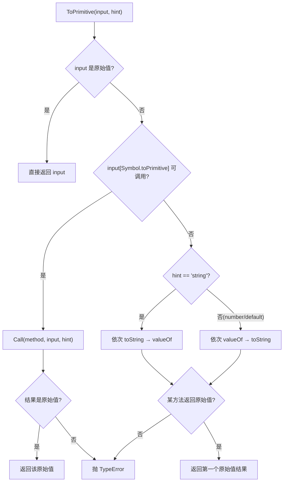
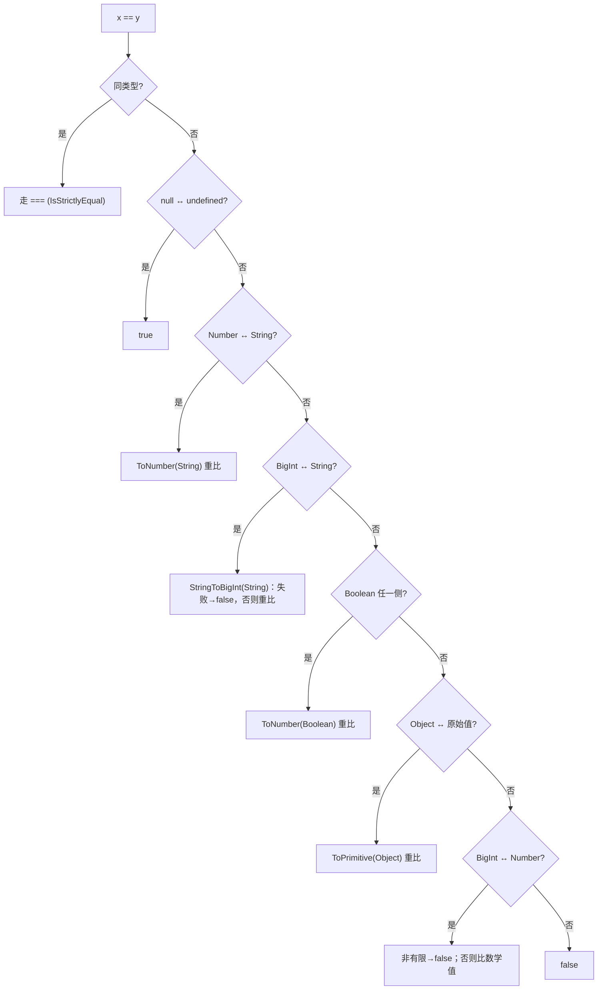

# 数据类型与类型转换：从 typeof 到 ToPrimitive

> 一句话概括：JavaScript 的"类型题"从来不是背表——**8 种类型、一套 ToPrimitive 抽象操作、三套相等算法（`===` / `==` / `Object.is`）和 IEEE 754 双精度**，共同决定了所有隐式转换的输出；本文把每条规则讲到规范步骤级，并给出工程上"什么时候该显式、什么时候会踩坑"的判断。

预计阅读时间：大约 90 分钟

所属主题：[JavaScript 基础常见面试题总结](summary.md)

**版本基线**：本文以 **ECMAScript ES2025（第 16 版）** 为基线，规范锚点用 ES2025 快照（`tc39.es/ecma262/2025`）的章节号 / 抽象操作名标注，更新特性注明版本归属；浏览器以当前 Chrome/V8 为准，Node.js 以 22/24 LTS 为准。文中示例均为可直接运行的 JS（标注 browser/Node 环境），关键输出已在 Node.js 实测核对（验证环境 v20.11.1，所涉语义均为 ES2021 及以前已稳定行为（单独标注的新特性除外），Node 22/24 与当前 Chrome/V8 输出一致）；跨 realm 示例用 `node:vm` 演示，浏览器对应 `iframe`。总结文档给结论，本文给机制与证据：每个机制按「结论 → 机制 → 边界/代价 → 实践/追问」展开。

---

## 0. 阅读路线

| 读者 | 建议阅读 | 关注点 |
| --- | --- | --- |
| 初级（1 年内） | 1.1~1.3、2.1、4.3、5.1、6.1 | 类型有哪些、`typeof` 结果、falsy 清单、`===` 与 `==` 区别、`0.1+0.2` 现象 |
| 中级（1~3 年） | 2、3、4、5.2~5.3、7、8 | 检测选型、ToPrimitive 调用顺序、三张转换表、`==` 算法、Symbol/BigInt |
| 高级（3 年+） | 1.4、2.2~2.5、3.2~3.4、5.3~5.5、6.2~6.5、9 | TDZ/跨 realm/解析歧义、IEEE 754 推导、`toFixed`、epsilon、坑清单 |
| 选型/资深 | 2.4、5.5、6.5、8.3、9.2~9.3 | 检测与相等选型、精度方案权衡、显式转换守则、性能视角 |

目录：

1. 8 种数据类型与值语义
2. 类型检测：四种武器与跨 realm
3. ToPrimitive：对象转原始值的总开关
4. ToNumber / ToString / ToBoolean 规则表
5. 相等比较：`===` / `==` / `Object.is`
6. IEEE 754 双精度与精度工程
7. Symbol：唯一键与 well-known symbols
8. BigInt：任意精度整数
9. 边界与实践：坑清单、显式守则、性能视角
10. 高频追问集
11. 参考资料

---

## 1. 8 种数据类型与值语义

### 1.1 类型全表：7 原始 + 1 对象

**结论**：ECMAScript 的语言类型共 **8 种**——7 种原始类型（primitive）加 1 种对象类型（Object）。原始类型不可变、按值比较；Object 是唯一的"引用类型"，`Array`/`Function`/`Date`/`RegExp`/`Map`/`Set`/`Proxy` 等都是它的子类型。

| 类型 | 类别 | 示例 | `typeof` 结果 | 版本归属 |
| --- | --- | --- | --- | --- |
| Undefined | 原始 | `undefined` | `'undefined'` | ES1 |
| Null | 原始 | `null` | `'object'`（历史坑，见 1.4） | ES1 |
| Boolean | 原始 | `true` / `false` | `'boolean'` | ES1 |
| Number | 原始 | `1` / `NaN` / `Infinity` / `-0` | `'number'` | ES1（IEEE 754 双精度） |
| String | 原始 | `'a'` / `"b"` | `'string'` | ES1（不可变 UTF-16 序列） |
| Symbol | 原始 | `Symbol('k')` | `'symbol'` | **ES2015** |
| BigInt | 原始 | `123n` | `'bigint'` | **ES2020** |
| Object | 对象 | `{}` / `[]` / `function(){}` / `new Date()` | `'object'`（可调用对象为 `'function'`） | ES1 |

两个常被混淆的点：

- **`Function` 不是独立的语言类型**，而是"实现了 `[[Call]]` 内部方法的 Object"（callable object）。`typeof` 单独给它 `'function'`，但 `class` 也是 `'function'`（类本质是构造器函数）。
- **原始类型 ≠ 没有方法**：`'abc'.toUpperCase()` 能调用，是因为引擎临时把原始值包装成对象（ToObject）再取方法，用完即弃；原始值本身仍不可变。

### 1.2 值语义 vs 引用语义

**结论**：原始值**按值**赋值与比较（拷贝的是值本身）；对象**按引用**赋值与比较（拷贝的是指向同一对象的引用，`===` 比的是"是不是同一个对象"）。

```js
// Node.js / 浏览器均可运行
let a = { x: 1 };
let b = a;          // 拷贝引用，a、b 指向同一个对象
b.x = 2;
console.log(a.x);   // 2 —— 改 b 就是改 a

let s = 'a';
let t = s;          // 拷贝值
t += 'b';
console.log(s);     // 'a' —— 原始值不可变，t 是新字符串

console.log({} === {});        // false —— 两个不同对象
console.log('abc' === 'abc');  // true  —— 按值比较
```

**边界与代价**：

- "按值传递"指**绑定（binding）的拷贝**，不是深拷贝。把对象传进函数，函数内改属性会影响外部；重新赋值形参则不会。
- 浅拷贝 / 深拷贝、`structuredClone`（HTML 标准，Node 17+ / 现代浏览器）、循环引用与可拷贝类型的完整边界，见 [对象属性与拷贝](objects-properties-and-copy.md)，本文不展开。
- Symbol 是原始类型，但**按唯一性（引用同一性）比较**——`Symbol('a') !== Symbol('a')`，这是它和其余原始值最大的不同（见第 7 章）。

**追问：String 是原始类型为什么有方法？** 引擎在属性访问时临时 ToObject 包装，调用结束包装对象即可被回收；字符串值本身始终不可变。

### 1.3 typeof 结果全表

**结论**：`typeof` 返回一个**字符串**，结果只有 8 种可能：`'undefined'`、`'object'`、`'boolean'`、`'number'`、`'bigint'`、`'string'`、`'symbol'`、`'function'`。它读的是值的内部类型标签，**不区分对象的具体种类**。

```js
// Node.js / 浏览器均可运行（输出已实测）
typeof undefined;        // 'undefined'
typeof null;             // 'object'  ← 坑一
typeof true;             // 'boolean'
typeof 1;                // 'number'
typeof NaN;              // 'number'（NaN 也是 Number）
typeof 1n;               // 'bigint'
typeof 's';              // 'string'
typeof Symbol();         // 'symbol'
typeof function () {};   // 'function'
typeof class {};         // 'function'
typeof {};               // 'object'
typeof [];               // 'object'  ← 无法区分 Array
typeof new Date();       // 'object'
typeof Math;             // 'object'（Math 是普通对象，不是函数）
```

**机制**：`typeof` 对应规范的 *The typeof Operator*，先 `GetValue` 再按类型分支返回字符串。V8 把它实现为带反馈槽的字节码 `IGNITION_HANDLER(TypeOf, InterpreterAssembler)`（`src/interpreter/interpreter-generator.cc`），内部调用 `Typeof(value, slot_id, feedback_vector)`——**连 `typeof` 都参与类型反馈**（见 9.3）。

**边界**：浏览器里 `typeof document.all === 'undefined'`（Annex B.3.6.3 的"故意违规"，见 4.3）；可调用 Proxy 的 `typeof` 是 `'function'`。**高级辨析：已撤销（revoked）的 Proxy 做 `typeof` 不抛错**——*The typeof Operator*（13.5.3.1）最后只检查"是否有 `[[Call]]` 内部槽"，不校验 Proxy 是否撤销：目标可调用返回 `'function'`，否则返回 `'object'`（实测）。对 revoked Proxy 真正抛 `TypeError` 的是 `Object.prototype.toString.call` 与 `Array.isArray`（走 *IsArray* → ValidateNonRevokedProxy，见 2.1）。`typeof` 自身唯一的抛错例外是 TDZ（见 1.4）。

### 1.4 两个坑：typeof null 与 typeof 未声明变量

**坑一：`typeof null === 'object'` 的历史原因**

**结论**：这是 JavaScript 第一天就有的 bug，因向后兼容至今未修。判断 `null` 请用 `value === null`，不要靠 `typeof`。

**机制**（MDN 原文）：最初实现里，值用「类型标签（type tag）+ 值」表示，**对象的类型标签是 `0`**；`null` 被表示为 NULL 指针（多数平台是 `0x00`），于是它的类型标签也被读成 `0` → `typeof` 返回 `'object'`。ES6 时代曾有过把 `typeof null` 改成 `'null'` 的提案，**因破坏既有代码而被拒绝**。

```js
typeof null === 'object';                 // true（历史遗留）
null === null;                            // true（正确判法）
Object.prototype.toString.call(null);     // '[object Null]'（可精确区分，见 2.3）
```

**坑二：`typeof` 未声明变量不抛错**

**结论**：`typeof undeclaredVar` 返回 `'undefined'` 而**不抛 `ReferenceError`**，因此 `typeof x === 'undefined'` 是安全的"存在性探测"（老式库用它检测宿主 API）。

**机制**：规范 *The typeof Operator*（13.5.3.1）求值时，若操作数是**不可解析的引用（unresolvable reference）直接返回 `'undefined'`**，不抛错（*GetValue* 6.2.5.5 对不可解析引用同样返回 undefined）；可解析时正常 GetValue 再按类型分支。直接读 `undeclaredVar` 才会抛 `ReferenceError`。

**边界（高频追问）**：`let`/`const`/`class` 在**暂时性死区（TDZ）**内，`typeof` **仍会抛 `ReferenceError`**——因为绑定已存在但未初始化，不是"不可解析引用"（实测；TDZ 与执行上下文详见 [作用域、闭包与执行上下文](scope-closures-and-execution-context.md)）。

```js
// Node.js / 浏览器均可运行
typeof neverDeclared;     // 'undefined'（安全）
// neverDeclared;         // ReferenceError（直接读才抛）

try {
  typeof laterLet;        // ReferenceError！TDZ 内 typeof 也抛
  let laterLet = 1;
} catch (e) {
  console.log(e.constructor.name); // 'ReferenceError'
}
```

**追问：为什么 `typeof null` 是 `'object'`？** 期望答案：早期类型标签低位为 0 表示对象，`null` 是空指针 0x00 被误读成对象标签；修复提案因兼容性被拒；判 `null` 用 `=== null`。

---

## 2. 类型检测：四种武器与跨 realm

### 2.1 四种检测方式对比

**结论**：没有一种检测方式"全能"。`typeof` 擅长原始类型，`instanceof` 擅长同 realm 的自定义类，`Object.prototype.toString.call` 擅长内置对象种类，`Array.isArray` 是判数组的唯一可靠选择。

| 方式 | 机制 | 能检测 | 主要失效/边界 | 跨 realm |
| --- | --- | --- | --- | --- |
| `typeof x` | 读内部类型标签 | 7 原始类型 + function | `null`→`'object'`；对象不分种类；仅 TDZ 抛错（revoked Proxy 不抛，见 1.3） | ✅ 安全 |
| `x instanceof C` | 沿原型链找 `C.prototype` | 对象是否继承自某构造器 | 跨 realm 失效；原型可改写；`Symbol.hasInstance` 可劫持；原始值恒 false | ❌ 失效 |
| `Object.prototype.toString.call(x)` | 读内置标签 / `Symbol.toStringTag` | 几乎所有内置类型 + null/undefined | `toStringTag` 可伪造；revoked Proxy 抛错 | ✅ 安全 |
| `Array.isArray(x)` | *IsArray*（7.2.2）判 Array exotic object | **仅数组** | revoked Proxy 抛错 | ✅ 安全（推荐） |

### 2.2 instanceof 的机制与三个失效场景

**结论**：`x instanceof C` 的本质是"**`C.prototype` 是否出现在 `x` 的原型链上**"（*OrdinaryHasInstance*），它只看链、不看内部结构，因此有三类失效。

**机制**：取 `C.prototype`，沿 `x.[[GetPrototypeOf]]` 逐级向上比对，命中即 `true`。原型链与继承的完整机制见 [原型链与继承](prototype-chain-and-inheritance.md)。

```js
// Node.js / 浏览器均可运行（输出已实测）
// 失效一：只看链不看内部槽 —— 伪造原型就能骗过 instanceof
const fake = Object.create(Array.prototype);
fake instanceof Array;        // true  ← 链上有 Array.prototype
Array.isArray(fake);          // false ← 它根本不是 Array exotic object

// 失效二：Symbol.hasInstance 可劫持判定
class Fake { static [Symbol.hasInstance](x) { return true; } }
1 instanceof Fake;            // true（原始值也能"是实例"）

// 失效三：无原型对象 / 原始值
Object.create(null) instanceof Object;  // false（链上没有 Object.prototype）
1 instanceof Number;                    // false（原始值不是对象）
```

**边界与代价**：`instanceof` 适合"同 realm 内判断自定义类的实例"，不适合判内置类型（尤其数组），更不适合跨 realm。`Symbol.hasInstance` 是语言留的扩展点，但也意味着 `instanceof` 的结果**可被任意改写**，安全敏感逻辑不要依赖它。

### 2.3 Object.prototype.toString 的机制与伪造

**结论**：`Object.prototype.toString.call(x)` 返回 `'[object Tag]'`，是判断内置对象种类最通用的手段，且能精确区分 `null`/`undefined`。

**机制**（规范 20.1.3.6，步骤已核对）：

1. `this` 是 `undefined` → `'[object Undefined]'`；是 `null` → `'[object Null]'`（特判，不 ToObject）；
2. 否则 ToObject，先 `IsArray` → `'Array'`；
3. 再依次按内部槽判定：`[[ParameterMap]]`→Arguments、`[[Call]]`→Function、`[[ErrorData]]`→Error、`[[BooleanData]]`→Boolean、`[[NumberData]]`→Number、`[[StringData]]`→String、`[[DateValue]]`→Date、`[[RegExpMatcher]]`→RegExp，都没有→Object；
4. 读 `x[Symbol.toStringTag]`，**若是字符串则覆盖**上面的内置标签，拼成 `'[object ' + tag + ']'`。

```js
// Node.js / 浏览器均可运行（输出已实测）
const t = v => Object.prototype.toString.call(v);
t(null);            // '[object Null]'
t(undefined);       // '[object Undefined]'
t([]);              // '[object Array]'
t(new Date());      // '[object Date]'
t(/x/);             // '[object RegExp]'
t(new Map());       // '[object Map]'
t(Promise.resolve());// '[object Promise]'
t(function () {});  // '[object Function]'
t(1n);              // '[object BigInt]'
t(Object(1));       // '[object Number]'（包装对象）

// 边界：toStringTag 可伪造 —— 它不是"绝对可信"的类型证明
t({ [Symbol.toStringTag]: 'Array' });  // '[object Array]'（其实是普通对象！）
```

**边界与代价**：第 4 步意味着任何对象都能自称 `'Array'`/`'Date'`。所以**判数组仍首选 `Array.isArray`**（走内部结构，无法伪造）；`toString.call` 适合"快速看种类"，不适合安全校验。

### 2.4 手写通用 getType 与选型建议

```js
// Node.js / 浏览器均可运行
function getType(value) {
  return Object.prototype.toString.call(value).slice(8, -1).toLowerCase();
}
getType(null);          // 'null'
getType(undefined);     // 'undefined'
getType([]);            // 'array'
getType(new Date());    // 'date'
getType(/x/);           // 'regexp'
getType(new Map());     // 'map'
getType(Promise.resolve()); // 'promise'
getType(1n);            // 'bigint'
getType(Symbol());      // 'symbol'
```

`slice(8, -1)` 截掉 `'[object '`（8 字符）和结尾 `']'`。它比 `typeof` 强在能区分 `null`/`undefined` 和对象种类；弱点同 2.3（可被 `toStringTag` 伪造）。

**选型速查**：

| 需求 | 推荐写法 | 理由 |
| --- | --- | --- |
| 判数组 | `Array.isArray(x)` | 内部结构判定，跨 realm 安全、不可伪造 |
| 判 null | `x === null` | `typeof null` 是 `'object'` |
| 判 NaN | `Number.isNaN(x)` | 全局 `isNaN` 会先 ToNumber，`isNaN('abc')` 也是 true |
| 判原始类型 | `typeof x` | 轻量；注意 null 与 TDZ |
| 判内置对象种类 | `Object.prototype.toString.call(x)` | 通用；防伪造场景改用内部槽判定 |
| 判自定义类实例 | `x instanceof MyClass`（同 realm） | 跨 realm 改用鸭子类型 / 品牌检查 |
| 判 null 或 undefined | `x == null` 或 `x === null \|\| x === undefined` | 见 5.5 |

### 2.5 跨 iframe/realm：为什么 instanceof 失效

**结论**：每个 realm（浏览器 iframe、Node `vm` 上下文）有**自己独立的全局对象与内置原型**。跨 realm 的数组，其原型链上是"对方 realm 的 `Array.prototype`"，而 `instanceof Array` 比的是"当前 realm 的 `Array.prototype`"——两者不是同一个对象，故 `false`。

```js
// Node.js（用 node:vm 模拟跨 realm；浏览器对应 iframe.contentWindow）
const vm = require('node:vm');
const foreignArr = vm.runInNewContext('[]');   // 另一个 realm 里创建的数组

foreignArr instanceof Array;                  // false ← 不同 realm 的 Array.prototype
Array.isArray(foreignArr);                    // true  ← IsArray 判内部结构，与 realm 无关
Object.prototype.toString.call(foreignArr);   // '[object Array]' ← 同样跨 realm 安全
vm.runInNewContext('({})') instanceof Object; // false（对象同理）
```

**机制**：`Array.isArray` 委托 *IsArray*（7.2.2）：非对象→false；是 Array exotic object→true；是 Proxy→校验未撤销后递归判目标；否则 false。**它判的是"数组内部结构"，不依赖任何 realm 的原型对象**，所以跨 realm 依然正确。浏览器里 `iframe.contentWindow.Array !== window.Array`，道理完全一样。

**一个反直觉的对照**：`Symbol.for` 的全局注册表**跨 realm 共享**（规范 20.4.2.2 明确 "shared by all realms"，实测 `vm.runInNewContext('Symbol.for("x")') === Symbol.for('x')` 为 `true`）——内置原型不共享，但全局符号注册表共享，这是两套不同的机制。

**追问：跨 iframe 怎么安全判数组？** 期望答案：用 `Array.isArray`（或 `Object.prototype.toString.call`），不要用 `instanceof`；根因是不同 realm 拥有不同的 `Array.prototype`，而 `IsArray` 判内部结构。

---

## 3. ToPrimitive：对象转原始值的总开关

### 3.1 hint 三值与调用顺序

**结论**：对象参与运算或比较前，先经 **ToPrimitive(input, hint)** 转成原始值。`hint` 有三种：`'number'`、`'string'`、`'default'`；转换优先走 `Symbol.toPrimitive`，否则按 hint 决定 `valueOf`/`toString` 的调用顺序。

**机制**（规范 7.1.1 ToPrimitive + 7.1.1.1 OrdinaryToPrimitive，步骤已核对）：

1. `input` 已是原始值 → 直接返回；
2. 取 `input[Symbol.toPrimitive]`，若可调用 → `Call(method, input, hint)`，**结果必须是原始值**，否则抛 `TypeError`；
3. 否则 OrdinaryToPrimitive：
   - `hint === 'string'` → 依次尝试 **`toString`、`valueOf`**；
   - `hint === 'number'`（或 default）→ 依次尝试 **`valueOf`、`toString`**；
   - 第一个返回原始值的方法胜出；两个都返回对象 → 抛 `TypeError`。
4. **`default` 视同 `number`**（Date 与 Symbol 包装对象例外，见 3.2）。



### 3.2 hint 从哪来：运算与语法的对照

**结论**：hint 由"触发转换的运算/语法"决定，不是由对象自己决定。

| 触发场景 | hint | 说明 |
| --- | --- | --- |
| `+obj`、`-obj`、`obj - 1`、`obj * 2`、`obj < 1` | `number` | 一元正负、算术、关系比较 → ToNumber/ToNumeric |
| `String(obj)`、`` `${obj}` ``、`ToString` | `string` | 显式字符串化、模板字符串 |
| 二元 `obj + ''`、`obj == 1` 的对象侧 | `default` | OrdinaryToPrimitive 把 default 当 number |
| `new Date() + ''`、`date == str` | `default` → **当 string** | Date 例外 |

**Date 例外**（规范 21.4.4.45 `Date.prototype[Symbol.toPrimitive]`，原文已核对）：Date 是内置对象中**唯一把 `default` 当 `string`** 的——所以 `new Date() + ''` 得到日期字符串，而 `+new Date()`（hint number）得到时间戳。

**Symbol 包装对象**（20.4.3.5）也自定义了 `Symbol.toPrimitive`：无视 hint 直接返回内部 symbol 值。于是 `String(Object(Symbol('s')))` 会抛 `TypeError`（ToPrimitive 返回 symbol 后，ToString 对 symbol 抛错，见 4.2；实测）。

```js
// Node.js / 浏览器均可运行（输出已实测）
const d = new Date(0);
typeof (d + '');          // 'string'（default → string → toString）
d + '' === d.toString();  // true
+d;                       // 0（number → valueOf → 时间戳）
d == d.toString();        // true（对象侧 default → string）
```

### 3.3 经典输出题：valueOf 与 toString 谁先调

```js
// Node.js / 浏览器均可运行（调用顺序已实测）
const obj = {
  valueOf() { console.log('valueOf'); return 1; },
  toString() { console.log('toString'); return '2'; },
};

obj + '';      // 打印 valueOf → '1'   （default→number，valueOf 先）
String(obj);   // 打印 toString → '2'  （string，toString 先）
`${obj}`;      // 打印 toString → '2'
obj == '1';    // 打印 valueOf → true  （default→1，再 '1'→1）
+obj;          // 打印 valueOf → 1
```

加上 `Symbol.toPrimitive` 后，它**优先于** valueOf/toString，且能拿到 hint：

```js
const obj2 = {
  [Symbol.toPrimitive](hint) { console.log('hint:', hint); return hint === 'string' ? 'S' : 7; },
  valueOf() { return 1; },
  toString() { return 'T'; },
};
obj2 + '';     // hint: default → '7'
String(obj2);  // hint: string  → 'S'
+obj2;         // hint: number  → 7
obj2 == 7;     // hint: default → true
```

### 3.4 解析歧义：`[] + {}` 与 `{} + []`

**结论**：`[] + {}` 恒为 `'[object Object]'`；`{} + []` 的结果**取决于 `{}` 被解析成"空块"还是"对象字面量"**——这是语法歧义，不是转换规则变了。

```js
// Node.js / 浏览器均可运行（输出已实测）
[] + {};            // '[object Object]'（[]→''，{}→'[object Object]'，拼接）
({} + []);          // '[object Object]'（表达式上下文，{} 是对象）
eval('{} + []');    // 0  ← 语句上下文：{} 是空块，剩下 +[] 是一元正号 → ToNumber([])=0
eval('({} + [])');  // '[object Object]'
+[];                // 0
+{};                // NaN（ToNumber('[object Object]')）
```

**机制**：语句开头的 `{}` 被解析为**空块语句**，于是 `{} + []` 实际是 `+[]`（一元正号）→ `ToNumber([])` → `ToNumber('')` → `0`。而在表达式上下文（赋值右侧、括号内、多数 console/REPL）`{}` 是对象字面量 → `'[object Object]'`。**面试要主动指出这个解析歧义**，而不是只背一个答案。

**追问：valueOf 和 toString 的调用顺序由什么决定？** 期望答案：由 hint 决定——string 先 toString，number/default 先 valueOf；`Symbol.toPrimitive` 最优先；Date 把 default 当 string。

---

## 4. ToNumber / ToString / ToBoolean 规则表

### 4.1 ToNumber（规范 7.1.4）

**结论**：`Number(x)` 与一元 `+x` **完全等价**（实测），都走 ToNumber。Symbol 和 BigInt 转 Number **抛 TypeError**；字符串按"数字字面量语法"解析，解析不了就是 NaN。

| 输入类型 | ToNumber 结果 |
| --- | --- |
| Undefined | `NaN` |
| Null | `+0` |
| Boolean | `true`→`1`，`false`→`+0` |
| Number | 原值 |
| String | 按 StringNumericLiteral 语法：trim 空白；空串/纯空白→`0`；支持 `0x`/`0b`/`0o`、十进制、科学计数；否则 `NaN` |
| Symbol | **抛 TypeError** |
| BigInt | **抛 TypeError** |
| Object | 先 ToPrimitive(hint number)，再 ToNumber |

```js
// Node.js / 浏览器均可运行（输出已实测）
Number(undefined);  // NaN
Number(null);       // 0   ← 注意不是 NaN
Number('');         // 0
Number('   ');      // 0
Number('0x10');     // 16
Number('0b11');     // 3
Number('0o17');     // 15
Number('0777');     // 777 ← 不是八进制！ToNumber 不认 legacy octal
Number('12abc');    // NaN（整体解析，不是 parseInt 的前缀解析）
Number('1_000');    // NaN ← 数字分隔符(ES2021)只用于字面量，不用于字符串转换
Number('Infinity'); // Infinity
Number([]);         // 0   （[]→''→0）
Number([5]);        // 5   （[5]→'5'→5）
Number([1, 2]);     // NaN （'1,2' 解析失败）
Number({});         // NaN （'[object Object]' 解析失败）
+'0x10';            // 16（与 Number('0x10') 一致）
```

**与 parseInt 的区别（高频坑）**：`parseInt` 是"前缀解析 + 可指定 radix"，`Number` 是"整体语法解析"。

```js
parseInt('123abc');     // 123（解析到非法字符为止）；Number('123abc') → NaN
parseInt('');           // NaN；Number('') → 0
parseInt('0777');       // 777（ES5 起不再默认八进制）
parseInt(0.0000005);    // 5 ← 先 ToString 得 '5e-7'，再前缀解析到 '5'！经典坑
parseInt('12.9');       // 12（截断小数）；Number('12.9') → 12.9
```

### 4.2 ToString（规范 7.1.17）

**结论**：`String(x)` 走 ToString 抽象操作；**Symbol 直接 ToString 抛 TypeError**，但 `String(symbol)` 函数对 symbol 有特判（走 `Symbol.prototype.toString`），二者不同。

| 输入类型 | ToString 结果 |
| --- | --- |
| Undefined | `'undefined'` |
| Null | `'null'` |
| Boolean | `'true'` / `'false'` |
| Number | `Number::toString(x, 10)`：`-0`→`'0'`、`NaN`→`'NaN'`、≥1e21 或 <1e-6 用科学计数 |
| String | 原值 |
| Symbol | **抛 TypeError**（但 `String(sym)` 特判返回 `'Symbol(x)'`） |
| BigInt | `BigInt::toString(x, 10)`（**无 `n` 后缀**） |
| Object | 先 ToPrimitive(hint string)，再 ToString |

```js
// Node.js / 浏览器均可运行（输出已实测）
String(undefined);   // 'undefined'
String(null);        // 'null'
String(-0);          // '0'  ← 负零字符串化丢失符号
String(NaN);         // 'NaN'
String(1e21);        // '1e+21'
String(0.0000001);   // '1e-7'
String(1n);          // '1'（无 n）
String([1, [2]]);    // '1,2'（Array.prototype.join）
String({});          // '[object Object]'
String(Symbol('x')); // 'Symbol(x)' ← String() 函数特判，不抛错

// 但抽象操作 ToString 对 symbol 抛错：
'' + Symbol();       // TypeError
`${Symbol()}`;       // TypeError
```

**边界（高频细节）**：`String(Symbol())` 能返回 `'Symbol(x)'`，而 `'' + Symbol()` / 模板字符串抛 `TypeError`——因为 `String()` 构造函数对 symbol 走了专门分支，而 `+`/模板走的是 ToString 抽象操作。Symbol 包装对象更隐蔽：`String(Object(Symbol('s')))` 也抛 `TypeError`（ToPrimitive 返回 symbol 后再 ToString，实测）。

### 4.3 ToBoolean 与 falsy 完整清单（规范 7.1.2）

**结论**：falsy 值**只有 8 个**：`false`、`0`、`-0`、`0n`、`''`（空串）、`null`、`undefined`、`NaN`。**其余全是 truthy**——包括 `'0'`、`'false'`、`[]`、`{}`、`new Boolean(false)`。

```js
// Node.js / 浏览器均可运行（输出已实测）
const falsy = [false, 0, -0, 0n, '', null, undefined, NaN];
falsy.every(v => !v);   // true（8 个全部 falsy）

Boolean('0');              // true ← 非空字符串
Boolean('false');          // true
Boolean([]);               // true ← 空数组也是 truthy！
Boolean({});               // true
Boolean(new Boolean(false));// true ← 包装对象是对象
Boolean(function () {});   // true
```

| 值 | ToBoolean | 易错点 |
| --- | --- | --- |
| `false` / `0` / `-0` / `0n` / `NaN` | false | `-0` 和 `0n` 常被漏掉 |
| `''`（空串） | false | `' '`（空格串）是 true |
| `null` / `undefined` | false | — |
| `'0'` / `'false'` / `[]` / `{}` | **true** | 最常被误判为 false |
| 任意对象（含包装对象） | true | 唯一例外见下 |

**机制**：规范 7.1.2 的 falsy 列表是 `undefined, null, +0𝔽, -0𝔽, NaN, 0ℤ, 空 String`（`0ℤ` 即 BigInt 零 `0n`），其余返回 true。

**边界一：`[]` 是 truthy，但 `[] == false` 是 true——不矛盾！** `if ([])` 走 **ToBoolean**（对象→true）；`[] == false` 走 **ToNumber**（`[]`→`''`→`0`，`false`→`0`，`0==0`→true）。**两条路径不同**，这是最经典的混淆点（见 5.3、9.1）。

**边界二：`document.all`（仅浏览器）** 是 Annex B.3.6 定义的 `[[IsHTMLDDA]]` 对象：ToBoolean 为 **false**、`typeof` 为 `'undefined'`、`== undefined`/`== null` 为 **true**（B.3.6.1~B.3.6.3）。这是为兼容老 IE 代码的"故意违规"（willful violation），Node 里不存在。它也是 `x == null` 惯用法的一个隐蔽命中项（见 5.5）。

**追问：falsy 有哪些？`[]` 是 true 还是 false？** 期望答案：8 个 falsy（含 `-0`、`0n`）；`[]` 是 truthy，但 `[] == false` 为 true，因为 `if` 走 ToBoolean、`==` 走 ToNumber，路径不同。

---

## 5. 相等比较：=== / == / Object.is

### 5.1 三套算法（外加 SameValueZero）对比

**结论**：JS 有**四套**相等语义——`===`（IsStrictlyEqual）、`==`（IsLooselyEqual）、`Object.is`（SameValue）、以及 `includes`/`Map`/`Set` 内部用的 SameValueZero。区别集中在 **NaN、±0、跨类型** 三处。

| 维度 | `===`（7.2.14） | `==`（7.2.13） | `Object.is`（7.2.9） | SameValueZero（7.2.10） |
| --- | --- | --- | --- | --- |
| 类型不同 | 直接 false | 按算法转换后比 | 直接 false | 直接 false |
| `NaN` vs `NaN` | **false** | false | **true** | **true** |
| `+0` vs `-0` | **true** | true | **false** | **true** |
| 对象比较 | 同一性（引用） | 先 ToPrimitive 再比 | 同一性 | 同一性 |
| BigInt vs Number | false（类型不同） | 数学值相等即 true | false | false |
| 典型用途 | 日常比较 | `x == null` 惯用法 | 找 NaN / 区分 ±0 | `includes`、`Map`/`Set` 键 |

```js
// Node.js / 浏览器均可运行（输出已实测）
NaN === NaN;                 // false
Object.is(NaN, NaN);         // true
0 === -0;                    // true
Object.is(0, -0);            // false
1 / -0;                      // -Infinity（区分 ±0 的老技巧）
1 / 0;                       // Infinity

[NaN].indexOf(NaN);          // -1 ← indexOf 用 ===
[NaN].includes(NaN);         // true ← includes(ES2016) 用 SameValueZero
new Set([NaN]).has(NaN);     // true ← Set/Map 键用 SameValueZero
new Map([[NaN, 1]]).get(NaN);// 1
Object.is(1n, 1n);           // true
```

**机制**：`===` 对 Number 用 `Number::equal`（6.1.6.1.13，NaN 不等、±0 相等）；`Object.is` 用 `Number::sameValue`（6.1.6.1.14，NaN 相等、±0 不等）；SameValueZero 用 `Number::sameValueZero`（6.1.6.1.15，NaN 相等、±0 相等）。非 Number 都走 `SameValueNonNumber`（对象比同一性）。

### 5.2 == 算法逐步（规范 7.2.13 IsLooselyEqual）

**结论**：`==` 不是"随便转一下"，而是一套**有固定顺序**的算法。核心精神：**null/undefined 特例优先，其余尽量往 Number 转，对象先 ToPrimitive**。

按规范顺序（已核对原文）：

1. **同类型** → 直接走 `IsStrictlyEqual`（`===`）；
2. `null` vs `undefined`（双向）→ **true**（特例，不转 Number；Annex B.3.6.2 让 `document.all` 也命中）；
3. Number vs String → `ToNumber(String)` 后重比；
4. BigInt vs String → `StringToBigInt(String)`，解析失败（undefined）→ false，否则重比；
5. x 是 Boolean → `ToNumber(x)` 后重比；
6. y 是 Boolean → `ToNumber(y)` 后重比；
7. x 是原始值（String/Number/BigInt/Symbol）且 y 是 Object → `ToPrimitive(y)` 后重比；
8. x 是 Object 且 y 是原始值 → `ToPrimitive(x)` 后重比；
9. BigInt vs Number（双向）→ 任一非有限（NaN/±Infinity）→ false；否则比**数学值** `ℝ(x) = ℝ(y)`；
10. 其余 → false。



（简化示意：双向分支与对象侧的先后细节以正文 10 步为准。）

**边界：`==` 不满足传递性**（实测）：

```js
'' == 0;     // true
'0' == 0;    // true
'' == '0';   // false ← 传递性被破坏！
```

### 5.3 经典题逐步推导

**`[] == ![]` → true**（逐步，中间值已实测）：

| 步 | 表达式 | 依据 |
| --- | --- | --- |
| 1 | `![]` → `false` | `ToBoolean([])=true`，取反得 false；式子变 `[] == false` |
| 2 | `[] == false` → `[] == 0` | 第 6 步：y 是 Boolean → `ToNumber(false)=0` |
| 3 | `[] == 0` → `'' == 0` | 第 8 步：x 是 Object → `ToPrimitive([])`（valueOf 返回自身对象→toString 返回 `''`） |
| 4 | `'' == 0` → `0 == 0` | 第 3 步：String vs Number → `ToNumber('')=0` |
| 5 | `0 == 0` → **true** | 第 1 步：同类型 Number → `Number::equal` |

**`{} == !{}` → 要分上下文**：

```js
// 表达式上下文（Node.js / 浏览器）
({}) == !({});   // false
// 推导：!{}=false → {}==false → ToNumber(false)=0
//       → ToPrimitive({})='[object Object]' → ToNumber(...)=NaN → NaN==0 → false

// 语句上下文
eval('{} == !{}');  // SyntaxError！{} 被解析为空块，剩下 == !{} 不是合法表达式
```

所以"`{} == !{}` 等于 false"**只在表达式上下文成立**；语句开头会因解析歧义直接语法错误（实测）。面试主动点出这一层，比只背 false 更加分。

**null 的"双重人格"**（实测，高频）：

```js
null == undefined;  // true（特例）
null == 0;          // false ← null 只与 undefined loose 相等，不转 Number
null >= 0;          // true  ← 关系比较走 ToNumber(null)=0，与 == 不同路径！
null > 0;           // false
undefined == 0;     // false
```

**包装对象**（实测）：

```js
new Number(1) == 1;             // true（ToPrimitive → 1）
new Number(1) === 1;            // false（类型不同）
new Number(1) == new Number(1); // false（两个不同对象，同一性比较）
```

### 5.4 Object.is 的用途与 ±0

**结论**：`Object.is`（ES2015）补上 `===` 的两个"反直觉"缺口——**把 NaN 视为相等、把 ±0 视为不等**，适合"找 NaN"和"区分符号零"。

```js
Object.is(NaN, NaN);   // true（=== 做不到）
Object.is(0, -0);      // false（=== 认为相等）
Object.is(0 * -1, -0); // true（0*-1 产生 -0）
```

**机制**：`Object.is` 就是 SameValue（7.2.9）。它不处理跨类型（`Object.is(1, '1')` 为 false），也不处理对象内容（仍比同一性）。需要"内容相等"请自行实现深比较（见 [对象属性与拷贝](objects-properties-and-copy.md)）。

### 5.5 x == null 惯用法、争议与 ESLint eqeqeq

**结论**：`x == null` 是**唯一被广泛接受的 `==` 惯用法**，等价于 `x === null || x === undefined`（因为 null/undefined 是 loose 相等里唯一的跨类型特例）。

```js
x == null;   // 仅当 x 是 null 或 undefined 时为 true
// 等价于
x === null || x === undefined;
```

**争议与边界**：

- 可读性/团队规范：有人觉得 `==` 一律该禁；`x == null` 简洁但需要读者懂特例。
- **浏览器里 `document.all == null` 也是 true**（Annex B.3.6.2），即 `x == null` 会额外命中 `document.all`——极隐蔽，但确实存在。
- 现代替代：`x ?? y`（**ES2020** 空值合并）只针对 null/undefined，语义更明确；判存在性也可用 `x === undefined`。

**ESLint `eqeqeq` 选项**：

| 配置 | 行为 |
| --- | --- |
| `'always'`（默认推荐） | 一律要求 `===`，`x == null` 也报错 |
| `'smart'` | 允许"安全"的 `==`：typeof 比较、与 null 比较、字面量同类型比较等 |
| `'allow-null'` | 专门放行 `== null` / `!= null` |

**实践**：团队若开 `eqeqeq: 'always'`，就写 `x === null || x === undefined` 或 `x ?? ...`；若接受惯用法，用 `'smart'`/`'allow-null'` 放行 `== null`，其余仍禁。**不要为了"显得懂"而在业务里滥用 `==`**。

**追问：`[] == ![]` 逐步？为什么 `null >= 0` 但 `null == 0` 是 false？** 期望答案：见 5.3 五步推导；`==` 里 null 只与 undefined 特例相等、不转 Number，而关系比较 `>=` 走 ToNumber(null)=0，两条路径不同。

---

## 6. IEEE 754 双精度与精度工程

### 6.1 结论：Number 是 binary64

**结论**：JS 的 Number 是 **IEEE 754 双精度浮点（binary64）**：1 位符号 + 11 位指数 + 52 位尾数（隐含前导 1，共 **53 位有效数字**）。大多数十进制小数无法用有限二进制精确表示，存储时就要舍入——这是一切精度问题的根源。

| 常量 | 值 | 含义 |
| --- | --- | --- |
| `Number.MAX_SAFE_INTEGER` | `9007199254740991`（2^53−1，ES2015） | 能精确表示的最大整数 |
| `Number.EPSILON` | `2.220446049250313e-16`（2^−52，ES2015） | 1 与下一个可表示数之差 |
| `Number.MAX_VALUE` | `≈1.7976931348623157e308` | 超出→`Infinity` |
| `Number.MIN_VALUE` | `5e-324` | 最小正次正规数 |

### 6.2 0.1 + 0.2 !== 0.3 的二进制推导

**结论**：`0.1 + 0.2 === 0.30000000000000004`，不等于 `0.3`。不是 JS 的 bug，是二进制浮点的必然。

**机制（逐步）**：

1. 十进制 `0.1` 转二进制是**无限循环**：`0.00011001100110011…`（`0011` 循环），规格化为 `1.100110011… × 2^−4`；53 位有效数字截断舍入后，实际存储值**略大于** 0.1。`0.2` 同理略大于 0.2。
2. 两个"略大"的值相加，精确和落在两个相邻 double 之间，再舍入一次。
3. 字面量 `0.3` 存储的是**略小于** 0.3 的那个 double。两者不是同一个值 → `!==`。

**实测证据**（`toPrecision(55)` 展开实际存储值，Node.js）：

| 表达式 | 实际存储的精确十进制值 |
| --- | --- |
| `0.1` | `0.1000000000000000055511151231257827021181583404541015625` |
| `0.2` | `0.200000000000000011102230246251565404236316680908203125` |
| `0.1 + 0.2` | `0.3000000000000000444089209850062616169452667236328125` |
| `0.3` | `0.299999999999999988897769753748434595763683319091796875` |

**高级细节（舍入到偶数）**：0.1 与 0.2 的**精确数学和**是 `0.3000000000000000166533453693773481063544750213623046875`，它**恰好落在上表后两个相邻 double 的正中间**（间距 2^−54）。IEEE 754 默认"舍入到最近、平局取偶数尾数"（round-half-to-even），选择了较大的那个 → `0.30000000000000004`。而 `0.3` 字面量舍入到较小的那个 → 两者不等。

```js
0.1 + 0.2;            // 0.30000000000000004
0.1 + 0.2 === 0.3;    // false
0.1 * 3;              // 0.30000000000000004（乘法同样不精确）
```

### 6.3 安全整数与精度丢失场景

**结论**：53 位有效数字意味着**只有 ±(2^53−1) 内的整数能被精确表示**；超出后相邻整数会"撞车"。

```js
// Node.js / 浏览器均可运行（输出已实测）
Number.MAX_SAFE_INTEGER;                 // 9007199254740991
Number.MAX_SAFE_INTEGER + 1 === Number.MAX_SAFE_INTEGER + 2; // true（都等于 2^53）
9007199254740992 === 9007199254740993;   // true（2^53+1 被舍入到 2^53）
2 ** 53 + 1;                             // 9007199254740992
Number.isSafeInteger(2 ** 53);           // false
Number.isSafeInteger(2 ** 53 - 1);       // true

// 真实事故：JSON 里的大整数 ID 静默丢精度
JSON.parse('{"id": 9007199254740993}').id; // 9007199254740992 ← 后端雪花 ID 常见坑
```

**典型场景**：19 位雪花 ID / 订单号、大额计数累加、后端 Long 型 ID 经 JSON 传到前端。**对策**：ID 用字符串传输，或前端用 BigInt 解析（见第 8 章）。

### 6.4 toFixed 的坑

**结论**：`toFixed` 舍入的是**实际二进制值**，不是"看起来的十进制"，所以 `(1.005).toFixed(2)` 是 `'1.00'` 而不是 `'1.01'`。

**机制**（规范 21.1.3.3，原文已核对）：取整数 `n` 使 `n / 10^f − x` 最接近 0，**平局取较大的 n**。这里的 `x` 是 Number 的实际值。`1.005` 实际存储为 `1.0049999999999998934…`（略小于 1.005），按规则舍入到 `'1.00'`。

```js
// Node.js / 浏览器均可运行（输出已实测）
(1.005).toFixed(2);   // '1.00' ← 实际值 1.0049999999999998934
(1.005).toPrecision(20); // '1.0049999999999998934'
(2.55).toFixed(1);    // '2.5'
(0.615).toFixed(2);   // '0.61'
(1.005).toFixed(3);   // '1.005' ← 位数不同结果不同！
(0.1 + 0.2).toFixed(2); // '0.30'
```

**另一个反直觉点**（规范 Note 2，实测）：`toFixed` 有时比 `toString` **更精确**——`toString` 只打印"足以区分相邻 double"的位数：

```js
(1000000000000000128).toString();   // '1000000000000000100'
(1000000000000000128).toFixed(0);   // '1000000000000000128'
```

**边界**：`fractionDigits` 范围 0~100，超出抛 `RangeError`；非有限数直接走 `toString`。**`toFixed` 不是"精确十进制舍入"，金额舍入不要依赖它**（用整数分或 decimal 库）。

### 6.5 工程方案与权衡

| 方案 | 原理 | 适用 | 代价/边界 |
| --- | --- | --- | --- |
| 整数分 | 金额 ×100 存整数，全程整数运算 | 固定小数位的金额 | 仅限固定精度；乘除仍需小心引入浮点 |
| epsilon 比较 | 相对容差判"近似相等" | 浮点结果校验、几何/科学计算 | 不能恢复已丢失的精度；容差要按量级缩放 |
| decimal 库 | 十进制算术（decimal.js / big.js / bignumber.js） | 金额、计量、需要精确小数 | 性能与体积开销；API 学习成本 |
| BigInt | 任意精度**整数** | 大 ID、计数、密码学 | 不能表示小数、不能混 Number、不能 JSON（见 8） |
| 字符串传输 | 大数 ID 用 string | 前后端 ID 传递 | 前端按需转 BigInt/字符串比较 |

**epsilon 的正确写法（相对容差）**：

```js
// Node.js / 浏览器均可运行（输出已实测）
function nearlyEqual(a, b, relTol = Number.EPSILON, absTol = Number.EPSILON) {
  const diff = Math.abs(a - b);
  if (diff <= absTol) return true;  // 接近 0 时用绝对容差
  return diff <= relTol * Math.max(Math.abs(a), Math.abs(b));
}
nearlyEqual(0.1 + 0.2, 0.3);                 // true
nearlyEqual(1e15 + 0.1 + 0.2, 1e15 + 0.3);   // true
```

**为什么不能只用 `Math.abs(a-b) < Number.EPSILON`**（实测两个方向都会错）：

- **大数漏判**：`1e15 + 0.1 + 0.2` 与 `1e15 + 0.3` 的差是 `0.125`，远大于 `EPSILON`（2.22e-16），naive 绝对比较返回 false——但它们在浮点意义下"应视为相等"。相对容差能正确处理。
- **假阳性**：`1e16 + 0.1 === 1e16` 为 true（0.1 在 1e16 量级已被完全舍掉），naive epsilon 会说"相等"，**但精度其实已经丢了**。epsilon 比较只能判"近似"，不能找回丢失的信息。

**追问：如何精确判断小数相等？** 期望答案：用相对 epsilon（按量级缩放容差），或干脆用整数分/decimal 库避免浮点；naive 绝对 `Number.EPSILON` 在大数失效，且无法恢复已丢精度。

---

## 7. Symbol：唯一键与 well-known symbols

### 7.1 唯一性

**结论**：`Symbol()`（ES2015）每次调用都返回**独一无二**的值，description 只是调试标签，不参与相等。它主要用作"不会撞名的属性键"。

```js
// Node.js / 浏览器均可运行（输出已实测）
Symbol('a') === Symbol('a');   // false ← 即使描述相同也是两个值
Symbol('a').description;       // 'a'（仅调试用）
typeof Symbol();               // 'symbol'
Symbol('a') == 'a';            // false（symbol 不与字符串 loose 相等）
```

**机制**：Symbol 是原始类型，但按**唯一性**比较（类似对象的同一性），这是它与其他原始值的根本区别。`new Symbol()` 抛 TypeError（Symbol 不是构造器）。

### 7.2 Symbol.for：全局注册表

**结论**：`Symbol.for(key)` 在**全局注册表**里按 key 复用同一个 symbol；`Symbol.keyFor` 反查 key。注册表**跨 realm 共享**。

```js
// Node.js / 浏览器均可运行（输出已实测）
Symbol.for('a') === Symbol.for('a');   // true（复用）
Symbol.keyFor(Symbol.for('a'));        // 'a'
Symbol.keyFor(Symbol('a'));            // undefined（非注册 symbol）

// 跨 realm 共享（规范 20.4.2.2："shared by all realms"）
const vm = require('node:vm');
vm.runInNewContext('Symbol.for("x")') === Symbol.for('x'); // true
```

| 维度 | `Symbol(desc)` | `Symbol.for(key)` |
| --- | --- | --- |
| 唯一性 | 每次唯一 | 同 key 复用 |
| 注册表 | 不进 | 进全局注册表（append-only） |
| 跨 realm | 各自独立 | **共享** |
| `keyFor` | undefined | 返回 key |
| 可被 GC | 可（无引用时） | 不可（注册表常驻） |
| 典型用途 | 对象私有键、防冲突 | 跨模块/跨 realm 共享的"协议键" |

### 7.3 作为属性键：不被常规枚举

**结论**：symbol 键**不出现在** `Object.keys` / `for...in` / `Object.getOwnPropertyNames` / `JSON.stringify` 里；要用 `Object.getOwnPropertySymbols` / `Reflect.ownKeys` 才能取到。

```js
// Node.js / 浏览器均可运行（输出已实测）
const s = Symbol('k');
const o = { [s]: 1, x: 2 };
Object.keys(o);                 // ['x']（看不到 s）
JSON.stringify(o);              // '{"x":2}'（symbol 键被忽略）
Object.getOwnPropertySymbols(o);// [Symbol(k)]
Reflect.ownKeys(o);             // ['x', Symbol(k)]
({ ...o })[s];                  // 1 ← 对象 spread(ES2018) 会拷贝可枚举 symbol 键

JSON.stringify({ [Symbol()]: 1 }); // '{}'（键被忽略）
JSON.stringify([Symbol()]);        // '[null]'（数组里的 symbol 值→null）
```

**边界**：symbol 键不是"绝对私有"——`getOwnPropertySymbols`/`Reflect.ownKeys` 能拿到，只是常规枚举看不见。真正的私有字段用 `#field`（ES2022）。属性枚举、拷贝与 symbol 键的完整规则见 [对象属性与拷贝](objects-properties-and-copy.md)。

### 7.4 well-known symbols 概览

**结论**：well-known symbols（规范 6.1.5.1）是语言预定义的一组"协议键"，让内置行为（迭代、instanceof、字符串化等）可被自定义。它们是**跨 realm 恒定的同一个 symbol**。

| Symbol | 用途 | 版本归属 |
| --- | --- | --- |
| `Symbol.iterator` | `for...of` / 展开的默认迭代器 | ES2015 |
| `Symbol.asyncIterator` | `for await...of` 的默认异步迭代器 | **ES2018** |
| `Symbol.hasInstance` | 自定义 `instanceof` 判定 | ES2015 |
| `Symbol.isConcatSpreadable` | `concat` 是否展开数组 | ES2015 |
| `Symbol.match` / `replace` / `search` / `split` | 自定义字符串匹配/替换/搜索/分割 | ES2015 |
| `Symbol.matchAll` | `String.prototype.matchAll` 的匹配迭代器 | **ES2020** |
| `Symbol.species` | 派生对象（map/filter 等）的构造器 | ES2015 |
| `Symbol.toPrimitive` | 自定义对象转原始值（见第 3 章） | ES2015 |
| `Symbol.toStringTag` | 自定义 `Object.prototype.toString` 标签 | ES2015 |
| `Symbol.unscopables` | `with` 绑定排除 | ES2015 |
| `Symbol.dispose` / `Symbol.asyncDispose` | `using` / `await using` 资源释放 | **预计 ES2027**（见下） |

**版本边界（已核对）**：`Symbol.dispose`/`asyncDispose` 来自 Explicit Resource Management 提案，**ES2025 快照尚未收录**（tc39 finished-proposals 标注 Expected Publication **2027**）；但 V8 已提前实现，**Node 20+ 即可访问这两个符号**（实测 v20.11.1 存在）。本文基线 ES2025 不把它们当作已纳入特性。

迭代器/生成器细节见 [迭代器与生成器](iterators-and-generators.md)，其余新特性与 well-known symbols 的展开见 [ES6+ 与现代 JS](es6-plus-and-modern-js.md)。

**追问：Symbol 解决什么问题？`Symbol.for` 和 `Symbol` 区别？** 期望答案：唯一属性键防冲突/模拟私有；`Symbol()` 每次唯一、可 GC，`Symbol.for` 全局注册表复用、跨 realm 共享、不可 GC；symbol 键不被常规枚举与 JSON 序列化。

---

## 8. BigInt：任意精度整数

### 8.1 动机与创建

**结论**：BigInt（**ES2020**）补上 Number 的整数精度天花板（2^53−1），提供**任意精度整数**。它只表示整数，不能表示小数。

```js
// Node.js / 浏览器均可运行（输出已实测）
123n;                  // 字面量
BigInt('123');         // 123n
BigInt('0x10');        // 16n（支持十六进制字符串）
BigInt(123);           // 123n（从整数 Number）
typeof 123n;           // 'bigint'
2n ** 64n;             // 18446744073709551616n（远超 2^53）
```

### 8.2 边界清单（全部实测）

| 边界 | 行为 | 示例 |
| --- | --- | --- |
| 与 Number 混合算术 | **抛 TypeError** | `1n + 1` → TypeError（"Cannot mix BigInt and other types"） |
| 关系比较 / `==` 可跨类型 | 按数学值比 | `1n < 2`→true；`0n == 0`→true；`1n == '1'`→true |
| `===` 跨类型 | 恒 false | `0n === 0`→false（类型不同） |
| 除法 | **向零截断** | `10n / 3n`→`3n`；`-7n / 2n`→`-3n` |
| `JSON.stringify` | **抛 TypeError** | `JSON.stringify(1n)`→TypeError |
| `Math.*` | **抛 TypeError** | `Math.max(1n, 2n)`→TypeError |
| 从小数构造 | **抛 RangeError** | `BigInt(0.1)`→RangeError |
| 转 Number 可能丢精度 | 舍入 | `Number(2n ** 64n)`→`18446744073709552000` |
| 无负零 | `-0n === 0n` | true |
| 位运算 | 支持 `& \| ^ ~ << >>`，**无 `>>>`** | — |

```js
// Node.js / 浏览器均可运行（输出已实测）
0n == 0;    // true  ← == 第 9 步：BigInt/Number 比数学值
0n === 0;   // false ← === 类型不同直接 false
1n == 1.5;  // false（数学值不等）
1n == '1';  // true  ← == 第 4 步：StringToBigInt('1')=1n

// JSON 需要 replacer 显式转字符串
JSON.stringify({ a: 1n }, (k, v) => typeof v === 'bigint' ? v.toString() : v);
// '{"a":"1"}'
```

**机制**：`0n == 0` 走 IsLooselyEqual 第 9 步（BigInt vs Number 比数学值 `ℝ`）；`0n === 0` 走 IsStrictlyEqual，类型不同直接 false。混合算术抛错是因为 BigInt 与 Number 的算术内部操作（`BigInt::add` vs `Number::add`）不允许跨类型操作数，必须显式 `BigInt(x)`/`Number(x)` 统一类型。

### 8.3 选型：BigInt vs decimal 库 vs 字符串

| 方案 | 能表示小数 | 精度 | 生态（JSON/Math） | 性能 | 适用 |
| --- | --- | --- | --- | --- | --- |
| BigInt | ❌ 仅整数 | 任意精度整数 | 都不支持，需手动处理 | 低于 Number（堆分配任意精度） | 大 ID、计数、密码学、位运算 |
| decimal 库 | ✅ | 任意精度十进制 | 库自带序列化 | 低于 Number | 金额、计量、精确小数 |
| 字符串 | ✅（文本） | 不丢字面 | JSON 原生 | 比较/运算需自行实现 | 大数 ID 传输、展示 |

**结论**：BigInt **不能替代 decimal 库**——它没有小数。金额用整数分或 decimal；大整数 ID 用 BigInt 或字符串。BigInt 与 Number 一样是原始值，但任意精度意味着堆分配与更慢的运算，热点路径慎用。

**追问：为什么 `0n == 0` 但 `0n !== 0`？BigInt 能替代 decimal 吗？** 期望答案：`==` 有 BigInt/Number 数学值比较分支，`===` 类型不同直接 false；BigInt 只表示整数、无小数，不能替代 decimal 库。

---

## 9. 边界与实践：坑清单、显式守则、性能视角

### 9.1 隐式转换真实项目坑清单

以下全部实测核对，按"现象 → 根因"组织：

| 现象 | 根因 | 对策 |
| --- | --- | --- |
| `if ('0')` / `if ([])` 进分支 | 非空串/对象是 truthy | 显式判 `x.length` / `Array.isArray` 等 |
| `[] == false` 为 true 但 `if ([])` 为 true | ToNumber vs ToBoolean 路径不同 | 比较用 `===`，判空用显式逻辑 |
| `null >= 0` true、`null == 0` false | 关系比较走 ToNumber，`==` 走特例 | 判空用 `== null` 或 `===` |
| `'' == 0`、`'0' == 0` 但 `'' != '0'` | `==` 无传递性 | 用 `===` |
| `{} + []` 语句得 0、表达式得 `'[object Object]'` | `{}` 解析歧义（空块 vs 对象） | 表达式加括号；别写这种代码 |
| `'5' + 2 = '52'`、`'5' - 2 = 3` | `+` 有字符串拼接重载，`-` 只走 Number | 先显式 `Number()` |
| `parseInt(0.0000005) = 5` | 先 ToString 得 `'5e-7'` 再前缀解析 | 用 `Number()` 或 `Math.trunc` |
| `Number('1_000') = NaN` | 数字分隔符(ES2021)仅字面量 | 字符串转换前去掉 `_` |
| `1 < 2 < 3` true、`3 > 2 > 1` false | 链式比较先算左边得 boolean 再 ToNumber | 拆成 `a < b && b < c` |
| `'b' + 'a' + + 'a' + 'a' = 'baNaNa'` | `+ 'a'`→NaN→`'NaN'` | 别玩这种题，业务里显式转换 |
| `JSON.parse` 大整数 ID 丢精度 | 超出 2^53−1 | ID 用字符串/BigInt |
| `typeof null === 'object'` | 历史类型标签 bug | 判 null 用 `=== null` |
| `typeof` 未声明安全、TDZ 内抛错 | GetValue 对 unresolvable 返回 undefined；TDZ 绑定已存在 | 存在性探测用 typeof；注意 TDZ |
| `String(Symbol())` 可以、`'' + Symbol()` 抛错 | String() 特判 vs ToString 抽象操作 | symbol 字符串化用 `String()`/`.description` |
| `document.all` falsy 且 typeof undefined | Annex B.3.6 故意违规（仅浏览器） | 别依赖；`x == null` 会命中它 |

### 9.2 什么时候该用显式转换

**结论**：**在边界处显式，在内部保持一致类型**。隐式转换不是" evil"，但它的规则太多、路径太隐蔽，业务代码应把不确定性挡在边界外。

**显式转换守则**：

- **输入边界**（用户输入、URL 参数、接口响应、存储读取）：显式 `Number()` / `String()` / `Boolean()`，并校验结果（如 `Number.isNaN`）。
- **比较**：默认 `===`；找 NaN / 区分 ±0 用 `Object.is`；判 null/undefined 用 `=== null || === undefined` 或 `??`。
- **金额/计量**：整数分或 decimal 库，不依赖浮点 + `toFixed`。
- **大整数 ID**：字符串传输，按需 BigInt。
- **团队规范**：ESLint `eqeqeq`（`'always'` 或 `'smart'`/`'allow-null'`）+ `no-implicit-coercion`，把"隐式"限制在少数公认惯用法。

**少数可接受的隐式惯用法**（团队约定下）：`x == null`（判空）、`!!x`（转布尔）、`+x`（转数字，等价 Number）、`x ?? y`（空值合并）。除此之外，显式更可读、更可预测。

### 9.3 性能视角（点到为止）

**结论**：隐式转换本身在 JIT 下常被优化掉，"**显式一定更快**"不成立——选显式主要是为了**正确性与可读性**。真正影响性能的是**类型的稳定性**。

- V8 用 **type feedback + inline cache（IC）**：调用点类型稳定（单态 monomorphic）最快，少数几种类型（多态 polymorphic）次之，类型繁杂（megamorphic）退化为通用查找。热点函数的参数/返回值类型尽量稳定，别一会儿 number 一会儿 string。
- 连 `typeof` 都带反馈槽（V8 `src/interpreter/interpreter-generator.cc` 的 `IGNITION_HANDLER(TypeOf)` 调用 `Typeof(value, slot_id, feedback_vector)`，已核对源码）；IC miss 与 megamorphic 处理见 `src/ic/ic.cc`。
- 对象形状（hidden class / map）稳定同样利于 IC；频繁增删属性、混合类型字段会让 IC 失效。

机制展开（Shapes/IC、隐藏类、去优化）超出本文范围，参见 Mathias Bynens《JavaScript engine fundamentals: Shapes and Inline Caches》与 V8 源码；本文只强调"**类型稳定 > 显式/隐式之争**"。

**追问：什么时候该显式转换？`==` 一定比 `===` 慢吗？** 期望答案：边界处显式、内部类型一致；`==` 不一定更慢（JIT 可优化），选 `===` 是为可预测性而非性能；性能关键是类型稳定（单态 IC）。

---

## 10. 高频追问集

**Q1：为什么 `typeof null === 'object'`？**
期望答案：早期实现用类型标签+值表示，对象标签为 0，null 是空指针 0x00 被误读成对象标签；ES6 修复提案因兼容性被拒。判 null 用 `=== null`，精确区分用 `Object.prototype.toString.call(null)`→`'[object Null]'`。

**Q2：`[] == ![]` 逐步推导？**
期望答案：`![]`→false（ToBoolean([])=true 取反）；`[] == false`→`[] == 0`（Boolean→ToNumber）；`[] == 0`→`'' == 0`（对象 ToPrimitive→''）；`'' == 0`→`0 == 0`（String→ToNumber）；同类型 Number→true。

**Q3：NaN 为什么 `!== NaN`，但 `Object.is(NaN, NaN)` 为 true？**
期望答案：IEEE 754 规定 NaN 无序、不等于任何值（含自身），`===` 对 Number 用 `Number::equal` 故 false；`Object.is` 用 SameValue（`Number::sameValue`）特判 NaN 相等。`includes`/`Map`/`Set` 用 SameValueZero 也认 NaN 相等，`indexOf` 用 `===` 故找不到 NaN。

**Q4：如何精确判断小数相等？**
期望答案：用相对 epsilon（`diff <= EPSILON * max(|a|,|b|)`，接近 0 时加绝对容差）；naive 绝对 `Number.EPSILON` 在大数漏判（1e15 量级差 0.125），且会把已丢精度误判相等（1e16+0.1===1e16）。要真正精确用整数分/decimal 库。

**Q5：跨 iframe 怎么判数组？为什么 instanceof 失效？**
期望答案：用 `Array.isArray`（或 `toString.call`）。不同 realm 有各自的 `Array.prototype`，`instanceof` 比的是当前 realm 的原型对象，跨 realm 链上没有它→false；`IsArray` 判数组内部结构，与 realm 无关。

**Q6：valueOf 和 toString 谁先调？**
期望答案：由 hint 决定——string 先 toString，number/default 先 valueOf；`Symbol.toPrimitive` 最优先且能拿到 hint；Date 把 default 当 string，Symbol 包装对象无视 hint 返回内部 symbol。

**Q7：为什么 `0n == 0` 但 `0n !== 0`？**
期望答案：`==`（IsLooselyEqual）有 BigInt/Number 分支，比数学值 ℝ 相等→true；`===`（IsStrictlyEqual）类型不同直接 false。BigInt 混合算术抛 TypeError，必须显式统一类型。

**Q8：falsy 有哪些？`[]` 是 truthy 为什么 `[] == false` 为 true？**
期望答案：8 个——false、0、-0、0n、''、null、undefined、NaN。`[]` 是 truthy（if 走 ToBoolean，对象→true）；`[] == false` 走 ToNumber（[]→''→0，false→0）→true。两条路径不同，不矛盾。

**Q9：`Symbol.for` 和 `Symbol` 区别？**
期望答案：`Symbol()` 每次唯一、可 GC、不进注册表；`Symbol.for(key)` 全局注册表复用、跨 realm 共享、不可 GC、`keyFor` 可反查。symbol 键不被 Object.keys/for...in/JSON 枚举。

**Q10：`(1.005).toFixed(2)` 为什么是 `'1.00'`？**
期望答案：1.005 实际存储为 1.0049999999999998934…（略小），toFixed 按规范"n/10^f−x 最接近 0、平局取大 n"舍入实际二进制值→1.00。它不是精确十进制舍入；金额舍入用整数分/decimal。

**Q11：`typeof` 未声明变量为什么不抛错？有例外吗？**
期望答案：typeof 求值对不可解析引用直接返回 'undefined'（13.5.3.1；GetValue 6.2.5.5 对不可解析引用同样返回 undefined）。唯一例外：let/const/class 的 TDZ 内 typeof 仍抛 ReferenceError（绑定已存在未初始化）。revoked Proxy 不使 typeof 抛错（只查 [[Call]] 有无，返回 'function'/'object'）；抛 TypeError 的是 toString.call / Array.isArray。

**Q12：`{} + []` 为什么有时 0 有时 `'[object Object]'`？**
期望答案：语句开头 `{}` 解析为空块，`{} + []` 实为 `+[]`→ToNumber([])=0；表达式上下文 `{}` 是对象→`'[object Object]'`。是解析歧义，不是转换规则变化。

---

## 11. 参考资料

**规范（ECMA-262 ES2025 快照，章节号已逐一核对）**：<https://tc39.es/ecma262/2025/>

- 类型与转换：6.1.5.1 Well-Known Symbols、7.1.1 ToPrimitive、7.1.1.1 OrdinaryToPrimitive、7.1.2 ToBoolean、7.1.4 ToNumber、7.1.17 ToString
- 比较：7.2.2 IsArray、7.2.9 SameValue、7.2.10 SameValueZero、7.2.11 SameValueNonNumber、7.2.13 IsLooselyEqual、7.2.14 IsStrictlyEqual、6.1.6.1.13 Number::equal、6.1.6.1.14 Number::sameValue、6.1.6.1.15 Number::sameValueZero
- 引用与内置：13.5.3 The typeof Operator、6.2.5.5 GetValue、20.1.3.6 Object.prototype.toString、20.4.2.2 Symbol.for、20.4.2.6 Symbol.keyFor、20.4.3.5 Symbol.prototype[%Symbol.toPrimitive%]、21.4.4.45 Date.prototype[%Symbol.toPrimitive%]、21.1.3.3 Number.prototype.toFixed、23.1.2.2 Array.isArray
- 浏览器兼容附录：Annex B.3.6 [[IsHTMLDDA]]（B.3.6.1 ToBoolean / B.3.6.2 IsLooselyEqual / B.3.6.3 typeof）

**MDN（行为与版本归属佐证）**：

- typeof：<https://developer.mozilla.org/en-US/docs/Web/JavaScript/Reference/Operators/typeof>（null 历史原因、TDZ、document.all）
- 相等与同一性：<https://developer.mozilla.org/en-US/docs/Web/JavaScript/Reference/Operators/Equality>、<https://developer.mozilla.org/en-US/docs/Web/JavaScript/Reference/Global_Objects/Object/is>
- Symbol：<https://developer.mozilla.org/en-US/docs/Web/JavaScript/Reference/Global_Objects/Symbol>（唯一性、Symbol.for 跨 realm、symbol 键不被 JSON/for...in 枚举）
- BigInt：<https://developer.mozilla.org/en-US/docs/Web/JavaScript/Reference/Global_Objects/BigInt>（混合运算/JSON/Math 限制、除法截断、0n==0）
- 数值边界：<https://developer.mozilla.org/en-US/docs/Web/JavaScript/Reference/Global_Objects/Number/MAX_SAFE_INTEGER>、<https://developer.mozilla.org/en-US/docs/Web/JavaScript/Reference/Global_Objects/Number/EPSILON>、<https://developer.mozilla.org/en-US/docs/Web/JavaScript/Reference/Global_Objects/Number/toFixed>
- 检测：<https://developer.mozilla.org/en-US/docs/Web/JavaScript/Reference/Global_Objects/Array/isArray>、<https://developer.mozilla.org/en-US/docs/Web/JavaScript/Reference/Operators/instanceof>、<https://developer.mozilla.org/en-US/docs/Web/JavaScript/Reference/Global_Objects/Object/toString>

**版本归属（tc39 finished-proposals，Expected Publication Year 已核对）**：<https://github.com/tc39/proposals/blob/main/finished-proposals.md>

- BigInt → 2020（ES2020）；Asynchronous Iteration（Symbol.asyncIterator）→ 2018（ES2018）；String.prototype.matchAll → 2020（ES2020）；Numeric separators → 2021；Nullish coalescing → 2020；Array.prototype.includes → 2016；Explicit Resource Management（Symbol.dispose/asyncDispose）→ **2027**（ES2025 未纳入）

**V8 源码锚点（已核对存在与关键片段）**：

- `src/interpreter/interpreter-generator.cc`：`IGNITION_HANDLER(TypeOf, InterpreterAssembler)` → `Typeof(value, slot_id, feedback_vector)`（typeof 带类型反馈）
- `src/ic/ic.cc`：inline cache miss / megamorphic 处理

**延伸阅读**：Mathias Bynens, *JavaScript engine fundamentals: Shapes and Inline Caches*：<https://mathiasbynens.be/notes/shapes-ics>

**兄弟专题（真正相关处）**：[总结](summary.md)、[作用域、闭包与执行上下文](scope-closures-and-execution-context.md)（TDZ）、[原型链与继承](prototype-chain-and-inheritance.md)（instanceof）、[对象属性与拷贝](objects-properties-and-copy.md)（深拷贝/symbol 键枚举）、[迭代器与生成器](iterators-and-generators.md)（Symbol.iterator）、[ES6+ 与现代 JS](es6-plus-and-modern-js.md)（well-known symbols/新特性）。

---

## 附：一页速记

**类型与检测**
1. 8 种类型：7 原始（Undefined/Null/Boolean/Number/String/Symbol/BigInt）+ Object；Function 是 callable Object。
2. 原始按值、对象按引用；Symbol 是原始但按唯一性比较。
3. typeof 8 种结果；null→'object'（历史标签 bug）；未声明安全，唯一抛错例外是 TDZ；revoked Proxy 不抛（toString.call/isArray 才抛）。
4. 判数组 Array.isArray（跨 realm 安全）；判种类 toString.call（可被 toStringTag 伪造）；instanceof 跨 realm 失效、可被 Symbol.hasInstance 劫持。

**转换**
5. ToPrimitive：Symbol.toPrimitive 优先；string 先 toString，number/default 先 valueOf；Date 把 default 当 string。
6. ToNumber：null→0、undefined→NaN、''→0、Symbol/BigInt 抛错；Number 与一元 + 等价；parseInt 是前缀解析。
7. ToString：Symbol 抛错但 String(sym) 特判；-0→'0'；BigInt 无 n 后缀。
8. falsy 仅 8 个：false/0/-0/0n/''/null/undefined/NaN；'0'/[]/{} 都是 truthy。

**相等**
9. ===：类型不同 false、NaN≠NaN、±0 相等；Object.is：NaN=NaN、±0 不等；SameValueZero（includes/Map/Set）：NaN=NaN、±0 相等。
10. ==：null↔undefined 特例；Number 优先；对象先 ToPrimitive；BigInt/Number 比数学值；无传递性。
11. [] == ![] 为 true（ToBoolean 取反→ToNumber→ToPrimitive→0==0）；{} == !{} 表达式 false、语句 SyntaxError。
12. x == null 等价判 null/undefined（浏览器还命中 document.all）；ESLint eqeqeq 管控。

**精度**
13. Number 是 binary64（53 位有效）；0.1+0.2=0.30000000000000004（精确和恰落中点，舍入到偶数取大）。
14. 安全整数 ±(2^53−1)；大 ID 经 JSON 丢精度；toFixed 舍入实际二进制值（1.005→'1.00'）。
15. 精度方案：整数分 / 相对 epsilon / decimal 库 / BigInt（仅整数）/ 字符串传输。

**Symbol 与 BigInt**
16. Symbol() 唯一可 GC；Symbol.for 注册表复用、跨 realm 共享、不可 GC；symbol 键不被常规枚举/JSON。
17. BigInt（ES2020）任意精度整数：混 Number 算术抛错、不能 JSON/Math、除法向零截断；0n==0 但 0n!==0。

**一句话**
> 所有"类型输出题"都能拆成同一条链路：**先确定走哪个抽象操作（ToPrimitive/ToNumber/ToString/ToBoolean），再确定走哪套相等算法（===/==/Object.is），最后落到 IEEE 754 的实际存储值**——把这三层讲清楚，比背一百个输出题更有用。
