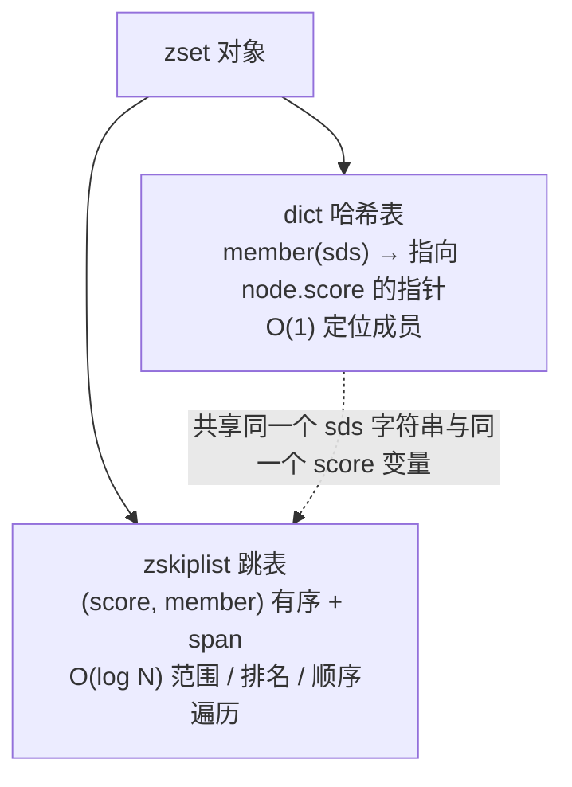
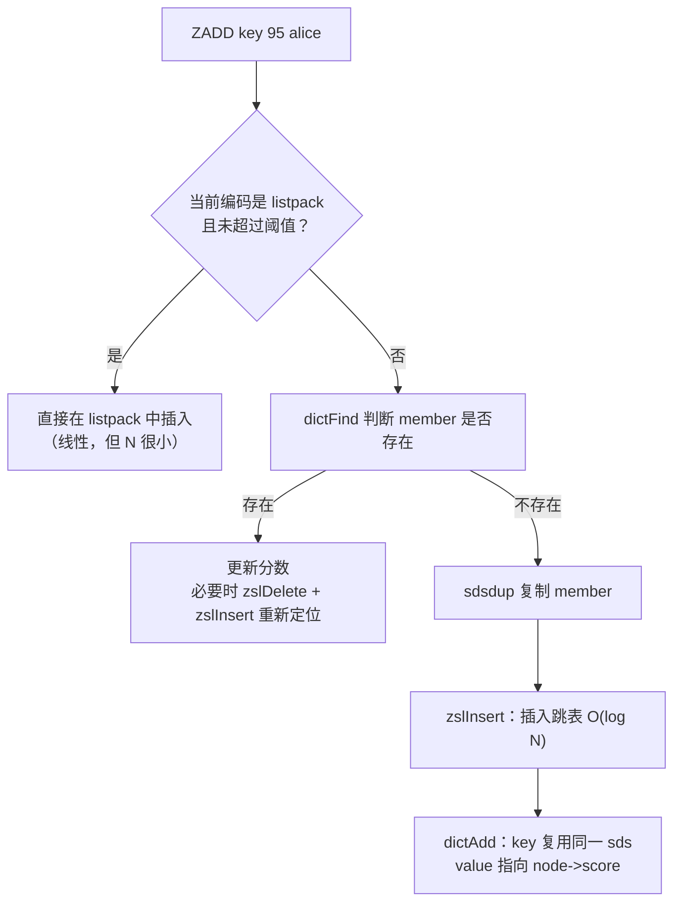

# 跳表（Skip List）与 Redis 有序集合深度笔记

> 一句话概括：跳表用「多级索引 + 随机层高」把一个只能顺序扫描的有序链表，改造成期望 `O(log N)` 的查找结构；
> Redis 把「跳表」和「哈希表」拼在一起，才同时拿到了「按分数有序」和「按成员 O(1) 定位」两种能力，这就是 `zset`。

本文基于 Redis 7.x 源码（`server.h`、`t_zset.c`）整理，兼顾原理、源码与选型，面向初级到资深不同深度的读者。

---

## 0. 阅读路线

| 读者 | 建议阅读 | 关注点 |
| --- | --- | --- |
| 初级 / 刚接触数据结构 | 第 1 章、第 5 章浅层题 | 跳表长什么样、为什么快、能回答"什么是跳表" |
| 中级 / 日常开发 | 全部，重点 1.4 ~ 1.8、2.2 ~ 2.8 | 查找/插入/删除的具体过程，`zset` 的读写路径 |
| 高级 / 准备面试 | 1.8、2.3 ~ 2.5、第 3 章、第 5 章 | 复杂度推导、`span` 设计、为什么不用红黑树 |
| 资深 / 做技术选型 | 第 3 章、2.9、2.10、第 7 章 | 工程权衡、内存账本、其他系统的同类选择 |

目录：

1. 跳表是什么
2. Redis 如何用跳表实现有序集合
3. 为什么是跳表：与其他排序结构的对比
4. 命令与复杂度速查
5. 高频面试问答
6. 动手：一百行写一个跳表
7. 跳表在工业界的其他用武之地
8. 参考资料

---

## 1. 跳表是什么

### 1.1 起点：有序链表的天花板

有序链表的结构非常朴素：每个节点存一个值，外加一个指向下一个节点的指针，整体按值升序排列。

```
head → 5 → 8 → 10 → 15 → 20 → 25 → 30 → 35 → 40 → NULL
```

它有两个天然优点：

- **有序**：从头到尾遍历，天然就是升序结果，范围查询（"取 15 到 30 之间"）非常自然。
- **插入/删除便宜**：只要已经拿到前驱节点，改两个指针就行，`O(1)`。

但它有一个致命缺点：**查找只能从头一个个走**，复杂度 `O(N)`。100 万个元素，平均要走 50 万步。

数组可以用二分查找把查找降到 `O(log N)`，但数组的插入/删除是 `O(N)`（要搬移元素）。
平衡树可以同时做到 `O(log N)` 查找和 `O(log N)` 更新，代价是实现复杂（旋转、着色）。

跳表给出了第三条路：**保留链表的简单性，用"加索引"的方式把查找降到 `O(log N)`**。

### 1.2 核心思想：给链表加"快速通道"

想象你在看一本 1000 页的书。如果只能一页页翻，找第 837 页要翻 837 次；但如果你先看目录定位到章节，再在章节内翻，就快得多。

跳表做的就是这件事：在原始链表（第 0 层）之上，再建若干层"稀疏索引"。

- 第 1 层：每 2 个节点抽 1 个；
- 第 2 层：每 4 个节点抽 1 个；
- 第 3 层：每 8 个节点抽 1 个；
- ……

查找时从最高层开始，能往右就往右，不能往右就下降一层。这样每一层都跳过了大量节点，整体查找步数从 `O(N)` 降到 `O(log N)`。

```
level 3:  header ─────────────────────────────────────▶ 30 ─────────────▶ NULL
level 2:  header ────────────────▶ 10 ────────────────▶ 30 ─────────────▶ NULL
level 1:  header ──────▶ 5 ──────▶ 10 ──▶ 20 ────────▶ 30 ──▶ 40 ───────▶ NULL
level 0:  header ──▶ 5 ─▶ 8 ─▶ 10 ─▶ 15 ─▶ 20 ─▶ 25 ─▶ 30 ─▶ 35 ─▶ 40 ──▶ NULL
```

（这是理想化的"严格等间隔"画法，便于理解；真实实现里层高是随机的，见 1.7。）

**关键洞察**：链表本身没有变，第 0 层仍然是完整的有序链表。索引层只是"额外挂上去的指针"，让查找时可以跳过节点。所以：

- 范围查询依然简单：找到起点后沿第 0 层顺序走；
- 插入/删除依然只是改指针；
- 唯一的代价是**额外的指针占用内存**——典型的时间换空间。

### 1.3 结构与术语

```
header（哨兵节点，不存数据，固定拥有最高层的指针）
  │ level 3  forward ──────────────────▶ ...
  │ level 2  forward ─────────▶ ...
  │ level 1  forward ──▶ ...
  │ level 0  forward ──▶ 第一个真实节点
  ▼
真实节点 = { ele, score, backward, level[0 .. k-1] }
           └─ 层数 k 由抛硬币决定
```

几个术语：

| 术语 | 含义 |
| --- | --- |
| 层（level） | 一个节点拥有的指针数组长度。节点在第几层有指针，就说它"高几层" |
| 头节点（header） | 哨兵节点，不存业务数据，固定拥有最高层的指针，是查找的起点 |
| 跨度（span） | Redis 特有：某层指针一次跳过多少个底层节点，用于 O(log N) 求排名 |
| 后退指针（backward） | Redis 特有：第 0 层的反向指针，支持逆序遍历 |
| 随机层高 | 新节点的层数不是固定的，而是按概率随机决定 |

### 1.4 查找过程：从左上角出发

规则只有两条：

1. **能往右就往右**：如果当前层的下一个节点值仍小于目标，就移过去；
2. **不能往右就下降**：否则降到下一层，继续尝试。

以上图查找 `25` 为例：

| 步骤 | 所在层 | 动作 | 说明 |
| --- | --- | --- | --- |
| 1 | level 3 | header → 30 | 30 > 25，不能往右，下降 |
| 2 | level 2 | header → 10 → 30 | 30 > 25，停在 10，下降 |
| 3 | level 1 | 10 → 20 → 30 | 30 > 25，停在 20，下降 |
| 4 | level 0 | 20 → 25 | 命中 |

总共比较 6 次。如果从第 0 层线性找，需要 7 步；元素越多，差距越明显——100 万个元素时大约 20 层、40 次比较即可，而不是 50 万次。

用伪代码表达：

```text
search(target):
    node = header
    for level from top down to 0:
        while node.forward[level] != NULL and node.forward[level].value < target:
            node = node.forward[level]
    # 此时 node 是第 0 层里小于 target 的最后一个节点
    return node.forward[0]  # 判断是否等于 target
```

注意：**查找结束时停下的位置，恰好是目标节点的前驱**。这个性质让插入和删除可以复用同一套查找逻辑，这也是跳表实现简洁的重要原因。

### 1.5 插入过程

插入分三步：

1. **定位**：用上面的查找逻辑，记录每一层"最后一个小于新值的节点"，记为 `update[i]`（这就是"前驱数组"）；
2. **掷骰子**：随机决定新节点的层数 `level`；
3. **接线**：对 `0 <= i < level` 的每一层，把新节点插到 `update[i]` 之后。

示意：在下面的跳表中插入 `22`，随机得到层数 3。

```
插入前：
level 2:  header ────────────────▶ 10 ────────────────▶ 30 ─────────────▶ NULL
level 1:  header ──────▶ 5 ──────▶ 10 ──▶ 20 ────────▶ 30 ──▶ 40 ───────▶ NULL
level 0:  header ──▶ 5 ─▶ 8 ─▶ 10 ─▶ 15 ─▶ 20 ─▶ 25 ─▶ 30 ─▶ 35 ─▶ 40 ──▶ NULL

插入 22（层数 3）后：
level 2:  header ────────────────▶ 10 ────────────────▶ 22 ──▶ 30 ──────▶ NULL
level 1:  header ──────▶ 5 ──────▶ 10 ──▶ 20 ────────▶ 22 ──▶ 30 ──▶ 40 ─▶ NULL
level 0:  header ──▶ 5 ─▶ 8 ─▶ 10 ─▶ 15 ─▶ 20 ─▶ 22 ─▶ 25 ─▶ 30 ─▶ 35 ─▶ 40 ─▶ NULL
```

关键点：

- 插入**不需要移动任何已有元素**，只改 `level` 个指针；
- 如果新节点的层数超过当前跳表最高层，就把多出来的层直接接在 header 后面，并抬高 `level`；
- 整个过程没有旋转、没有重新平衡——这是跳表相对平衡树最大的工程优势。

### 1.6 删除过程

删除同样先定位前驱，然后对每一层判断"我的下一个节点是不是要删的节点"，是就跳过它：

```text
delete(target):
    update = find_predecessors(target)
    x = update[0].forward[0]
    if x == NULL or x.value != target: return false
    for i in 0 .. x.level-1:
        if update[i].forward[i] == x:
            update[i].forward[i] = x.forward[i]
    如果最高层已经没有任何节点，降低 level
    释放 x
```

删除也是局部操作，平均 `O(log N)`，同样没有全局重排。

### 1.7 层高怎么定：抛硬币

如果严格按"每 2 个抽 1 个"建索引，插入删除后就必须维护这个比例（重新分层），复杂度立刻回到 `O(N)` 或者引入平衡逻辑。

跳表的解法是：**每插入一个节点，抛硬币决定它有多高**。

规则（Pugh 原始论文的写法）：

- 节点初始在第 1 层（第 0 层）；
- 以概率 `p` 继续往上长一层；
- 重复直到失败，或达到最大层数 `MAX_LEVEL`。

于是：

```
P(节点层数 >= k) = p^(k-1)
P(节点层数 = k)  = p^(k-1) * (1 - p)
```

例如 `p = 0.25` 时：所有节点都在第 0 层；1/4 的节点在第 1 层也有指针；1/16 的节点到第 2 层；1/64 到第 3 层……

这样得到的索引"期望上"是均匀的，但**不需要任何维护成本**：插入时掷一次骰子即可，删除时该降层就降层。

一个常见的疑问：随机层高会不会让结构退化？

- 单个节点层数过高不会破坏正确性，只会多占几个指针；
- 整张表退化成纯链表（所有节点都是 1 层）的概率是 `(1-p)^n`，元素一多就趋近于 0；
- 期望复杂度仍然是 `O(log N)`，只是"期望"而不是"最坏"。

对 Redis 这种单线程、客户端无法影响随机源的场景，这个概率保证完全够用。

### 1.8 复杂度分析（推导）

设节点数为 `n`，提升概率为 `p`。

**一层有多少节点？** 第 `k` 层（从 0 开始计）的节点数期望是 `n * p^k`。

**表有多少层？** 令 `n * p^L ≈ 1`，得

```
L ≈ log_(1/p) n
```

**查找要走多少步？**

- 在每一层，从"进入该层的位置"往右走，平均期望前进 `1/p` 步就会遇到一个"下一跳超出目标"的节点（因为相邻两个高层节点的间距期望是 `1/p`）；
- 一共 `log_(1/p) n` 层。

所以期望比较次数约为：

```
(1/p) * log_(1/p) n
```

这个量级是 `O(log N)`。`n = 10^6` 时的具体数值：

| 提升概率 p | 每节点期望层数 `1/(1-p)` | 表的层数 `log_(1/p) n` | 期望比较次数 | 指针内存相对值 |
| --- | --- | --- | --- | --- |
| 1/2 | 2.00 | ≈ 20 | ≈ 40 | 2.00 |
| 1/4（Redis） | 1.33 | ≈ 10 | ≈ 40 | 1.33 |
| 1/8 | 1.14 | ≈ 7 | ≈ 56 | 1.14 |

可以看到：`p` 从 1/2 降到 1/4，查找步数几乎不变，但每个节点的指针期望从 2 个降到 1.33 个。**这就是 Redis 选 1/4 的原因**（详见 2.4）。

再看空间：节点总层数期望是 `n / (1-p)`，也就是总指针数约为 `1.33n`。相对于存数据的部分，这是可以接受的常数开销。

**最坏情况**：如果运气极差（或随机源可被对手预测），所有节点都是 1 层，查找退化为 `O(N)`。这是跳表相对红黑树唯一的理论短板——**跳表是概率平衡，平衡树是严格平衡**。

### 1.9 跳表的性能特征与代价

| 维度 | 表现 | 说明 |
| --- | --- | --- |
| 查找 | 期望 `O(log N)` | 每层走 `1/p` 步，共 `log_(1/p) N` 层 |
| 插入 | 期望 `O(log N)` | 定位 O(log N) + 改 level 个指针 |
| 删除 | 期望 `O(log N)` | 同上 |
| 范围查询 | `O(log N + M)` | 定位起点 O(log N)，然后沿底层链表走 M 步 |
| 排名 | `O(log N)`（带 span） | 见 Redis 的 span 设计 |
| 最坏 | `O(N)` | 概率极低，随机源不可控时才会出现 |
| 实现复杂度 | **低** | 无旋转、无着色、无分裂合并 |
| 内存 | 中 | 每节点约 `1/(1-p)` 个指针，`p=1/4` 时 1.33 个 |
| 缓存局部性 | 一般 | 指针跳转，节点在堆上分散；不如数组/B+ 树顺序扫描 |

一句话：**跳表用"多几个指针"换来了"实现简单 + 范围查询友好 + 无锁友好"**。

---

## 2. Redis 如何用跳表实现有序集合

### 2.1 为什么一个结构不够：dict + skiplist

有序集合 `zset` 要同时支持两类操作：

| 操作 | 例子 | 需要的能力 |
| --- | --- | --- |
| 按成员查分数 | `ZSCORE key alice` → `95` | 精确查找，最好 `O(1)` |
| 按分数排序/范围/排名 | `ZRANGE key 0 9`、`ZRANGEBYSCORE`、`ZRANK` | 有序结构，`O(log N)` |

一种结构很难同时把两件事做到最优：

- 只用哈希表：`ZSCORE` 是 `O(1)`，但完全无序，范围查询、排名无从谈起；
- 只用跳表：有序、范围、排名都行，但"按成员找分数"要 `O(log N)`，而且每次都得比较字符串。

Redis 的选择非常直接：**两个都要，拼起来**。



- `dict` 负责"成员 → 分数"的 `O(1)` 映射；
- `zskiplist` 负责"按分数有序"的一切；
- 两者**共享同一份数据**：dict 的 key 就是跳表节点里的那个 `sds`，dict 的 value 直接指向跳表节点的 `score` 字段。所以不是存了两份元素，只是多存了一份索引。

### 2.2 源码里的数据结构

`server.h` 中的定义（Redis 7.x）：

```c
typedef struct zset {
    dict *dict;      /* member -> score 的映射 */
    zskiplist *zsl;  /* 按 (score, member) 有序的跳表 */
} zset;
```

跳表节点：

```c
typedef struct zskiplistNode {
    sds ele;                          /* 成员，字符串 */
    double score;                     /* 分数，排序依据 */
    struct zskiplistNode *backward;   /* 第 0 层的后退指针，支持逆序 */
    struct zskiplistLevel {
        struct zskiplistNode *forward; /* 该层下一个节点 */
        unsigned long span;            /* 到下一个节点跨过了多少个底层节点 */
    } level[];                        /* 柔性数组：长度 = 该节点的层数 */
} zskiplistNode;

typedef struct zskiplist {
    struct zskiplistNode *header, *tail; /* 头节点、尾节点 */
    unsigned long length;                /* 元素个数 */
    int level;                           /* 当前最高层数 */
} zskiplist;
```

几个值得注意的实现细节：

1. **`level[]` 是柔性数组**，每个节点按自己的层数分配内存：

   ```c
   zskiplistNode *zslCreateNode(int level, double score, sds ele) {
       zskiplistNode *zn =
           zmalloc(sizeof(*zn) + level * sizeof(struct zskiplistLevel));
       zn->score = score;
       zn->ele = ele;
       return zn;
   }
   ```

   层数低的节点只占一个指针的位置，不会为"可能用到的层"预留空间。

2. **header 固定分配 32 层**，且不存数据（`ele = NULL`、`score = 0`），所有层的 `forward` 初始为 `NULL`、`span` 为 0。

3. **`tail` 是真实节点指针**，配合 `backward` 支持 `ZREVRANGE` 这类逆序操作。

4. 跳表没有"负无穷/正无穷"哨兵节点，用 `NULL` 表示结束——比教科书版本更省内存。

### 2.3 关键设计一：span —— 用跨度换排名

普通跳表只能回答"有没有、在哪里"，回答不了"它是第几名"。而 `ZRANK`、`ZRANGE start stop` 恰恰需要排名。

Redis 在每个指针上额外存了一个 `span`：

> `span` = 这个指针一次跨过了多少个第 0 层节点（**包含目标节点本身**）。

```
level 2:  header ──span=3──▶ 10 ──span=2──▶ 30 ──▶ NULL
level 1:  header ──span=2──▶ 5 ──span=2──▶ 10 ──span=2──▶ 20 ──▶ 30 ──▶ NULL
level 0:  header ──1──▶ 5 ─1─▶ 8 ─1─▶ 10 ─1─▶ 15 ─1─▶ 20 ─1─▶ 25 ─1─▶ 30 ─▶ NULL
```

于是：**从 header 走到某个节点，沿途把所有 `span` 加起来，就是它的排名（1-based）**。

```c
unsigned long zslGetRank(zskiplist *zsl, double score, sds ele) {
    zskiplistNode *x;
    unsigned long rank = 0;
    int i;

    x = zsl->header;
    for (i = zsl->level-1; i >= 0; i--) {
        while (x->level[i].forward &&
            (x->level[i].forward->score < score ||
                (x->level[i].forward->score == score &&
                sdscmp(x->level[i].forward->ele, ele) <= 0))) {
            rank += x->level[i].span;   /* 一次跳跃，累加跨过的节点数 */
            x = x->level[i].forward;
        }
        if (x->ele && x->score == score && sdscmp(x->ele, ele) == 0) {
            return rank;
        }
    }
    return 0;   /* 0 表示不存在 */
}
```

反过来，给定排名找节点，也只需要"按 span 跳楼梯"：

```c
zskiplistNode *zslGetElementByRank(zskiplist *zsl, unsigned long rank) {
    zskiplistNode *x;
    unsigned long traversed = 0;
    int i;

    x = zsl->header;
    for (i = zsl->level-1; i >= 0; i--) {
        while (x->level[i].forward && (traversed + x->level[i].span) <= rank) {
            traversed += x->level[i].span;
            x = x->level[i].forward;
        }
        if (traversed == rank) {
            return x;
        }
    }
    return NULL;
}
```

这样就实现了：

- `ZRANGE key 100 199`：先用 `zslGetElementByRank` 跳到第 100 名（`O(log N)`），再沿底层走 100 步（`O(M)`），总计 `O(log N + M)`；
- 如果没有 `span`，就只能从第 0 层数 100 步，虽然这里 M 不大，但对于 `ZRANGE 500000 500009` 这类操作，`span` 让"定位"这一步保持 `O(log N)` 而不是 `O(N)`。

**`span` 的维护**是插入/删除中最容易写错的部分，也是面试深挖点。

插入时（`zslInsert` 核心片段）：

```c
    /* 记录每层前驱，以及从 header 走到该前驱跨过的节点数 */
    x = zsl->header;
    for (i = zsl->level-1; i >= 0; i--) {
        rank[i] = (i == zsl->level-1) ? 0 : rank[i+1];
        while (x->level[i].forward &&
               (x->level[i].forward->score < score ||
                (x->level[i].forward->score == score &&
                 sdscmp(x->level[i].forward->ele, ele) < 0))) {
            rank[i] += x->level[i].span;
            x = x->level[i].forward;
        }
        update[i] = x;
    }

    /* 新节点层数更高时，多出来的层直接挂在 header 后面 */
    level = zslRandomLevel();
    if (level > zsl->level) {
        for (i = zsl->level; i < level; i++) {
            rank[i] = 0;
            update[i] = zsl->header;
            update[i]->level[i].span = zsl->length;
        }
        zsl->level = level;
    }

    x = zslCreateNode(level, score, ele);
    for (i = 0; i < level; i++) {
        x->level[i].forward = update[i]->level[i].forward;
        update[i]->level[i].forward = x;

        /* 把原来 update[i] 到 forward 之间的跨度，按第 0 层的真实步数切开 */
        x->level[i].span = update[i]->level[i].span - (rank[0] - rank[i]);
        update[i]->level[i].span = (rank[0] - rank[i]) + 1;
    }

    /* 新节点没有覆盖到的层，跨度都要 +1（下面多了一个节点） */
    for (i = level; i < zsl->level; i++) {
        update[i]->level[i].span++;
    }
```

理解这段代码的关键是 `rank[i]`：它表示"从 header 沿第 i 层走到 `update[i]`，跨过了多少个底层节点"。而 `rank[0] - rank[i]` 就是"`update[i]` 到插入位置之间，还剩多少个底层节点"。原来的 `span` 减掉这一段，剩给新节点的后继；新节点自己占 1 个位置。

删除时（`zslDeleteNode`）：

```c
void zslDeleteNode(zskiplist *zsl, zskiplistNode *x, zskiplistNode **update) {
    int i;
    for (i = 0; i < zsl->level; i++) {
        if (update[i]->level[i].forward == x) {
            update[i]->level[i].span += x->level[i].span - 1;  /* 把 x 的跨度合并给前驱 */
            update[i]->level[i].forward = x->level[i].forward;
        } else {
            update[i]->level[i].span -= 1;                     /* 这一层没经过 x，但少了一个节点 */
        }
    }
    if (x->level[0].forward) {
        x->level[0].forward->backward = x->backward;
    } else {
        zsl->tail = x->backward;
    }
    while (zsl->level > 1 && zsl->header->level[zsl->level-1].forward == NULL)
        zsl->level--;                                          /* 最高层空了就降层 */
    zsl->length--;
}
```

注意那个 `else` 分支：如果某层的前驱不是 `x`（说明 `x` 的层数比这一层低），这一层虽然不用改指针，但少了一个底层节点，所以 `span` 要减 1。

### 2.4 关键设计二：随机层高 1/4，最大 32 层

```c
#define ZSKIPLIST_MAXLEVEL 32   /* 最多 32 层 */
#define ZSKIPLIST_P 0.25        /* 每提升一层的概率 1/4 */

int zslRandomLevel(void) {
    static const int threshold = ZSKIPLIST_P * RAND_MAX;
    int level = 1;
    while (random() < threshold)
        level += 1;
    return (level < ZSKIPLIST_MAXLEVEL) ? level : ZSKIPLIST_MAXLEVEL;
}
```

三个问题逐一回答：

**① 为什么 `p = 1/4` 而不是 1/2？**

- 查找步数：`p=1/2` 是 `2 * log2 n`，`p=1/4` 是 `4 * log4 n`，两者换算成 2 为底都约等于 `2 * log2 n`——**速度几乎一样**；
- 指针内存：每节点期望层数 `1/(1-p)`，`p=1/2` 要 2 个指针，`p=1/4` 只要 1.33 个，**省下约 1/3**；
- 实现上 `ZSKIPLIST_P * RAND_MAX` 是编译期算好的整数阈值，运行时只做一次整数比较，没有浮点运算。

数学上最优的 `p` 在 `1/e ≈ 0.368` 附近（最小化 `(1/p) * log_(1/p) n`），`1/4` 很接近最优，同时是 2 的幂，工程上更顺手。

**② 为什么最大 32 层？**

`p = 1/4` 时，`P(层数 >= 32) = (1/4)^31 = 2^-62`。也就是说，要出现 32 层，大约需要 `4^31 ≈ 4.6 × 10^18` 个元素——远超任何单机 Redis 实例能存下的数据量。32 层足够覆盖所有现实场景，同时让 header 的固定开销只有 `32 × 16 = 512` 字节。

**③ 层高超过 32 怎么办？**

直接截断为 32。截断只影响极端情况的期望值，不影响正确性。

### 2.5 关键设计三：`(score, member)` 复合排序

有序集合允许分数重复。分数相同时怎么排？Redis 规定：**按 member 的字典序（二进制比较）升序**。

跳表里的比较逻辑随处可见：

```c
/* 先比分数，分数相同再比 member */
(x->level[i].forward->score < score ||
 (x->level[i].forward->score == score &&
  sdscmp(x->level[i].forward->ele, ele) < 0))
```

这个设计带来两个好处：

1. **顺序是确定的**：`ZRANGE` 不会因为分数相同而出现"随机顺序"，同样的数据永远得到同样的结果；
2. **字典序范围查询成为可能**：`ZRANGEBYLEX` 依赖的正是"分数相同时按 member 字典序排列"这一性质。Redis 文档也特别说明：`ZRANGEBYLEX` 只在所有元素分数相同时行为才可预期。

再看分数本身：`score` 是 IEEE 754 双精度浮点数。允许 `+inf` / `-inf`，但**不允许 NaN**（`zslInsert` 里有 `serverAssert(!isnan(score))`）。`-0.0` 会被规范化成 `0.0`，避免出现"两个 0 却不相等"的诡异情况。

### 2.6 关键设计四：`backward` 指针

第 0 层是完整的有序链表，Redis 为它加了反向指针：

- `ZREVRANGE key 0 9`：从 `tail` 开始沿 `backward` 走 10 步；
- `ZREVRANGEBYSCORE key max min`：先 `zslLastInRange` 定位，再反向遍历。

如果没有 `backward`，逆序查询要么从头走到底（`O(N)`），要么维护一个额外的反向跳表（双倍内存）。一个 8 字节的指针解决了问题。

### 2.7 写路径：一次 `ZADD` 发生了什么



对应的源码（`t_zset.c`，简化后）：

```c
/* 新增成员 */
if (de == NULL) {
    zskiplistNode *znode;
    ele = sdsdup(ele);
    znode = zslInsert(zs->zsl, score, ele);
    serverAssert(dictAdd(zs->dict, ele, &znode->score) == DICT_OK);
}
```

两个细节值得注意：

- **`dictAdd` 的 value 是 `&znode->score`**：dict 不另外存一份分数，而是指向跳表节点里的 `score` 字段。查 `ZSCORE` 时解引用即可，改分数时也只改一处，不会出现两个结构数据不一致。
- **更新已有成员的分数**：Redis 不会无脑删了重插，而是先看新分数是否还落在"前驱和后继之间"。如果位置不变，直接改 `score` 即可（`O(1)`）；只有顺序需要调整时才 `zslDeleteNode` + `zslInsert`。对应函数是 `zslUpdateScore`。

另外还有两个影响写路径的细节：

- `ZADD NX`：成员存在时直接返回，不做任何修改；
- `ZADD XX`：成员不存在时不插入；
- `ZADD GT/LT`：只有新分数更大/更小时才更新，否则视为 no-op。

这些都建立在"dict 先判断存在性"的基础上——如果只有跳表，判断存在性本身就要 `O(log N)`。

### 2.8 读路径：范围查询是怎么走的

**① `ZRANGE key start stop`（按排名）**

1. `zslGetElementByRank(start+1)`：借助 `span` 在 `O(log N)` 内跳到起点；
2. 沿第 0 层 `forward` 走 `stop - start + 1` 步，边走边收集；
3. 总复杂度 `O(log N + M)`。

**② `ZRANGEBYSCORE key min max`（按分数）**

1. `zslFirstInRange`：从左上角出发，跳过所有"分数小于 min"的节点，找到第一个满足条件的节点；
2. 沿第 0 层往后走，直到分数超过 max；
3. 总复杂度 `O(log N + M)`。

```c
zskiplistNode *zslFirstInRange(zskiplist *zsl, zrangespec *range) {
    zskiplistNode *x;
    int i;

    if (!zslIsInRange(zsl, range)) return NULL;   /* 整体不在范围内，直接返回 */

    x = zsl->header;
    for (i = zsl->level-1; i >= 0; i--) {
        /* 只要能跳到一个仍然小于下界的节点，就往前跳 */
        while (x->level[i].forward &&
               !zslValueGteMin(x->level[i].forward->score, range))
            x = x->level[i].forward;
    }

    x = x->level[0].forward;
    serverAssert(x != NULL);
    if (!zslValueLteMax(x->score, range)) return NULL;
    return x;
}
```

注意这里和普通查找的微妙差别：查找是"边跳边比较"，而范围查询是"先把所有小于下界的节点跳过去，最后落到第一个候选节点上"。开区间/闭区间由 `zslValueGteMin` / `zslValueLteMax` 里的 `minex` / `maxex` 标记处理。

**③ `ZRANK key member`**

1. `dictFind` 拿到分数，`O(1)`；
2. `zslGetRank` 累加 `span`，`O(log N)`。

**④ `ZREVRANGE`**

1. 正向算出起点，或从 `tail` 反向走；
2. 沿 `backward` 收集。

**⑤ `ZCOUNT`**

先用 `zslFirstInRange` / `zslLastInRange` 定位两端，再用两次 `zslGetRank` 相减。`O(log N)`。

**⑥ `ZREMRANGEBYSCORE`**

定位区间起点后，沿第 0 层逐个摘除。每个节点摘除时要更新各层指针和 `span`，但层数上限固定为 32，所以单次摘除是常数级开销；整体复杂度是 `O(log N + M)`（官方文档口径）。实现上 `zslDeleteRangeByScore` 只计算一次前驱数组，之后连续摘除，不会每删一个节点都重新查找。

### 2.9 内存账本

以 `p = 1/4`、100 万个元素为例，粗略估算每个元素的额外开销：

| 组成部分 | 大小（约） | 说明 |
| --- | --- | --- |
| 跳表节点基础字段 | 24 B | `sds` 指针 8 + `score` 8 + `backward` 8 |
| 层数组 | 1.33 × 16 ≈ 21 B | 每层 `forward` 8 + `span` 8 |
| dictEntry | 24 B | 三个指针（key / value / next） |
| 哈希桶均摊 | 8 B | 负载因子约 1 |
| 分配器开销 | 8 ~ 16 B | jemalloc 尺寸类对齐 |
| **合计** | **约 85 B** | 不含 member 字符串本身 |

再加上 `sds` 本身（头部 + 字符串内容，通常 16 ~ 48 字节）。所以一个 100 万元素、member 平均 10 字节的 zset，内存大约在 100 MB 量级——这也解释了为什么 Redis 官方建议大 zset 要评估内存，而不是无脑塞。

对比一下：如果用纯跳表（不配 dict），可以省掉 dictEntry 和桶，但 `ZSCORE` 会从 `O(1)` 变成 `O(log N)`，`ZADD` 的存在性判断也要多一次查找。Redis 选择用约 32 字节/元素换 `O(1)` 的 `ZSCORE`，在"读多写少、排行榜类场景"里是划算的。

> 注：以上数字是量级估算，实际取决于 member 长度、分配器尺寸类和哈希表负载情况。

### 2.10 编码切换：小对象根本不用跳表

跳表不是唯一选择。当 zset 很小时，跳表 + 哈希表的固定开销（header 512 字节、dict 结构本身）显得很浪费，Redis 会改用**紧凑的 listpack**：

| 条件 | 编码 | `ZSCORE` 复杂度 |
| --- | --- | --- |
| 元素数 ≤ `zset-max-listpack-entries`（默认 128）且每个 member 长度 ≤ `zset-max-listpack-value`（默认 64） | `listpack` | `O(N)`（线性扫描，但 N ≤ 128） |
| 超过任一阈值 | `skiplist` | `O(1)` |

可以用命令观察：

```bash
redis-cli zadd board 95 alice
redis-cli object encoding board          # listpack
redis-cli config set zset-max-listpack-entries 2
redis-cli zadd board 80 bob
redis-cli object encoding board          # skiplist
```

两个版本细节：

- Redis 7.0 之前用的是 `ziplist`，对应配置名 `zset-max-ziplist-entries`；7.0 起统一换成 `listpack`；
- listpack 编码下**没有 dict**，元素按 `(member, score)` 交替存放在一块连续内存里，所以 `ZSCORE` 是线性扫描。由于 N 很小，实际比跳表还快（缓存友好、无指针）。

这个设计体现了一个通用原则：**数据结构的选择要跟着数据规模走**。小数据用紧凑结构换内存和局部性，大数据用索引结构换渐进复杂度。

---

## 3. 为什么是跳表：与其他排序结构的对比

### 3.1 候选方案横向对比

| 结构 | 查找 | 插入/删除 | 范围查询 | 按排名 | 实现复杂度 | 内存 | 适用场景 |
| --- | --- | --- | --- | --- | --- | --- | --- |
| 有序数组 | `O(log N)` 二分 | `O(N)` 搬移 | `O(log N + M)` | `O(1)` | 低 | 最紧凑 | 静态数据、读多写无 |
| 有序链表 | `O(N)` | `O(1)`（已知前驱） | `O(N + M)` | `O(N)` | 最低 | 低 | 只做顺序遍历 |
| 红黑树 / AVL | `O(log N)` 最坏 | `O(log N)` 最坏 | `O(log N + M)` | `O(log N)`（需额外 size 字段） | **高**（旋转、着色） | 每节点 2 指针 + 颜色 | 通用有序容器 |
| B+ 树 | `O(log N)` | `O(log N)` | `O(log N + M)`，叶子链表 | 需额外计数 | 高（分裂/合并） | 高（页式结构） | 磁盘索引、数据库 |
| **跳表** | `O(log N)` 期望 | `O(log N)` 期望 | `O(log N + M)`，底层链表 | `O(log N)`（span） | **低** | 中（1.33 指针/节点） | 内存有序索引、排行榜 |
| 堆 | `O(1)` 取极值 | `O(log N)` | 不支持 | 不支持 | 中 | 低 | 优先队列、定时器 |
| 哈希表 | `O(1)` | `O(1)` | 不支持（无序） | 不支持 | 低 | 中 | 精确查找 |

### 3.2 为什么不用红黑树 / AVL

这是面试最常问的对比。Redis 作者 antirez 在多个场合解释过，核心原因有四条：

**① 范围查询的实现成本**

跳表的第 0 层本来就是一条有序链表。找到起点后，沿着 `forward` 一路走即可，代码就是几行 `while`。

红黑树要做范围查询，得走中序遍历：要么递归/显式栈，要么给每个节点加父指针做"后继"查找。前者有函数调用和栈开销，后者多 8 字节/节点。而且中序遍历的访问顺序在内存上是"树形跳跃"，缓存局部性并不好。

**② 实现复杂度与 bug 风险**

红黑树的插入删除要考虑变色、左旋、右旋、双旋，各种 case 分支；AVL 要维护平衡因子。跳表只有"找前驱 → 改指针"两步，`zslInsert` 不到 60 行，且没有全局不变式需要维护。

对于 Redis 这种"正确性极其重要、又要保持代码可读"的基础设施，**简单本身就是一种性能**：少一个 bug，少一次线上事故。

**③ 排名（rank）的支持**

红黑树要支持 `O(log N)` 排名，每个节点得额外存"子树大小"，删除/旋转时更新；跳表只需要在指针上存 `span`，插入删除时顺手加减——而且 `span` 本来就和指针放在一起，访问时一次缓存行就拿到了。

**④ 并发友好（加分项）**

虽然 Redis 是单线程执行命令，跳表的"局部修改、无全局重平衡"特性在别的系统里是决定性的：LevelDB/RocksDB 的 memtable 用跳表，正是因为它允许"单写多读"的无锁实现——写线程只改局部指针，读线程永远能看到一致的结构；而平衡树的旋转会牵动一大片节点，很难做无锁。

顺带一提：Java 的 `ConcurrentSkipListMap` 也是同样的理由。

### 3.3 为什么不用 B+ 树

B+ 树是为**磁盘**设计的：一个节点存几百个 key，一次 I/O 读一整页，把树高压到 3~4 层。它的优势建立在"磁盘随机读很贵、顺序读便宜"这个前提上。

Redis 是纯内存数据库，没有磁盘 I/O 的约束，B+ 树的核心优势用不上；反而要承担节点分裂/合并、页内搬移的复杂度，以及更高的内存放大。所以不合适。

反过来说：如果数据在磁盘上（MySQL、RocksDB 的 SSTable），B+ 树/LSM 才是正解。**结构选择永远取决于存储介质和访问模式**。

### 3.4 为什么不用有序数组、堆、纯哈希

- **有序数组**：查找快，但 `ZADD` 要在中间插入，得搬移后面所有元素，`O(N)`。排行榜场景写入很频繁，不可接受。
- **堆**：只能快速拿到最大/最小，拿不到"第 100 名"，也做不了"取分数在 [80, 90] 之间的所有人"。`ZRANGE` 这类需求直接出局。
- **纯哈希**：`ZSCORE` 很快，但无序。要范围查询就得每次全量排序，`O(N log N)`。
- **纯跳表**：能查、能排，但"成员 → 分数"要 `O(log N)` 且每次比较字符串。配上 dict 后，`ZSCORE` 变成 `O(1)`，`ZADD` 的存在性判断也变成 `O(1)`。

所以 Redis 的最终答案是 **`dict + skiplist` 的组合**，而不是单选某一个。

### 3.5 诚实地说，跳表的代价

任何选型都有代价，跳表也不例外：

| 代价 | 说明 | 缓解方式 |
| --- | --- | --- |
| 最坏 `O(N)` | 概率平衡，理论上可能退化 | 随机源不可被客户端影响；32 层上限；实际退化概率可忽略 |
| 内存开销 | 每节点约 1.33 个额外指针 | `p=1/4` 已是在速度和内存间的折中；小对象退回 listpack |
| 缓存局部性一般 | 指针跳转，节点分散在堆上 | 无法完全避免；顺序遍历时 jemalloc 的分配局部性有帮助 |
| 不支持并发写 | 跳表本身不是线程安全的 | Redis 单线程模型下不是问题 |
| 无"第 k 小"的稳定下界 | 依赖随机性 | 用 `span` 保证排名查询的对数复杂度 |

一句话总结：**跳表不是"最好的有序结构"，而是"在内存场景下综合成本最低的有序结构"**。

---

## 4. 命令与复杂度速查

| 命令 | 复杂度 | 用到的结构 |
| --- | --- | --- |
| `ZADD key score member [score member ...]` | `O(M log N)` | dict 判重 + zslInsert |
| `ZSCORE key member` | `O(1)` | dict |
| `ZINCRBY key increment member` | `O(log N)` | dict + zslUpdateScore |
| `ZCARD key` | `O(1)` | `zsl->length` |
| `ZCOUNT key min max` | `O(log N)` | zslFirst/LastInRange + zslGetRank |
| `ZRANK / ZREVRANK key member` | `O(log N)` | dict + span 累加 |
| `ZRANGE key start stop [WITHSCORES]` | `O(log N + M)` | zslGetElementByRank + 底层遍历 |
| `ZRANGEBYSCORE key min max` | `O(log N + M)` | zslFirstInRange + 底层遍历 |
| `ZRANGEBYLEX key min max` | `O(log N + M)` | 字典序范围（要求同分） |
| `ZREVRANGE / ZREVRANGEBYSCORE` | `O(log N + M)` | 同上 + `backward` |
| `ZREMRANGEBYRANK / BYSCORE / BYLEX` | `O(log N + M)` | 定位 + 批量删除 |
| `ZPOPMIN / ZPOPMAX` | `O(log N)`，带 count 为 `O(M log N)` | header/tail + 删除 |
| `ZUNIONSTORE / ZINTERSTORE` | `O(N) + O(M log M)` | 聚合后重建 |
| `ZSCAN` | 每次 `O(1)`，全量 `O(N)` | dict 扫描 |

（`N` 是集合元素个数，`M` 是本次操作涉及/返回的元素个数。）

---

## 5. 高频面试问答

**Q1：跳表为什么能做到 `O(log N)`？**

因为有多级索引：第 k 层节点数约为 `n * p^k`，层数约为 `log_(1/p) n`；每层平均只走 `1/p` 步就会下降。总步数约 `(1/p) * log_(1/p) n`，是 `O(log N)`。注意这是**期望**复杂度，不是最坏。

**Q2：为什么层高要随机，而不是固定"每 2 个抽 1 个"？**

固定间隔在插入/删除后必须重新维护索引，否则比例会失衡，维护成本是 `O(N)` 甚至更高。随机层高让"期望均匀"无需任何维护——插入时掷一次骰子即可，删除时自动降层。

**Q3：跳表最坏情况是什么？Redis 怎么处理？**

最坏是所有节点都在第 0 层，退化成链表，`O(N)`。Redis 的处理：① 随机源 `random()` 不受客户端影响，攻击者无法构造退化；② 最大 32 层，避免异常高的节点；③ 实际业务中退化概率是 `(1-p)^n`，可以忽略。

**Q4：Redis 为什么用跳表而不是红黑树？**

四个理由：范围查询天然简单（底层就是链表）、实现简单无旋转（bug 少）、`span` 天然支持 `O(log N)` 排名、局部修改对并发/无锁友好。红黑树能做到同样的渐进复杂度，但工程成本高得多。

**Q5：zset 为什么需要 dict + skiplist 两个结构？**

`ZSCORE` 需要 `O(1)` 的精确查找，dict 提供；`ZRANGE`/`ZRANK` 需要有序，跳表提供。单用任何一个都会让另一类操作退化。两者共享同一个 `sds` 和 `score`，额外成本只是一份索引。

**Q6：`span` 是干什么的？**

记录"这个指针跨过了多少个底层节点"，用于 `O(log N)` 计算排名或按排名定位。`ZRANK` 就是把沿途 `span` 累加；`ZRANGE start stop` 就是按 `span` 跳到起点。没有 `span`，排名查询只能从头数。

**Q7：为什么 `p = 1/4`、`MAXLEVEL = 32`？**

`p=1/4` 时查找步数与 `p=1/2` 基本相同，但每节点指针期望从 2 降到 1.33，省 1/3 内存，且便于位运算。32 层对应 `4^31 ≈ 4.6e18` 个元素，覆盖所有现实规模，header 开销也只有 512 字节。

**Q8：`ZRANGE 0 -1` 为什么不是 `O(N)`？**

它是 `O(log N + N)`，也就是 `O(N)`——因为要返回全部 N 个元素，输出本身就 `O(N)`。但 `ZRANGE 500000 500009` 是 `O(log N + 10)`，靠 `span` 直接跳到第 50 万名，而不是从头数。

**Q9：分数相同的元素怎么排序？**

按 member 的字典序（`sdscmp` 二进制比较）升序。这也让 `ZRANGEBYLEX` 有了确定的语义（要求所有元素同分）。

**Q10：小 zset 也用跳表吗？**

不用。元素数 ≤ 128 且 member ≤ 64 字节时用 listpack，连续内存、无指针开销，`ZSCORE` 退化为 `O(N)` 但 N 很小反而更快。超过阈值才转 `skiplist`。

**Q11：Redis 单线程，为什么还说跳表"并发友好"？**

这句话不是说 Redis 内部有并发，而是说跳表这个结构本身适合做无锁/单写多读：插入只改局部指针，读线程不会看到"旋转到一半"的中间态。LevelDB/RocksDB 的 memtable 就是这么用的。

**Q12：跳表和 B+ 树怎么选？**

看存储介质：内存 + 需要频繁插入和范围查询 → 跳表（Redis、LevelDB memtable）；磁盘 + 需要大块顺序 I/O → B+ 树/LSM（MySQL、RocksDB SSTable）。B+ 树的页式结构在内存里是纯负担。

**Q13：跳表能做范围删除吗？**

能。`ZREMRANGEBYSCORE` / `ZREMRANGEBYRANK` 就是：先定位区间边界，再沿第 0 层逐个摘除并更新 `span`。批量删除时 Redis 会先收集节点再统一处理，避免反复查找。

**Q14：如果让你改进 Redis 的 zset，你会动哪里？**

开放题。可以聊：`span` 是 64 位，元素数超过 `2^64` 才溢出（实际不可能）；dict 与跳表共享 `score`，一致性靠"只通过 `zsetAdd` 修改"保证；listpack 阈值可调，但调大后 `ZSCORE` 会变慢，是明确的权衡。

---

## 6. 动手：一百行写一个跳表

看懂源码不如自己写一遍。下面是一份可运行的 Java 实现，保留了 Redis 跳表的主干（多层 `forward` + 随机层高），省略了 `span` 和 `backward`，方便先理解核心。

```java
import java.util.Random;

/**
 * 最小可运行的跳表：int key、int value，按 key 升序。
 * 与 Redis zskiplist 的差异：没有 span（不支持排名）、没有 backward（不支持逆序）。
 */
public class SkipList {

    private static final int MAX_LEVEL = 32;
    private static final double P = 0.25;

    private static final class Node {
        final int key;
        int value;
        final Node[] forward;   // forward[i]：第 i 层的下一个节点

        Node(int key, int value, int level) {
            this.key = key;
            this.value = value;
            this.forward = new Node[level];
        }
    }

    private final Node head = new Node(Integer.MIN_VALUE, 0, MAX_LEVEL);
    private final Random random = new Random();
    private int level = 1;      // 当前实际层数（1 表示只有第 0 层）
    private int size = 0;

    /** 抛硬币：每多一层的概率是 P */
    private int randomLevel() {
        int lv = 1;
        while (lv < MAX_LEVEL && random.nextDouble() < P) {
            lv++;
        }
        return lv;
    }

    /** 每层中小于 key 的最后一个节点，作为插入/删除的前驱 */
    private Node[] findPredecessors(int key) {
        Node[] prev = new Node[MAX_LEVEL];
        Node cur = head;
        for (int i = level - 1; i >= 0; i--) {
            while (cur.forward[i] != null && cur.forward[i].key < key) {
                cur = cur.forward[i];
            }
            prev[i] = cur;
        }
        return prev;
    }

    public Integer get(int key) {
        Node cur = head;
        for (int i = level - 1; i >= 0; i--) {
            while (cur.forward[i] != null && cur.forward[i].key < key) {
                cur = cur.forward[i];
            }
        }
        Node next = cur.forward[0];
        return (next != null && next.key == key) ? next.value : null;
    }

    public void put(int key, int value) {
        Node[] prev = findPredecessors(key);
        Node next = prev[0].forward[0];
        if (next != null && next.key == key) {
            next.value = value;                 // 已存在，覆盖
            return;
        }

        int newLevel = randomLevel();
        if (newLevel > level) {                 // 新层的前驱是 header
            for (int i = level; i < newLevel; i++) {
                prev[i] = head;
            }
            level = newLevel;
        }

        Node node = new Node(key, value, newLevel);
        for (int i = 0; i < newLevel; i++) {    // 逐层接线
            node.forward[i] = prev[i].forward[i];
            prev[i].forward[i] = node;
        }
        size++;
    }

    public boolean remove(int key) {
        Node[] prev = findPredecessors(key);
        Node target = prev[0].forward[0];
        if (target == null || target.key != key) {
            return false;
        }
        for (int i = 0; i < level; i++) {
            if (prev[i].forward[i] == target) {
                prev[i].forward[i] = target.forward[i];
            }
        }
        while (level > 1 && head.forward[level - 1] == null) {
            level--;                            // 顶层空了就降层
        }
        size--;
        return true;
    }

    public int size() {
        return size;
    }

    public static void main(String[] args) {
        SkipList list = new SkipList();
        for (int i = 0; i < 100; i += 5) {
            list.put(i, i * i);
        }
        System.out.println(list.get(35));       // 1225
        System.out.println(list.remove(35));    // true
        System.out.println(list.get(35));       // null
        System.out.println(list.size());        // 19
    }
}
```

想把 Redis 版本补齐，只需要：

1. 把 `int key` 换成 `sds ele + double score`，比较逻辑改成"先比分、再比字符串"；
2. 在 `Node` 里加 `Node backward`（第 0 层反向指针）；
3. 给每层的 `forward` 配一个 `long span`，插入/删除按 2.3 的公式维护；
4. 换成一个全局的 `level` 上限和随机源（Redis 用 `random()`，标准库 `Random` 即可）。

---

## 7. 跳表在工业界的其他用武之地

跳表不是 Redis 的专属，它在"需要有序 + 高频写 + 简单实现"的场景里反复出现：

| 系统 | 用途 | 选择理由 |
| --- | --- | --- |
| Redis | `zset` 有序集合 | 范围查询 + 排名 + 实现简单 |
| LevelDB / RocksDB | MemTable（内存写入缓冲） | 单写多读，可做无锁；顺序遍历方便刷盘 |
| Java `ConcurrentSkipListMap` | 并发有序 Map | 无锁读、局部写，替代 `TreeMap` 的并发版本 |
| Lucene | 部分倒排索引结构（早期/特定场景） | 有序、可合并 |
| Apache HBase | 部分内存索引 | 同上 |
| 部分分布式协调/服务发现 | 有序节点、范围扫描 | 实现简单、易调参 |

一个反例同样有价值：**MySQL InnoDB 用 B+ 树而不是跳表**，因为数据在磁盘上，页式 I/O 的收益远大于指针开销。**这提醒我们：没有万能结构，只有匹配场景的结构。**

---

## 8. 参考资料

- William Pugh, *Skip Lists: A Probabilistic Alternative to Balanced Trees*, 1990 —— 跳表原始论文，复杂度分析的出处。
- Redis 源码 `src/t_zset.c`：`zslInsert`、`zslDeleteNode`、`zslGetRank`、`zslGetElementByRank`、`zslFirstInRange`、`zsetAdd`。
- Redis 源码 `src/server.h`：`zskiplistNode`、`zskiplist`、`zset` 定义。
- Redis 官方文档：`ZADD`、`ZRANGE`、`ZRANGEBYSCORE`、`ZRANK`、`ZRANGEBYLEX` 的命令页与复杂度说明。
- Redis 配置：`zset-max-listpack-entries`、`zset-max-listpack-value`。

---

## 附：三句话记住这篇文档

1. **跳表 = 有序链表 + 多级索引 + 随机层高**，用额外指针换来期望 `O(log N)` 的查找/插入/删除，以及天然简单的范围查询。
2. **Redis zset = dict + skiplist**：dict 管 `O(1)` 的成员定位，skiplist 管有序、范围、排名；`span` 让排名也是 `O(log N)`。
3. **选跳表不选红黑树，核心不是渐进复杂度，而是工程成本**：无旋转、代码短、范围查询和排名更自然，代价是概率性平衡和一点指针内存。
