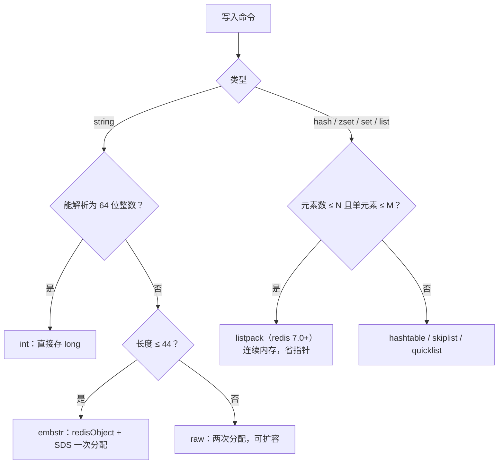
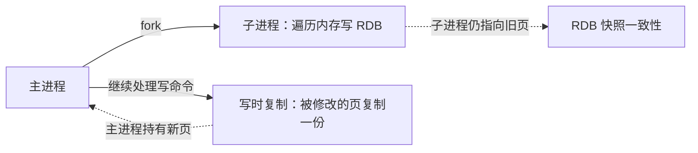
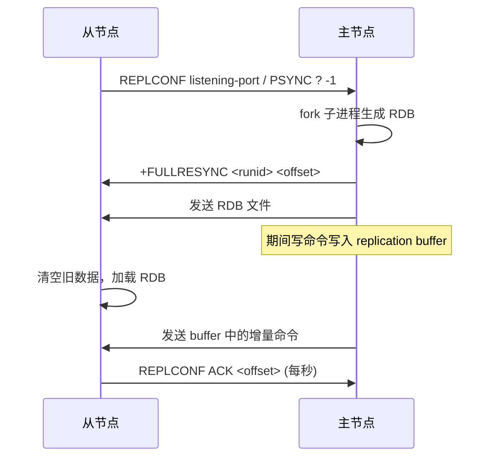

# Redis 常见面试题总结

> 一句话概括：Redis 面试考的从来不是"背命令"，而是"你能不能为一个**单线程、纯内存、可持久化**的键值系统说清楚它的**边界在哪、代价是什么、故障时怎么退化**"。

本文按面试真实提问顺序组织：基础认知 → 底层结构 → 持久化 → 内存管理 → 高可用 → 缓存治理 → 分布式锁 → 事务与脚本 → 性能排障 → 场景设计 → 快问快答。每题都给出**一句话结论 + 展开要点 + 追问方向**，方便临场组织语言。

---

## 0. 怎么用这篇文档

### 0.1 答题四段式

面试官问"Redis 为什么快"，答"因为它是内存数据库"只能拿到 30 分。用四段式：

| 层次 | 内容 | 作用 |
| --- | --- | --- |
| ① 结论 | 一句话给出判断 | 让面试官知道你有整体认知 |
| ② 机制 | 关键实现原理，2~4 个点 | 证明不是背的 |
| ③ 边界 | 什么时候不成立 / 代价是什么 | **区分中级和高级的分水岭** |
| ④ 实践 | 你在项目里怎么用、踩过什么坑 | 把知识变成经验 |

例：

> Redis 快主要有三个原因：纯内存操作、IO 多路复用 + 单线程避免锁竞争、以及针对场景优化过的数据结构。**但它快的边界是"单命令短耗时"**——一旦有 `KEYS *`、大 key 删除、fork 这类操作，单线程就会被独占，所有请求排队。所以线上我们禁用了 `KEYS`，用 `SCAN` 替代，大 key 删除统一走 `UNLINK`。

### 0.2 面试官的四个考察层次

| 层次 | 典型问法 | 期望 |
| --- | --- | --- |
| 会不会用 | `zset` 怎么做排行榜 | 知道 5 种基础类型 + 常见场景 |
| 懂不懂原理 | 为什么用跳表不用红黑树 | 能讲清内部编码、复杂度、设计取舍 |
| 能不能扛事 | 缓存雪崩怎么处理、主从延迟怎么办 | 有故障预案，知道降级和兜底 |
| 有没有判断力 | 这个场景该不该用 Redis | 能说"不该用"的理由 |

### 0.3 本主题文档与目录

本主题按「一份总结 + 若干专题」组织，深入细节见下表（新增专题后请同步补充）：

| 文档 | 内容 |
| --- | --- |
| [skiplist-and-sorted-set.md](skiplist-and-sorted-set.md) | 跳表的多级索引与随机层高、Redis 7.x `zset` 的 `dict + skiplist` 双结构、`span` 与排名计算，以及与其他排序结构的选型对比 |

本文目录：

1. 基础认知
2. 数据类型与底层编码
3. 持久化
4. 过期删除与内存淘汰
5. 高可用：主从、哨兵、Cluster
6. 缓存三大问题与双写一致性
7. 分布式锁
8. 事务、Lua 与 Pipeline
9. 性能与运维排障
10. 场景设计题
11. 版本演进（加分项）
12. 快问快答 40 题
13. 面试答题模板与反问
14. 参考资料

---

## 1. 基础认知

### 1.1 Redis 是什么

**结论**：Redis 是一个**单线程执行命令、纯内存、支持持久化**的键值数据库，同时兼作缓存、消息中间件和轻量级数据结构服务器。

三个关键词决定了它的一切优缺点：

- **纯内存** → 快，但容量受内存价格约束，必须考虑淘汰和持久化；
- **单线程执行** → 无锁、无上下文切换、命令天然原子，但一条慢命令阻塞全局；
- **丰富的数据结构** → 不只是 KV，能直接表达排行榜、去重、限流、地理索引等业务模型。

### 1.2 为什么快

| 原因 | 说明 |
| --- | --- |
| 纯内存访问 | 内存随机读约 100ns 量级，比磁盘随机读快 3~5 个数量级（SSD 约 100µs，机械盘约 10ms） |
| IO 多路复用 | epoll 单线程管理上万连接，无阻塞、无额外线程开销 |
| 单线程无锁 | 不存在竞态，不需要加锁/解锁，没有线程切换成本 |
| 高效数据结构 | SDS 预分配、listpack 连续内存、跳表 O(log N)、渐进式 rehash |
| 协议简单 | RESP 协议解析成本低，可内联命令 |
| 短路径设计 | 一条命令从读 socket 到写回，路径极短，几乎没有抽象层 |

**追问：单线程怎么处理上万个连接？**
不是"一个连接一个线程"，而是 epoll 把就绪的 fd 交给事件循环，一次处理一批。连接多但大多空闲时，单线程完全够用——瓶颈在**内存带宽和网络**，不在 CPU。

**追问：那快是不是没有上限？**
不是。单线程意味着吞吐上限 ≈ `1 / 单命令平均耗时`。所以有 Pipeline（摊薄 RTT）、多线程 IO（6.0）、Cluster 分片（横向扩展）三条扩容路径。

### 1.3 单线程还是多线程

这是最容易答错的题。准确说法：**命令执行始终是单线程，网络 IO 在 6.0 之后可以多线程**。

| 版本 | 变化 |
| --- | --- |
| ≤ 5.x | 完全单线程（命令 + IO 都在主线程）；后台有 bio 线程做 close/aof fsync/lazy free |
| 6.0 | 引入**多线程 IO**：`io-threads` 默认 1（即关闭），只负责 socket 读写和协议解析，**命令执行仍在主线程**；`io-threads-do-reads` 控制读是否也走多线程（默认 no） |
| 7.0 | `listpack` 全面替代 `ziplist`；多部分 AOF；Function；分片 Pub/Sub |
| 7.4 | hash 字段级过期 `HEXPIRE` 系列命令 |
| 8.0 | 新 IO 线程模型（进一步下沉网络层）、向量集合、内置 JSON/搜索/时序等 |

为什么命令执行不能多线程？因为一旦并行，`INCR`、`LPUSH`、事务、Lua 的原子性全部需要加锁，复杂度暴涨而收益有限——瓶颈通常在网络和内存，不在 CPU。

**追问：多线程 IO 为什么能提速？**
读请求时，主线程把 socket 读走、解析协议的活分给 IO 线程，自己只做命令执行；写回同理。这样"协议解析"这个纯 CPU 的重复劳动被并行化了，主线程专注在数据结构操作上。

### 1.4 Redis vs Memcached

| 维度 | Redis | Memcached |
| --- | --- | --- |
| 数据结构 | string/list/hash/set/zset/bitmap/HLL/geo/stream | 只有 KV（value 是字节串） |
| 持久化 | RDB + AOF | 无 |
| 高可用 | 主从 + 哨兵 + Cluster | 客户端分片，无原生集群 |
| 线程模型 | 命令单线程 | 多线程 |
| 单值上限 | 512MB | 1MB（默认） |
| 内存管理 | jemalloc + 淘汰策略 | slab allocator，易碎片 |
| 适用 | 缓存 + 数据结构服务 + 轻量 MQ | 纯 KV 缓存、超高并发简单读写 |

一句话：**Memcached 是缓存，Redis 是数据结构服务器**。纯 KV 场景 Memcached 的多线程吞吐可能更高，但绝大多数业务需要的是 Redis 的结构能力。

### 1.5 什么场景不该用 Redis

面试里能主动说出"不该用"，比背十个用法更加分：

- **需要强一致 + 事务回滚**：Redis 事务不支持回滚，金融账务请用关系库；
- **数据量远大于内存**：全量数据放 Redis 成本极高，考虑 SSD 型 KV（如 Pika、RocksDB）；
- **复杂多条件查询 / 聚合**：`SCAN` + 客户端过滤是反模式，用 ES / ClickHouse；
- **可靠消息队列**：Stream 可用，但削峰、重投、事务消息请用 Kafka / RocketMQ；
- **作为唯一存储**：持久化是"尽力而为"，宕机仍可能丢秒级数据。

---

## 2. 数据类型与底层编码

### 2.1 数据类型全景

| 类型 | 核心命令 | 典型场景 | 底层编码 |
| --- | --- | --- | --- |
| string | `SET/GET/INCR/SETNX/SETEX` | 缓存对象、计数器、分布式锁、位图 | int / embstr / raw |
| list | `LPUSH/RPOP/LRANGE/LMOVE` | 栈、队列、时间线、简易消息队列 | listpack / quicklist |
| hash | `HSET/HGET/HGETALL/HINCRBY` | 对象存储、购物车、配置 | listpack / hashtable |
| set | `SADD/SISMEMBER/SINTER/SRANDMEMBER` | 去重、共同好友、标签 | intset / listpack / hashtable |
| zset | `ZADD/ZRANGE/ZRANK/ZINCRBY` | 排行榜、延时队列、滑动窗口限流 | listpack / skiplist |
| bitmap | `SETBIT/BITCOUNT/BITFIELD` | 签到、在线状态、布隆过滤器 | string（位操作） |
| hyperloglog | `PFADD/PFCOUNT/PFMERGE` | UV 去重统计 | 稀疏/稠密 HLL |
| geo | `GEOADD/GEOSEARCH/GEODIST` | 附近的人、门店距离 | zset（geohash 存 score） |
| stream | `XADD/XREADGROUP/XACK/XAUTOCLAIM` | 消息队列、消费组 | rax + listpack |

> 记忆法：**bitmap/HLL/geo 都是"用 string 或 zset 的底层存储 + 特殊编码"**，不是独立的结构。geo 本质是 zset（geohash 52 位整数做 score），HLL 本质是 string（12KB 定长稠密编码）。

### 2.2 一个 key 的编码是怎么决定的

Redis 7.x 的编码选择逻辑（简化）：



### 2.3 编码转换阈值速查

| 类型 | 紧凑编码 | 转换条件（默认值） | 转换后 |
| --- | --- | --- | --- |
| string | int / embstr | 长度 > 44 字节，或内容被修改（如 APPEND） | raw |
| hash | listpack | `hash-max-listpack-entries 128` 或 `hash-max-listpack-value 64` | hashtable |
| zset | listpack | `zset-max-listpack-entries 128` 或 `zset-max-listpack-value 64` | skiplist |
| set（整数） | intset | `set-max-intset-entries 512` | hashtable |
| set（字符串） | listpack（7.2+） | `set-max-listpack-entries 128`、`value 64` | hashtable |
| list | listpack | 单个 listpack 超过 `list-max-listpack-size -2`（8KB） | quicklist 多节点 |

**关键点：转换是单向的**。一旦超过阈值变成 `hashtable`/`skiplist`，即使后来删元素降回阈值以下，**也不会退回紧凑编码**。这是压缩大 key 后内存不下降的常见原因。

观察命令：

```bash
redis-cli object encoding user:1:profile   # listpack
redis-cli object encoding board             # skiplist
redis-cli memory usage board               # 实际占用字节
```

### 2.4 SDS：为什么不用 C 字符串

C 的 `char *` 做字符串有三个致命问题，SDS（Simple Dynamic String）逐一解决：

| 问题 | C 字符串 | SDS |
| --- | --- | --- |
| 求长度要遍历 | `O(N)` | `len` 字段，`O(1)` |
| 二进制不安全 | `\0` 截断，存不了图片/序列化数据 | 按 `len` 判断，二进制安全 |
| 拼接易溢出 | `strcat` 可能越界 | 先检查 `alloc - len`，不够就扩容 |
| 频繁扩容开销 | 无容量概念，需手动管理内存 | **空间预分配**：`len < 1MB` 时翻倍，`≥ 1MB` 时多给 1MB，减少 realloc 次数 |
| 缩短不释放 | — | **惰性释放**：只改 `len`，等真正需要时再 `realloc` |

```c
struct sdshdr {
    uint32_t len;    /* 已用长度 */
    uint32_t alloc;  /* 分配长度（不含 header 和 \0） */
    unsigned char flags;
    char buf[];
};
```

（上面以 `sdshdr32` 为例；SDS 实际有 sdshdr5/8/16/32/64 五种头部，按字符串长度选用，以节省头部开销。）

`embstr` 与 `raw` 的区别：`embstr` 把 `redisObject` 和 `sdshdr` 一次性 `malloc`，**只读**（append 时会转成 `raw` 重新分配），适合短小的固定字符串；`raw` 分两次分配，可扩容。注意：共享整数 0~9999 用的是 `int` 编码，而不是 `raw`。

### 2.5 listpack：为什么要干掉 ziplist

`ziplist` 每个 entry 存"前一个 entry 的长度"，用于反向遍历。问题在于长度编码是变长的：如果一个 entry 从 253 字节涨到 254 字节，它的 `prevlen` 从 1 字节变成 5 字节，导致**后一个 entry 的 `prevlen` 也要变**，可能继续引发连锁——这就是**连锁更新（cascade update）**，最坏 `O(N²)`。

`listpack`（7.0 起全面替代 ziplist）改用 `entry-len` 记录**自己**的长度，反向遍历靠 `total-bytes` 尾部偏移，不再依赖前驱信息，**彻底消除连锁更新**。

| 对比 | ziplist | listpack |
| --- | --- | --- |
| 反向遍历 | 依赖 `prevlen` | 依赖自身 `entry-len` + 尾偏移 |
| 连锁更新 | 存在 | 不存在 |
| 内存 | 略省（`prevlen` 1~5B） | 略多（`entry-len` 1~5B，但无背向依赖） |
| 状态 | 7.0 起仅作为旧数据兼容 | 主流紧凑编码 |

### 2.6 各类型选型踩坑

- **用 `string` 存整个对象 JSON** vs **`hash` 存字段**：整体更新用 string 快；只改部分字段、需要 `HINCRBY` 用 hash。但 hash 字段多了会转 hashtable，反而比 string 更占内存。
- **`list` 当队列**：`LPUSH + BRPOP` 可用，但没有 ack 和重投，宕机即丢；要可靠投递用 Stream 或专业 MQ。
- **`set` 做大规模去重**：1000 万元素约 600MB+，改用 bitmap（有界整数）或布隆过滤器（允许误判）。
- **`zset` 做延时队列**：靠轮询 `ZRANGEBYSCORE`，没有 push 语义，延迟精度取决于轮询间隔；Stream 的 `XREAD BLOCK` 更合适。

---

## 3. 持久化

### 3.1 RDB：某一时刻的全量快照

**触发方式**

| 方式 | 命令/配置 | 是否阻塞 |
| --- | --- | --- |
| 手动同步 | `SAVE` | 阻塞主线程，线上禁用 |
| 手动异步 | `BGSAVE` | fork 子进程，主线程仅 fork 期间短暂阻塞 |
| 自动 | `save 3600 1 300 100 60 10000` | 同上 |
| 关闭时 | `shutdown` 若配置 save | — |
| 主从全量同步 | 自动触发 | 同上 |

**fork + COW 是核心**



- `fork` 本身要复制**页表**（不是数据），内存越大页表越大，阻塞时间越长——**10GB 实例 fork 可能阻塞几十到上百毫秒**；
- 写时复制期间，被修改的页会额外占用内存，最坏情况下内存翻倍（写入量极大时）；
- 子进程写 RDB 是顺序 IO，对主进程影响主要在内存和磁盘带宽。

**优点**：文件紧凑（二进制 + 压缩）、恢复极快、适合冷备和全量同步。
**缺点**：实时性差，两次快照之间的数据会丢；fork 有阻塞风险。

### 3.2 AOF：追加写命令日志

每条写命令按 RESP 协议追加到 `appendonly.aof`（7.0 起是 `appendonlydir/` 下的多文件）。

**三种刷盘策略（`appendfsync`）**

| 策略 | 行为 | 丢数据 | 性能 |
| --- | --- | --- | --- |
| `always` | 每条命令都 `fsync` | 最多丢 1 条 | 最差，QPS 掉一个量级 |
| `everysec`（默认） | 后台线程每秒 `fsync` | 最多丢 1 秒 | 好 |
| `no` | 交给操作系统（约 30s） | 可能丢几十秒 | 最好，但不建议 |

**AOF 重写**

AOF 会无限膨胀（一个 key 改 100 次就有 100 条命令）。重写是"根据当前内存状态生成最小命令集"，不是读旧 AOF：

```
原 AOF:  SET a 1 / SET a 2 / INCR a / DEL a / SET a 10
重写后:  SET a 10
```

重写期间的新写入不能丢：7.0 之前先缓冲在 `aof_rewrite_buf`，子进程写完 base 后由主进程把这段缓冲追加进新 AOF；7.0 起（多部分 AOF）直接写进 incr AOF 文件，不再经过重写缓冲。

**7.0 的多部分 AOF（Multi Part AOF）**：拆成 `base.rdb`（或 `base.aof`）+ `incr.aof` + `manifest`，重写时只需替换 base，避免大文件重写的 IO 放大和内存拷贝。

### 3.3 混合持久化（4.0+）

`aof-use-rdb-preamble yes`：AOF 重写时，前半段写成 RDB 二进制，后半段追加增量命令。

| 方案 | 恢复速度 | 数据完整性 | 文件大小 |
| --- | --- | --- | --- |
| 纯 RDB | 快 | 差（丢分钟级） | 小 |
| 纯 AOF | 慢（要重放所有命令） | 好（丢秒级） | 大 |
| **混合** | **快** | **好** | 中 |

生产建议：**主从 + 混合持久化**。RDB 用于冷备和全量同步，AOF 兜住秒级数据。

### 3.4 重启恢复流程

1. 如果有 AOF 且开启 → **优先加载 AOF**（更完整）；
2. 否则加载 RDB；
3. 都没有 → 空实例启动。

> 注意：AOF 开启时 RDB 文件不会被加载，即使 AOF 内容为空。曾经有事故是"误删 AOF 后重启，数据全空但 RDB 明明存在"——因为 AOF 文件存在但为空，Redis 认为它就是全部数据。

### 3.5 持久化的追问

**Q：RDB 和 AOF 能同时开吗？**
能，且推荐。但要注意两者都会 fork，以及 AOF 重写和 RDB 保存不要撞在一起（`no-appendfsync-on-rewrite yes` 可缓解 fsync 阻塞）。

**Q：fork 会不会阻塞？怎么优化？**
会，阻塞时间与页表大小正相关。优化：① 控制单实例内存（建议 ≤ 10~16GB）；② 关闭透明大页 `THP`；③ 用 `fork` 频率低的策略；④ 主从分离，把持久化放到从节点。

**Q：AOF 重写期间主线程阻塞吗？**
数据拷贝在子进程，主线程只有在"把重写缓冲追加到新 AOF"和"rename 替换文件"时短暂阻塞。但 `everysec` 的 fsync 若遇上磁盘慢，会造成 `aof_delayed_fsync` 升高，表现为周期性卡顿。

---

## 4. 过期删除与内存淘汰

### 4.1 过期 key 怎么删

Redis 不会为每个 key 起定时器（内存和 CPU 都受不了），而是两种策略结合：

| 策略 | 触发时机 | 作用 |
| --- | --- | --- |
| 惰性删除 | 访问 key 时检查 `expireIfNeeded` | 保证不会返回过期数据 |
| 定期删除 | 每 100ms（`hz 10`）随机抽 20 个带过期时间的 key，删除其中过期的；若过期比例 > 25%，重复抽样 | 主动回收，避免内存泄漏 |

**这就是"内存没满但 key 明明过期了还占着内存"的原因**：定期删除是抽样，可能漏掉；只有被访问时才一定删。

**追问：从库会删过期 key 吗？**
不会。从库的过期由主库同步 `DEL` 驱动，从库自己读到过期 key 时**返回空但不删除**（3.2 之后逻辑更严格），保证主从数据一致。所以从库内存可能短暂高于主库。

**追问：`EXPIRE` 的精度？**
毫秒级（`PEXPIRE`），内部用 `expires` 字典存绝对时间戳，与系统时间相关——**改系统时间会影响过期**。

### 4.2 八种内存淘汰策略

`maxmemory` 触发后按 `maxmemory-policy` 处理：

| 策略 | 范围 | 规则 |
| --- | --- | --- |
| `noeviction`（默认） | — | 不淘汰，写命令返回 OOM 错误（读仍可用） |
| `allkeys-lru` | 所有 key | 淘汰最久未使用的 |
| `allkeys-lfu` | 所有 key | 淘汰访问频率最低的 |
| `allkeys-random` | 所有 key | 随机淘汰 |
| `volatile-lru` | 设了过期时间的 | 淘汰最久未使用的 |
| `volatile-lfu` | 设了过期时间的 | 淘汰访问频率最低的 |
| `volatile-random` | 设了过期时间的 | 随机淘汰 |
| `volatile-ttl` | 设了过期时间的 | 优先淘汰剩余 TTL 最短的 |

**选型建议**

- 纯缓存，所有 key 都可丢 → `allkeys-lru`（最常用）；
- 冷热分明、有明显热点 → `allkeys-lfu`（能防"偶发全表扫描把热点冲掉"）；
- 缓存 + 持久数据混存 → `volatile-lru`，但**风险是：没有过期时间的 key 永远不会被淘汰，可能把内存占满后开始报 OOM**；
- 绝不能丢数据 → `noeviction` + 监控告警。

### 4.3 LRU 和 LFU 都是"近似"

Redis 没有实现标准 LRU 链表（内存开销太大），而是**采样 + 时间戳**：

- 每个 `redisObject` 的 `lru` 字段只有 **24 bit**，存的是"上次访问的秒级时钟"（不是完整时间戳），约 194 天回绕一次；
- 淘汰时随机取 `maxmemory-samples`（默认 5）个 key，选 `lru` 最小的淘汰；
- 采样数越大越接近真实 LRU，CPU 开销也越大。

LFU 把这个 24 bit 拆成两段：**16 bit 衰减时间 + 8 bit 计数器**（最大 255）。

- 计数器不是每次 +1，而是**概率递增**：计数越大，+1 的概率越低（对数计数），避免短时间高频访问直接冲到 255；
- 计数器随时间衰减：`lfu-decay-time`（默认 1，**单位是分钟**）表示每空闲 1 分钟计数减 1（在访问时结算衰减）；
- `lfu-log-factor`（默认 10）控制增长速度。

**追问：LRU 的致命问题是什么？**
一次全表扫描（如离线任务遍历所有 key）会把整个 LRU 链表冲一遍，导致真正的热点全部被淘汰——**缓存污染**。LFU 因为看频率，高频 key 的计数不会因为一次访问就被超越，抗污染能力更强。这也是 Redis 4.0 引入 LFU 的原因。

### 4.4 内存碎片

`mem_fragmentation_ratio = used_memory_rss / used_memory`：

- 1.0 ~ 1.5：正常；
- \> 1.5：碎片较多，可开启 `activedefrag yes`（主动碎片整理，消耗 CPU）；
- < 1：说明部分内存被 swap 到磁盘，**性能会断崖式下跌**，必须立刻处理。

常见碎片来源：频繁增删不同大小的对象、大量 key 过期、`appendonly` 重写。jemalloc 的 size class 会放大这种现象（申请 100 字节实际占 112 字节）。

---

## 5. 高可用：主从、哨兵、Cluster

### 5.1 主从复制

**建立流程**



**全量 vs 增量**

| 类型 | 触发条件 | 代价 |
| --- | --- | --- |
| 全量同步 | 首次连接 / `runid` 不匹配 / offset 不在 backlog 范围 | fork + 传输整个 RDB，最重 |
| 增量同步 | `runid` 匹配且 offset 在 `repl_backlog` 内 | 只传缺失命令 |

`repl_backlog` 是主节点上的一个**环形缓冲区**（`repl-backlog-size` 默认 1MB）。它决定了"从节点断线多久内可以增量恢复"。写入量大的实例必须调大（计算公式：`平均写入速率 × 允许断线秒数`），否则每次重连都是全量同步，形成"同步风暴"。

**关键认知**

- 复制是**异步**的：主节点写完就返回客户端，不等从节点确认。所以主库宕机可能丢数据（`WAIT` 命令可做有限同步，但会牺牲性能）。
- 从节点默认**只读**（`replica-read-only yes`），可配置读写分离，但要承担主从延迟导致的一致性问题。
- **复制风暴**：大量从节点同时重连、都触发全量同步时，主节点 fork 和网络压力骤增。缓解：调大 `repl-backlog-size` 让断线尽量走增量恢复、用级联复制（从节点再挂从节点）分摊全量同步压力、错峰重连。

### 5.2 哨兵（Sentinel）

哨兵解决"主节点挂了怎么办"，本身是独立进程，通常 3 个以上奇数部署。

**故障判定与转移**

| 阶段 | 说明 |
| --- | --- |
| 主观下线（SDOWN） | 单个哨兵在 `down-after-milliseconds` 内 ping 不通 |
| 客观下线（ODOWN） | 达到 `quorum` 个哨兵都认为它下线 |
| 领导者选举 | 基于 Raft，需要**多数派**（majority）授权，避免脑裂 |
| 选新主 | 优先级 `replica-priority` → 复制 offset 最大 → runid 最小 |
| 通知与切换 | 其他从节点 `REPLICAOF` 新主；客户端通过哨兵查询新地址 |

**脑裂问题**

网络分区时，旧主仍在接受写入，哨兵已在另一侧选出新主 → 分区恢复后旧主被降级，**这部分写入永久丢失**。

缓解配置：

```conf
min-replicas-to-write 1     # 至少 1 个从节点同步正常才允许写
min-replicas-max-lag 10     # 从节点延迟不超过 10 秒
```

代价是降低了可用性（从节点全挂时主节点拒绝写入），需要业务权衡。

**追问：哨兵本身挂了怎么办？**
哨兵是集群，3 个挂 1 个仍可工作；但哨兵不解决**数据分片**，单主容量仍有上限。

### 5.3 Cluster 分片

**核心机制**

| 机制 | 说明 |
| --- | --- |
| 槽位 | 固定 **16384** 个 slot，`CRC16(key) % 16384` 决定归属 |
| 节点通信 | 集群总线端口 = 服务端口 + 10000，gossip 协议传播节点状态和槽位表 |
| 请求路由 | 访问错误节点返回 `MOVED`（槽已永久迁移）或 `ASK`（迁移中临时重定向） |
| 故障转移 | 主节点被多数主节点标记 `FAIL` 后，其从节点延迟 `500ms + random(0~500ms) + rank*1000ms` 发起选举，需**多数主节点**授权 |
| 最小规模 | 3 主 3 从（6 节点），才能保证任一主挂掉后仍有投票多数 |

**为什么是 16384 个槽？**

- 心跳包要带槽位位图：`16384 / 8 = 2KB`，若用 65536 则是 8KB，gossip 带宽翻 4 倍；
- 作者判断集群规模一般不超过 1000 个节点，16384 个槽足够均匀分布；
- 槽位越多，迁移时的状态位图和迁移粒度越细，但收益递减。

**Cluster 的限制（面试高频）**

| 限制 | 说明 | 规避 |
| --- | --- | --- |
| 多 key 操作必须同槽 | `MGET`、`SINTER`、事务、Lua 涉及多个 key 时要求同 slot | 用 **hash tag** `{user1}:name`、`{user1}:age` |
| 只支持 db0 | 没有 16 个数据库 | 用 key 前缀区分环境 |
| 不支持跨槽事务 | `MULTI` 内 key 必须同槽 | 拆分或改 Lua |
| 复制仍是异步 | 主节点故障仍可能丢数据 | 业务容忍 + `WAIT` + 定期对账 |
| 扩容需要迁移槽 | 手动/工具迁移，迁移期间 `ASK` 重定向 | 用 `redis-cli --cluster reshard`，低峰执行 |
| 客户端要支持集群协议 | 需处理 `MOVED/ASK` | 用 Lettuce/Jedis 集群模式 |

**MOVED vs ASK**

- `MOVED`：这个槽**已经**归别人了，客户端应更新本地槽位表，以后都发到新节点；
- `ASK`：这个槽**正在**迁移，这个 key 已经搬走了，客户端**只这一次**去新节点，不更新缓存表。

理解这两个的区别，能直接说明你是否真的用过 Cluster。

### 5.4 三种方案对比

| 维度 | 主从 | 哨兵 | Cluster |
| --- | --- | --- | --- |
| 数据分片 | 否 | 否 | 是（16384 槽） |
| 自动故障转移 | 否 | 是 | 是 |
| 容量上限 | 单机内存 | 单机内存 | 水平扩展 |
| 运维复杂度 | 低 | 中 | 高 |
| 多 key 操作 | 无限制 | 无限制 | 需同槽 |
| 适用规模 | 读扩展、备份 | 中小规模高可用 | 大数据量、高并发 |

---

## 6. 缓存三大问题与双写一致性

### 6.1 缓存穿透

**问题**：查询一个**根本不存在**的数据，缓存永远不命中，请求全部打到数据库。恶意攻击（随机 ID 遍历）能让 DB 直接崩。

**方案对比**

| 方案 | 原理 | 优点 | 缺点 |
| --- | --- | --- | --- |
| 缓存空值 | 不存在也缓存 `null`，TTL 短（如 60s） | 实现最简单 | 大量随机 key 会占内存；数据后来创建了会读到脏空值 |
| 布隆过滤器 | 位数组 + 多哈希，判断"可能存在/一定不存在" | 内存极小（1 亿元素约 114MB @1% 误判） | 有误判、**不支持删除**、需预热 |
| 接口层校验 | 参数合法性、限流、黑名单 | 成本最低 | 只能挡明显非法请求 |
| 互斥 + 单飞 | 同 key 只放一个请求到 DB | 顺带解决击穿 | 不解决"不存在"的本质 |

**布隆过滤器为什么不能删除？**
一个元素会置位多个 bit，删除时无法确定这些 bit 是否被其他元素共享，清掉会导致误判为"不存在"（假阴性），破坏"一定不存在"的保证。要支持删除需用计数布隆（Counting Bloom）或布谷鸟过滤器（Cuckoo Filter）。

### 6.2 缓存击穿

**问题**：某个**热点 key 过期**的瞬间，大量并发请求同时打到 DB。

**方案**

1. **互斥锁重建**：只让一个线程回源，其他线程短暂等待/重试。
   ```text
   value = GET key
   if value == nil:
       if SET lock:key 1 NX PX 3000:      # 抢到锁才回源
           value = queryDB(); SET key value EX ttl; DEL lock:key
       else:
           sleep(50ms); retry(最多 3 次)   # 或直接返回旧值/降级
   ```
2. **逻辑过期**：value 里存 `expireAt`，物理上永不过期。发现逻辑过期时，异步起线程重建，其他请求先返回旧值——**牺牲一致性换可用性**，适合排行榜、商品详情这类能容忍短暂陈旧的场景。
3. **热点永不过期 + 后台刷新**：定时任务主动更新。

**追问：互斥锁方案的问题？**
① 锁超时导致重复重建（要评估回源耗时）；② 抢锁失败的线程要么等待（延迟升高）要么降级（返回旧值/默认值），必须提前设计降级策略，否则"防击穿"变成"全量 503"。

### 6.3 缓存雪崩

**问题**：**大量 key 同时过期**，或 **Redis 实例整体挂掉**，流量瞬间全压到 DB。

| 成因 | 方案 |
| --- | --- |
| 同一时刻批量过期 | TTL 加随机抖动：`EX = base + random(0, 300)` |
| 实例宕机 | 主从 + 哨兵/Cluster；本地二级缓存（Caffeine）兜底 |
| 热点集中 | 多级缓存、限流、熔断降级（Sentinel/Hystrix） |
| 冷启动 | 缓存预热：启动时或低峰期批量加载 |

**兜底顺序**：本地缓存 → Redis → 限流/队列 → DB。每一层都要有超时和熔断，不能让慢调用拖死整条链路。

### 6.4 双写一致性

这是面试最能拉开差距的一题。核心认知：**缓存和数据库无法做到强一致**，只能做"最终一致 + 短暂不一致窗口可接受"。

**四种策略对比**

| 策略 | 做法 | 问题 |
| --- | --- | --- |
| 先更新 DB，再更新缓存 | 写两次 | 并发下缓存可能被旧值覆盖（A 更新 DB=1，B 更新 DB=2，B 先写缓存 2，A 后写缓存 1 → 缓存 1，DB 2） |
| 先删缓存，再更新 DB | 删完再写库 | 读请求在删缓存后、写库前回源，把**旧值**写回缓存，之后一直脏 |
| **先更新 DB，再删缓存**（Cache Aside） | 最常用 | 极端并发下仍有小概率脏（读 A 在写 B 之前查库旧值，写 B 删缓存后 A 才回填），概率低且可通过 TTL 兜底 |
| 延迟双删 | 更新 DB 前删一次，更新后延迟 ~500ms 再删一次 | 延迟时间难定（要覆盖"读旧值 + 回填"的耗时），仍非严格一致 |

**为什么推荐"先更新库、再删缓存"？**
因为它把"并发写导致缓存错乱"的概率降到最低：删除是幂等的，即使删两次也无害；而"更新缓存"在并发下会互相覆盖。

**强一致诉求怎么办**

1. **订阅 binlog**（Canal / Debezium）+ MQ 异步删缓存：把"删缓存"从业务代码里剥离，天然有序、可重试、可补偿；
2. **分布式锁 + 版本号**：写路径加锁，缓存 value 带版本号，回填时比对版本；
3. **读写都走同一份存储**：对强一致要求极高的字段（余额、库存）干脆不缓存，或只缓存不可变快照。

**追问：删除失败怎么办？**
① 重试（同步重试 N 次 → 失败入 MQ 重试队列）；② 记录到日志/表，定时对账补偿；③ 给缓存设较短 TTL 作为最终兜底。

**追问：为什么是删缓存而不是更新缓存？**
① 更新缓存有并发覆盖问题；② 如果缓存值需要多表聚合计算，每次写都更新是浪费（可能更新 10 次只读 1 次），**懒加载更经济**。

### 6.5 热 key 与大 key

**热 key**：单个 key 的 QPS 极高，打满单个分片/单核。

| 方案 | 说明 |
| --- | --- |
| 本地缓存 | 最有效，JVM 内 Caffeine 顶住绝大部分流量，设短 TTL |
| key 拆分 | `hotkey:1..N` 副本，随机读，写时全量更新（注意一致性） |
| 读写分离 | 从节点分担读（有延迟） |
| 限流降级 | 保护性措施，超过阈值直接降级返回 |
| 发现手段 | `redis-cli --hotkeys`（需 LFU）、监控 `monitor` 采样、客户端埋点统计 |

**大 key**：string > 10KB，或集合元素 > 5000（经验阈值）。

危害：① 网络阻塞（一次传输几十 MB）；② 删除时阻塞主线程（`DEL` 是同步释放）；③ 迁移/持久化放大；④ 集群槽迁移卡住。

治理：

```bash
redis-cli --bigkeys              # 扫描各类型最大的 key
redis-cli --memkeys              # 按内存排序
redis-cli memory usage key       # 单 key 精确占用
UNLINK bigkey                    # 异步删除（4.0+）
```

拆分思路：大 hash 按字段哈希拆成 N 个；大 list 按时间/批次拆；大 set 用 bitmap 或分片。**根本原则：不要让单个 key 承载无上限的数据**。

---

## 7. 分布式锁

### 7.1 正确的最小实现

```bash
# 加锁：原子地"不存在才设置" + 过期时间，value 必须是唯一标识
SET lock:order:123 <uuid> NX PX 30000

# 释放：必须用 Lua 校验持有者，避免误删别人的锁
if redis.call("get", KEYS[1]) == ARGV[1] then
    return redis.call("del", KEYS[1])
else
    return 0
end
```

**为什么 value 要放 uuid？**
场景：A 拿到锁但业务超时（锁已过期），B 拿到锁；A 执行完直接 `DEL`，把 B 的锁删了。加 uuid 校验后，A 只会删自己的（此时已不存在），不会误伤。

**为什么必须 `NX` 和 `PX` 一起？**
`SETNX` + `EXPIRE` 是两步，中间宕机就产生**永不过期的死锁**。`SET ... NX PX` 是单命令原子操作。

### 7.2 常见错误清单

| 错误写法 | 后果 |
| --- | --- |
| `SETNX` 后再 `EXPIRE` | 两条命令非原子，宕机造成死锁 |
| 释放时不校验 value | 误删他人锁 |
| 校验和删除分两步（`GET` 后 `DEL`） | 中间锁过期，仍会误删 |
| 锁无过期时间 | 死锁 |
| 过期时间短于业务耗时 | 并发进入临界区 |
| 抢锁失败无超时/重试策略 | 请求堆积等待，或直接放弃导致业务失败 |

### 7.3 锁续期与 Redisson 看门狗

业务耗时不可预知，固定 TTL 必然有两个失败模式：太短 → 提前释放；太长 → 宕机后长时间不可用。

Redisson 的方案（Watch Dog）：

- 加锁成功默认 TTL 30s；
- 后台定时任务每 `TTL/3`（10s）检查一次，若锁仍被当前线程持有，就重置为 30s；
- 客户端宕机 → 定时任务停止 → 锁在 30s 内自动释放。

**注意**：看门狗只在"不显式指定 leaseTime"时生效；一旦指定 `leaseTime`，Redisson 不会续期（因为这代表你确定业务上限）。

### 7.4 Redlock 与它的争议

**Redlock 算法**：部署 5 个**独立**的 Redis master（非主从），客户端依次加锁：

1. 记录开始时间；
2. 向 5 个节点用相同 key/value 加锁，设置很短的网络超时；
3. 若在**多数派（≥3）**上加锁成功，且总耗时 < 锁有效期，则认为加锁成功；
4. 失败则向所有节点解锁。

**Martin Kleppmann 的批评（面试加分项）**

| 问题 | 说明 |
| --- | --- |
| 依赖时钟 | 锁的有效期依赖各节点本地时钟，时钟跳变/漂移会破坏安全性 |
| GC / 网络停顿 | 客户端拿到锁后长时间 STW，醒来时锁已过期，仍会并发写入 |
| 无法保证互斥 | 上述场景下，两个客户端可能同时认为自己持锁 |
| 正确做法 | 需要 **fencing token**（单调递增的版本号，下游存储拒绝旧 token 的写入），或使用 ZooKeeper/etcd（有租约和顺序节点） |

**antirez 的回应**：Redlock 适用于"对效率要求高、对正确性要求不极致"的场景（如防重复任务），需要绝对正确时应该用带 fencing 的方案。

**面试怎么答**：
> 单实例 Redis 锁在"主从异步复制"下有天然缺陷——主节点加锁成功但未同步就宕机，从节点升主后锁丢失。Redlock 想用多节点多数派解决，但它依赖时钟、无法防 GC 停顿，学术界（Kleppmann）认为它不满足严格的安全性。我的实践是：**普通业务用 Redisson 单实例锁 + 看门狗 + 业务幂等**；涉及资金等强一致场景，用数据库行锁/乐观锁或 ZooKeeper，并在下游加 fencing token。

---

## 8. 事务、Lua 与 Pipeline

### 8.1 Redis 事务

```bash
MULTI
SET a 1
INCR a
LPUSH a x        # 运行时错误：a 是 string
EXEC
```

**三个必须知道的结论**

1. **不支持回滚**。上面的 `LPUSH` 报错，但 `SET` 和 `INCR` 都生效了。Redis 认为"运行时错误是编程错误，不该由数据库兜底"。
2. **入队时错误会让整个事务不执行**。语法错误、命令不存在 → `EXEC` 返回错误，全部不执行。
3. **`WATCH` 是乐观锁**。`WATCH key` 后，若 `EXEC` 前该 key 被其他客户端修改，`EXEC` 返回 `nil`，需要业务重试。

**为什么这么设计？**
为了保持简单和高性能：回滚需要 undo log，会引入额外内存和复杂度；而 Redis 的定位是缓存/数据结构服务，不是事务型数据库。

### 8.2 Lua 脚本

```lua
-- 原子地"读-判断-写"，分布式锁释放、库存扣减都用它
local stock = tonumber(redis.call('GET', KEYS[1]))
if stock == nil or stock <= 0 then return -1 end
redis.call('DECR', KEYS[1])
return stock - 1
```

| 特性 | 说明 |
| --- | --- |
| 原子性 | 脚本执行期间不会插入其他命令（但**不是事务语义**，中途报错前面的已生效） |
| 减少 RTT | 多个命令一次网络往返 |
| 注意事项 | 脚本要短（阻塞主线程）；`KEYS` 必须显式传入（Cluster 才能路由）；避免 `redis.call` 循环大 key |
| 7.0 替代 | Redis Functions（`FUNCTION LOAD`），可持久化、可命名、支持库管理 |

**追问：Lua 脚本能保证原子性，为什么还需要事务？**
Lua 更适合"读-改-写"这类需要条件的复合操作；事务适合"批量执行、不希望被打断"。但两者都不提供回滚。实际项目里 Lua 更常用，因为它能带逻辑。

### 8.3 Pipeline vs 事务 vs Lua

| 维度 | Pipeline | MULTI/EXEC | Lua |
| --- | --- | --- | --- |
| 减少 RTT | ✅ | ✅ | ✅ |
| 原子执行 | ❌（中间可插入其他客户端命令） | ✅ | ✅ |
| 条件逻辑 | ❌ | ❌ | ✅ |
| 错误处理 | 逐条返回 | 不支持回滚 | 可用 `pcall` 捕获 |
| Cluster 限制 | 无（命令相互独立，客户端按槽路由） | 同槽 | 同槽 |
| 典型用途 | 批量读写、导入导出 | 简单批量原子操作 | 库存扣减、分布式锁、限流 |

---

## 9. 性能与运维排障

### 9.1 一条命令的耗时去哪了

```
总延迟 = 网络往返 + 排队等待 + 命令执行 + 结果传输
        └─ 客户端/网络 ─┘  └─ 单线程阻塞 ─┘  └─ 大结果 ─┘
```

**Redis 只统计"命令执行"这一段**（slowlog），所以"慢查询日志里没有记录，但客户端就是慢"是常态——要查网络、排队、大结果集。

### 9.2 常见阻塞原因清单

| 原因 | 表现 | 处理 |
| --- | --- | --- |
| `KEYS *` / `FLUSHALL` | 瞬时 CPU 100%，全站超时 | 用 `SCAN`；`FLUSHALL ASYNC` |
| 大 key `DEL` | 删除时卡住几百 ms | `UNLINK` + `lazyfree-lazy-user-del yes` |
| `HGETALL` 大 hash | 单次返回几十 MB | 用 `HSCAN` 分批，或拆分 key |
| fork（RDB/AOF 重写/全量同步） | 周期性毛刺 | 控制内存、关 THP、错开持久化 |
| AOF `always` | 写 QPS 上不去 | 改 `everysec` |
| 大 Lua 脚本 | 脚本期间全阻塞 | 拆分、限制执行时间（`busy-reply-threshold`） |
| 内存不足触发淘汰 | 延迟抖动 | 扩容、加 `maxmemory` 告警 |
| swap | 延迟飙升到秒级 | 禁用 swap 或 `vm.swappiness=1` |
| 客户端连接数打满 | 新连接被拒 | 连接池、`maxclients`、查连接泄漏 |
| 网卡带宽打满 | 大 value 传输慢 | 压缩 value、拆分、升级带宽 |

**排查工具**

```bash
redis-cli --latency                 # 持续测延迟
redis-cli --latency-history         # 分时段看毛刺
redis-cli --intrinsic-latency 100   # 测机器本身（排除 Redis 因素）
redis-cli slowlog get 10            # 慢查询
redis-cli info commandstats         # 各命令调用次数与平均耗时
redis-cli info stats | grep rejected_connections  # 因 maxclients 被拒的连接数
redis-cli info stats | grep evicted_keys          # 被淘汰的 key 数（触发 maxmemory）
redis-cli --bigkeys / --hotkeys
LATENCY DOCTOR                      # 内置延迟诊断
```

### 9.3 慢查询配置

```conf
slowlog-log-slower-than 10000   # 微秒，10ms；0 = 记录所有，-1 = 关闭
slowlog-max-len 128             # 最多保存条数（内存中的队列）
```

`slowlog` 只记录**命令执行时间**，不含网络和排队，也不记录 `EXEC` 内部的单条命令（只记 `EXEC` 本身）。

### 9.4 容量与部署经验值

| 项 | 经验值 | 说明 |
| --- | --- | --- |
| 单实例内存 | ≤ 10~16GB | 再大 fork 和全量同步代价过高 |
| key 数量 | 千万级以内 | 超过后 `SCAN`、过期删除压力明显 |
| 连接数 | 单实例 ≤ 1w | 更多用 Cluster 或连接池 |
| `maxmemory` | 物理内存 70~80% | 留出 COW 和碎片空间 |
| 持久化 | 主从 + 混合持久化 | 主节点可只开 AOF，从节点做 RDB 备份 |

---

## 10. 场景设计题

### 10.1 场景与结构对照表

| 需求 | 结构 | 关键命令 | 注意点 |
| --- | --- | --- | --- |
| 对象缓存 | hash / string | `HSET` / `SET` | 字段多时 hash 更省内存 |
| 计数器 / 限速 | string | `INCR` + `EXPIRE` | 原子，无需加锁 |
| 排行榜 | zset | `ZINCRBY` / `ZREVRANGE` | 同分按 member 字典序 |
| 好友/关注去重 | set | `SADD` / `SINTER` | 大集合考虑分片 |
| 签到 / 在线状态 | bitmap | `SETBIT` / `BITCOUNT` | 1 亿用户 1 天约 12MB |
| UV 统计 | hyperloglog | `PFADD` / `PFCOUNT` | 0.81% 误差，12KB |
| 附近的人 | geo | `GEOADD` / `GEOSEARCH` | 底层是 zset |
| 延时队列 | zset / stream | `ZADD` + `ZRANGEBYSCORE` / `XREADGROUP` | 轮询有延迟；stream 有 ack |
| 分布式 ID | string | `INCR` / `INCRBY` | 集群下用步长分段 |
| 分布式锁 | string | `SET NX PX` + Lua | 见第 7 章 |
| 简易消息队列 | list / stream | `LPUSH`+`BRPOP` / `XADD`+`XREADGROUP` | list 无 ack，会丢消息 |

### 10.2 排行榜

```bash
ZADD board 95 alice 88 bob
ZINCRBY board 10 alice          # 加分
ZREVRANGE board 0 9 WITHSCORES  # Top10
ZREVRANK board bob              # 排名（0-based）
```

要点：
- 同分按 member 字典序，结果稳定；
- 亿级成员要考虑分片（按榜单维度拆 key），`ZRANGE` 深分页用 `ZRANGE start stop` 而不是"取全量再截断"；
- 实时榜 + 历史榜分离，历史榜用定时任务落库。

### 10.3 限流三件套

| 算法 | 实现 | 优点 | 缺点 |
| --- | --- | --- | --- |
| 固定窗口 | `INCR key` + `EXPIRE 1` | 最简单 | 临界突刺（0:59 和 1:00 各打满一次） |
| 滑动窗口 | zset：`ZREMRANGEBYSCORE` 清旧 + `ZCARD` 判断 + `ZADD` | 精确 | 内存随请求量增长 |
| 令牌桶 | Lua：按时间差补令牌，桶容量上限 | 允许突发、平滑 | 脚本稍复杂 |

令牌桶 Lua 骨架：

```lua
-- KEYS[1]=限流key；ARGV[1]=桶容量（也是初始令牌数）；ARGV[2]=每秒补充令牌数
local now = redis.call('TIME')[1]                 -- 秒级时间戳
local last = tonumber(redis.call('HGET', KEYS[1], 'ts') or now)
local tokens = tonumber(redis.call('HGET', KEYS[1], 'tk') or ARGV[1])
local rate, cap = tonumber(ARGV[2]), tonumber(ARGV[1])
tokens = math.min(cap, tokens + (now - last) * rate)   -- 按时间差补令牌，封顶桶容量
if tokens < 1 then return 0 end                   -- 令牌不足，拒绝
redis.call('HSET', KEYS[1], 'ts', now, 'tk', tokens - 1)
return 1
```

### 10.4 延时队列

**ZSET 方案**

```text
生产者: ZADD delay:queue <executeAt> <taskId>
消费者: ZRANGEBYSCORE delay:queue 0 <now> LIMIT 0 10
        → 用 Lua 原子地 ZREM + 投递（避免多消费者重复取）
```

问题：轮询有延迟；任务量大时 `ZRANGEBYSCORE` 频繁；没有重试和死信。

**Stream 方案（更推荐）**

```bash
XADD orders * orderId 123            # 生产
XGROUP CREATE orders g1 0 MKSTREAM
XREADGROUP GROUP g1 c1 COUNT 10 BLOCK 2000 STREAMS orders >
XACK orders g1 <id>                  # 处理成功确认
XAUTOCLAIM orders g1 c1 60000 0      # 认领超时未 ack 的消息（7.0）
```

Stream 有消费组、ack、pending 列表、消息 ID，接近一个轻量 MQ。但仍不建议做核心交易链路。

### 10.5 分布式 ID

```bash
SET seq 1000
INCR seq                             # 单机严格递增
```

集群方案：给每个节点分配不同的起始值和步长（如 5 个节点：0/5/10/15/20，步长 5），或用 `INCRBY` 按机器号分段，避免全局冲突。

局限：依赖 Redis 可用性；ID 连续可被推测业务量（对外的订单号应加随机位或哈希混淆）。

### 10.6 签到与 UV

```bash
# 签到：用户 1001 在 2026-11 的第 24 天签到
SETBIT sign:1001:202611 23 1
BITCOUNT sign:1001:202611            # 本月签到天数
BITFIELD sign:1001:202611 GET u1 23  # 取第 24 天状态（offset = 天数 - 1）

# UV：按天/按页面
PFADD uv:20261124 user1 user2 user3
PFCOUNT uv:20261124                  # 约 0.81% 误差
```

上例是「**每用户每月一个 key**」（offset = 天数 - 1），每人每月 31 bit，1 亿用户 × 31 bit ≈ 387MB 总量。另一种常见设计是「**每天一个 key**」（offset = 用户 ID），1 亿用户约 12MB/天（见 10.1）；后者在用户 ID 稀疏时（ID 上亿但日活百万）会浪费大量空间，此时改用 `set` 或 HLL。

### 10.7 秒杀扣库存

```lua
-- KEYS[1]=库存key，KEYS[2]=已购用户集合（Cluster 下两者须同 hash tag，如 {seckill:1001}:stock / {seckill:1001}:users）
-- ARGV[1]=用户ID，ARGV[2]=扣减数量
if redis.call('SISMEMBER', KEYS[2], ARGV[1]) == 1 then
    return -2                          -- 已购买，幂等返回
end
local stock = tonumber(redis.call('GET', KEYS[1]) or '0')
if stock < tonumber(ARGV[2]) then return -1 end   -- 库存不足
redis.call('DECRBY', KEYS[1], ARGV[2])
redis.call('SADD', KEYS[2], ARGV[1])
return stock - tonumber(ARGV[2])
```

完整链路：**库存预热 → Lua 原子扣减（含幂等）→ 成功后发 MQ 异步下单 → 未支付超时回补库存**。要点：Redis 只做"拦截超额流量"，最终一致性靠 DB 兜底 + 对账。

---

## 11. 版本演进（加分项）

| 版本 | 关键特性 | 面试价值 |
| --- | --- | --- |
| 2.6 | Lua 脚本 | 原子复合操作的基础 |
| 2.8 | `PSYNC` 增量复制、Redis Sentinel 稳定 | 主从断线不再全量 |
| 3.0 | Cluster 正式版 | 水平扩展 |
| 4.0 | `UNLINK`/lazy free、LFU、混合持久化、`SWAPDB` | 解决大 key 删除阻塞与缓存污染 |
| 5.0 | Stream、`ZPOPMIN/MAX` | 轻量消息队列 |
| 6.0 | 多线程 IO、ACL、客户端缓存（RESP3） | 网络瓶颈优化、权限模型 |
| 7.0 | listpack 全面替代 ziplist、多部分 AOF、Function、分片 Pub/Sub、ACL v2 | 内存与持久化的实质改进 |
| 7.2 | set 支持 listpack 编码 | 小集合更省内存 |
| 7.4 | hash 字段级过期 `HEXPIRE` 系列 | 更细粒度 TTL，节省 key 数量 |
| 8.0 | 向量集合、新 IO 线程模型、内置 JSON/搜索/时序 | 新场景（推荐系统、特征存储、向量检索） |

**能说清"7.0 的 listpack 解决了什么"和"6.0 的多线程为什么不是命令多线程"，就已经超过大多数候选人。**

---

## 12. 快问快答 40 题

| # | 问题 | 一句话答案 |
| --- | --- | --- |
| 1 | Redis 默认端口 | 6379（Cluster 总线 +10000） |
| 2 | 默认数据库个数 | 16（0~15），Cluster 只有 db0 |
| 3 | key 和 value 的最大长度 | 都是 512MB |
| 4 | Redis 是单线程吗 | 命令执行单线程，6.0 起 IO 可多线程 |
| 5 | 为什么不用多线程执行命令 | 加锁成本 > 收益，瓶颈在网络和内存 |
| 6 | Redis 6.0 多线程默认开吗 | 不开，`io-threads` 默认 1 |
| 7 | 五种基础类型 | string / list / hash / set / zset |
| 8 | 四种扩展类型 | bitmap / hyperloglog / geo / stream |
| 9 | 哪种类型能排序 | zset（按 score），list 只能按插入顺序 |
| 10 | zset 底层 | listpack（小）/ skiplist + dict（大） |
| 11 | 为什么 zset 要 dict + skiplist | dict 给 O(1) 查分，跳表给有序/范围/排名 |
| 12 | 跳表为什么不用红黑树 | 范围查询简单、实现简单、span 支持排名、无锁友好 |
| 13 | 跳表层高概率 | p=1/4，最大 32 层 |
| 14 | hash 底层 | listpack（≤128 且 ≤64B）/ hashtable |
| 15 | list 底层 | quicklist（节点内是 listpack） |
| 16 | set 底层 | intset / listpack（7.2+）/ hashtable |
| 17 | SDS 相比 C 字符串 | O(1) 长度、二进制安全、预分配、惰性释放 |
| 18 | embstr 阈值 | 44 字节 |
| 19 | RDB 是干什么的 | 全量快照，fork + COW |
| 20 | AOF 三种刷盘 | always / everysec / no |
| 21 | AOF 默认策略 | everysec，最多丢 1 秒 |
| 22 | 混合持久化 | RDB 头 + AOF 增量（4.0+） |
| 23 | 重启先加载哪个 | 有 AOF 则用 AOF |
| 24 | 过期删除策略 | 惰性 + 定期（每 100ms 抽样 20 个） |
| 25 | 淘汰策略几种 | 8 种（2 范围 allkeys/volatile × 3 算法 lru/lfu/random + volatile-ttl + noeviction） |
| 26 | 默认淘汰策略 | `noeviction`，写操作报 OOM |
| 27 | Redis 的 LRU 是精确的吗 | 不是，24bit 时钟 + 随机采样 |
| 28 | LFU 解决什么问题 | LRU 被全表扫描污染，LFU 看频率 |
| 29 | 主从复制是同步还是异步 | 异步，主库写完即返回 |
| 30 | 全量同步靠什么 | fork 生成 RDB + replication buffer |
| 31 | 增量同步靠什么 | runid + offset + repl_backlog |
| 32 | 哨兵解决什么 | 自动故障转移，不解决分片 |
| 33 | Cluster 槽位数 | 16384 |
| 34 | MOVED 和 ASK 区别 | MOVED 永久迁移（更新表），ASK 临时（不更新） |
| 35 | Cluster 多 key 限制 | 必须同槽，用 hash tag `{x}` |
| 36 | 缓存穿透 | 查不存在的数据，用空值/布隆/校验 |
| 37 | 缓存击穿 | 热点 key 过期，用互斥锁/逻辑过期 |
| 38 | 缓存雪崩 | 大量同时过期/实例挂，用随机 TTL/高可用/限流 |
| 39 | 分布式锁最小实现 | `SET key val NX PX`，Lua 校验释放 |
| 40 | Redis 事务支持回滚吗 | 不支持，运行时错误继续执行 |

---

## 13. 面试答题模板与反问

### 13.1 万能结构：背景 → 方案 → 权衡 → 结果

问"你们怎么用 Redis 做缓存"：

> **背景**：商品详情 QPS 峰值 5 万，DB 单表 3000 万行，直接查库 P99 超过 800ms。
> **方案**：三级缓存——本地 Caffeine（100ms TTL，顶住热点）+ Redis Cluster（10 分钟 TTL + 随机抖动）+ DB。写路径走 Cache Aside：更新 DB 后删缓存，删除失败进 MQ 重试。
> **权衡**：接受秒级不一致，用 TTL 兜底；热点 key 加本地缓存后，Redis 只需承受 1/N 流量。
> **结果**：P99 从 800ms 降到 30ms，DB QPS 下降 90%；踩过的坑是运营批量导入导致缓存雪崩，后来加了 TTL 抖动和导入限流。

### 13.2 不会答时怎么办

不要编。可以说：

- "这块我没有在生产环境实践过，我的理解是……（讲原理），如果是我会先做 X 验证。"
- 把问题拉回你熟悉的相邻领域："这个场景更接近我们做过的限流，当时的做法是……"

面试官更怕"张口就来"，不怕"知道边界"。

### 13.3 可以反问的问题

- 你们的 Redis 是自建还是云服务？单实例多大内存、用什么集群方案？
- 缓存一致性上，你们更偏"业务代码保证"还是"binlog 订阅"？
- 有没有遇到过集群扩缩容或大 key 治理的坑？

这些问题能让面试官感觉你真的运维过，而不是只写过 `get/set`。

---

## 14. 参考资料

- Redis 官方文档：<https://redis.io/docs/latest/>（命令复杂度、持久化、集群规范）
- Redis 源码：`src/server.c`（事件循环）、`t_string.c` / `t_zset.c` / `t_hash.c`（编码与命令实现）、`aof.c`、`rdb.c`、`replication.c`、`sentinel.c`、`cluster.c`
- 《Redis 设计与实现》黄健宏 —— 数据结构与持久化的最佳入门
- 《Redis 开发与运维》付磊 —— 运维、集群、故障案例
- Martin Kleppmann, *How to do distributed locking* —— Redlock 批评的原始文章
- antirez, *Is Redlock safe?* —— 对上述批评的回应
- Redis 官方博客：*Redis 7.0 Multi Part AOF*、*Redis 6.0 Threaded I/O*

---

## 附：一页速记

**结构层**
1. 五种基础类型 + bitmap/HLL/geo/stream；小数据用 listpack，大数据才上 hashtable/skiplist。
2. 编码转换单向不可逆——删元素不会退回紧凑编码。
3. zset = dict（O(1) 查分）+ skiplist（有序/范围/排名）；跳表 p=1/4，32 层。

**持久化层**
4. RDB 快但丢分钟级；AOF 全但慢；混合持久化取两者之长。
5. fork 的代价是页表复制 + COW 内存放大，单实例别超 16GB。

**内存层**
6. 过期靠"惰性 + 定期抽样"，所以过期 key 可能还占内存。
7. 默认 `noeviction`，不给 `maxmemory` 就像开车不系安全带。
8. LRU 会被全表扫描污染，热点场景用 LFU。

**高可用层**
9. 主从异步复制 → 主库宕机可能丢数据；哨兵解决切换，Cluster 解决容量。
10. Cluster 16384 槽，多 key 必须同槽，`MOVED` 是永久、`ASK` 是临时。

**应用层**
11. 穿透（不存在）用布隆/空值；击穿（热点过期）用互斥锁/逻辑过期；雪崩（批量过期/宕机）用随机 TTL + 高可用 + 限流。
12. 双写一致性只能最终一致：先更新 DB 再删缓存，失败重试 + TTL 兜底。
13. 分布式锁：`SET NX PX` + uuid + Lua 释放；强一致场景要 fencing token。
14. Redis 事务不回滚；要原子复合逻辑用 Lua。

**一句话**
> Redis 的所有面试题，最终都指向同一个判断：**你知不知道自己正在用"单线程 + 内存"换取速度，并且愿意为这个交换付出哪些代价。**
